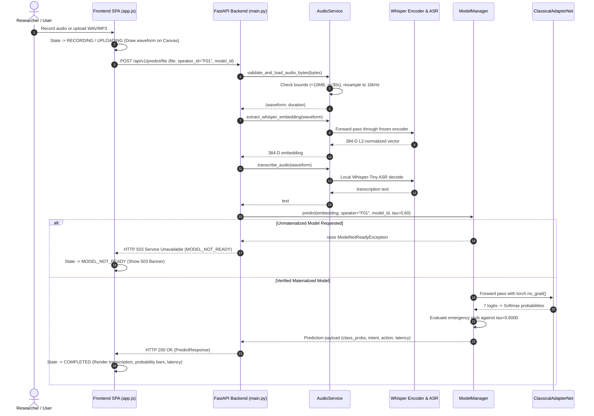

# Full-Scale Research Application — System Architecture

**Project:** Low-Resource Personalized Atypical Speech Recognition Using Hybrid Quantum-Classical Deep Learning for Reliable Emergency Communication  
**Document ID:** `DOC-APP-ARCH-001`  
**Application Tier:** Gate B.2 Controlled Local Research Demonstration  
**Version:** 1.2.0  
**Status:** IMPLEMENTED & VERIFIED  

---

## 1. High-Level Architecture Overview

The application is structured as a **strictly local-first, zero-cloud, privacy-preserving research application** designed to showcase personalized atypical speech classification, acoustic feature extraction, offline ASR, and frozen scientific results without exposing clinical risk or deploying uncalibrated emergency workflows.

```
┌────────────────────────────────────────────────────────────────────────────────────────┐
│                              FRONTEND USER INTERFACE (SPA)                             │
│  - Vanilla ES6 JavaScript (app.js) + Modern Dark Design System (style.css)             │
│  - 7 Tabbed Workspaces: Overview, Audio Lab, Registry, Results, Provenance, Diag, Help │
│  - Real-Time HTML5 Canvas Audio Waveform Visualizer + Microphone Web Audio API         │
│  - Visible State Machine: IDLE ➔ RECORDING ➔ UPLOADING ➔ INFERRING ➔ COMPLETED/ABSTAIN │
└───────────────────────────────────────────┬────────────────────────────────────────────┘
                                            │ HTTP REST / WebSocket (/ws/inference)
                                            ▼
┌────────────────────────────────────────────────────────────────────────────────────────┐
│                              FASTAPI BACKEND SERVICE (PORT 8000)                       │
│  - Host Binding: 127.0.0.1 (Strict Loopback Only; No External Cloud Egress)            │
│  - CORS Policy: Allowlisted Local Origins Only                                         │
├───────────────────────────────────────────┬────────────────────────────────────────────┤
│  Audio Ingestion & Feature Service        │  Model Manager & Inference Orchestrator    │
│  - Librosa / SoundFile 16 kHz Mono Load   │  - Continual Classical Adapters (60 Ckpts) │
│  - Frozen Whisper-Tiny 384-D Encoder      │  - Deterministic Eval-Mode Forward Pass    │
│  - Offline Whisper ASR Transcription      │  - Decoupled Threshold Policy (tau=0.6000) │
│  - Ephemeral Temp File Auto-Cleanup       │  - Unmaterialized Candidate Gate (503)     │
├───────────────────────────────────────────┴────────────────────────────────────────────┤
│  Research Artifact Reader & Provenance Engine                                          │
│  - Authoritative Read-Only CSV/JSON Parsers (Results Phases 1–8.2.1)                   │
│  - 28/28 Historical SHA-256 Cryptographic Checksum Audit Reporter                      │
│  - Deployment Gate Status Reporter (Gate A: OK, B.2: OK, C: BLOCKED, D: BLOCKED)       │
└────────────────────────────────────────────────────────────────────────────────────────┘
```

---

## 2. Core Subsystems & Component Boundaries

### 2.1 Audio Ingestion & Acoustic Feature Extraction
- **Module:** [`src/app/audio_service.py`](file:///d:/DL/src/app/audio_service.py)
- **Ingestion Contract:** Accepts multipart audio file uploads (`.wav`, `.mp3`, `.flac`, `.ogg`, `.webm`) or base64 JSON payloads.
- **Boundaries:** Maximum payload size $\le 10\text{ MB}$, maximum duration $\le 30.0\text{ seconds}$.
- **Canonical Preprocessing:** Resamples to 16 kHz mono float32 with peak amplitude scaling in $[-1.0, 1.0]$.
- **Whisper Representation:** Extracts deterministic 384-dimensional acoustic representations via [`src/embeddings/whisper_encoder.py`](file:///d:/DL/src/embeddings/whisper_encoder.py) with L2 unit-norm normalization ($||\mathbf{z}||_2 = 1.0$).
- **ASR Transcription:** Decoupled local transcription via offline Whisper-Tiny. Transcription text is separated from intent classification to avoid conflating acoustic intelligibility with emergency detection.
- **Ephemeral Lifecycle:** All uploaded audio is decoded in memory or in temporary files within `cache/app_uploads/` and deleted immediately inside `finally` blocks.

### 2.2 Quantum Model Management & Quantum-Only Operational Architecture
- **Module:** [`src/app/quantum_model_manager.py`](file:///d:/DL/src/app/quantum_model_manager.py)
- **Sole Operational Predictor:** The canonical quantum model (`qsvc_q8_r1`, Fidelity Quantum Kernel QSVC with 8-Qubit `ZZFeatureMap`) is the exclusive model authorized to produce live speech intent predictions.
- **Classical Model Relegation:** Classical models (`continual_classical_adapter`, `classical_adapter`, `phase8_1_track_a_baseline`) are strictly relegated to historical research baselines and are rejected upfront on operational routes with **HTTP 400 Bad Request** (`MODEL_NOT_ALLOWED_FOR_OPERATIONAL_INFERENCE`).
- **Zero Fallback Invariant:** Zero silent or automatic fallback to classical models under any circumstance.
- **Fail-Closed Execution:** The serialized quantum checkpoints in `models/continual/phase7_8/{SPEAKER_ID}/model_checkpoint.pkl` contain the fitted PCA ($384 \to 8$), MinMaxScaler ($[0, \pi]$), and precomputed SVC, but omit the reference adaptation vectors ($X_{\text{train\_pca}}$) required to evaluate test-time Gram vectors. The system strictly fails closed with **HTTP 503 Service Unavailable** (`QUANTUM_MODEL_NOT_READY`).
- **Zero Model Retraining / Parameter Fabrication:** Under the immutable artifact policy, retraining or synthesizing artificial support vectors is strictly prohibited.
- **Speaker Isolation:** Strict routing by Speaker ID. Requests for unknown speakers return HTTP 404 `SPEAKER_NOT_FOUND` without fallback.

### 2.3 Intent Taxonomy & Decision Thresholding
- **Taxonomy Source of Truth:** Authoritative 7-class taxonomy from [`config/taxonomy.yaml`](file:///d:/DL/config/taxonomy.yaml):
  1. `GENERAL_SPEECH` (Non-emergency baseline)
  2. `CRITICAL_RESPONSE` (Emergency)
  3. `FALL` (Emergency)
  4. `BREATHING_MEDICAL` (Emergency)
  5. `PAIN` (Emergency)
  6. `SOS_HELP` (Emergency)
  7. `LOCATION` (Emergency)
- **Decision Cutoff $\tau = 0.6000$:** Operating cutoff applied to pooled emergency probability. Conspicuously flagged as an **uncalibrated demonstration default — threshold provenance unverified for adapter models**.
- **FER Safety Ceiling ($15.0\%$):** Decoupled from $\tau$. Documented as an internal research evaluation constraint, not a validated clinical safety claim.
- **Acoustic Quality Abstention:** If acoustic quality $< 0.30$, the system outputs `predicted_intent = UNKNOWN`, `suggested_action = ABSTAIN`, avoiding forced misclassifications on corrupted inputs.

### 2.4 Research Artifacts & Provenance Engine
- **Module:** [`src/app/routes/research.py`](file:///d:/DL/src/app/routes/research.py)
- **Read-Only Data Access:** Safely parses on-disk frozen CSV tables from `results/phase8_1/` and `results/phase6_5_6_final_comparison_table.csv`.
- **Cryptographic Verification:** Verifies all 28 historical research files against [`reports/project_readiness/checksums.json`](file:///d:/DL/reports/project_readiness/checksums.json).
- **Gate Governance:** Reports Gate A (Complete), Gate B.2 (Active Demo), Gate C (`STRICTLY_BLOCKED`), and Gate D (`STRICTLY_BLOCKED`).

---

## 3. Data Flow Diagram



---

## 4. Trust Boundaries & Security Architecture

1. **Local Loopback Isolation:** Service binds exclusively to `127.0.0.1`. No public network interfaces are exposed.
2. **Ephemeral Audio Storage:** Audio data is held only in memory during processing or in temporary files that are purged immediately.
3. **Path Traversal Protection:** Static file mounts serve exclusively allowlisted directories (`src/app/static`, `reports/project_readiness/figures`, `results/phase8_1/figures`).
4. **Zero Live External Services:** No telephony, Twilio, SMS, emergency dispatch, or cloud telemetry integrations exist in the application code.
