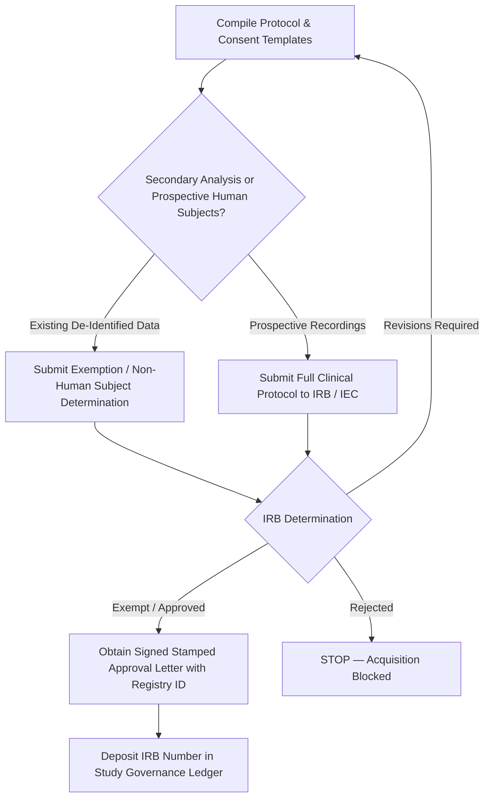
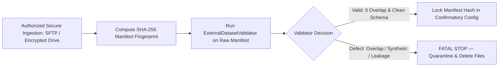

# Dataset Acquisition Workflow and Data Governance Protocol
## End-to-End Governance Specification for Lawful Independent Cohort Ingestion

**Project Title:** Low-Resource Personalized Atypical Speech Recognition Using Hybrid Quantum-Classical Deep Learning for Reliable Emergency Communication  
**Document Identifier:** SPEC-ACQ-WORKFLOW-2026-V1  
**Status:** **ACTIVE PLANNING & GOVERNANCE SPECIFICATION — NO EXTERNAL ACTION EXECUTED**  
**Date:** 2026-10-11  
**Responsible Roles:** Data Governance Officer, Institutional Legal Counsel, Lead Biostatistician, Systems Security Architect  

---

> [!CAUTION]
> **GOVERNANCE & LEGAL STOP NOTICE:**  
> This document specifies an actionable, multi-stage acquisition and compliance process. **NO APPLICATION HAS BEEN SUBMITTED, NO CUSTODIAN CONTACTED, AND NO DATA DOWNLOADED.** All forms and templates contained herein are marked:  
> `DRAFT — NOT APPROVED — NOT FOR PARTICIPANT USE`.  
> Actual dataset acquisition requires signed institutional approvals, bilateral legal execution, and separate project owner authorization.

---

## 1. Candidate Decision Criteria and Multi-Factor Scoring Rubric

To evaluate prospective candidate datasets before initiating formal legal inquiries, the project applies a 100-point multi-factor rubric:

| Evaluation Dimension | Weight | Objective Criteria | Scoring Thresholds |
| :--- | :---: | :--- | :--- |
| **A. Cohort Independence** | 25 pts | Verified 0% speaker, institution, and acoustic recording overlap with TORGO. | 25 = 100% independent; 0 = Any detected overlap. |
| **B. Cohort Size & Statistical Power** | 20 pts | Total independent dysarthric speakers ($K$) available for evaluation. | 20 = $K \ge 100$; 15 = $K \in [50, 99]$; 10 = $K \in [20, 49]$; 0 = $K < 20$. |
| **C. Acoustic Quality & Format** | 15 pts | Uncompressed 16 kHz 16-bit linear PCM; sound-treated / clinical acoustic capture. | 15 = Clean 16 kHz PCM; 10 = Minor noise; 0 = Low-bitrate lossy MP3/AMR. |
| **D. Emergency Intent Mapping** | 15 pts | Prompt coverage of emergency semantics or feasibility of secondary clinical annotation. | 15 = Validated emergency labels; 10 = Sentence prompts mappable; 5 = Isolated words; 0 = Numbers only. |
| **E. Legal DUA & Licensing Pathway** | 15 pts | Explicit academic research license with clear institutional DUA process. | 15 = Established DUA (e.g. SAP/UIUC); 10 = Individual request; 0 = Proprietary/Closed. |
| **F. Ethical & Consent Documentation** | 10 pts | Verified original IRB approval with explicit research data sharing consent. | 10 = Complete IRB docs available; 5 = Partial docs; 0 = Absent consent provenance. |

$$\text{Composite Score} = \sum_{i \in \{A..F\}} \text{Dimension Score}_i$$
- **Minimum Eligibility Threshold:** $\text{Score} \ge 75/100$ AND Dimension A = 25 AND Dimension E $\ge 10$.
- **UA-Speech Evaluation:** $25 + 10 + 15 + 5 + 15 + 10 = 80/100$ (*Eligible for Development Benchmarking*).
- **Speech Accessibility Project (SAP) Evaluation:** $25 + 20 + 15 + 10 + 15 + 10 = 95/100$ (*Primary Candidate for Confirmatory Cohort*).
- **Nemours Evaluation:** $25 + 0 + 15 + 0 + 5 + 5 = 50/100$ (*Ineligible for Confirmatory Pilot*).

---

## 2. Pre-Application Checklist

Before any outreach or application submission is initiated:
- [ ] Candidate dataset evaluated and scored $\ge 75$ on the Decision Rubric.
- [ ] Technical prerequisite verified: Pipeline tested on local fixtures and demonstrated ready for 16 kHz input.
- [ ] Principal Investigator (PI) and Institutional Review Board (IRB) point of contact confirmed.
- [ ] Local secure storage environment provisioned (encrypted volume with access logging).
- [ ] Institutional Legal Counsel / Technology Transfer Office briefed on candidate DUA terms.
- [ ] Zero unmaterialized code or backdoor dependencies in the local data intake path.
- [ ] Explicit written authorization from Project Owner to initiate dataset inquiry.

---

## 3. Institutional Affiliation & Investigator Information

The following institutional information must be formally compiled by the sponsoring university or research facility before DUA submission:

```markdown
### Institutional Registration Dossier (Template)
- Sponsoring Institution: [Institutional Legal Entity Name]
- Department / Center: [Department of Computer Science / Biomedical Engineering]
- Institution Address: [Physical Postal Address, City, State/Province, Country, PIN/ZIP]
- Institutional Tax / Registration ID: [Accredited Entity Identifier]
- Principal Investigator (PI): [Full Name, Academic Rank, Institutional Title]
- PI Institutional Email: [user@institution.edu] (Personal Gmail/Yahoo strictly barred)
- PI Professional Profile / ORCID: [0000-0000-0000-0000]
- Institutional Authorized Official (Legal Signatory): [Full Name, Legal Title / Dean of Research]
- Institutional Legal / Contracts Office Email: [legal-techtransfer@institution.edu]
- Data Protection Officer (DPO) / Compliance Lead: [Full Name, Contact Email]
```

---

## 4. Dataset Request Materials Dossier

For formal application submissions (e.g. Speech Accessibility Project or UA-Speech):
1. **One-Page Research Proposal:**
   - Specific Research Aim: Evaluation of few-shot personalized acoustic adapters on unseen dysarthric speech.
   - Non-Interventional Diagnostic Scope: Explicit statement that data will NOT be connected to live emergency services, clinical monitoring, or medical triage.
   - Data Security Controls: Offline sandbox execution on local air-gapped or loopback storage; no cloud processing.
   - Retention Period: Maximum 3 years or study duration, followed by certified cryptographic erasure.
2. **Technical Environment Specification:**
   - Hardware: Local isolated research server with encrypted storage (AES-256).
   - Network Controls: Loopback interface (`127.0.0.1:8000`); outbound network traffic blocked.
   - Access Control: Role-Based Access Control (RBAC) restricted to named, credentialed investigators.

---

## 5. DUA and License Review Checklist

The institutional legal review must evaluate every clause of the candidate DUA against this checklist:

| Review Domain | Requirement / Constraint | Compliance Determination |
| :--- | :--- | :--- |
| **Permitted Use** | Strictly academic, non-commercial, exploratory assistive speech research. | `NEEDS_LEGAL_COUNSEL_VERIFICATION` |
| **Redistribution Bar** | Zero redistribution of raw audio files, spectrograms, or individual transcripts. | `NEEDS_LEGAL_COUNSEL_VERIFICATION` |
| **Derivative Weights** | Permissibility of releasing mathematical adapter weights (25k params) or embeddings. | `NEEDS_LEGAL_COUNSEL_VERIFICATION` |
| **Cloud Computing** | Ban on uploading audio to public multi-tenant clouds or third-party proprietary APIs. | `NEEDS_LEGAL_COUNSEL_VERIFICATION` |
| **Re-Identification** | Categorical prohibition against attempting to link participant voice to real identities. | `NEEDS_LEGAL_COUNSEL_VERIFICATION` |
| **Breach Notification** | Mandatory 24-to-72 hour security incident notification to data custodian. | `NEEDS_LEGAL_COUNSEL_VERIFICATION` |
| **Governing Law** | Jurisdictional venue and dispute resolution terms acceptable to sponsoring university. | `NEEDS_LEGAL_COUNSEL_VERIFICATION` |

---

## 6. Ethics / IRB / IEC Determination Workflow



1. **Submission Type:** The research team will submit an Institutional Review Board (IRB) application for **Secondary Analysis of De-Identified Acoustic Data** (if acquiring existing cohorts like SAP/UASpeech) or **Non-Interventional Speech Diagnostic Protocol** (if prospectively enrolling participants).
2. **Key Protocol Attachments:**
   - Participant Information Sheet & Informed Consent Form (written at accessible reading grade level).
   - Data Protection Impact Assessment (DPIA) addressing voice biometrics.
   - Clinical Oversight Plan signed by licensed Speech-Language Pathologist (CCC-SLP).
3. **Acceptance Threshold:** Formal written approval letter or formal exemption certificate from an accredited IRB/IEC bearing a registered protocol number. Informal verbal consent or self-exemption is strictly prohibited.

---

## 7. Privacy, Voice Biometric, and Information Security Controls

Voice recordings constitute **sensitive biometric personal data** under modern data privacy frameworks (India Digital Personal Data Protection Act 2023, EU GDPR Article 9, US HIPAA Safe Harbor / state biometric laws).

### 7.1 Security Architecture Controls
- **Data Minimization:** Raw audio files are ingested exclusively for feature extraction. Post-extraction, temporary audio buffers are zeroed and purged from memory immediately (`AUTO_CLEANUP_TEMP_FILES = True`).
- **Encryption at Rest:** All external datasets and cached feature matrices must reside on AES-256 BitLocker / LUKS encrypted volumes.
- **Encryption in Transit:** Internal API communications restricted to TLS 1.3 / loopback IPC.
- **Role-Based Access Control (RBAC):** Access to raw audio folders restricted to authorized study personnel via POSIX permissions (`chmod 700`).
- **Audit Logging:** Every file read, feature extraction, and validation check logs a tamper-evident event containing timestamp, user role, input file hash, and operation.
- **Incident Response Plan:** Any unauthorized file access, unencrypted transmission, or lost credential triggers immediate containment, session revocation, and 48-hour formal custodian notification.

---

## 8. Statutory Legal Basis and Permitted Use Mapping

The legal basis for processing atypical speech data must be validated by institutional legal counsel across applicable jurisdictions:

| Jurisdiction & Statute | Classification of Speech Data | Statutory Legal Basis | Statutory Requirement |
| :--- | :--- | :--- | :--- |
| **India: DPDP Act 2023** | Personal Data (Section 2(t)) / Biometric Identifier | Section 4: Valid, informed, clear consent for specified assistive research purpose. | Purpose limitation, reasonable security safeguards, erasure upon purpose completion. |
| **US: HIPAA / Common Rule** | Protected Health Information (PHI) / 45 CFR 46 | Exemption under 45 CFR 46.104(d)(4) for de-identified secondary research, or IRB waiver. | Expert Determination or Safe Harbor de-identification; zero direct identifiers. |
| **EU: GDPR (Regulation 2016/679)** | Special Category Data (Art. 9(1): Biometric / Health) | Article 9(2)(j): Scientific research purposes with Article 89 safeguards. | Technical measures (pseudonymization), DPO review, proportionality test. |

---

## 9. Restrictions on External Uploads, Cloud Processors, and Publication

To prevent catastrophic data leakage and DUA violations:
1. **Zero External API Offloading:** Audio files, MFCC vectors, Whisper representations, and transcripts must **NEVER** be transmitted to external commercial AI APIs (OpenAI Whisper API, Google Speech API, ElevenLabs, Amazon Transcribe). All processing executes locally offline.
2. **Zero Public Repository Commits:** External audio files, raw transcripts, and patient-linked metadata are permanently excluded in `.gitignore` and must never be committed to Git or public code repositories.
3. **Derivative Weight Distribution Policy:** Before any trained adapter checkpoint or residual classifier weight is published or shared, an acoustic inversion analysis must be conducted to prove that original participant speech cannot be reconstructed from adapter tensors.

---

## 10. Custodian Correspondence Ledger (Pre-Submission)

All correspondence templates are drafted for review and remain strictly in status **`NOT_SENT`**:

```markdown
### Outreach Record 1: Statistical Speech Technology Group (UIUC)
- Target Recipient: uaspeech-requests@lists.illinois.edu
- Document: Formal Academic Access Request Dossier
- Status: NOT_SENT — AWAITING OWNER AUTHORIZATION
- Date Prepared: 2026-10-11
- Action Required: Project Owner signature and institutional legal approval before transmission.

### Outreach Record 2: Speech Accessibility Project (Beckman Institute)
- Target Recipient: speechaccessibility@beckman.illinois.edu
- Document: 1-Page Research Scope Proposal & Institutional DUA Package
- Status: NOT_SENT — AWAITING OWNER AUTHORIZATION
- Date Prepared: 2026-10-11
- Action Required: Institutional Authorized Official appointment and legal review.
```

---

## 11. Signatures and Approval Execution Register

All signature fields remain unexecuted until formal institutional action is completed:

| Approval Role | Full Name | Institutional Affiliation | Status | Signature Block |
| :--- | :--- | :--- | :--- | :--- |
| **Project Owner** | [UNASSIGNED / OWNER REVIEW PENDING] | Sponsoring Organization | `AWAITING_REVIEW` | `[BLANK — AWAITING OFFICIAL SIGNATURE]` |
| **Principal Investigator** | [UNASSIGNED] | Sponsoring University | `UNASSIGNED` | `[BLANK — AWAITING OFFICIAL SIGNATURE]` |
| **Institutional Authorized Official** | [UNASSIGNED] | Office of Technology Transfer | `UNASSIGNED` | `[BLANK — AWAITING OFFICIAL SIGNATURE]` |
| **Institutional IRB Chair** | [UNASSIGNED] | Accredited Review Board | `UNASSIGNED` | `[BLANK — AWAITING OFFICIAL SIGNATURE]` |
| **Licensed CCC-SLP Lead** | [UNASSIGNED] | Clinical Speech Pathology | `UNASSIGNED` | `[BLANK — AWAITING OFFICIAL SIGNATURE]` |
| **Data Protection Officer** | [UNASSIGNED] | Information Security Office | `UNASSIGNED` | `[BLANK — AWAITING OFFICIAL SIGNATURE]` |

---

## 12. Dataset Receipt and Intake Verification Protocol

*(To be executed only after lawful DUA execution and authorized dataset receipt)*:



1. **Cryptographic Checksum Verification:** Compare custodian-supplied SHA-256 hashes against downloaded archives before decompression.
2. **Automated Schema & Overlap Audit:** Execute `ExternalDatasetValidator.validate_manifest()` in strict fail-closed mode (`allow_synthetic = False`).
3. **Partition Stratification by Speaker:** Split the verified cohort into Development ($30\%$) and Confirmatory ($70\%$) partitions with strict speaker disjointness.
4. **Protocol Locking:** Compute the SHA-256 fingerprint of the confirmatory manifest and register it in the preregistration protocol.
