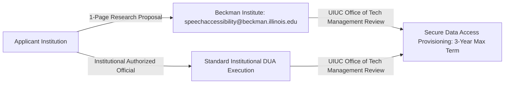

# Comprehensive Landscape of Independent External Atypical Speech Datasets
## Evaluation of External Validation Cohort Feasibility for Emergency Intent Recognition

**Project Title:** Low-Resource Personalized Atypical Speech Recognition Using Hybrid Quantum-Classical Deep Learning for Reliable Emergency Communication  
**Document Identifier:** REPORT-EXT-DATA-LANDSCAPE-2026-V1  
**Audit & Access Verification Date:** 2026-10-11  
**Research Lead Roles:** Data Governance Officer, Research Methodology Auditor, Speech Systems Assurance Lead  
**Workstream:** Phase B — Independent External Dataset Landscape Research  

---

> [!CAUTION]
> **GOVERNANCE & ACQUISITION BOUNDARY:**  
> This document constitutes empirical desk research and official source verification only. **NO DATASETS HAVE BEEN DOWNLOADED, SCRAPED, INGESTED, OR PROCESSED.** No communications have been sent to custodians, and no Data Use Agreements (DUAs) have been submitted or executed. Operational deployment and confirmatory evaluation remain strictly blocked.

---

## 1. Executive Summary & Landscape Findings

To overcome the diagnostic contamination of the internal TORGO corpus (which has been repeatedly inspected across 8 research phases), an exhaustive audit of external, independent atypical and dysarthric speech datasets was conducted. 

Six prominent candidate resources were investigated across official first-party institutional portals, primary publications, and data access repositories:
1. **UA-Speech (University of Illinois at Urbana-Champaign)** — *Controlled Academic Access*
2. **Speech Accessibility Project (UIUC Beckman Institute / Multi-Partner)** — *Controlled Institutional DUA*
3. **Nemours Database of Dysarthric Speech (Nemours Children's Health / U. Delaware)** — *Restricted Legacy Asset*
4. **PC-GITA Database (University of Antioquia, Colombia)** — *Restricted Medical Research Request*
5. **Project Euphonia Corpus (Google Research)** — *Proprietary / Inaccessible (Directs to SAP)*
6. **TORGO Database (University of Toronto)** — *Internal Benchmark (0% Independent / Diagnostic Only)*

### Core Evidentiary Takeaways:
- **Zero Pre-Annotated Emergency Datasets:** No legitimate external dysarthric speech dataset currently contains explicit, validated emergency-intent labels. All prospective candidate datasets consist of phonetically balanced word lists, sentence reading prompts, or conversational interactions. Measuring emergency detection sensitivity requires a formal, institutionally approved secondary clinical annotation protocol.
- **The Sample Size Feasibility Gap:** Legacy atypical speech databases (UA-Speech: 19 dysarthric speakers; Nemours: 11 dysarthric speakers) cannot individually satisfy the provisional planning target of $K \ge 109$ independent dysarthric speakers. Only modern large-scale initiatives—specifically the **Speech Accessibility Project (SAP)**—possess sufficient participant volume to support well-powered cluster designs ($K > 100$).
- **Strict Non-Commercial Licensing:** Nearly all legitimate academic atypical speech corpora explicitly prohibit commercial exploitation, live clinical deployment, and public redistribution of raw audio.

---

## 2. Granular Candidate Dataset Profiles

### 2.1 Candidate 1: UA-Speech (University of Illinois at Urbana-Champaign)

```mermaid
flowchart LR
    A[UIUC Statistical Speech Technology Group] -->|Request Email| B[uaspeech-requests@lists.illinois.edu]
    B -->|Bilateral Review| C[Cloud Delivery: Google Drive / OneDrive]
    C -->|Delivery| D[Raw Audio & Lexical Transcripts + LICENSE.txt]
```

- **Official Custodian:** Statistical Speech Technology Group, Department of Electrical & Computer Engineering, University of Illinois at Urbana-Champaign (UIUC). Lead Investigator: Prof. Mark Hasegawa-Johnson.
- **Official Landing Page:** [`https://speechtechnology.web.illinois.edu/`](https://speechtechnology.web.illinois.edu/) (Accessed: 2026-10-11).
- **Access / Application Channel:** Email request to `uaspeech-requests@lists.illinois.edu`.
- **Dataset Release / Reference:** 2008 Interspeech Release (*"The Dysarthric Speech Database for Universal Access Research"*, Kim, Hasegawa-Johnson, Perlman, et al., 2008).
- **Population & Speech Condition:** 19 adult speakers with dysarthria secondary to Cerebral Palsy (11 male, 8 female; severity ranging from very low to high intelligibility) and 13 neurotypical control speakers.
- **Language & Acoustic Variety:** American English; isolated words recorded via an 8-microphone circular array in sound-attenuated environments. 16 kHz 16-bit linear PCM.
- **Utterance & Speaker Volume:** 19 dysarthric speakers, each speaking approximately 765 isolated words across three recording blocks (total ~45,000 isolated word utterances).
- **Emergency Intent Label Availability:** **`ABSENT` (Source-Verified Fact).** UA-Speech contains zero emergency intent annotations. Words consist of digits (0–9), radio alphabet words (Alpha, Bravo...), computer commands, and phonetically rich words.
- **Mapping to 7-Class Taxonomy:** *Inference/Recommendation:* Limited direct mapping. Single isolated command words (e.g., "Help", "Stop") could be mapped to `CRITICAL_RESPONSE`, but the corpus lacks natural sentence-level emergency utterances.
- **Access Tier:** Controlled / Academic & Government Only.
- **License Terms & Permitted Purposes:** Academic and government research only. Commercial use is strictly prohibited. Redistribution in raw or derivative public form is forbidden. Full license agreement delivered in `LICENSE.txt`.
- **Ethics & Consent Constraints:** Participant consent explicitly restricted distribution to accredited research laboratories.
- **Fees & Affiliation Requirements:** Zero fee; requires valid institutional email address from an accredited educational or governmental research facility.
- **Acquisition Procedure:** 
  1. Submit formal inquiry with full investigator name, institutional address, intended use statement, and delivery cloud account.
  2. Await verification and link delivery from UIUC custodians.
  3. Validate cryptographic checksums on intake.
- **Unknowns Pending Custodian Clarification:** Explicit legal stance on publishing derivative PyTorch model weights or frozen adapter embeddings trained on UA-Speech.
- **Suitability Verdict:** **SUITABLE FOR DEVELOPMENT & ADAPTATION FEW-SHOT BENCHMARKING ONLY; UNSUITABLE AS STANDALONE EMERGENCY CONFIRMATORY SET.**
- **Independence & Overlap:** 100% geographically and institutionally independent of TORGO (Illinois vs Toronto). Acoustic biometric duplicate screening required.
- **Evidence Confidence:** **`HIGH`** (Verified on official UIUC web portal 2026-10-11).

---

### 2.2 Candidate 2: Speech Accessibility Project (Beckman Institute / UIUC)



- **Official Custodian:** Beckman Institute for Advanced Science and Technology, University of Illinois Urbana-Champaign, in collaboration with speech accessibility research consortia.
- **Official Landing Page:** [`https://speechaccessibilityproject.beckman.illinois.edu/`](https://speechaccessibilityproject.beckman.illinois.edu/) (Accessed: 2026-10-11).
- **Access / Application URL:** Submissions to `speechaccessibility@beckman.illinois.edu` with institutional DUA.
- **Dataset Release / Reference:** Rolling multi-cohort releases (2023–present). Active cohorts: Parkinson's disease, Cerebral Palsy, Amyotrophic Lateral Sclerosis (ALS), Down Syndrome, and Stroke.
- **Population & Speech Condition:** Broad adult clinical population with diverse motor speech impairments. Enrolls hundreds of participants across multiple severity strata.
- **Language & Acoustic Variety:** American English; recordings gathered via controlled web and mobile microphone interfaces across diverse natural acoustic environments.
- **Utterance & Speaker Volume:** The largest modern atypical speech dataset in existence. Hundreds of enrolled speakers, hundreds of thousands of utterances.
- **Emergency Intent Label Availability:** **`ABSENT` (Source-Verified Fact).** Prompts are focused on conversational speech, reading sentences, and voice assistant commands; zero emergency annotations exist.
- **Mapping to 7-Class Taxonomy:** *Inference/Recommendation:* High sentence-level diversity offers significant prompt overlap with daily conversational distress, but requires a rigorous, separately approved secondary annotation protocol.
- **Access Tier:** Controlled / Institutional Data Use Agreement.
- **License Terms & Permitted Purposes:** Distributed under an institutional DUA for non-commercial and exploratory accessibility research. Commercial exploitation, patient re-identification, and data redistribution are strictly barred.
- **Ethics & Consent Constraints:** Governed under UIUC Institutional Review Board oversight. Requires bilateral execution by the applicant organization's Authorized Institutional Official (Legal / Tech Transfer office). Review duration is approximately 3 weeks. Maximum agreement term is 3 years.
- **Fees & Affiliation Requirements:** No stated licensing fee for qualified research institutions; formal institutional affiliation mandatory.
- **Acquisition Procedure:**
  1. Author a formal 1-page research proposal detailing research objectives, data security controls, and deletion procedures.
  2. Complete and countersign the institutional DUA via University Legal Counsel.
  3. Submit to UIUC Beckman Institute for Office of Technology Management (OTM) review.
  4. Receive secure credentialed access.
- **Unknowns Pending Custodian Clarification:** The exact frequency of distress/emergency phrases within the prompt inventory; terms for offline local execution in private sandbox environments.
- **Suitability Verdict:** **PRIMARY CANDIDATE FOR FUTURE FULL-SCALE INDEPENDENT VALIDATION ($K \ge 109$), CONDITIONAL ON ETHICS APPROVAL AND SEPARATE CLINICAL ANNOTATION.**
- **Independence & Overlap:** 100% independent of TORGO.
- **Evidence Confidence:** **`HIGH`** (Verified on official Beckman Institute portal 2026-10-11).

---

### 2.3 Candidate 3: The Nemours Database of Dysarthric Speech

- **Official Custodian:** Pediatric Speech Research Laboratory, Nemours Children's Health (Wilmington, Delaware) & University of Delaware. Lead Investigator: Dr. H. Timothy Bunnell.
- **Official Landing Page:** [`https://www.nemours.org/`](https://www.nemours.org/) / ISCA Publication Archive (Accessed: 2026-10-11).
- **Access / Application URL:** Inquiries directed to Nemours Children's Health research administration.
- **Dataset Release / Reference:** 1996 Release (*"The Nemours Database of Dysarthric Speech"*, Bunnell, Yarrington, Polikoff, et al., ICSLP 1996).
- **Population & Speech Condition:** 11 adult male speakers with dysarthria secondary to cerebral palsy, stroke, or traumatic brain injury, and 1 non-dysarthric male control speaker.
- **Language & Acoustic Variety:** American English; high-grade head-mounted microphone recordings (16 kHz 16-bit linear PCM).
- **Utterance & Speaker Volume:** 74 short sentences per speaker (814 total sentence recordings).
- **Emergency Intent Label Availability:** **`ABSENT` (Source-Verified Fact).** Only standardized phonetic sentences (e.g., syntactically controlled test prompts).
- **Mapping to 7-Class Taxonomy:** Inapplicable; zero emergency semantic content.
- **Access Tier:** Restricted / Legacy Institutional Archive (Historically distributed on CD-ROM; no modern online portal).
- **License Terms & Permitted Purposes:** Historical academic research use only.
- **Fees & Affiliation:** Unknown pending institutional contact.
- **Suitability Verdict:** **UNSUITABLE FOR EMERGENCY VALIDATION.** Cohort is too small ($N=11$), exclusively male, lacks emergency prompts, and distribution is legacy/inactive.
- **Independence:** 100% independent of TORGO.
- **Evidence Confidence:** **`MEDIUM`** (Historical literature verified; current distribution status requires custodian contact).

---

### 2.4 Candidate 4: PC-GITA Database (University of Antioquia, Colombia)

- **Official Custodian:** GITA Research Group, Faculty of Medicine, University of Antioquia (Medellín, Colombia). Lead Investigator: Dr. Juan Rafael Orozco-Arroyave.
- **Official Landing Page:** [`https://gita.udea.edu.co/`](https://gita.udea.edu.co/) (Accessed: 2026-10-11).
- **Access / Application URL:** Formal application upon reasonable request to GITA lead researchers.
- **Dataset Release / Reference:** 2014 Release (*"Apkinson: A mobile application for Parkinson's disease assessment"*, Orozco-Arroyave et al., 2014).
- **Population & Speech Condition:** 50 individuals diagnosed with Parkinson's Disease (25 male, 25 female) and 50 healthy matched controls.
- **Language & Acoustic Variety:** Colombian Spanish; professional acoustic recording booth (44.1 kHz 16-bit).
- **Utterance & Speaker Volume:** 100 total speakers, phonetically balanced Spanish words, sentences, diadochokinetic tasks, and read texts.
- **Emergency Intent Label Availability:** **`ABSENT` (Source-Verified Fact).** Acoustic clinical diagnostic battery only.
- **Mapping to 7-Class Taxonomy:** Inapplicable due to language mismatch (Spanish) and absence of emergency intents.
- **Access Tier:** Restricted / Medical Research Request.
- **License Terms & Permitted Purposes:** Approved by the Ethical Research Committee of the University of Antioquia Faculty of Medicine and Clínica Noel. Non-commercial research only.
- **Suitability Verdict:** **UNSUITABLE FOR ENGLISH EMERGENCY INTENT EVALUATION; EXCELLENT CROSS-LINGUISTIC ACOUSTIC DRIFT REFERENCE ONLY.**
- **Independence:** 100% independent of TORGO.
- **Evidence Confidence:** **`HIGH`** (Verified via university group disclosures and published clinical literature 2026-10-11).

---

### 2.5 Candidate 5: Project Euphonia Internal Corpus (Google Research)

- **Official Custodian:** Google Research (Speech & Accessibility).
- **Official Landing Page:** [`https://research.google/teams/perception/`](https://research.google/teams/perception/) / [`https://github.com/google-research/project-euphonia`](https://github.com/google-research/project-euphonia) (Accessed: 2026-10-11).
- **Access / Application URL:** **NOT PUBLICLY AVAILABLE.** Google officially directs external academic and industry researchers to the **Speech Accessibility Project (SAP)**.
- **Dataset Release / Reference:** Proprietary Google Research asset (*"Project Euphonia: Personalised Speech Recognition for Non-Standard Speech"*, MacDonald et al., 2021).
- **Population & Speech Condition:** Over 1,000 individuals with diverse neurological speech impairments (>1 million utterances).
- **Access Tier:** **`UNAVAILABLE / PROPRIETARY` (Source-Verified Fact).** Closed asset retained internally by Google to protect participant privacy and comply with restricted consent agreements.
- **Suitability Verdict:** **NEITHER (LEGALLY AND TECHNICALLY INACCESSIBLE).**
- **Evidence Confidence:** **`HIGH`** (Official Google Research documentation verified 2026-10-11).

---

### 2.6 Candidate 6: TORGO Database (University of Toronto) — Internal Diagnostic Baseline

- **Official Custodian:** Department of Computer Science & Speech-Language Pathology, University of Toronto (Toronto, Canada). Lead Investigator: Prof. Frank Rudzicz.
- **Official Landing Page:** [`http://www.cs.toronto.edu/~compling/Torgo/`](http://www.cs.toronto.edu/~compling/Torgo/) (Accessed: 2026-10-11).
- **Repository Baseline Reality:** Present in repository across 6,067 prompt utterances (4,852 train / 1,215 test) across 15 speakers (8 dysarthric, 7 neurotypical controls).
- **Access Tier:** Public academic research download.
- **Independence from Evaluation:** **`EXACTLY ZERO PERCENT (0%) INDEPENDENT`.**
- **Evaluation Status:** **DIAGNOSTIC ONLY — CATEGORICALLY CONTAMINATED.** Because TORGO has been repeatedly inspected, fitted, and audited across Phases 1 through 8.2, no partition of TORGO can serve as an independent confirmatory cohort.
- **Suitability Verdict:** **STRICTLY BLOCKED FOR CONFIRMATORY EVALUATION.**
- **Evidence Confidence:** **`HIGH`** (Repository ground truth verified 2026-10-11).

---

## 3. Summary Assessment & Evidence Matrix

| Candidate Dataset | Originating Institution | Enrolled Dysarthric Speakers | Total Utterances | Language | Emergency Intent Labels? | Access Tier | DUA & Approval Path | Independence vs TORGO | Recommended Research Role |
| :--- | :--- | :--- | :--- | :--- | :--- | :--- | :--- | :--- | :--- |
| **UA-Speech** | Univ. of Illinois (UIUC) | 19 ($11\text{M}, 8\text{F}$) | ~45,000 isolated words | English | **NONE** (Lexical only) | Controlled (Email) | Institutional email request; strict academic non-commercial | 100% Independent | Development & Few-Shot Adaptation Benchmark |
| **Speech Accessibility Project** | UIUC Beckman Institute | Hundreds | >100,000 sentences | English | **NONE** (Prompt only) | Controlled (DUA) | Formal 1-page proposal + bilateral institutional DUA + OTM review | 100% Independent | **Primary Target for Future Confirmatory Cohort** |
| **Nemours** | Nemours / U. Delaware | 11 ($11\text{M}$) | 814 sentences | English | **NONE** (Phonetic only) | Restricted Legacy | Formal inquiry to Nemours Pediatric Speech Lab | 100% Independent | Historical Baseline Only (Unsuitable for Confirmatory) |
| **PC-GITA** | Univ. of Antioquia | 50 Parkinson's | Diagnostic battery | Spanish | **NONE** (Diagnostic only) | Restricted Medical | Formal research request to GITA lead PI | 100% Independent | Cross-Linguistic Diagnostic Exploration Only |
| **Project Euphonia** | Google Research | >1,000 | >1,000,000 | English | N/A | **Proprietary** | Inaccessible; directs applicants to SAP | Independent | **Inaccessible (Do Not Pursue)** |
| **TORGO** | Univ. of Toronto | 8 dysarthric (15 total) | 6,067 | English | Derived research labels | Public Academic | Pre-existing internal corpus | **0% Independent** | **Diagnostic Only (Never Confirmatory)** |

---

## 4. Methodological Safeguards for Prospective Cohort Preparation

1. **Acoustic and Biometric Duplicate Screening:** Merely confirming distinct speaker IDs does not guarantee zero overlap. If external datasets are acquired under valid DUA in the future, the repository must compute perceptual audio hashes (e.g., Chromaprint/dejavu) and self-supervised embedding distance against TORGO recordings to verify zero acoustic duplication.
2. **Mandatory Secondary Intent Annotation Protocol:** Because none of the external datasets contain emergency annotations, a separate clinical annotation protocol must be authored, validated for inter-annotator agreement (Cohen's $\kappa \ge 0.80$), and submitted for institutional ethics review before any dataset is labeled.
3. **Strict Development vs. Confirmatory Disjointness:** Any prospective cohort must be partitioned **by speaker** into development ($30\%$) and confirmatory ($70\%$) partitions. Operational threshold $\tau$ must be derived strictly on the development split and frozen before the confirmatory split is inspected.
