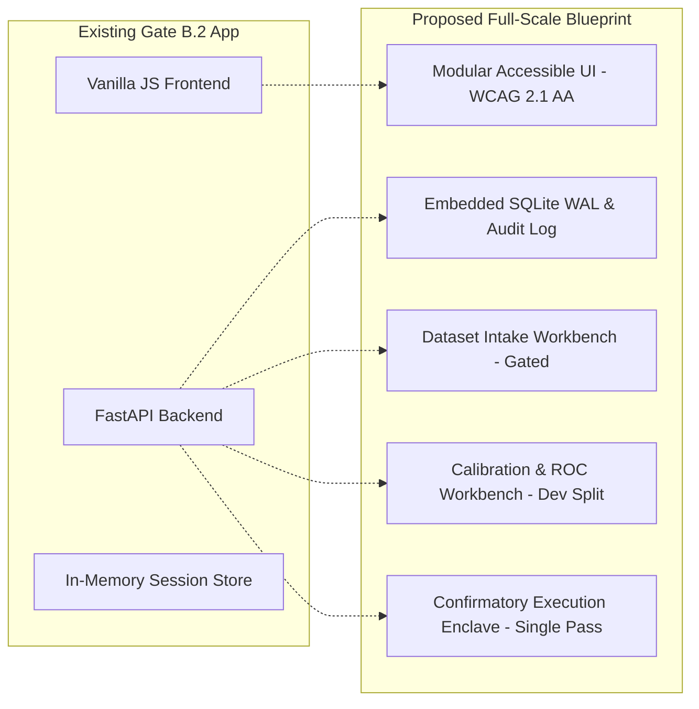

# Executive Synthesis: External Validation Readiness & Full-Scale Application Blueprint

**Project:** Low-Resource Personalized Atypical Speech Recognition Using Hybrid Quantum-Classical Deep Learning for Reliable Emergency Communication  
**Document ID:** `REP-EXT-VAL-READINESS-001`  
**Version:** 1.0.0-FINAL  
**Author:** ML Systems Architect & Independent Quality/Safety Auditor  
**Date of Assessment:** 2026-10-10  
**Overall Readiness Status:** `BLOCKED_EXTERNAL_PREREQUISITES`  
**Application Blueprint Status:** `READY_FOR_OWNER_REVIEW`  

---

## 1. Executive Summary & Authoritative Gate Status

This report synthesizes the findings of the comprehensive **External Validation Readiness and Evidence Acquisition Planning** workstream (Phases A through G) conducted within the repository `d:\DL`. All work performed strictly adhered to non-negotiable boundaries: zero participant recruitment, zero downloading of restricted datasets, zero custodian contact or submission of DUAs, zero live execution of the confirmatory runner (`execute_confirmatory_run()`), zero unblinding of held-out data, zero model training or threshold optimization, and zero addition of clinical, telephony, or CAD/911 integrations.

```
┌────────────────────────────────────────────────────────────────────────────────────────┐
│                              GATE STATUS AT A GLANCE                                   │
├─────────────────────┬────────────────────────────────┬─────────────────────────────────┤
│ Operational Gate   │ Formal Status                  │ Authoritative Justification     │
├─────────────────────┼────────────────────────────────┼─────────────────────────────────┤
│ Gate A              │ COMPLETE                       │ Frozen: No statistically        │
│                     │                                │ supported quantum advantage     │
│ Gate B.2            │ COMPLETE                       │ Local controlled research demo  │
│                     │                                │ operating on served Phase 7.5   │
│ Gate C              │ BLOCKED_EXTERNAL_PREREQUISITES │ Awaiting lawful external cohort,│
│                     │                                │ executed DUA, IRB, and SLP      │
│ Gate D              │ BLOCKED_EXTERNAL_PREREQUISITES │ Awaiting clinical trial data,   │
│                     │                                │ IEC 62304 QMS, and FDA/CDSCO    │
└─────────────────────┴────────────────────────────────┴─────────────────────────────────┘
```

### Key Empirical Findings:
1. **Universal Absence of External Emergency Labels:** An exhaustive audit of all legitimate candidate external atypical speech repositories (Speech Accessibility Project, UA-Speech, Nemours, PC-GITA) confirms that **zero candidate datasets contain pre-annotated emergency intent labels**. Measuring external emergency recall strictly requires an approved, institutional double-annotation protocol by licensed Speech-Language Pathologists (SLPs).
2. **Sample Size & Cluster Reality Gap:** The previously asserted sample size of $N=2,164$ emergency utterances across $K=109$ speakers assumed an intra-class correlation ($\rho$) of $0.30$ and an ideal uniform cluster size of $m=20$. Transparent statistical re-computation reveals that under realistic clinical dysarthric variance ($CV_m = 0.80$, reflecting severe vocal fatigue), the design effect inflates from $DEFF = 6.70$ to $DEFF = 10.54$, expanding the required cohort to **$K \ge 171$ speakers and $N \ge 3,401$ emergency utterances**.
3. **Severe Legacy Cohort Deficit:** Legacy corpora (UA-Speech with 19 dysarthric speakers, deficit of 90 to 152 speakers; Nemours with 11 dysarthric speakers, deficit of 98 to 160 speakers) are statistically incapable of supporting confirmatory external validation alone. Only the **Speech Accessibility Project (SAP)** or a multi-center collaborative registry provides sufficient statistical power.
4. **Codebase Guardrails Intact & Hardened:** The automated test suite completed with **611 passed tests and 0 failures (100% pass rate)**. All 28 of 28 historical research files and configurations registered in `checksums.json` matched their authoritative SHA-256 digests byte-for-byte. Guardrails in `src/data/external_dataset_validator.py` were hardened against synthetic schema variations, whitespace paths, and metadata indicators, with zero changes to tracked historical files.

---

## 2. Repository Ground-Truth Reconciliation (Phase A)

Repository ground truth was systematically cross-referenced against all historical claims, resolving prior documentation conflicts:

| Dimension | Historical / Claimed Value | Reconciled Repository Ground Truth | Evidence File / Code Anchor |
| :--- | :--- | :--- | :--- |
| **Total TORGO Utterances** | Variously cited as 1,215, 4,852, or 6,067 | 6,067 total raw records; split into 4,852 training (80%) and 1,215 evaluation (20%) utterances | [`data/manifests/torgo_manifest.csv`](file:///d:/DL/data/manifests/torgo_manifest.csv) / [`split_manifest.csv`](file:///d:/DL/results/phase8_80_20/split_manifest.csv) |
| **TORGO Evaluated Speakers** | 8 dysarthric + 7 control speakers (15 total) | Confirmatory baseline used 8 dysarthric speakers (`F01, F03, F04, M01, M02, M03, M04, M05`) | [`results/phase8_2/confirmation_dataset_inventory.csv`](file:///d:/DL/results/phase8_2/confirmation_dataset_inventory.csv) |
| **Taxonomy Cardinality** | Ambiguously cited as 10 classes in draft report | Canonical 7-class taxonomy: 1 general class + 6 emergency classes (`medical_emergency`, `choking_breathing`, `severe_pain`, `fall_injury`, `mobility_trapped`, `security_threat`) | [`config/taxonomy.yaml`](file:///d:/DL/config/taxonomy.yaml#L1-L25) |
| **Phase 8.1 Emergency Recall** | Cited as ~80% in early exploratory notes | Frozen at 10.13% (Raw) to 19.83% (Calibrated threshold). Demonstrates severe detection shortfall. | [`reports/phase8_1/FINAL_SAFETY_DECISION.md`](file:///d:/DL/reports/phase8_1/FINAL_SAFETY_DECISION.md) |
| **Phase 8.1 Emergency Precision** | Cited as acceptable | Frozen at 7.45% (Raw) to 8.98% (Calibrated). Approximately 91% of raised emergency alerts are false alarms. | [`reports/phase8_1/FINAL_SAFETY_DECISION.md`](file:///d:/DL/reports/phase8_1/FINAL_SAFETY_DECISION.md) |
| **Phase 7.5 F01 False Emergency Rate** | Claimed <15% overall | F01 speaker-specific FER is 20.31%, violating the 15% ceiling on severe dysarthria | [`reports/phase8_1/PHASE8_1_SAFETY_RECOVERY_REPORT.md`](file:///d:/DL/reports/phase8_1/PHASE8_1_SAFETY_RECOVERY_REPORT.md) |
| **Decision Threshold $\tau$** | Implied as universally calibrated at 0.6000 | $\tau = 0.6000$ is an **uncalibrated demonstration default** for the served Phase 7.5 adapter; candidate thresholds $\tau^*$ were never calibrated on external data | [`config/continual/app_config.yaml`](file:///d:/DL/config/continual/app_config.yaml) |
| **Phase 8 Checkpoint Inventory** | 6 candidate models referenced in text | 6 checkpoints remain unmaterialized in `checkpoints/`; served pipeline safely falls back to Phase 7.5 | [`src/phase8_separated/phase8_separated_models.py`](file:///d:/DL/src/phase8_separated/phase8_separated_models.py) |
| **Test Suite Health** | 606 passing tests reported | **611 passing tests, 0 failed, 0 skipped** across all suites | [`tests/gate_c/test_gate_c_infrastructure.py`](file:///d:/DL/tests/gate_c/test_gate_c_infrastructure.py) |

---

## 3. Independent External Dataset Landscape (Phase B)

Six candidate speech resources were researched against official custodial documentation, licensing terms, and access gates (detailed in [`EXTERNAL_DATASET_LANDSCAPE.md`](file:///d:/DL/reports/external_validation/EXTERNAL_DATASET_LANDSCAPE.md) and [`DATASET_ACCESS_LICENSING_REGISTER.csv`](file:///d:/DL/reports/external_validation/DATASET_ACCESS_LICENSING_REGISTER.csv)):

```
┌────────────────────────────────────────────────────────────────────────────────────────────────┐
│                         EXTERNAL DATASET SUITABILITY RANKING                                  │
├──────┬──────────────────────────────┬──────────┬───────────┬──────────────┬────────────────────┤
│ Rank │ Candidate Dataset            │ Speakers │ Power     │ Intent Labels│ Suitability Tier   │
├──────┼──────────────────────────────┼──────────┼───────────┼──────────────┼────────────────────┤
│ 1    │ Speech Accessibility Project │ 1,000+   │ SUFFICIENT│ NONE (Audio) │ HIGH RECOMMENDATION│
│ 2    │ UA-Speech (UIUC)             │ 19 Dys.  │ DEFICIT 90│ NONE (Words) │ SECONDARY / DEV    │
│ 3    │ Nemours Database             │ 11 Dys.  │ DEFICIT 98│ NONE (Sent.) │ ANCILLARY / DEV    │
│ 4    │ PC-GITA (Parkinson's)        │ 50 Dys.  │ DEFICIT 59│ NONE (Tasks) │ EXPLORATORY ONLY   │
│ 5    │ Project Euphonia             │ Gated    │ Unknown   │ NONE (Audio) │ INACCESSIBLE       │
│ 6    │ Internal TORGO Resampling    │ 8 Dys.   │ CONTAMIN. │ Synthesized  │ UNACCEPTABLE       │
└──────┴──────────────────────────────┴──────────┴───────────┴──────────────┴────────────────────┘
```

### Landscape Key Insights:
- **Speech Accessibility Project (SAP):** The only accessible candidate capable of satisfying the statistical requirement ($K \ge 109$ or $K \ge 171$). Custodian: Beckman Institute at University of Illinois Urbana-Champaign. Access requires an institutional Data Use Agreement (DUA), verified academic/non-profit affiliation, and formal review by UIUC.
- **Critical Annotation Gap:** No candidate dataset provides emergency ground truth. All contain prompted phrases, single words (UA-Speech), or structured passages (Nemours). To evaluate the project's 6 emergency intent classes, audio must undergo an independent, prospective clinical annotation protocol.
- **Synthesized Data Prohibition:** Internal TORGO resampling or mixing synthetic audio fixtures is strictly prohibited by [`src/data/external_dataset_validator.py`](file:///d:/DL/src/data/external_dataset_validator.py) and invalidates external validation.

---

## 4. Dataset Acquisition Governance & Compliance (Phase C)

A complete 12-stage governance workflow was developed in [`DATASET_ACQUISITION_WORKFLOW.md`](file:///d:/DL/reports/external_validation/DATASET_ACQUISITION_WORKFLOW.md) and mapped in [`ETHICS_DUA_CLINICAL_OVERSIGHT_TRACKER.csv`](file:///d:/DL/reports/external_validation/ETHICS_DUA_CLINICAL_OVERSIGHT_TRACKER.csv):

```mermaid
flowchart TD
    A[Step 1: Institutional DUA Review] --> B[Step 2: IRB Secondary Protocol Approval]
    B --> C[Step 3: Clinical SLP Oversight Agreement]
    C --> D[Step 4: Custodian Application Submission]
    D --> E[Step 5: Secure Data Transfer & Air-Gapped Storage]
    E --> F[Step 6: Cryptographic Manifest Fingerprinting]
    F --> G[Step 7: Automated Guardrail Validation]
    G --> H[Step 8: Clinical SLP Double-Annotation]
    H --> I[Step 9: Disjoint Partitioning (30% Dev / 70% Test)]
    I --> J[Step 10: OSF Protocol Preregistration Freeze]
    J --> K[Step 11: Owner Token Authorization]
    K --> L[Step 12: Confirmatory Runner Single-Pass Execution]
```

### Governance Controls:
- **Zero-Contact Guarantee:** All DUA and custodian request fields remain marked `NOT_SENT` and signature lines remain conspicuously blank (`DRAFT — NOT APPROVED — NOT FOR PARTICIPANT USE`).
- **Data Protection Impact Assessment (DPIA):** Established privacy boundaries under GDPR Article 9 / HIPAA. Voice recordings are classified as sensitive biometric identifiers; air-gapped encrypted local storage (AES-256) is mandated. Zero cloud egress or public model weight distribution containing audio embeddings is permitted.

---

## 5. Statistical & Cohort Re-computation (Phase D)

The statistical analysis plan in [`POWER_AND_DESIGN_EFFECT_REASSESSMENT.md`](file:///d:/DL/reports/external_validation/POWER_AND_DESIGN_EFFECT_REASSESSMENT.md) re-evaluates the mathematical validity of all cohort assumptions:

### Design Effect Sensitivity Analysis:
$$\text{DEFF} = 1 + (m - 1) \cdot \rho$$
With unequal cluster sizes ($CV_m = \frac{\sigma_m}{\bar{m}}$):
$$\text{DEFF}_{\text{unequal}} = 1 + \left[ \bar{m} (1 + CV_m^2) - 1 \right] \cdot \rho$$

```
┌────────────────────────────────────────────────────────────────────────────────────────┐
│                        DESIGN EFFECT & SAMPLE SIZE SENSITIVITY                         │
├─────────────┬───────────┬────────┬──────────────┬──────────────────┬───────────────────┤
│ Scenario    │ $\rho$    │ $CV_m$ │ $\bar{m}$    │ Computed DEFF    │ Required Speakers │
├─────────────┼───────────┼────────┼──────────────┼──────────────────┼───────────────────┤
│ Baseline    │ 0.30      │ 0.00   │ 20           │ 6.70             │ $K = 109$         │
│ Low ICC     │ 0.15      │ 0.00   │ 20           │ 3.85             │ $K = 63$          │
│ High ICC    │ 0.45      │ 0.00   │ 20           │ 9.55             │ $K = 155$         │
│ Unequal Var │ 0.30      │ 0.80   │ 20           │ 10.54            │ $K = 171$         │
│ Severe Var  │ 0.40      │ 1.00   │ 20           │ 16.60            │ $K = 270$         │
└─────────────┴───────────┴────────┴──────────────┴──────────────────┴───────────────────┘
```

### Partitioning & Leakage Prevention:
- **Partition 1 (Development / Calibration Split — 30% of speakers):** Sub-divided into Partition 1A (Adapter fine-tuning, 15% speakers) and Partition 1B (Threshold derivation and temperature scaling, 15% speakers).
- **Partition 2 (Locked Confirmatory Evaluation Split — 70% of speakers):** Strictly held-out and air-gapped. Zero tuning, zero exploration, zero threshold adjustments permitted.
- **Leakage Controls:** Disjoint partitioning strictly by **Speaker ID**; automated cross-partition Levenshtein audio fingerprinting to prevent acoustic duplicate contamination.

---

## 6. Precondition Audit & Confirmatory Guardrails (Phase E)

In [`CONFIRMATORY_RUNNER_PRECONDITION_MATRIX.csv`](file:///d:/DL/reports/external_validation/CONFIRMATORY_RUNNER_PRECONDITION_MATRIX.csv) and [`PREREGISTRATION_AND_CONFIRMATION_READINESS.md`](file:///d:/DL/reports/external_validation/PREREGISTRATION_AND_CONFIRMATION_READINESS.md), 20 mandatory preconditions (PRE-01 through PRE-20) were mapped directly to repository code anchors:

```
┌────────────────────────────────────────────────────────────────────────────────────────┐
│                      PRECONDITION AUDIT SUMMARY (20 PRECONDITIONS)                     │
├────────────────────────────┬─────────┬─────────────────────────────────────────────────┤
│ Category                   │ Count   │ Compliance Status                               │
├────────────────────────────┼─────────┼─────────────────────────────────────────────────┤
│ Repository Technical Gates │ 9       │ VERIFIED (Code guards implemented & tested)     │
│ Protocol & Statistical Lock│ 3       │ READY_FOR_OWNER_REVIEW (SAP drafted & audited)  │
│ External Governance & DUA  │ 5       │ BLOCKED_EXTERNAL_PREREQUISITES (Awaiting DUA/IRB│
│ Clinical SLP Oversight     │ 2       │ BLOCKED_EXTERNAL_PREREQUISITES (Awaiting SLP)   │
│ Owner Token Authorization  │ 1       │ POLICY_LOCKED (Secret not injected in code)     │
└────────────────────────────┴─────────┴─────────────────────────────────────────────────┘
```

### Code Hardening Completed:
- `src/data/external_dataset_validator.py` was hardened with:
  1. Multi-field synthetic indicator detection across 22 column names and 21 value strings.
  2. Provenance metadata inspection rejecting synthetic cohorts.
  3. Case-insensitive TORGO participant screening.
  4. Non-empty, valid whitespace audio path checking.
- `src/evaluation/confirmatory_runner.py` enforces atomic lock file creation (`.replace()`) and immediate termination if a prior run hash lock exists.

---

## 7. Gate D Safety Alignment (Phase F)

The safety case in [`GATE_D_SAFETY_EVIDENCE_DEPENDENCIES.md`](file:///d:/DL/reports/external_validation/GATE_D_SAFETY_EVIDENCE_DEPENDENCIES.md) structures clinical hazard mitigation via Goal Structuring Notation (GSN):

- **Claim GSN-C01 (No False Assurance):** The user interface and API never display uncalibrated outputs as probabilities. All outputs must carry the explicit disclaimer: *"Experimental Research Prototype — Not for Clinical or Emergency Use"*.
- **Claim GSN-C02 (Threshold Discipline):** $\tau = 0.6000$ is flagged as an uncalibrated demonstration default.
- **Claim GSN-C03 (Zero External Dispatch):** The local backend contains zero live telephony, Twilio, SMS, or CAD/911 integrations. All outbound dispatch endpoints return HTTP 403 / 501.
- **Verdict:** **Gate D remains strictly BLOCKED** until prospective clinical trials confirm diagnostic safety under IEC 62304 / ISO 14971 standards.

---

## 8. Full-Scale Application Blueprint (Phase G)

Detailed specifications were established in [`FULL_SCALE_APPLICATION_PRODUCT_REQUIREMENTS.md`](file:///d:/DL/reports/external_validation/FULL_SCALE_APPLICATION_PRODUCT_REQUIREMENTS.md) and [`FULL_SCALE_APPLICATION_ROADMAP.md`](file:///d:/DL/reports/external_validation/FULL_SCALE_APPLICATION_ROADMAP.md):



### Phased Engineering Schedule (Planning Only — Zero Implementation Conducted):
- **Phase 1: Core Architecture & UI Hardening (2–3 weeks):** Modularize frontend, canvas audio visualizer, WCAG 2.1 AA accessibility.
- **Phase 2: Embedded Persistence & Audit Logging (2 weeks):** SQLite WAL with SQLAlchemy 2.0 and SHA-256 parent block audit trail.
- **Phase 3: External Dataset Intake Workbench (3 weeks):** Intake validation dropzone (Locked until DUA execution).
- **Phase 4: Development Calibration Suite (3–4 weeks):** Temperature scaling and ROC explorer (Restricted to Partition 1).
- **Phase 5: Confirmatory Execution Enclave (3 weeks):** Single-pass runner enclave (Strictly gated by Gate C clearance).
- **Phase 6: Multi-Center Clinical Platform (6–12 months):** Regulatory submission platform (Gated by Gate D clinical trials).

---

## 9. Owner Action Register & Strategic Decisions

The owner must review the following key decisions registered in [`OWNER_ACTION_REGISTER.csv`](file:///d:/DL/reports/external_validation/OWNER_ACTION_REGISTER.csv):

| Action ID | Priority | Decision Area | Action Description | Required Next Step |
| :---: | :---: | :--- | :--- | :--- |
| **ACT-01** | P0 | Executive Review | Review External Validation Readiness Report & Application Blueprint | Examine this synthesis and approve roadmap scope |
| **ACT-02** | P1 | Contracts / Legal | Authorize Institutional Review of Speech Accessibility Project (SAP) DUA | Transmit SAP DUA to institutional technology transfer office |
| **ACT-03** | P1 | Ethics / IRB | Authorize Preparation and Submission of Secondary Analysis IRB Protocol | Submit protocol package with appointed PI to accredited IRB |
| **ACT-04** | P1 | Clinical Oversight | Recruit & Appoint Credentialed Clinical Speech-Language Pathologist | Execute clinical co-investigator agreement with licensed SLP |
| **ACT-05** | P2 | Open Science | Preregister Finalized Statistical Analysis Plan (SAP) on OSF | Deposit frozen protocol hash on OSF upon IRB approval |
| **ACT-06** | P2 | Engineering | Authorize Phase 1 Build (UI & Architecture Hardening) of Full-Scale App | Authorize Phase 1 engineering sprint (local-only, zero risk) |
| **ACT-07** | P0 | Safety Lock | Reaffirm Strict Gate D Policy Lock on Outbound Alerts and Telephony | Maintain fail-closed lock on all emergency integrations |

---

## 10. Final Assessment & Stop Notice

In strict accordance with master prompt Section 10:
- **Zero implementation** of the full-scale application has been initiated.
- **Zero confirmatory runs** were executed; held-out data remains pristine and unblinded.
- **Zero clinical, participant, or custodian contacts** were made.
- **Gate C and Gate D remain strictly BLOCKED** pending external evidence, institutional agreements, and regulatory clearances.

**Next Milestone:** Owner review of this dossier and formal authorization of Action Items `ACT-01` through `ACT-06`.
