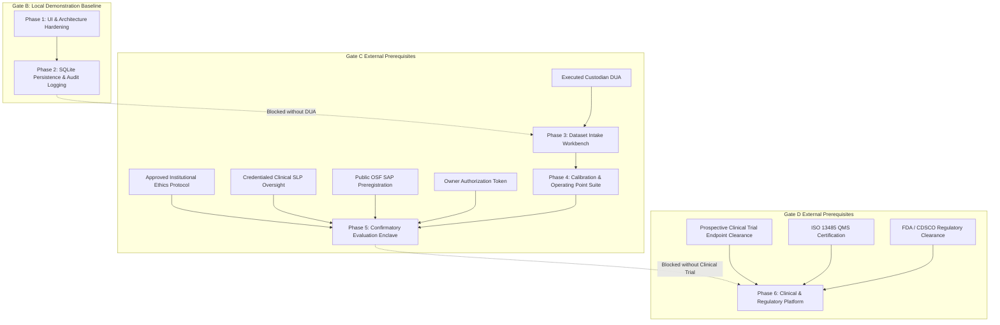

# Phased Engineering Roadmap — Full-Scale Research Application

**Project:** Low-Resource Personalized Atypical Speech Recognition Using Hybrid Quantum-Classical Deep Learning for Reliable Emergency Communication  
**Document ID:** `ROADMAP-FULL-SCALE-APP-001`  
**Document Status:** **ENGINEERING ROADMAP — PLANNING ONLY (NOT AUTHORIZED FOR BUILD)**  
**Version:** 1.0.0-DRAFT  
**Author:** ML Systems Architect & Platform Engineering Lead  
**Audit Date:** 2026-10-10  

---

## 1. Roadmap Architecture & Phased Strategy

The roadmap is structured into six discrete, sequential engineering phases. Each phase is decoupled by explicit objective exit criteria, gate dependencies, and owner review checkpoints.

```
┌────────────────────────────────────────────────────────────────────────────────────────┐
│                        FULL-SCALE APPLICATION PHASED ROADMAP                           │
├────────────────────────────────────────────────────────────────────────────────────────┤
│ Phase 1: Core Architecture & UI Hardening (Extending Gate B.2)       [ENGINEERING ONLY]│
│ Phase 2: Embedded Persistence & Append-Only Audit Logging             [ENGINEERING ONLY]│
│ Phase 3: External Dataset Intake & Verification Workbench       [GATED: DUA REQUIRED]  │
│ Phase 4: Development Calibration & Operating Point Suite        [GATED: DEV SPLIT ONLY]│
│ Phase 5: Confirmatory Evaluation Execution Enclave              [GATED: GATE C PREREQS]│
│ Phase 6: Multi-Center Clinical & Regulatory Telemetry Platform  [GATED: GATE D PREREQS]│
└────────────────────────────────────────────────────────────────────────────────────────┘
```

---

## 2. Phase-by-Phase Engineering Specification

### Phase 1: Core Architecture & UI Hardening
- **Objective:** Upgrade the existing Gate B.2 SPA into a modular, production-grade frontend architecture while maintaining 100% local-only execution.
- **Key Deliverables:**
  - Modularize `src/app/static/app.js` into ES6 modules (audio engine, state manager, view router, WebSocket client).
  - Implement full keyboard accessibility and WCAG 2.1 AA focus management across all 7 views.
  - Implement canvas-based real-time audio waveform visualizer and spectrogram preview in the Audio Lab.
  - Add interactive client-side research calculation tools (interactive Wilcoxon signed-rank and McNemar test explorer).
- **Dependencies:** Gate B.2 completion (Verified).
- **Estimated Effort:** 2–3 engineering weeks.
- **Exit Criteria:** Full WCAG 2.1 AA compliance audit passes; zero external network requests; all 608+ tests pass.

---

### Phase 2: Embedded Persistence & Append-Only Audit Logging
- **Objective:** Implement a lightweight, zero-configuration local persistence layer for model caching, session telemetry, and immutable audit trails.
- **Key Deliverables:**
  - Integrate embedded `SQLite 3` with Write-Ahead Logging (`WAL`) mode via `SQLAlchemy 2.0` / `Aiosqlite`.
  - Schema migration pipeline using `Alembic`.
  - Implement append-only cryptographic audit logger writing model query events with SHA-256 parent block hashing.
  - Automated session log rotation and cryptographic audit export.
- **Dependencies:** Phase 1 completion.
- **Estimated Effort:** 2 engineering weeks.
- **Exit Criteria:** Zero database server daemons required; SQLite database file encryptable at rest; unit test coverage $\ge 90\%$.

---

### Phase 3: External Dataset Intake & Verification Workbench
- **Objective:** Build the UI and backend workbench for importing, verifying, and hashing independent atypical speech dataset manifests.
- **Key Deliverables:**
  - Web UI dropzone for dataset manifest CSVs and companion provenance metadata JSON.
  - Integration with [`src/data/external_dataset_validator.py`](file:///d:/DL/src/data/external_dataset_validator.py):
    - Automated detection and hard rejection of synthetic speech records.
    - Automated case-insensitive screening against TORGO speaker IDs and utterance collisions.
    - Provenance verification: enforces `ethics_approval_status == 'APPROVED'` and `dua_status in ('EXECUTED', 'ACTIVE')`.
  - Manifest cryptographic fingerprinting and ledger registration.
- **Gating Dependency:** **BLOCKED until formal execution of institutional DUA (e.g., UIUC SAP DUA).** The UI interface must remain conspicuously disabled with an "Awaiting Institutional DUA" lock banner.
- **Estimated Effort:** 3 engineering weeks.
- **Exit Criteria:** Validation workbench successfully processes valid mock manifests and rejects all invalid/synthetic/TORGO-overlapping fixtures in automated CI tests.

---

### Phase 4: Development Calibration & Operating Point Suite
- **Objective:** Implement an interactive workbench for deriving decision thresholds $\tau^*$ and temperature scaling parameters exclusively on Partition 1 (Development Split; 30% of speakers).
- **Key Deliverables:**
  - Speaker-level adapter adaptation training runner on Partition 1A (15% of speakers).
  - ROC / Precision-Recall curve interactive viewer on Partition 1B (15% of speakers).
  - Calibration engine supporting Platt scaling, Temperature scaling, and Isotonic regression.
  - Automated generation of candidate operating point registries with frozen SHA-256 fingerprints.
- **Gating Dependency:** **Requires lawfully acquired and partitioned external dataset (Partition 1 available).**
- **Estimated Effort:** 3–4 engineering weeks.
- **Exit Criteria:** Derived threshold $\tau^*$ and calibration mapping cryptographically frozen before any access to Partition 2 is attempted.

---

### Phase 5: Confirmatory Evaluation Execution Enclave
- **Objective:** Secure, single-pass evaluation execution interface wrapping [`src/evaluation/confirmatory_runner.py`](file:///d:/DL/src/evaluation/confirmatory_runner.py).
- **Key Deliverables:**
  - Multi-factor authorization UI requiring manual entry of Owner Authorization Token.
  - Pre-flight compliance validator checking all 15 preconditions (PRE-01 through PRE-15).
  - Single-pass atomic cryptographic run lock creation (`confirmatory_lock_<manifest_hash[:8]>.json`).
  - GEE / GLMM clustered statistical report generator executing pre-registered SAP analyses.
- **Gating Dependency:** **STRICTLY BLOCKED pending Gate C clearance (IRB approval, DUA execution, public OSF preregistration, and signed Owner Decision Memo).**
- **Estimated Effort:** 3 engineering weeks.
- **Exit Criteria:** Confirmatory runner executes exactly once on Partition 2 (70% of speakers), generates locked audit reports, and permanently prevents re-running.

---

### Phase 6: Multi-Center Clinical & Regulatory Telemetry Platform
- **Objective:** Future medical device software platform for prospective interventional clinical trials and regulatory submission.
- **Key Deliverables:**
  - ISO 13485 / IEC 62304 compliant design controls and traceability matrices.
  - High-availability distributed architecture with end-to-end encryption.
  - Real-time clinical trial electronic data capture (EDC) integration.
  - Multi-center prospective clinical study data collection portals.
- **Gating Dependency:** **STRICTLY BLOCKED pending Gate D qualification (IEC 62304 lifecycle, clinical efficacy trials, and regulatory clearance).**
- **Estimated Effort:** 6–12 months (clinical trial timeline).
- **Exit Criteria:** Regulatory clearance granted (US FDA De Novo / 510(k) or India CDSCO Form MD-15).

---

## 3. Dependency Mapping: Future App Features vs. External Prerequisites



---

## 4. Owner Decision Register (Required Before Coding Starts)

| Decision ID | Decision Title | Context & Options | Recommended Action |
| :---: | :--- | :--- | :--- |
| **DEC-01** | Authorization to Begin Phase 1 Engineering | Should engineering begin Phase 1 UI hardening and modularization of the existing Gate B.2 app? | **AUTHORIZE Phase 1** (Purely local engineering; zero clinical risk). |
| **DEC-02** | Local Persistence Architecture | Select between (A) Embedded SQLite WAL or (B) In-Memory Ephemeral Storage. | **SELECT Option A (SQLite WAL)** for robust local audit logging. |
| **DEC-03** | Dataset Acquisition Sponsorship | Authorize institutional counsel to begin review of the UIUC Speech Accessibility Project standard DUA. | **AUTHORIZE DUA Review** to unblock Phase 3 prerequisites. |
| **DEC-04** | Ethics Submission Authorization | Authorize submission of secondary data analysis protocol to institutional IRB. | **AUTHORIZE Ethics Submission** once PI and institution are confirmed. |
| **DEC-05** | Strict Gate C/D Feature Freezing | Reaffirm that Phase 5 confirmatory evaluation and Phase 6 clinical platforms remain locked in code. | **REAFFIRM Policy Lock** until formal pre-flight dossier is signed. |
