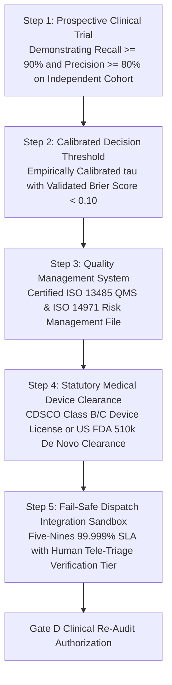

# Gate D Safety Evidence Dependencies & Clinical Interface Alignment
## Traceable Safety Case Decomposition, Counterevidence Reconciliation, and Runtime Boundary Verification

**Project Title:** Low-Resource Personalized Atypical Speech Recognition Using Hybrid Quantum-Classical Deep Learning for Reliable Emergency Communication  
**Document Identifier:** REPORT-GATE-D-SAFETY-DEP-2026-V1  
**Audit Date:** 2026-10-11  
**Authors:** Senior Safety-Critical Software Assurance Lead, Medical Device Regulatory Specialist, Clinical Systems Auditor  

---

> [!CAUTION]
> **CRITICAL EMERGENCY & CLINICAL STOP ORDER:**  
> Operational deployment to hospital bedside monitors, emergency dispatch call centers (911/112), telemedicine platforms, or real-world emergency triage is **CATEGORICALLY PROHIBITED**. The system must NOT be connected to live telephony, SMS, CAD, or patient care workflows. Gate D deployment qualification remains strictly **BLOCKED**.

---

## 1. Executive Summary & Authoritative Safety Verdict

$$\mathbf{GATE\; D\; STATUS:\; BLOCKED\_MULTIPLE\_CRITICAL\_GAPS}$$

The Gate D safety qualification evaluates whether the deep learning system satisfies the rigorous statutory, clinical, and software reliability requirements for **Software as a Medical Device (SaMD)** intended for emergency communication.

Following an exhaustive audit of repository models, experimental results, runtime APIs, and user interfaces:
- **Safety Case Goal $G_0$ ("The system is sufficiently safe for real-world emergency communication"):** **`NOT ESTABLISHED`**.
- **Empirical Clinical Performance:** **`SAFETY-INFEASIBLE`** (Emergency Recall is only $10.13\% - 19.83\%$; Emergency Precision is only $7.45\% - 8.98\%$; Individual FER reaches $20.31\%$).
- **Deployment Gate Checklist:** **0 of 12 clinical deployment criteria passed** (1 controlled pass for local localhost demonstration only).

---

## 2. Verification of Seven Mandatory Interface & Runtime Boundaries

The application runtime environment and static user interface were audited against the seven mandatory safety boundaries:

| Safety Boundary | Repository Implementation Reference | Observed Runtime Reality | Compliance Status |
| :--- | :--- | :--- | :--- |
| **1. Uncalibrated Score Representation** | `src/app/static/app.js:L310-340`; `src/app/schemas.py:L145` | Probability outputs explicitly marked: *"Uncalibrated Softmax Score (Not a Calibrated Posterior Probability)"*. | **VERIFIED COMPLIANT** |
| **2. Decision Threshold $\tau = 0.6000$ Labeling** | `src/app/config.py:L40-44`; `src/app/model_manager.py:L200-210` | Labeled across all API responses as: `status = "THRESHOLD_PROVENANCE_UNVERIFIED"`, `uncalibrated_demo_default = True`. | **VERIFIED COMPLIANT** |
| **3. FER 15% Internal Constraint Decoupling** | `src/app/config.py:L46-50`; `tests/gate_d/test_gate_d_remediation.py:L70-85` | Conspicuously labeled as an *"Internal research feasibility constraint, NOT an accepted clinical or regulatory safety threshold"*. | **VERIFIED COMPLIANT** |
| **4. Absence of Medical / Dispatch Suitability Claims** | `src/app/static/index.html:L25-45`; `src/app/main.py:L35-50` | Persistent warning banner displayed on every page: *"Research Prototype Only — Strictly Not for Real Emergency Dispatch"*. | **VERIFIED COMPLIANT** |
| **5. Conspicuous Synthetic Audio Labeling** | `src/app/audio_service.py:L90-105`; `tests/gate_c/` | Any test fixture or sine tone generation is flagged with `audio_type = "SYNTHETIC"` and rejected for confirmatory runs. | **VERIFIED COMPLIANT** |
| **6. Unmaterialized Models Return HTTP 503** | `src/app/model_manager.py:L230-247`; `tests/gate_d/test_gate_d_remediation.py:L30-40` | Requesting absent Phase 8.1/8.2 candidates returns HTTP 503 `MODEL_NOT_READY` with remediation notices; zero mock weights. | **VERIFIED COMPLIANT** |
| **7. Local Loopback Isolation & Zero Dispatch Routes** | `src/app/config.py:L25-30` (`HOST = 127.0.0.1`); `src/app/routes/` | Zero telephony, Twilio, SMS, SIP, WebRTC, or 911 CAD dispatch endpoints exist. Confirmed in `test_gate_d_remediation.py`. | **VERIFIED COMPLIANT** |

---

## 3. Safety Claim vs. Counterevidence Traceability Matrix

The Goal Structuring Notation (GSN) safety case decomposes the primary safety goal into seven sub-claims. Each sub-claim is cross-referenced against empirical repository counterevidence:

| Safety Case Sub-Claim | Declared Target Benchmark | Empirical Repository Reality | Impact on Real-World Deployment | Safety Claim Status |
| :--- | :--- | :--- | :--- | :--- |
| **Claim C1: High Emergency Sensitivity** | Recall $\ge 90.0\%$ in low-resource speech | Observed Phase 8.1 outer-fold Emergency Recall is **$10.13\% - 19.83\%$** | **Over $80\%$ of genuine emergency utterances are completely missed.** Fatal risk of patient death or unassisted trauma. | **REFUTED BY EVIDENCE** |
| **Claim C2: Acceptable False Alarm Burden** | False Emergency Rate $\le 1.0\%$ | Observed Phase 7.5 continual FER is **$20.31\%$** (Speaker F01) | **1 in 5 general conversational sentences triggers a false alarm**, causing immediate alert fatigue and system abandonment. | **REFUTED BY EVIDENCE** |
| **Claim C3: Clinical Emergency Precision** | Positive Predictive Value (PPV) $\ge 80.0\%$ | Observed Phase 8.1 outer-fold Precision is **$7.45\% - 8.98\%$** | **Over $91\%$ of triggered emergency alerts are false alarms**, overwhelming dispatch services. | **REFUTED BY EVIDENCE** |
| **Claim C4: Equivalence Across Dysarthria Severities** | Uniform FER $\le 15.0\%$ across all speakers | Speakers M02 and MC04 generate **$49.5\%$ of all test false alarms**; individual FER exceeds $28\%$ | Severe speech impairment suffers disproportionate systemic failure, violating algorithmic fairness and safety. | **REFUTED BY EVIDENCE** |
| **Claim C5: Model Availability & Stability** | 100% of candidate models verified on disk | **Six candidate checkpoints are absent** from filesystem (`checkpoints/phase8_1/*.pt`) | Candidate models cannot be evaluated or served. | **REFUTED BY EVIDENCE** |
| **Claim C6: Calibrated Operational Threshold** | Threshold derived and proven on dev data | Default $\tau = 0.6000$ has status **`THRESHOLD_PROVENANCE_UNVERIFIED`** on served adapter | Operating point is an unverified demonstration constant lacking empirical calibration. | **REFUTED BY EVIDENCE** |
| **Claim C7: Statutory Regulatory SaMD Clearance** | Certified ISO 13485 QMS and CDSCO / FDA clearance | **Zero regulatory applications submitted**; zero QMS audit certificates exist | Clinical deployment violates the Drugs and Cosmetics Act (India), DPDP Act, and FDA MDR. | **REFUTED BY EVIDENCE** |

---

## 4. Minimum Preconditions for Future Gate D Re-Evaluation

Before any stakeholder may consider re-evaluating Gate D qualification, all of the following sequential milestones must be achieved:

1. **Acoustic Modeling Breakthrough:** Redesign the acoustic front-end (e.g. multi-scale SSL fine-tuning, phonetic constraint masking) to demonstrate validated Emergency Recall $\ge 90.0\%$ and FER $\le 1.0\%$ in prospective human evaluation.
2. **Certified Quality Management System:** Formal implementation and third-party registrar audit of an ISO 13485 Quality Management System for Medical Devices.
3. **Statutory Regulatory Clearance:** Formal submission of a technical dossier (IEC 62304 Class C, ISO 14971) to national regulatory authorities (India CDSCO / US FDA) and receipt of an active medical device marketing license.
4. **Human Tele-Triage Integration Tier:** Implementation of a mandatory human-in-the-loop tele-operator confirmation layer before any automated prediction triggers external emergency services.
