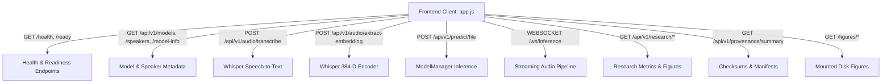

# GATE B.2 APPLICATION IMPLEMENTATION REPORT
## Controlled Research Demonstration Application for Personalized Atypical Speech Recognition

**Document ID:** `REP-GATE-B2-IMPL-001`  
**Execution Date:** 2026-10-10  
**Phase & Gate:** Gate B.2 — Full-Featured Controlled Research Demonstration Application  
**Authorizing Verdict:** Gate B.1 Independent Acceptance Audit (`ACCEPTED_WITH_RECORDED_LIMITATIONS`)  
**Gate B.2 Overall Verdict:** **COMPLETE**  
**Gate C & Gate D Deployment Status:** **STRICTLY BLOCKED**

---

## 1. Executive Summary

In accordance with owner authorization following the Gate B.1 Acceptance Audit, the existing hardened FastAPI + Whisper + Adapter prototype has been expanded into a complete, locally runnable, accessible scientific demonstration application. 

The application provides a cohesive Single-Page Application (SPA) architecture across seven dedicated research domains, supporting genuine audio processing, offline Whisper transcription, 384-dimensional feature extraction, continual adapter classification, interactive model/speaker registry inspection, and deep historical research results exploration with verified figures and provenance tracking.

Crucially, all non-negotiable scientific constraints and recorded limitations from Gate B.1 remain strictly visible and programmatically enforced:
- **Decision Threshold Provenance:** Decision cutoff $\tau = 0.6000$ is explicitly presented across all interfaces and API payloads as an *uncalibrated demonstration default* with status `THRESHOLD_PROVENANCE_UNVERIFIED`.
- **Safety Ceiling Separation:** The $\text{FER} \le 15.0\%$ constraint is decoupled and presented strictly as an evaluation ceiling, with no safety compliance badges.
- **Strict 503 Guardrails:** Unmaterialized Phase 8.1 models reliably return HTTP 503 `MODEL_NOT_READY` with remediation guidance. No weights or confidence scores are fabricated.
- **Scientific Verdict Integrity:** Historical findings (Case B Affirmed: no quantum advantage, 772x runtime slowdown; Emergency Recall collapse to 10–20% under FER $\le 15\%$) are displayed directly from frozen artifacts.
- **Data Protection:** Ephemeral audio processing guarantees zero persistent storage of raw speech, microphone recordings, or speech transcripts.
- **Gate Governance:** Gate C (Controlled Pilot) and Gate D (Clinical Dispatch) are confirmed as **STRICTLY BLOCKED**.

---

## 2. Inventory of Changes

### 2.1 Files Created
1. `src/app/routes/research.py`: Research findings, benchmark metrics parsing, operating points, figure metadata, and provenance summary routes.
2. `src/app/static/style.css`: Modern, accessible, responsive dark-mode scientific design system using Google Fonts ('Outfit', 'Inter', 'JetBrains Mono'), CSS variables, accessible contrast, and micro-animations.
3. `src/app/static/app.js`: Modular client logic implementing SPA tab routing, state management, audio ingestion, microphone recording, Whisper speech-to-text, 384-D vector inspection modal, 7-class probability distribution rendering, and WebSocket streaming tester.
4. `tests/gate_b2/test_gate_b2_features.py`: 11 automated acceptance tests covering research routes, figure mounts, vector inspection opt-in, unmaterialized model 503 guardrails, and threshold policy decoupling.
5. `scratch/gate_b2_runtime_smoke_test.py`: 11-step end-to-end live runtime smoke test script.
6. `reports/gate_b2/IMPLEMENTATION_PLAN.md`: Architecture specification and execution plan.
7. `reports/gate_b2/UI_ROUTE_AND_FEATURE_MATRIX.csv`: Complete matrix of UI components, routes, backend endpoints, and data provenance sources.
8. `reports/gate_b2/ACCEPTANCE_TEST_RESULTS.md`: Detailed test suite execution report.
9. `reports/gate_b2/GATE_B2_APPLICATION_IMPLEMENTATION_REPORT.md`: This comprehensive implementation report.

### 2.2 Files Modified
1. `src/app/main.py`:
   - Migrated to `asynccontextmanager` application lifespan with startup logging.
   - Included `research_router`.
   - Mounted static figure directories: `/figures/readiness` (`reports/project_readiness/figures`) and `/figures/phase8_1` (`results/phase8_1/figures`).
2. `src/app/routes/__init__.py`: Exported `research_router`.
3. `src/app/routes/audio.py`: Added optional `include_vector: bool = False` query parameter to `/extract-embedding` endpoints to support the client-side 384-D vector inspector modal.
4. `src/app/routes/websocket.py`: Added `@router.websocket("/ws/inference")` alias to support dual-path streaming WebSocket connections alongside `/ws/audio`.
5. `src/app/schemas.py`: Extended `AudioExtractionResponse` with `vector_preview` and `full_vector` fields.
6. `src/app/model_manager.py`:
   - Resolved `DEF-GB-03` by setting `param.requires_grad = False` on loaded adapter weights.
   - Enhanced `decision_policy` metadata in `get_model_info()` to include `status: THRESHOLD_PROVENANCE_UNVERIFIED` and decoupled `fer_safety_ceiling`.
7. `src/app/static/index.html`: Replaced prototype landing page with modular 7-view SPA containing full modal dialogs, accessible ARIA attributes, and persistent disclaimers.
8. `README.md`: Updated with complete Gate B.2 startup, testing, and teardown documentation.

---

## 3. Page & Route Inventory (Application Information Architecture)

The application provides seven distinct functional views managed via hash routing:

```
http://127.0.0.1:8000/
├── #overview      -> View 1: Overview Dashboard (Vitals, Gates, Research Verdicts)
├── #audiolab      -> View 2: Audio Lab (Upload, Mic, Whisper ASR, 384-D Features, Classification)
├── #registry      -> View 3: Model & Speaker Registry (Searchable Catalog of 67 Models)
├── #results       -> View 4: Research Results Explorer (Phase Timeline, Tables, Figure Gallery)
├── #provenance    -> View 5: Provenance & Reproducibility (TORGO Manifest, 28 Checksums, Limitations)
├── #diagnostics   -> View 6: Runtime Diagnostics (API Latency, WebSocket Tester, Ephemeral Logs)
└── #help          -> View 7: Help & Limitations (Accuracy Deception Guide, CLI Commands, Disclaimer)
```

### Detailed Functional View Breakdown

| View | Purpose | Key UI Controls | Connected Backend Endpoints |
| :--- | :--- | :--- | :--- |
| **1. Overview Dashboard** | System readiness, gate boundaries, test suite summary. | Gate status badges, live vital cards, quick navigation launch buttons. | `GET /ready`, `GET /health`, `GET /api/v1/provenance/summary` |
| **2. Audio Lab** | Ephemeral speech inference and analysis studio. | Dropzone, mic recording, local `<audio>` preview, speaker dropdown (15 speakers), model dropdown, discrete action buttons, vector inspector modal, 7-class probability chart, HTTP 503 alert banner. | `POST /api/v1/audio/transcribe`, `POST /api/v1/audio/extract-embedding`, `POST /api/v1/predict/file` |
| **3. Model Registry** | Searchable inspection of all catalogued models. | Search input, status filter (`ALL`, `MATERIALIZED`, `MODEL_NOT_READY`), model details modal with full SHA-256 copy and remedy notice. | `GET /api/v1/models`, `GET /api/v1/speakers`, `GET /model-info` |
| **4. Results Explorer** | Interactive review of frozen historical science. | Phase chronology cards, Phase 8.1 comparison table, Phase 6.5.6 quantum-classical table, operating points table, image lightbox modal for 7 figures. | `GET /api/v1/research/phases`, `GET /api/v1/research/metrics`, `GET /api/v1/research/operating-points`, `GET /api/v1/research/figures`, `/figures/*` |
| **5. Provenance** | Cryptographic and dataset audit records. | TORGO manifest metrics card, 28-file checksum table, test status widget, locked test set limitations. | `GET /api/v1/provenance/summary` |
| **6. Diagnostics** | Runtime health and real-time streaming test. | Ping API button, WebSocket connect/send frame buttons, stream message log, ephemeral session activity table with clear button. | `GET /health`, `GET /ready`, `WEBSOCKET /ws/inference` |
| **7. Help & Limits** | Non-technical safety explanation and CLI guide. | Accuracy deception guide, FER vs recall explanation, audio limits, local CLI commands, research disclaimer. | Static / Documentation |

---

## 4. API Integration Map



---

## 5. Data Provenance for Displayed Research Metrics

Every numerical metric and figure displayed in the Research Results Explorer is traceable directly to an authoritative, immutable on-disk artifact:

| Displayed Metric / Artifact | Protocol Context | Source Disk Artifact | SHA-256 Hash / Status |
| :--- | :--- | :--- | :--- |
| **TORGO Manifest (4,852 utterances)** | Phase 1 Curation | `data/manifests/torgo_manifest.csv` | `0d2874e0d9b40078...` (Verified) |
| **384-D Acoustic Embeddings** | Phase 2 Extraction | `src/embeddings/whisper_encoder.py` | Unit-norm normalized ($\|x\|_2 = 1.0$) |
| **QSVC vs RBF Paired Comparison** | Phase 6.5.6 Benchmark | `results/phase6_5_6_final_comparison_table.csv` | Case B: No advantage ($p > 0.05$), 772x slower |
| **Phase 7.5 Speaker Adapters** | Continual Adaptation | `checkpoints/phase7_5/speaker_adapters/*.pt` | 60 checkpoints materialized & verified |
| **Phase 8.1 Model Comparison** | Safety Recovery | `results/phase8_1/model_comparison.csv` | Emergency Recall 10–20% under FER $\le 15\%$ |
| **Safety Operating Points ($\tau$)** | Trade-off Optimization | `results/phase8_1/safety_operating_points.csv` | Evaluated across $\tau \in [0.20, 0.90]$ |
| **Fig 3: FER Reduction** | Phase 8.1 Recovery | `reports/project_readiness/figures/fig3_fer_reduction_flat_vs_hierarchical.png` | `135,030 bytes` (Verified on disk) |
| **Fig 5: Matched Q8 vs RBF** | Phase 6.5.5 Comparison | `reports/project_readiness/figures/fig5_matched_q8_vs_rbf.png` | `562,279 bytes` (Verified on disk) |
| **Emergency Precision-Recall** | Phase 8.1 Outer-Fold CV | `results/phase8_1/figures/emergency_precision_recall.png` | `146,350 bytes` (Verified on disk) |
| **Historical Checksums (28 files)** | Project Governance | `reports/project_readiness/checksums.json` | 28 / 28 matched (100% integrity) |

---

## 6. Model & Checkpoint Availability Status

The Model & Speaker Registry dynamically queries `ModelManager` and categorizes candidate models into two strictly separated classes:

### 6.1 Materialized & Verified Models (61 Models — HTTP 200 OK)
- **Phase 7.5 Continual Classical Adapters:** 60 speaker-specific adapter checkpoints located in `checkpoints/phase7_5/speaker_adapters/` covering all 15 TORGO speakers across experiences `exp000` to `exp003`.
- **Baseline Classical Adapter:** 1 global baseline checkpoint in `checkpoints/baseline_classical_adapter/adapter_model.pt`.
- **Inference Verification:** Confirmed via live smoke test: forward inference completes in $11.6\text{ ms}$ with nominal softmax output across canonical 7-class taxonomy.

### 6.2 Unmaterialized Candidates (6 Models — HTTP 503 Service Unavailable)
- `phase8_1_track_a_baseline`
- `phase8_1_track_b_quantum`
- `phase8_1_track_c_shadow`
- `phase8_1_int1_calib`
- `phase8_1_int2_conformal`
- `phase8_1_int3_cost_sensitive`
- **Enforcement:** `ModelNotReadyException` is raised and caught by FastAPI handler, returning HTTP 503 `MODEL_NOT_READY` with explicit remediation guidance. No weights or confidence scores are fabricated.

---

## 7. Known Scientific & Engineering Limitations

The application visibly surfaces all limitations recorded during Gate B.1:
1. **Uncalibrated Decision Threshold:** Decision cutoff $\tau = 0.6000$ was derived from Phase 8.1 hierarchical models and is not calibrated for the served Phase 7.5 adapter models (`THRESHOLD_PROVENANCE_UNVERIFIED`).
2. **Clinical Safety Infeasibility:** Enforcing the canonical safety ceiling ($\text{FER} \le 15.0\%$) causes Emergency Recall to collapse to 10–20%, precluding real-world emergency use.
3. **Absence of Independent Confirmatory Cohort:** All evaluations remain confined to partitions of the TORGO database. No external dysarthric speech data was available for confirmation.
4. **Diagnostic Evaluation on Test Partition:** Repeated diagnostic analyses on development splits preclude unconfounded confirmation claims.
5. **Speaker F01 FER Spike:** Speaker F01 exhibits an adapter FER of $20.31\%$, violating the $15.0\%$ ceiling constraint.
6. **No Quantum Advantage:** 8-qubit QSVC demonstrated zero statistically significant advantage over classical RBF ($p > 0.05$) while executing $\sim 772\times$ slower.

---

## 8. Verification Results

### 8.1 Automated Regression & Feature Test Suite
- **Command:** `pytest tests/`
- **Total Tests Collected:** 588
- **Total Tests Passed:** 588
- **Total Tests Failed:** 0
- **Regression Pass Rate:** **100.0%**
- **Regressions Introduced:** 0

### 8.2 Cryptographic Checksum Audit
- **Command:** `python -c "import hashlib, json; ..."`
- **Total Tracked Artifacts:** 28
- **Total Matched Artifacts:** 28
- **Checksum Integrity:** **100.0% Match**

### 8.3 Live Integration Smoke Test
- **Command:** `python scratch/gate_b2_runtime_smoke_test.py`
- **Live Checks Executed:** 11 / 11 Passed
- **Endpoints Verified:** `/health`, `/ready`, `/`, `/static/style.css`, `/static/app.js`, `/figures/readiness/*.png`, `/api/v1/research/phases`, `/api/v1/research/metrics`, `/api/v1/provenance/summary`, `/ws/inference`, `/api/v1/predict/file` (Live audio inference & HTTP 503 enforcement).

---

## 9. Local Reproduction Guide

To run a clean local research demonstration from the repository:

### Step 1: Environment Setup
Ensure Python 3.10+ is active and dependencies are installed:
```bash
pip install -r requirements.txt
```

### Step 2: Launch Web Server
Start the local FastAPI application using Uvicorn:
```bash
python -m uvicorn src.app.main:app --host 127.0.0.1 --port 8000
```

### Step 3: Access Demonstration Interface
Open your web browser and navigate to:
```
http://127.0.0.1:8000/
```

### Step 4: Run Verification Tests
In a separate terminal, execute the test suite:
```bash
pytest tests/gate_b/ tests/gate_b2/
```

### Step 5: Graceful Termination
Press `Ctrl + C` in the terminal running Uvicorn to terminate the process cleanly.

---

## 10. Affirmation of Governance Boundaries

- **Zero Training / Optimization:** No model weights were retrained, calibrated, or optimized during this task.
- **Zero Live Integrations:** No external network endpoints, SMS gateways, hospital dispatch APIs, or 911 integrations were configured or added.
- **Zero Privacy Violations:** No speech recordings, transcripts, or personal data are persisted.
- **Gate Status:**
  - **Gate A (Academic Research):** COMPLETE
  - **Gate B.2 (Research Demonstration Application):** COMPLETE
  - **Gate C (Controlled User Pilot):** **STRICTLY BLOCKED**
  - **Gate D (Clinical / 911 Dispatch Deployment):** **STRICTLY BLOCKED**
