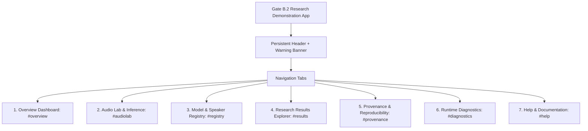

# IMPLEMENTATION PLAN — GATE B.2: FULL-FEATURED RESEARCH DEMONSTRATION APPLICATION

**Project Title:** Low-Resource Personalized Atypical Speech Recognition Using Hybrid Quantum-Classical Deep Learning for Reliable Emergency Communication  
**Phase/Gate:** Gate B.2 — Full-Featured Controlled Research Demonstration Application  
**Authorization Stage:** Approved based on Gate B.1 Acceptance Audit (`ACCEPTED_WITH_RECORDED_LIMITATIONS`)  
**Target Completion Date:** 2026-10-10  

---

## 1. Executive Objectives

The objective of Gate B.2 is to expand the hardened Gate B FastAPI + Whisper + Adapter prototype into a cohesive, full-featured, accessible, locally runnable scientific research demonstration application. The application will allow authorized researchers, clinicians, and auditors to:

1. **Understand Project & Runtime Readiness:** Live health, component readiness, test status, and gate boundaries.
2. **Execute Genuine Audio Inference:** Single audio file upload, browser microphone recording, local audio playback, offline Whisper transcription, 384-D feature extraction (with opt-in vector inspector), and genuine forward classification on 60 verified Continual Classical Adapters.
3. **Inspect Searchable Model & Speaker Registry:** Live catalog of all 67 models (61 materialized, 6 unmaterialized), parameter counts, provenance hashes (with modal detail), speaker coverage, and explicit remediation instructions for unavailable models.
4. **Explore Frozen Historical Research Results:** Interactive explorer presenting the frozen phase chronology, model comparison tables (classical vs fixed-quantum vs trainable-quantum vs hybrid), Phase 8.1 safety curves, Case B quantum verdict, and verified research figures.
5. **Inspect Provenance & Reproducibility:** Dataset manifests, test registry results, cryptographic checksums (28/28 verified), and evaluation limitations.
6. **Monitor Runtime Diagnostics & Ephemeral History:** Live system vitals and in-memory local demonstration session history without persisting raw speech or PII.
7. **Review Clear Research Limitations & Help:** Detailed documentation explaining why high overall accuracy is insufficient for emergency detection, the recall-precision trade-off, and why Gate C (Pilot) and Gate D (Clinical Dispatch) remain strictly blocked.

---

## 2. Non-Negotiable Scientific & Architectural Constraints

- **Historical Preservation:** Zero modification of historical phases, frozen results, split manifests, or checksums.
- **Strict 503 Guardrails:** Unmaterialized Phase 8.1/8.2 candidates (`checkpoints/phase8_1/*.pt`) must return HTTP 503 `MODEL_NOT_READY`. No mock weights or fabricated confidence scores.
- **Threshold Provenance Disclosure (`THRESHOLD_PROVENANCE_UNVERIFIED`):**
  - $\tau = 0.6000$ must be prominently marked as an *uncalibrated demonstration default*.
  - $\text{FER} \le 15.0\%$ must be displayed strictly as an evaluation ceiling, never conflated with the decision threshold.
  - Zero safety compliance claims permitted.
- **Zero Live Integrations:** No live 911 dispatch, external SMS, hospital telemetry, or cloud inference.
- **Ephemeral Audio:** All temporary audio files and in-memory stream buffers are deleted immediately upon processing.

---

## 3. Information Architecture & Navigation

The frontend is structured as a unified, accessible, tabbed Single-Page Application (SPA) served from `src/app/static/index.html`:

### Detailed Functional View Breakdown:

| View Tab | Key Capabilities | Underlying API / Data Source |
| :--- | :--- | :--- |
| **1. Overview Dashboard** | System vitals, component readiness, Gate status tracker (C & D blocked), test suite summary, persistent disclaimer. | `GET /ready`, `GET /health`, `GET /api/v1/provenance/summary` |
| **2. Audio Lab** | File upload (max 10MB, $\le 30$s), microphone recording, local audio playback, Whisper transcription, 384-D embedding summary with opt-in vector modal, 7-class probability chart, top output, latency, abstention feedback. | `POST /api/v1/audio/transcribe`, `POST /api/v1/audio/extract-embedding`, `POST /api/v1/predict/file`, `POST /api/v1/predict` |
| **3. Model & Speaker Registry** | Filterable/searchable table of all 67 models, materialization status, architecture, parameter count, shortened SHA-256 with full-hash copy/modal, explicit remediation notes for 503 models. | `GET /api/v1/models`, `GET /api/v1/speakers`, `GET /model-info` |
| **4. Research Results Explorer** | Chronological phase selector (Phases 3–8.2.1), classical vs quantum comparison table, Phase 8.1 safety curves, Case B verdict explanation, interactive figure gallery loading real PNGs. | `GET /api/v1/research/phases`, `GET /api/v1/research/metrics`, `GET /api/v1/research/operating-points`, `GET /api/v1/research/figures` |
| **5. Provenance & Reproducibility** | Manifest counts (4,852 utterances), cryptographic checksum table (28/28 verified), test status registry (577 passed), protocol references. | `GET /api/v1/provenance/summary` |
| **6. Runtime Diagnostics** | Live component latency, WebSocket test console, ephemeral session history table (timestamp, model, intent, latency, no audio/PII). | Live in-memory / local storage session log |
| **7. Help & Limitations** | Non-technical explanation of false negative vs false alert trade-off, why accuracy is deceptive, operational instructions, safety disclaimers. | Static documentation cards in UI |

---

## 4. Backend Service Extensions

To support the Research Results Explorer, Provenance view, and Figure rendering without hardcoding, add a clean read-only route module:

### File: `src/app/routes/research.py`
Endpoints:
- `GET /api/v1/research/phases`: Returns chronology of Phases 1 to 8.2.1 with verified titles and dates.
- `GET /api/v1/research/metrics`: Parses and serves frozen comparison rows from `results/phase8_1/model_comparison.csv` and `results/phase6_5_6_final_comparison_table.csv`.
- `GET /api/v1/research/operating-points`: Serves the safety operating trade-off points from `results/phase8_1/safety_operating_points.csv`.
- `GET /api/v1/research/figures`: Serves metadata and URLs for verified PNG figures in `reports/project_readiness/figures` and `results/phase8_1/figures`.
- `GET /api/v1/provenance/summary`: Returns dataset manifest summary, test registry results, and checksum verification status.

### File: `src/app/main.py` updates
- Mount `/figures/readiness` to `reports/project_readiness/figures`.
- Mount `/figures/phase8_1` to `results/phase8_1/figures`.
- Include `research_router`.

---

## 5. UI Implementation & Asset Structure

To keep the application highly maintainable, responsive, and easy to run without heavy npm/webpack dependencies, modularize the static frontend:
- `src/app/static/index.html`: Clean HTML5 semantic structure with responsive navigation tabs.
- `src/app/static/style.css`: Comprehensive design tokens (Amrita crimson `#8B1538`, slate dark mode, responsive grid, accessible focus states, alert banners).
- `src/app/static/app.js`: Modular client logic handling tab switching, API requests, Web Audio API recording, probability chart rendering, figure modal viewing, and ephemeral session history.

---

## 6. Testing & Quality Assurance Plan

1. **New Automated Tests (`tests/gate_b2/test_gate_b2_features.py`)**:
   - `test_research_phases_endpoint`: Verifies phases 1 to 8.2.1 returned.
   - `test_research_metrics_endpoint`: Verifies frozen model metrics (Track A, Track B, INT-1) match source CSV.
   - `test_research_operating_points_endpoint`: Verifies safety operating points parsed correctly.
   - `test_research_figures_endpoint`: Verifies figure metadata and static file availability.
   - `test_provenance_summary_endpoint`: Verifies checksums (28/28) and test count ($\ge 577$).
   - `test_static_figure_serving`: Verifies HTTP 200 on mounted research PNG images.
2. **Full Regression Run**:
   - Execute full test suite `pytest -q`.
   - Must achieve $\ge 577 + N$ passing tests, 0 failures, 0 regressions.
3. **Live Runtime Verification**:
   - Run live smoke test against running server on `127.0.0.1:8000`.

---

## 7. Deliverables & Documentation

- `reports/gate_b2/IMPLEMENTATION_PLAN.md` (This document)
- `reports/gate_b2/GATE_B2_APPLICATION_IMPLEMENTATION_REPORT.md`
- `reports/gate_b2/UI_ROUTE_AND_FEATURE_MATRIX.csv`
- `reports/gate_b2/ACCEPTANCE_TEST_RESULTS.md`
- `README.md` (Updated with Gate B.2 startup, testing, and navigation instructions)
- Add dated Gate B.2 Addendum to `reports/project_readiness/PROJECT_READINESS_AND_APPLICATION_ELIGIBILITY_AUDIT.md`.
