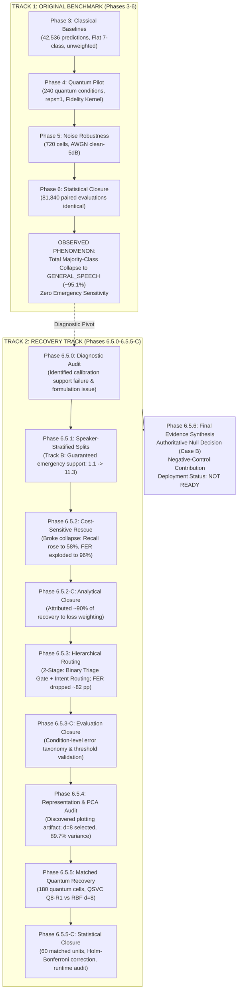

# PHASE 6.5.6 — FINAL EVIDENCE SYNTHESIS REPORT
## Comprehensive Longitudinal Evidence Chain: From Benchmark Failure to Rigorous Closure

**Project:** Low-Resource Personalized Atypical Speech Recognition Using Hybrid Quantum-Classical Deep Learning for Reliable Emergency Communication  
**Team:** kernal  
**Tracking Phase:** Phase 6.5.6 Final Recovery Synthesis  
**Scope:** Complete Artifact Inventory, Evidence Integration & Methodological Synthesis  
**Status:** COMPLETE & FROZEN  

---

## 1. Longitudinal Research Progression & Workflow

---

## 2. Complete Artifact Provenance Inventory

The following table catalogs the authoritative artifacts across all experimental phases:

| Phase | Artifact Path | Artifact Type | Authoritative? | Used in Final Synthesis? | Key Content & Scientific Role |
| :--- | :--- | :---: | :---: | :---: | :--- |
| **Phase 3** | `reports/phase3_complete_results.md` | Report | YES | YES | Baseline classical models (Linear SVM, RBF, Adapter) on 42,536 Track A predictions; documents original majority-class collapse. |
| **Phase 3.5** | `reports/phase3_5_rbf_invariance_audit.md` | Audit Report | YES | YES | Proves mathematical mechanism of RBF majority collapse under severe class imbalance ($\approx 95.10\%$). |
| **Phase 4** | `reports/phase4_complete_results.md` | Report | YES | YES | Results of 240 quantum conditions ($q \in \{2,4,6,8\}$); documents that QSVC replicated RBF majority collapse. |
| **Phase 4.5** | `reports/phase4_5_null_result_statement.md` | Statement | YES | YES | Formal declaration of null quantum result in original benchmark; verified kernel matrix PSD integrity. |
| **Phase 5** | `reports/phase5_results_report.md` | Report | YES | YES | 720 cells across Clean, 15, 10, 5 dB AWGN; confirms noise does not break majority collapse. |
| **Phase 6** | `reports/phase6_complete_results.md` | Report | YES | YES | Statistical closure of Track 1: 48 hypothesis tests confirming RBF and QSVC predictions were identical for 81,840 evaluations. |
| **Phase 6.5.0** | `phase6_5/reports/phase6_5_0_diagnostic_report.md` | Diagnostic | YES | YES | Diagnostic audit establishing calibration support failure: $7/60$ conditions single-class; $N=20$ had only $\approx 1.1$ emergency samples. |
| **Phase 6.5.1** | `phase6_5/reports/phase6_5_1_feasibility_report.md` | Report | YES | YES | Specification of Track B: deterministic speaker-stratified prompt-isolated splits guaranteeing emergency representation. |
| **Phase 6.5.1** | `phase6_5/analysis/original_vs_recovery_feasibility.csv` | Data Table | YES | YES | Condition-level comparison of calibration emergency support ($1.1 \to 11.3$ samples at $N=20$). |
| **Phase 6.5.2** | `phase6_5/classical_rescue/reports/phase6_5_2_classical_rescue_report.md` | Report | YES | YES | Empirical results of cost-sensitive class weighting: broke majority collapse, but false alarm rate exploded to $96.82\%$. |
| **Phase 6.5.2-C**| `phase6_5/classical_rescue/reports/phase6_5_2_closure_report.md` | Closure Report| YES | YES | Factorial attribution confirming class weighting drove $>90\%$ of recall recovery. |
| **Phase 6.5.3** | `phase6_5/hierarchical/reports/phase6_5_3_hierarchical_report.md` | Report | YES | YES | Two-stage hierarchical architecture results: binary emergency triage gate reduced FER from $96.82\%$ to $15.06\%$ at $N=30$. |
| **Phase 6.5.3** | `phase6_5/hierarchical/analysis/flat_vs_hierarchical_matched.csv` | Data Table | YES | YES | Matched paired data establishing large FER reduction ($\Delta = -81.76\text{ pp}$) from hierarchical gating. |
| **Phase 6.5.3-C**| `phase6_5/hierarchical/reports/phase6_5_3_closure_report.md` | Closure Report| YES | YES | Error taxonomy audit establishing Stage-1 triage gate errors dominate overall system failures. |
| **Phase 6.5.4** | `reports/phase6_5_4_representation_pca_audit.md` | Audit Report | YES | YES | Representation space evaluation ($d \in \{2 \dots 384\}$); selects $d=8$ ($89.73\%$ variance) for quantum parity. |
| **Phase 6.5.4** | `reports/phase6_5_4_pca_forensic_reconciliation.md` | Forensic Audit| YES | YES | Traces historical $27.4\%$ PCA variance to a hardcoded plotting script artifact; proves empirical PCA-4 is $80.66\% \pm 4.37\%$. |
| **Phase 6.5.5** | `reports/phase6_5_5_quantum_recovery_report.md` | Report | YES | YES | Execution of 180 quantum conditions ($d=8, q=8$, reps $\in \{1,2\}$); provisional matched comparison vs. RBF and Adapter. |
| **Phase 6.5.5** | `results/phase6_5_5_speaker_results.csv` | Master Results| YES | YES | Primary ground-truth results across all 60 conditions and 7 evaluated models ($420$ condition rows). |
| **Phase 6.5.5-C**| `reports/phase6_5_5_C_statistical_closure.md` | Closure Report| YES | YES | Authoritative Wilcoxon signed-rank tests, Cohen's $d_z$, and Holm-Bonferroni correction across 60 matched units. |
| **Phase 6.5.5-C**| `reports/phase6_5_5_C_runtime_audit.md` | Audit Report | YES | YES | Audited dual-basis computational cost: $772.6\times$ per evaluation vs. $212.8\times$ total wall-clock runtime. |
| **Phase 6.5.6** | `reports/phase6_5_6_final_fair_comparison.md` | Synthesis | YES | YES | Final paper-ready tables and dual-benchmark comparison matrix. |
| **Phase 6.5.6** | `reports/phase6_5_6_metric_reconciliation.md` | Forensic Audit| YES | YES | Full reconciliation of Emergency Precision, PCA variance, and runtime ratios. |

---

## 3. The Two Experimental Worlds

A critical methodological imperative of this research is maintaining the strict boundary between the two independent experimental formulations:

### Track 1: Original Benchmark (Phases 3–6)
- **Calibration Sampling:** Random unstratified sampling from speaker utterances.
- **Classification Architecture:** Single-stage flat 7-class classification (`GENERAL_SPEECH` + 6 emergency intents).
- **Loss Formulation:** Unweighted empirical risk minimization ($C=1.0$).
- **Representation:** Unreduced 384-dimensional Whisper-tiny embeddings for classical models; $d=4$ PCA for quantum models.
- **Observed Behavior:** Total majority-class collapse into `GENERAL_SPEECH`. Both RBF and QSVC failed to predict emergency classes on $>99.8\%$ of test samples. QSVC predictions matched RBF predictions identically across 81,840 paired evaluations.

### Track 2: Recovery Protocol (Phases 6.5.0–6.5.5-C)
- **Calibration Sampling:** Deterministic speaker-stratified prompt-isolated calibration (Track B), guaranteeing proportional emergency representation across $N \in \{20, 30, 40, 50\}$.
- **Classification Architecture:** Two-stage hierarchical routing: Stage 1 performs binary emergency triage gating; Stage 2 performs conditional multi-class intent routing among emergency subtypes.
- **Loss Formulation:** Cost-sensitive inverse-frequency class weighting applied at both stages.
- **Representation:** Audited $d=8$ PCA representation retaining $89.73\% \pm 2.99\%$ variance, establishing representational parity between classical and quantum classifiers.
- **Observed Behavior:** Non-trivial emergency recognition recovered across all models. Under matched conditions, QSVC Q8-R1 and Classical RBF-SVM $d=8$ perform statistically identically (Case B). Classical Adapter achieves superior emergency recall at the cost of high false alarms.

> [!CAUTION]
> **Cross-Track Comparison Rule:**  
> Track 1 and Track 2 represent fundamentally distinct experimental protocols. They MUST NOT be combined into a single paired hypothesis test (e.g. calculating a $p$-value between Phase 3 RBF and Phase 6.5.5 QSVC is methodologically invalid). Cross-track synthesis must remain strictly qualitative and attributional.

---

## 4. Synthesis of Recovery Interventions

### 4.1 Data Recovery (Phase 6.5.1)
The original random calibration protocol produced severe data starvation for emergency classes. At $N=20$, calibration sets contained an average of only $1.13$ emergency samples, with $7$ of $60$ conditions having zero emergency samples. Track B introduced speaker-stratified sampling, which increased emergency support to an average of $11.33$ samples at $N=20$ and increased represented emergency classes from $1.0$ to $5.2$. This resolved the data foundation limitation without modifying the underlying TORGO speech recordings.

### 4.2 Cost-Sensitive Rescue & False-Alarm Dilemma (Phase 6.5.2)
Introducing balanced class weighting proved that the models possessed latent acoustic discriminability for emergency intents. Weighted Adapter recall jumped from $0.0\%$ to $58.42\%$, and Weighted RBF recall increased to $38.10\%$. However, flat cost-sensitive classification caused an extreme false-alarm explosion: False-Emergency Rate (FER) reached $96.82\%$ for RBF at $N=30$. In a safety-critical context, a system that flags nearly every non-emergency utterance as an emergency is operationally unusable.

### 4.3 Hierarchical Triage Architecture (Phase 6.5.3)
To resolve the false-alarm dilemma, Phase 6.5.3 introduced a two-stage hierarchical architecture. Decoupling binary emergency triage from multi-class subtype routing achieved a dramatic reduction in false alarms: for RBF at $N=30$, FER dropped from $96.82\%$ to $15.06\%$ ($\Delta = -81.76\text{ pp}$). However, Stage-1 precision remained low ($\approx 0.8\% - 2.0\%$) due to the severe $95.10\%$ negative class prevalence in atypical speech testing.

### 4.4 Representation Space Audit (Phase 6.5.4)
Auditing the representation space from $d=2$ to $d=384$ revealed two key insights:
1. The historical claim that $d=4$ PCA captured only $27.4\%$ variance was a plotting script artifact. True empirical variance for $d=4$ is $80.66\% \pm 4.37\%$.
2. While $d=4$ is sufficient for binary triage, it creates a compression bottleneck for Stage-2 multi-class routing. Expanding to $d=8$ increased explained variance to $89.73\% \pm 2.99\%$ and substantially boosted Stage-2 accuracy ($27.01\% \to 33.91\%$). This established $d=8$ as the primary candidate for fair quantum comparison.

### 4.5 Quantum Kernel Evaluation & Statistical Closure (Phase 6.5.5 & 6.5.5-C)
Executing 180 quantum conditions with $d=8$, 8 qubits, and ZZFeatureMap established that:
- Quantum kernel matrices are mathematically valid, symmetric, unit-diagonal, and strictly positive semi-definite (minimum eigenvalue $\ge 0.000186$).
- Across 60 matched conditions, QSVC Q8-R1 and Classical RBF-SVM $d=8$ showed no statistically supported differences across any primary metric after Holm-Bonferroni correction (Macro-F1 $p=0.3428$, Recall $p=0.0689$, FER $p=0.9505$, IPER $p=0.0582$).
- The primary decision is definitively frozen as **CASE B: NO STATISTICALLY SUPPORTED DIFFERENCE**.
- The Classical Adapter demonstrated a statistically supported advantage over QSVC in Emergency Recall ($45.81\%$ vs. $27.52\%$, $p = 0.000125$), while QSVC achieved lower false alarms ($28.12\%$ vs. $49.82\%$).
- Simulated QSVC incurred an inference latency penalty of $\approx 772.6\times$ per test evaluation relative to Classical RBF-SVM.

---

## 5. Synthesis Figures

All synthesis figures have been generated and permanently saved into `reports/phase6_5_6/figures/`:

1. **Figure 1 (`fig1_original_vs_recovery_progression.png`):** Progression from Original Benchmark collapse to Recovery Closure.
2. **Figure 2 (`fig2_emergency_support_recovery.png`):** Calibration emergency sample support: Original Track A vs. Recovered Track B.
3. **Figure 3 (`fig3_fer_reduction_flat_vs_hierarchical.png`):** Mitigation of False-Emergency Rate via hierarchical routing.
4. **Figure 4 (`fig4_representation_dimensionality.png`):** PCA dimensionality sweep vs. explained variance and Stage-2 accuracy.
5. **Figure 5 (`fig5_matched_q8_vs_rbf.png`):** Paired scatter plots of QSVC Q8-R1 vs. Classical RBF-SVM $d=8$ across 60 conditions.
6. **Figure 6 (`fig6_emergency_recall_comparison.png`):** Emergency recall distributions: QSVC vs. Classical RBF vs. Classical Adapter.
7. **Figure 7 (`fig7_quantum_computational_cost.png`):** Computational cost audit: per-evaluation latency vs. total wall-clock runtime.
8. **Figure 8 (`fig8_evidence_chain_workflow.png`):** Complete research evidence chain and methodology flowchart.
