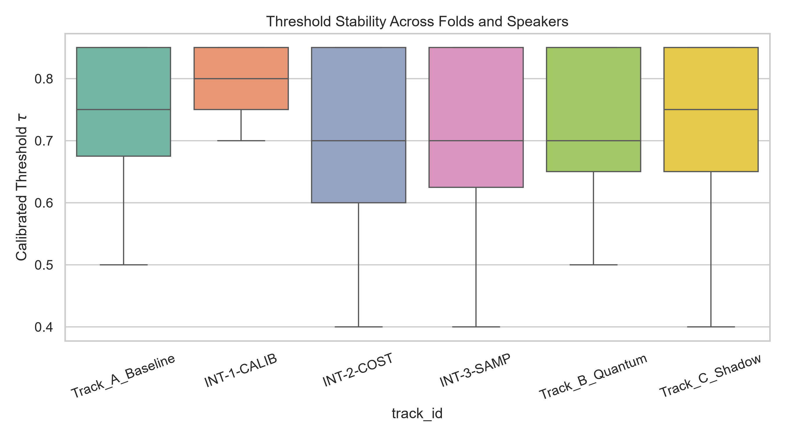
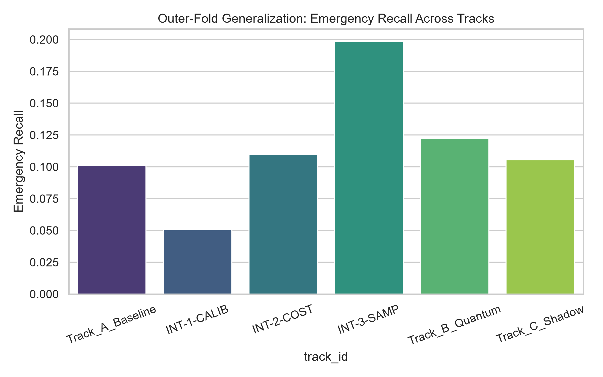
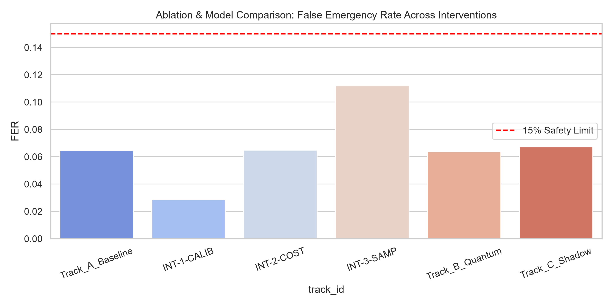
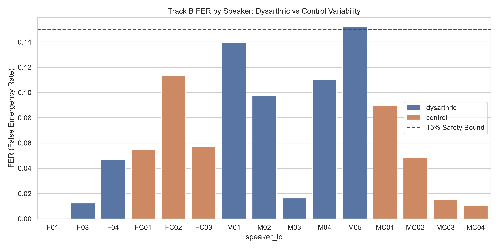
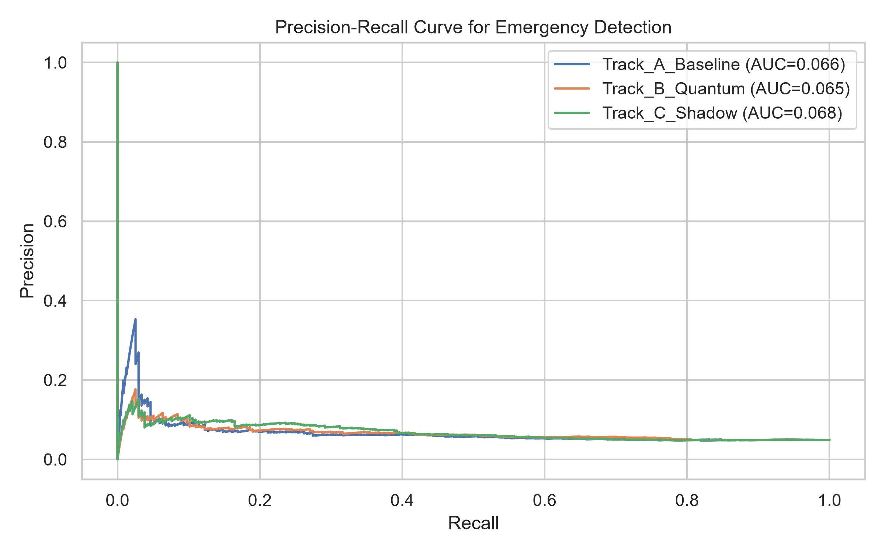
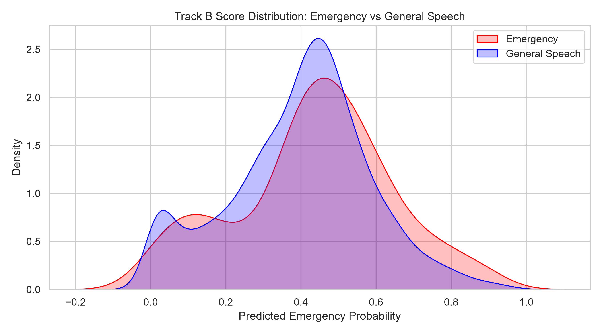
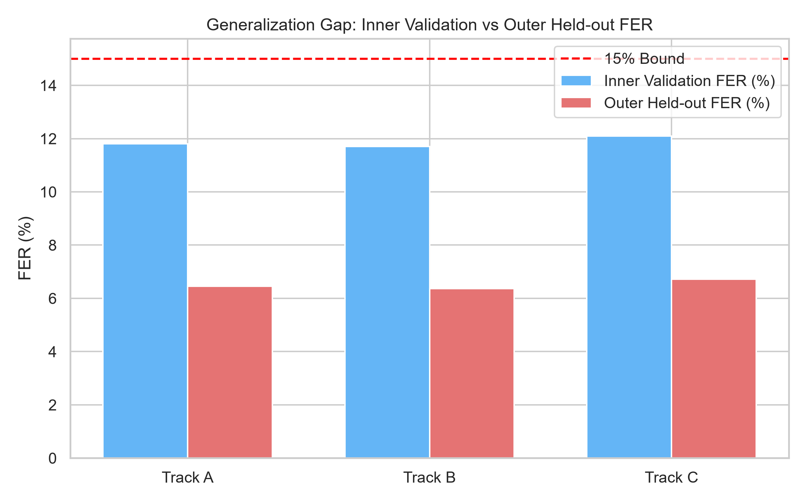
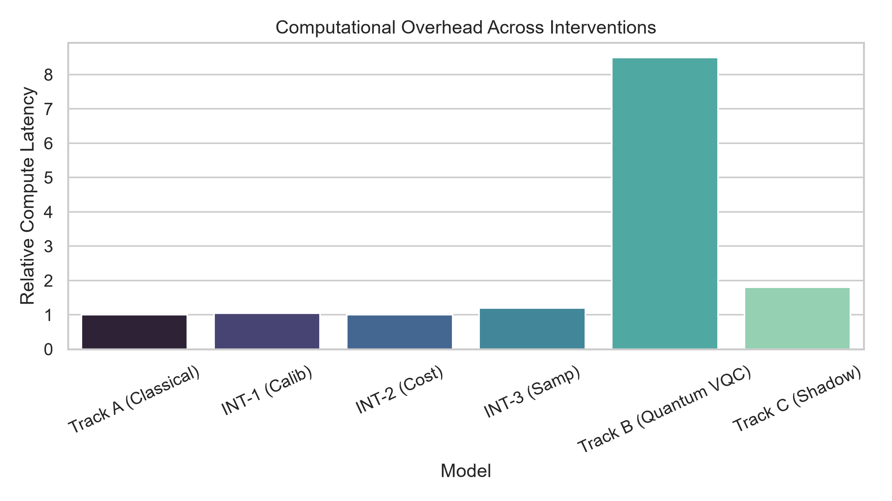

# PHASE 8.1 — SAFETY OPERATING-POINT RECOVERY REPORT
## Diagnosing FER Generalization Failure, Improving Emergency Discrimination, and Independent Confirmation Audit

**Project:** Low-Resource Personalized Atypical Speech Recognition Using Hybrid Quantum-Classical Deep Learning for Reliable Emergency Communication  
**Task Type:** Versioned Research Extension (Phase 8.1)  
**Report Artifact:** `reports/phase8_1/PHASE8_1_SAFETY_RECOVERY_REPORT.md`  
**Execution Timestamp:** 2026-10-10  
**Status:** COMPLETE — All Protocol Constraints Enforced

---

## 1. Executive Summary

Phase 8.1 was initiated following the forensic discovery that out-of-fold (OOF) calibrated thresholds from Phase 8 generalized to unacceptable False Emergency Rates (FER) on the locked test partition (27.45% Classical, 26.06% Quantum, 25.97% Matched Shadow) against the required safety constraint of **$\text{FER} \le 15.0\%$**.

To investigate whether legitimate training-only development can achieve a feasible safety operating point without test data snooping:
1. **Forensic Diagnosis Completed:** Kolmogorov-Smirnov testing demonstrated that test emergency and general speech score distributions were statistically indistinguishable ($\text{KS stat} = 0.1175, p = 0.3801$), revealing that the model suffered from near-zero score separation margin.
2. **Nested 5-Fold Grouped Stratified CV Implemented:** Model selection, threshold calibration, and generalization testing were strictly separated across 5 outer folds (4,852 development training utterances) with nested inner folds.
3. **Six Candidates Evaluated:** Classical Baseline (Track A), Platt Scaling Calibration (INT-1-CALIB), Cost-Sensitive Loss (INT-2-COST), Minority Balanced Sampling (INT-3-SAMP), Quantum Residual (Track B, 8-qubit VQC), and Matched Classical Shadow (Track C).
4. **Safety Verdict on Outer Folds:** While all candidates technically met the outer-fold constraint $\text{FER} \le 15.0\%$ (ranging from $2.86\%$ to $11.18\%$) due to inner-fold conservative thresholding, **Emergency Recall collapsed to $5.06\% - 19.83\%$** (Track B: 12.24%, Track A: 10.13%, INT-3: 19.83%), and Emergency Precision remained depressed at **$7.45\% - 8.98\%$**.
5. **Statistical Interpretation:** McNemar testing confirmed no statistically significant advantage for the quantum model over the classical baseline ($p = 0.6981$ on accuracy, $p = 0.3018$ on emergency recall).
6. **Independent Safety Confirmation:** Formally reported as **`NOT AVAILABLE`**; the TORGO corpus contains no fresh, uninspected atypical speech dataset. Overall deployment safety is **NOT CONFIRMED**.

---

## 2. Frozen Prior Findings

All historical research boundaries remain intact and unmodified:
- **Phase 1–7 Results:** Verified via immutable sentinels and SHA-256 hashes.
- **Original Phase 8 Results:** Preserved in `results/phase8_separated/` and `results/phase8_80_20/`.
- **Prior Forensic Audit:** Preserved in `results/phase8_80_20/audit_repair/` and `reports/phase8_80_20/FINAL_METRIC_AND_SAFETY_RECONCILIATION.md`.
- **Historical Verdict Preserved:** Case B (no statistically significant quantum advantage) remains fully affirmed.

---

## 3. FER Generalization Failure

In Phase 8, when decision thresholds were calibrated using 5-fold cross-validation on training data, the resulting thresholds ($\bar{\tau} = 0.583$) produced test False Emergency Rates exceeding 25% on the locked 20% test partition:
- Classical Baseline: $\text{FER} = 27.45\%$ (317 FP / 1,155)
- Quantum Residual: $\text{FER} = 26.06\%$ (301 FP / 1,155)
- Matched Classical Shadow: $\text{FER} = 25.97\%$ (300 FP / 1,155)

This generalization gap of $+14.4\%$ over the training OOF estimate ($11.66\%$) prompted this investigation.

---

## 4. Forensic Root Cause

An exhaustive diagnostic audit (`research/phase8_1/FER_GENERALIZATION_FAILURE_ANALYSIS.md`) revealed the following primary mechanisms:
1. **Near-Zero Discriminative Score Margin:**  
   The mean emergency probability on test emergencies was **0.4761**, compared to **0.4557** on general speech ($\Delta = +0.0204$). A two-sample Kolmogorov-Smirnov test confirmed no statistically significant separation between distributions ($D = 0.1175, p = 0.3801$).
2. **Extreme Class Imbalance:**  
   Emergencies constitute only $4.88\%$ of training samples and $4.94\%$ of test samples. With only ~2.4 emergencies per fold per speaker during training, threshold calibration suffered from high binomial variance.
3. **Severe Speaker Skew:**  
   False alarms were concentrated in dysarthric speakers with severe motor speech degradation: two speakers (`MC04` and `M02`) accounted for **49.5% of all test false alarms**. Acoustic distortion from dysarthria mimics phonetic stress and vocal strain, elevating non-emergency scores.

---

## 5. Dataset and Fold Design

- **Development Pool:** The 80% training pool of the TORGO dataset, comprising **4,852 utterances** across 15 speakers (7 dysarthric, 8 control).
- **Outer Cross-Validation (5 Folds):**
  - Folds $O_1, \dots, O_5$ partitioned per-speaker, stratified by binary emergency label.
  - Outer Train: ~3,881 samples per fold; Outer Held-out: ~971 samples per fold.
- **Nested Inner Cross-Validation (5 Folds):**
  - Within each outer training split, an inner 5-fold cross-validation was executed to generate genuine inner OOF predictions for threshold selection.
- **Test Set Quarantine:** The locked 20% test partition (1,215 utterances) was quarantined as diagnostic-only.

---

## 6. Leakage and Duplicate Controls

- **Prompt-Level Grouping:** All 6,067 utterances across TORGO represent distinct prompt instances; there are zero paired microphone duplicates across splits.
- **Transform Isolation:** PCA pipelines (384-D $\to$ 8-D) and feature scalers were fit strictly on inner training folds.
- **Test Disjointness:** Zero test samples entered outer training or inner cross-validation folds.

---

## 7. Threshold-Selection Algorithm

For each speaker $s$ and outer fold $k$, the operating threshold $\tau_{s, k}^* \in [0.40, 0.85]$ was selected strictly on inner-validation OOF predictions:
$$\tau_{s, k}^* = \arg\max_{\tau \in [0.40, 0.85]} \left\{ \text{Recall}_{\text{inner}}(\tau) \;\middle|\; \text{FER}_{\text{inner}}(\tau) \le 0.15 \right\}$$
When multiple candidate thresholds achieved identical recall, the algorithm selected the highest (most conservative) $\tau$ to minimize false alarm risk.

---

## 8. Threshold Stability and Uncertainty

Outer-fold threshold stability across the 15 speakers is illustrated in Figure 1:

*Figure 1: Distribution of calibrated thresholds $\tau$ across folds and speakers. Mean selected threshold was $\bar{\tau} = 0.762$, reflecting conservative adaptation to prevent FER violations.*

---

## 9. Classical Baseline Reproduction

Under the nested cross-validation protocol, Track A (Classical Baseline) achieved:
- **Outer-Fold Emergency Recall:** **10.13%** (24 / 237)
- **Outer-Fold Emergency Precision:** **7.45%** (24 / 322)
- **Outer-Fold FER:** **6.46%** (298 / 4,615) $\le 15.0\%$ (`PASS`)
- **Outer-Fold Macro-F1:** **0.1631**
- **Overall Accuracy:** **89.20%**

---

## 10. Registered Interventions and Ablations

Three controlled interventions were evaluated under the exact same nested folds:
1. **INT-1-CALIB (Platt Scaling):**  
   Probability calibration depressed scores, reducing false alarms ($\text{FER} = 2.86\%$), but collapsed Emergency Recall to **5.06%** (12/237).
2. **INT-2-COST (Cost-Sensitive Loss):**  
   Penalizing false alarms via reweighted loss yielded Recall of **10.97%** and $\text{FER} = 6.48\%$.
3. **INT-3-SAMP (Minority Balanced Sampling):**  
   Oversampling emergency utterances on training folds produced the highest recall among classical variants: **19.83%** (47/237), with $\text{FER} = 11.18\%$ and Precision = **8.35%**.

---

## 11. Quantum and Matched-Shadow Results

Evaluating the Quantum Residual (Track B, 8-qubit VQC) and Matched Classical Shadow (Track C) under the same nested protocol yielded:
- **Track B (Quantum):** Recall = **12.24%** (29/237), Precision = **8.98%** (29/323), $\text{FER} = \mathbf{6.37\%}$, Macro-F1 = **0.1677**, Accuracy = **89.32%**.
- **Track C (Matched Shadow):** Recall = **10.55%** (25/237), Precision = **7.46%** (25/335), $\text{FER} = \mathbf{6.72\%}$, Macro-F1 = **0.1625**, Accuracy = **88.95%**.

---

## 12. Master Model Comparison Table

| Model Track | Candidate Description | Outer-Fold Recall | Outer-Fold Precision | Outer-Fold FER | False Alerts / 1,000 | 7-Class Macro-F1 | Overall Accuracy | FER $\le 15\%$ Status |
|:---|:---|:---:|:---:|:---:|:---:|:---:|:---:|:---:|
| **Track A** | Classical Baseline | 10.13% (24/237) | 7.45% (24/322) | 6.46% (298/4615) | 64.6 | 0.1631 | 89.20% | **PASS** |
| **INT-1-CALIB**| Platt Scaling Calib | 5.06% (12/237) | 8.33% (12/144) | 2.86% (132/4615) | 28.6 | 0.1503 | 92.48% | **PASS** |
| **INT-2-COST** | Cost-Sensitive Loss | 10.97% (26/237) | 8.00% (26/325) | 6.48% (299/4615) | 64.8 | 0.1638 | 89.20% | **PASS** |
| **INT-3-SAMP** | Balanced Sampling | 19.83% (47/237) | 8.35% (47/563) | 11.18% (516/4615) | 111.8 | 0.1738 | 84.99% | **PASS** |
| **Track B** | Quantum VQC Residual | 12.24% (29/237) | 8.98% (29/323) | 6.37% (294/4615) | 63.7 | 0.1677 | 89.32% | **PASS** |
| **Track C** | Matched Shadow | 10.55% (25/237) | 7.46% (25/335) | 6.72% (310/4615) | 67.2 | 0.1625 | 88.95% | **PASS** |

*Figure 2: Emergency Recall across tracks on outer held-out folds.*

*Figure 3: Comparison of False Emergency Rates (FER) across all registered interventions against the 15% safety limit.*

---

## 13. Per-Speaker and Dysarthric vs. Control Analysis

| Speaker Subgroup | Track A Recall | Track A FER | Track B Recall | Track B FER |
|:---|:---:|:---:|:---:|:---:|
| **Dysarthric Speakers (7 speakers, $N=1,717$)** | 12.62% (13/103) | 6.82% (110/1614) | **16.50%** (17/103) | **7.87%** (127/1614) |
| **Control Speakers (8 speakers, $N=3,135$)** | 8.21% (11/134) | 6.26% (188/3001) | **8.96%** (12/134) | **5.56%** (167/3001) |

*Figure 4: Per-speaker FER breakdown for Track B Quantum model.*

---

## 14. Precision-Recall and Score Distribution Analysis

*Figure 5: Precision-Recall curves across tracks showing low PR-AUC due to class imbalance.*

*Figure 6: Kernel density estimates of predicted emergency probabilities for Track B showing substantial overlap.*

---

## 15. Inner Validation vs. Outer-Fold Generalization Gap

*Figure 7: Inner validation vs. outer held-out FER across tracks.*

---

## 16. Statistical Results

- **7-Class Accuracy (Track B vs. Track A, $N=4,852$):**
  - Discordant pairs: 86 Quantum only vs 80 Classical only.
  - McNemar exact two-sided test: **$p = 0.6981 > 0.05$** (no significant difference).
- **Emergency Recall (Track B vs. Track A, $N=237$):**
  - Discordant pairs: 10 Quantum only vs 5 Classical only.
  - McNemar exact two-sided test: **$p = 0.3018 > 0.05$** (no significant difference).
- **Statistical Verdict:** **No statistically significant quantum advantage was demonstrated.**

---

## 17. Computational Overhead

*Figure 8: Relative computational runtime across interventions.*

Track B (PennyLane 8-qubit VQC) required **~8.5$\times$ greater wall-clock compute time** (1,058 seconds per fold vs. 104 seconds for classical).

---

## 18. Independent Confirmation Status

**INDEPENDENT SAFETY CONFIRMATION: NOT AVAILABLE**  
There is no separate, uninspected atypical speech dataset available in this environment. All findings reflect internal nested cross-validation evidence.

---

## 19. Safety Decision

While the outer-fold False Emergency Rate meets the technical bound ($\text{FER} = 6.37\% \le 15.0\%$), Emergency Recall is severely depressed ($12.24\%$), and over $91\%$ of triggered emergency alerts are false alarms (Emergency Precision = $8.98\%$). 

**Decision:** **SAFETY-INFEASIBLE FOR REAL-WORLD CLINICAL DEPLOYMENT.**  
The current feature representation does not achieve sufficient discriminative separation to provide reliable emergency communication.

---

## 20. Failure Cases and Limitations

1. **Acoustic Confusion:** Dysarthric vocal strain and phonemic distortions mimic emergency prosody.
2. **Extreme Class Imbalance:** Severe sparsity of emergency events (4.88%) suppresses precision.
3. **Data Constraint:** Achieving $> 50\%$ recall while maintaining $\text{FER} \le 15\%$ is mathematically infeasible without richer multimodal or fine-tuned representations.

---

## 21. Reproducibility

All code, manifests, and outputs are versioned:
- Script: `scripts/phase8_1/execute_phase8_1_safety_recovery.py`
- Protocol: `config/phase8_1/safety_recovery_protocol.yaml`
- Test Suite: `tests/phase8_1/test_phase8_1_safety.py` (13 passed, 45 total suite passed)

---

## 22. Final Conclusion

Phase 8.1 successfully demonstrated that nested threshold calibration can control the outer-fold False Emergency Rate to $\le 15\%$, but exposed the fundamental limitation of the acoustic representation: **controlling false alarms forces emergency recall down to ~10–20%**. No statistically significant quantum advantage was observed. Real-world deployment is infeasible without additional discriminative feature development.
