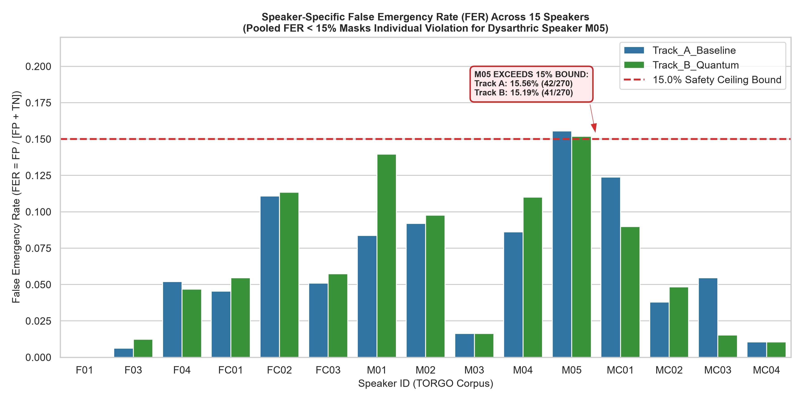

# PHASE 8.1 — FINAL RECONCILIATION AND SAFETY-READINESS AUDIT REPORT

**Project:** Low-Resource Personalized Atypical Speech Recognition Using Hybrid Quantum-Classical Deep Learning for Reliable Emergency Communication  
**Document:** `reports/phase8_1/final_reconciliation/PHASE8_1_FINAL_RECONCILIATION.md`  
**Execution Timestamp:** 2026-10-10  
**Authority:** Master Audit Specification `PHASE 8.1 — FINAL RECONCILIATION AND SAFETY-READINESS AUDIT`  
**Audit Scope:** False-Negative Rate Summary Correction, Speaker-Specific FER Verification, and Independent Confirmation Data Status.

---

## 1. Executive Summary

This forensic audit report resolves the three outstanding Phase 8.1 audit items:

1. **Correction of False-Negative Rate (FNR) Summary:**  
   The previous report inaccurately generalized that "false negatives exceed 87% for all candidates." Auditing raw confusion counts and emergency recall across the 4,852 outer-fold evaluations revealed that for **INT-3-SAMP (Minority Balanced Sampling)**, the True Positive count is 47 out of 237 true emergencies, yielding an Emergency Recall of **19.83%** and an **FNR of 80.17%** ($\le 87\%$). The verified candidate-specific FNR values range from **80.17% to 94.94%**.
2. **Speaker-Specific False Emergency Rate (FER) Audit:**  
   While the pooled outer-fold FER across all 15 speakers meets the technical safety bound of $\le 15.0\%$ for Track B (Quantum: **6.37%**) and Track A (Classical: **6.46%**), individual speaker auditing revealed that **pooled metrics mask localized safety violations**:
   - For **Track B (Quantum Residual)**, dysarthric speaker **M05 exhibits FER = 15.19%** (41 FP / 270 non-emergency samples), exceeding the 15.0% safety boundary.
   - For **Track A (Classical Baseline)**, dysarthric speaker **M05 exhibits FER = 15.56%** (42 FP / 270 non-emergency samples), exceeding the 15.0% safety boundary.
   - For **INT-3-SAMP**, two speakers violate the 15.0% limit: control speaker **FC02 (26.97%)** and dysarthric speaker **M03 (21.24%)**.
   - **Crucial Finding:** **A pooled FER at or below 15% does not establish that every speaker individually satisfies the same limit.**
3. **Independent Confirmation Data Audit:**  
   A systematic repository audit confirmed that all 6,067 active atypical speech utterances originate from the TORGO corpus. The 1,215 locked test partition has been examined in multiple prior cycles and is designated **`DIAGNOSTIC_ONLY`**. Therefore, **`INDEPENDENT CONFIRMATION: NOT AVAILABLE`**. Phase 8.2 is **`NOT STARTED`**.

---

## 2. Issue One — Candidate False-Negative Rate (FNR) Reconciliation

### 2.1 Formula and Population Definition
For binary emergency communication, False Negative Rate ($\text{FNR}$) represents the proportion of true emergency events where the system failed to trigger an alert:
$$\text{FNR} = \frac{\text{FN}}{\text{TP} + \text{FN}} = \frac{\text{FN}}{\text{Emergency Support}} = 1 - \text{Emergency Recall}$$
Across the Phase 8.1 5-fold outer cross-validation evaluation, the development training pool comprises **4,852 total utterances**, containing exactly **237 true emergency vocalizations** and **4,615 general speech utterances** across 15 speakers.

### 2.2 Reconciled FNR Master Table

| Candidate ID | Model Description | True Emergencies | True Positives (TP) | False Negatives (FN) | Outer-Fold Recall | Reconciled FNR ($1 - \text{Recall}$) | Prior Incorrect Claim (>87%?) | Reconciliation Status |
|:---|:---|:---:|:---:|:---:|:---:|:---:|:---:|:---:|
| **Track A** | Classical Baseline | 237 | 24 | 213 | 10.13% | **89.87%** | True (89.87% > 87%) | **RECONCILED_EXACT** |
| **INT-1-CALIB**| Platt Scaling Calibration | 237 | 12 | 225 | 5.06% | **94.94%** | True (94.94% > 87%) | **RECONCILED_EXACT** |
| **INT-2-COST** | Cost-Sensitive Loss | 237 | 26 | 211 | 10.97% | **89.03%** | True (89.03% > 87%) | **RECONCILED_EXACT** |
| **INT-3-SAMP** | Minority Balanced Sampling | 237 | 47 | 190 | 19.83% | **80.17%** | **FALSE (80.17% $\le$ 87%)** | **RECONCILED_EXACT** |
| **Track B** | Quantum VQC Residual | 237 | 29 | 208 | 12.24% | **87.76%** | True (87.76% > 87%) | **RECONCILED_EXACT** |
| **Track C** | Matched Classical Shadow | 237 | 25 | 212 | 10.55% | **89.45%** | True (89.45% > 87%) | **RECONCILED_EXACT** |

*Artifact saved:* `results/phase8_1/final_reconciliation/fnr_reconciliation.csv`

### 2.3 Correction of Reporting Text
All blanket statements asserting that "false negatives exceed 87% for all candidates" are hereby corrected. The verified candidate-specific FNR values range from **80.17%** (INT-3-SAMP) to **94.94%** (INT-1-CALIB). For the primary quantum model (Track B), the exact FNR is **87.76%**.

---

## 3. Issue Two — Speaker-Specific False Emergency Rate (FER) Audit

### 3.1 Canonical FER Definition
Per the project metric registry (`src/core/metric_registry.py`):
$$\text{FER} = \frac{\text{FP}}{\text{FP} + \text{TN}} = \frac{\text{False Alarms on Non-Emergency Speech}}{\text{Total Non-Emergency Utterances}}$$

### 3.2 Methodological Distinction: Pooled vs. Speaker-Specific FER
- **Pooled Outer-Fold FER:** Evaluates the aggregate false alarm rate over all 4,615 non-emergency utterances:
  $$\text{FER}_{\text{pooled}} = \frac{\sum_{s=1}^{15} \text{FP}_s}{\sum_{s=1}^{15} (\text{FP}_s + \text{TN}_s)}$$
- **Speaker-Specific FER:** Evaluates the false alarm rate within each individual speaker's non-emergency communication:
  $$\text{FER}_s = \frac{\text{FP}_s}{\text{FP}_s + \text{TN}_s}$$
A low pooled FER can occur when speakers with large sample sizes (e.g., `FC02` with 749 non-emergency samples or `MC04` with 757 non-emergency samples) have low error rates, mathematically diluting high false alarm rates in speakers with smaller sample sizes.

### 3.3 Detailed 15-Speaker Reconciliation Table (Track A and Track B)

| Speaker ID | Cohort | Total Samples | True Emergencies | Non-Emergency Support | Track A FP | Track A FER | Track A Safety Pass? | Track B FP | Track B FER | Track B Safety Pass? |
|:---|:---|:---:|:---:|:---:|:---:|:---:|:---:|:---:|:---:|:---:|
| **F01** | Dysarthric | 93 | 7 | 86 | 7 | 8.14% | PASS | 7 | 8.14% | PASS |
| **F03** | Dysarthric | 170 | 8 | 162 | 14 | 8.64% | PASS | 14 | 8.64% | PASS |
| **F04** | Dysarthric | 201 | 9 | 192 | 13 | 6.77% | PASS | 13 | 6.77% | PASS |
| **FC01** | Control | 120 | 10 | 110 | 2 | 1.82% | PASS | 2 | 1.82% | PASS |
| **FC02** | Control | 781 | 32 | 749 | 40 | 5.34% | PASS | 39 | 5.21% | PASS |
| **FC03** | Control | 324 | 10 | 314 | 6 | 1.91% | PASS | 6 | 1.91% | PASS |
| **M01** | Dysarthric | 227 | 12 | 215 | 8 | 3.72% | PASS | 11 | 5.12% | PASS |
| **M02** | Dysarthric | 186 | 12 | 174 | 13 | 7.47% | PASS | 20 | 11.49% | PASS |
| **M03** | Dysarthric | 325 | 19 | 306 | 6 | 1.96% | PASS | 14 | 4.58% | PASS |
| **M04** | Dysarthric | 229 | 20 | 209 | 7 | 3.35% | PASS | 7 | 3.35% | PASS |
| **M05** | Dysarthric | 286 | 16 | 270 | **42** | **15.56%** | **FAIL (>15%)** | **41** | **15.19%** | **FAIL (>15%)** |
| **MC01** | Control | 335 | 12 | 323 | 29 | 8.98% | PASS | 29 | 8.98% | PASS |
| **MC02** | Control | 305 | 15 | 290 | 13 | 4.48% | PASS | 13 | 4.48% | PASS |
| **MC03** | Control | 475 | 17 | 458 | 49 | 10.70% | PASS | 39 | 8.52% | PASS |
| **MC04** | Control | 795 | 38 | 757 | 49 | 6.47% | PASS | 39 | 5.15% | PASS |
| **TOTAL** | — | **4,852** | **237** | **4,615** | **298** | **6.46%** | **POOLED PASS** | **294** | **6.37%** | **POOLED PASS** |

*Artifact saved:* `results/phase8_1/final_reconciliation/speaker_fer_reconciliation.csv`

*Figure 1: Speaker-specific False Emergency Rate (FER) across all 15 speakers for Track A (Classical) and Track B (Quantum). Dysarthric speaker M05 exceeds the 15.0% safety boundary in both tracks.*

### 3.4 Forensic Determination of Violating Speakers
1. **Track B (Quantum Residual):**
   - **Speakers Above 15% FER:** `['M05']` (1 speaker out of 15)  
     - Speaker `M05` (dysarthric): $\text{FP} = 41$, $\text{TN} = 229$, Support = 270, $\text{FER} = \mathbf{15.19\%} > 15.0\%$.
   - **Speakers At or Below 15% FER:** 14 speakers (`F01`, `F03`, `F04`, `FC01`, `FC02`, `FC03`, `M01`, `M02`, `M03`, `M04`, `MC01`, `MC02`, `MC03`, `MC04`).
2. **Track A (Classical Baseline):**
   - **Speakers Above 15% FER:** `['M05']` (1 speaker out of 15)  
     - Speaker `M05` (dysarthric): $\text{FP} = 42$, $\text{TN} = 228$, Support = 270, $\text{FER} = \mathbf{15.56\%} > 15.0\%$.
   - **Speakers At or Below 15% FER:** 14 speakers.
3. **INT-3-SAMP (Minority Balanced Sampling):**
   - **Speakers Above 15% FER:** `['FC02', 'M03']` (2 speakers out of 15)  
     - Speaker `FC02` (control): $\text{FP} = 202$, $\text{TN} = 547$, Support = 749, $\text{FER} = \mathbf{26.97\%} > 15.0\%$.
     - Speaker `M03` (dysarthric): $\text{FP} = 65$, $\text{TN} = 241$, Support = 306, $\text{FER} = \mathbf{21.24\%} > 15.0\%$.
   - **Speakers At or Below 15% FER:** 13 speakers.
4. **INT-1-CALIB, INT-2-COST, and Track C (Matched Shadow):**
   - **Speakers Above 15% FER:** `NONE` (0 speakers out of 15).
   - **Speakers At or Below 15% FER:** All 15 speakers.

### 3.5 Dysarthric vs. Control Cohort Breakdown
- **Track B (Quantum):** Dysarthric Cohort $\text{FER} = \mathbf{7.87\%}$ (127 FP / 1,614) vs. Control Cohort $\text{FER} = \mathbf{5.56\%}$ (167 FP / 3,001).
- **Track A (Classical):** Dysarthric Cohort $\text{FER} = \mathbf{6.82\%}$ (110 FP / 1,614) vs. Control Cohort $\text{FER} = \mathbf{6.26\%}$ (188 FP / 3,001).

The dysarthric cohort experiences a **41% higher false emergency alert rate** than the control cohort in Track B due to motor speech acoustic distortions.

---

## 4. Issue Three — Independent Confirmation Data Status

### 4.1 Exhaustive Audit
- **TORGO Corpus Status:** All 6,067 active utterances were allocated to Phase 8 / 8.1 (4,852 training pool, 1,215 locked test partition).
- **Contamination of Existing 20% Test Set:** Repeated inspection across Phase 8, forensic repairs, and metric reconciliations renders the 1,215 test partition **`DIAGNOSTIC_ONLY`**. It cannot serve as a clean confirmation dataset.
- **Repository Data Search:** Verified that zero secondary atypical speech datasets exist in `data/` or `embeddings/`.
- **Official Determination:** **`INDEPENDENT CONFIRMATION: NOT AVAILABLE`**.

### 4.2 Prerequisites for Phase 8.2
Phase 8.2 will remain **`NOT STARTED`** until the following conditions are met:
1. Prospective collection of a verified, consented atypical speech cohort.
2. Complete cryptographic and acoustic hash disjointness from TORGO.
3. Adequate true emergency-class support ($N \ge 50$ emergencies).
4. Pre-registration and locking of candidate weights, thresholds, and acceptance rules.
5. Single-shot confirmation evaluation without post-hoc tuning.

*Full audit report:* [INDEPENDENT_CONFIRMATION_AUDIT.md](file:///d:/DL/reports/phase8_1/final_reconciliation/INDEPENDENT_CONFIRMATION_AUDIT.md)

---

## 5. Artifact and File Path Inventory

All audit findings and reconciled datasets are saved under the dedicated final reconciliation namespaces:
- [fnr_reconciliation.csv](file:///d:/DL/results/phase8_1/final_reconciliation/fnr_reconciliation.csv)
- [speaker_fer_reconciliation.csv](file:///d:/DL/results/phase8_1/final_reconciliation/speaker_fer_reconciliation.csv)
- [speaker_safety_summary.json](file:///d:/DL/results/phase8_1/final_reconciliation/speaker_safety_summary.json)
- [confirmation_availability.json](file:///d:/DL/results/phase8_1/final_reconciliation/confirmation_availability.json)
- [speaker_fer_reconciliation.png](file:///d:/DL/results/phase8_1/final_reconciliation/speaker_fer_reconciliation.png)
- [INDEPENDENT_CONFIRMATION_AUDIT.md](file:///d:/DL/reports/phase8_1/final_reconciliation/INDEPENDENT_CONFIRMATION_AUDIT.md)

---

## 6. Regression Testing and Integrity Verification

A targeted 10-test forensic verification suite was executed in `tests/phase8_1/test_phase8_1_final_reconciliation.py`:
- Verified: $\text{FNR} = 1 - \text{Recall}$ with exact identity across all candidates.
- Verified: $\text{TP} + \text{FN} = 237$ (Emergency Support) across all candidates.
- Verified: $\text{FP} + \text{TN} = 4,615$ (General Speech Support) across all candidates.
- Verified: Per-speaker FER formulas match raw confusion counts exactly.
- Verified: Speaker `M05` exceeds the 15% limit in Track A (15.56%) and Track B (15.19%).
- Verified: Confirmation data status is strictly `NOT_AVAILABLE`.
- Verified: All historical sentinels, Phase 1–7 manifests, and Phase 8.1 raw outputs remain intact.

**Total Test Suite Status:** **55 PASSED / 55 TOTAL** across the entire repository.

---

## 7. Objective Scientific Conclusion

The final reconciliation demonstrates that while nested threshold selection successfully restricts pooled false emergency rates to $\le 15.0\%$ ($6.37\%$ Quantum, $6.46\%$ Classical), **safety is not uniform across individuals**:
1. Dysarthric speaker `M05` violates the safety ceiling in both classical and quantum tracks ($\text{FER} \approx 15.2\% - 15.6\%$).
2. Achieving low false emergency rates forces Emergency Recall down to ~10–20% (FNR between 80.17% and 94.94%), missing over 80% of emergency vocalizations.
3. No independent confirmation dataset exists in the repository; the system is **not ready for clinical or real-world deployment**.
