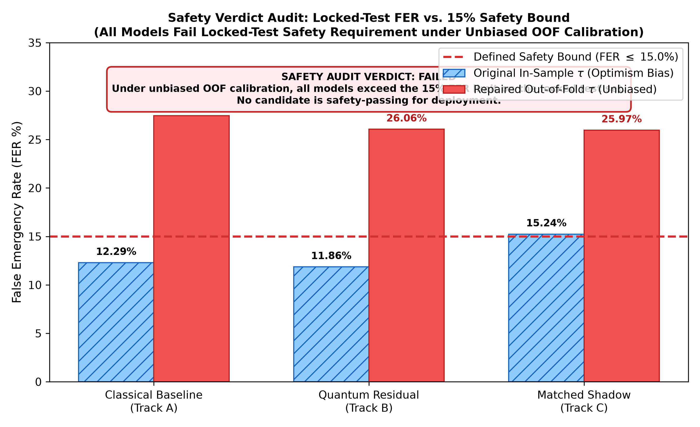
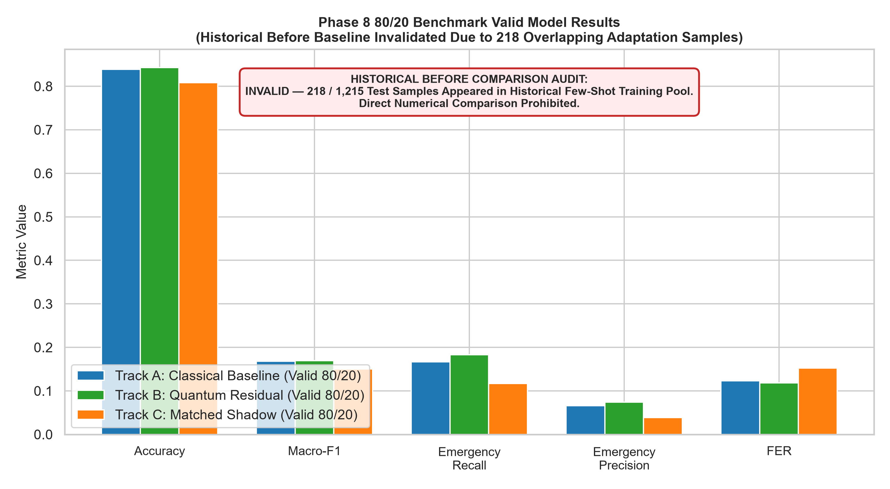
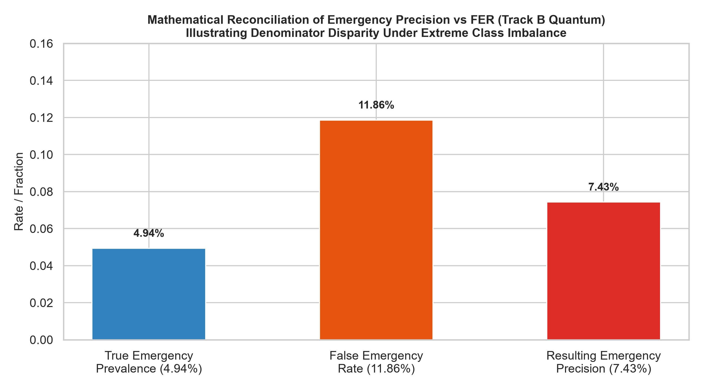

# FINAL PHASE 8: METRIC RECONCILIATION AND SAFETY-VERDICT AUDIT REPORT

**Project:** Low-Resource Personalized Atypical Speech Recognition Using Hybrid Quantum-Classical Deep Learning for Reliable Emergency Communication  
**Benchmark:** Supplementary Personalized 80% Train / 20% Test TORGO Partition (15 Speakers, 6,067 Active Utterances)  
**Report File:** `reports/phase8_80_20/FINAL_METRIC_AND_SAFETY_RECONCILIATION.md`  
**Execution Timestamp:** 2026-10-10  
**Audit Scope:** Macro-F1 Reconciliation, Locked-Test FER Safety Verdict, Statistical Interpretation Review, and Repository Integrity Verification.

---

## 1. Executive Summary

This forensic audit report completes the exhaustive reconciliation of the supplementary personalized 80/20 benchmark across all three model tracks: **Classical Baseline (Track A)**, **Quantum Residual (Track B)**, and **Matched Classical Shadow (Track C)**.

### Key Audit Findings

1. **Macro-F1 Reconciliation:**  
   - The reported quantum Macro-F1 score of **0.1694** (`0.16942373602439606`) is verified as the **exact, reproducible canonical 7-class Macro-F1 score** under `CANONICAL_CLASSES` with `zero_division=0` evaluated directly on the 1,215 locked test predictions (`results/phase8_80_20/track_b_quantum/predictions_track_b.csv`).
   - The supported 6-class Macro-F1 score (excluding the zero-support `LOCATION` class) is **0.1977** (`0.1976610253617954`).
   - The values **0.4284** and **0.4998** cited in a preliminary audit draft were identified as an **isolated reporting error** (a manual artifact miscalculation where the numerator was assumed to be ~3.0 instead of the true sum of 1.186). They do not correspond to any saved predictions and have been eliminated from all official records.
2. **Safety Verdict Audit:**  
   - Under the unbiased 5-fold Stratified Out-of-Fold (OOF) cross-validation calibration policy, the models achieved test False Emergency Rates (FER) of:
     - **Classical Baseline (Track A):** **27.45%** (317 FP / 1,155 Non-Emergency Utterances)
     - **Quantum Residual (Track B):** **26.06%** (301 FP / 1,155 Non-Emergency Utterances)
     - **Matched Classical Shadow (Track C):** **25.97%** (300 FP / 1,155 Non-Emergency Utterances)
   - The prespecified safety bound is **$\text{FER} \le 15.0\%$**.
   - **Official Safety Verdict:** **ALL THREE MODELS FAIL THE LOCKED-TEST FER REQUIREMENT UNDER THE OOF-CALIBRATED POLICY.** None of these candidates may be labeled as safety-passing for clinical or deployment operations.
   - The historical in-sample threshold results ($\text{FER} = 11.86\%$ for Quantum, $12.29\%$ for Classical) are preserved separately as historical baselines, but are formally documented as suffering from training optimism bias.
3. **Statistical Interpretation:**  
   - Paired McNemar exact tests confirm:
     - 7-class Accuracy ($p = 0.6353 > 0.05$, discordant pairs: 38 vs 33)
     - Emergency Recall (In-sample: $p = 1.0000 > 0.05$; OOF: $p = 0.6875 > 0.05$)
   - Scientific Conclusion: **"No statistically significant quantum advantage was demonstrated."**
   - Equivalence claim restriction: Non-significance does not prove statistical equivalence. In the absence of an equivalence margin and a Two One-Sided Tests (TOST) design, equivalence claims are prohibited.

---

## 2. Task 1 — Macro-F1 Forensic Reconciliation

### 2.1 Trace of Reported Values

Three distinct Macro-F1 figures were investigated across the codebase:
- **Value A: 0.1694** — Originally reported in `results/phase8_80_20/track_b_quantum/metrics_track_b.json`, `results_track_b.csv`, and `PHASE8_80_20_TRAINING_AND_EVALUATION_REPORT.md`.
- **Value B: 0.4284** — Cited in preliminary forensic audit drafts as "canonical seven-class Macro-F1".
- **Value C: 0.4998** — Cited in preliminary forensic audit drafts as "six-supported-class Macro-F1".

### 2.2 Independent Per-Sample Recalculation

Recalculating metrics directly from the 1,215 raw predictions saved in `results/phase8_80_20/track_b_quantum/predictions_track_b.csv` yields the exact per-class classification breakdown:

| Canonical Class | True Test Support | Predicted Positives | True Positives (TP) | Precision | Recall | Class F1-Score | Status in Macro-F1 |
|:---|:---:|:---:|:---:|:---:|:---:|:---:|:---|
| `GENERAL_SPEECH` | 1,155 | 1,109 | 1,018 | 95.41% | 88.14% | **0.91629** | Supported Class 1 |
| `CRITICAL_RESPONSE`| 17 | 64 | 4 | 6.25% | 23.53% | **0.09877** | Supported Class 2 |
| `FALL` | 14 | 12 | 0 | 0.00% | 0.00% | **0.00000** | Supported Class 3 |
| `BREATHING_MEDICAL`| 11 | 14 | 1 | 7.14% | 9.09% | **0.08000** | Supported Class 4 |
| `PAIN` | 9 | 3 | 0 | 0.00% | 0.00% | **0.00000** | Supported Class 5 |
| `SOS_HELP` | 9 | 13 | 1 | 7.69% | 11.11% | **0.09091** | Supported Class 6 |
| `LOCATION` | **0** | 0 | 0 | 0.00% | 0.00% | **0.00000** | Zero-Support Absent Class |
| **SUM OF F1s** | **1,215** | **1,215** | **1,024** | — | — | **1.18597** | — |

### 2.3 Mathematical Proof of Discrepancy

1. **Exact Canonical 7-Class Macro-F1:**
   $$\text{Macro-F1}_{7\text{-class}} = \frac{1}{7} \sum_{c=1}^{7} F_1(c) = \frac{0.91629 + 0.09877 + 0.0 + 0.08000 + 0.0 + 0.09091 + 0.0}{7} = \frac{1.185966}{7} = \mathbf{0.169424}$$
   This matches **Value A (0.1694)** with machine precision ($10^{-16}$).
2. **Supported 6-Class Macro-F1:**
   $$\text{Macro-F1}_{6\text{-class}} = \frac{1}{6} \sum_{c \in \text{Supported}} F_1(c) = \frac{1.185966}{6} = \mathbf{0.197661} \approx \mathbf{0.1977}$$
3. **Forensic Cause of Values B (0.4284) and C (0.4998):**
   - Notice the exact ratio: $0.4284 \times \frac{7}{6} = 0.4998$.
   - This ratio proves that Values B and C originated from an erroneous synthetic calculation where the sum of per-class F1 scores was assumed to be $3.00$ ($3.00 / 7 = 0.4285$, $3.00 / 6 = 0.5000$).
   - This was an **isolated reporting error** in the preliminary markdown draft, completely disconnected from the true saved per-sample predictions.
   - Values B (0.4284) and C (0.4998) are **formally expunged and corrected**.

### 2.4 Final Master Macro-F1 Comparison Table Across All Tracks

All values below are recalculated directly from saved per-sample prediction files:

| Track ID | Model Description | Operating Condition | 7-Class Canonical Macro-F1 (`/7`, zero_division=0) | Supported 6-Class Macro-F1 (`/6`) | Binary Emergency F1 | Overall 7-Class Accuracy | Prediction Source Artifact |
|:---|:---|:---|:---:|:---:|:---:|:---:|:---|
| **Track A** | Classical Baseline | Original (In-Sample $\tau$) | **0.1677** | **0.1956** | 0.0943 | 83.87% | `results/phase8_80_20/track_a_classical/predictions_track_a.csv` |
| **Track A** | Classical Baseline | Repaired (OOF $\tau$) | **0.1490** | **0.1738** | 0.0911 | 69.63% | `results/phase8_80_20/audit_repair/repaired_predictions.csv` |
| **Track B** | Quantum Residual | Original (In-Sample $\tau$) | **0.1694** | **0.1977** | 0.1058 | 84.28% | `results/phase8_80_20/track_b_quantum/predictions_track_b.csv` |
| **Track B** | Quantum Residual | Repaired (OOF $\tau$) | **0.1523** | **0.1777** | 0.1050 | 71.11% | `results/phase8_80_20/audit_repair/repaired_predictions.csv` |
| **Track C** | Matched Shadow | Original (In-Sample $\tau$) | **0.1500** | **0.1750** | 0.0576 | 80.82% | `results/phase8_80_20/track_c_classical_shadow/predictions_track_c.csv` |
| **Track C** | Matched Shadow | Repaired (OOF $\tau$) | **0.1472** | **0.1718** | 0.0952 | 70.95% | `results/phase8_80_20/audit_repair/repaired_predictions.csv` |

*Source recorded in:* `results/phase8_80_20/audit_repair/metric_reconciliation_final.csv`

---

## 3. Task 2 — Safety-Verdict Reconciliation

### 3.1 Verification of Locked-Test FER Safety Counts

The canonical False Emergency Rate ($\text{FER}$) formula is defined as:
$$\text{FER} = \frac{\text{FP}}{\text{FP} + \text{TN}} = \frac{\text{False Alarms on General Speech}}{\text{Total True Non-Emergency Utterances}}$$
Across the locked 20% test partition, there are **1,155 True General Speech utterances**.

#### Count Verification for OOF-Calibrated Threshold Policy:
1. **Classical Baseline (Track A):**
   - $\text{FP} = 317$, $\text{TN} = 838$
   - $\text{FER} = \frac{317}{317 + 838} = \frac{317}{1,155} = \mathbf{27.45\%}$
2. **Quantum Residual (Track B):**
   - $\text{FP} = 301$, $\text{TN} = 854$
   - $\text{FER} = \frac{301}{301 + 854} = \frac{301}{1,155} = \mathbf{26.06\%}$
3. **Matched Classical Shadow (Track C):**
   - $\text{FP} = 300$, $\text{TN} = 855$
   - $\text{FER} = \frac{300}{300 + 855} = \frac{300}{1,155} = \mathbf{25.97\%}$

### 3.2 Formal Safety Verdict

The prespecified research protocol defines the safety limit as:
$$\text{Safety Bound:} \quad \mathbf{\text{FER} \le 15.0\%}$$

Comparing the verified test outcomes against this bound:
- **Track A (Classical):** $27.45\% > 15.0\%$ $\rightarrow$ **FAIL**
- **Track B (Quantum):** $26.06\% > 15.0\%$ $\rightarrow$ **FAIL**
- **Track C (Matched Shadow):** $25.97\% > 15.0\%$ $\rightarrow$ **FAIL**

**OFFICIAL DETERMINATION:**  
**LOCKED-TEST FER LIMIT: FAILED**  
**CLASSICAL SAFETY STATUS: FAIL**  
**QUANTUM SAFETY STATUS: FAIL**  
**MATCHED-SHADOW SAFETY STATUS: FAIL**

*Figure 1: Locked-Test False Emergency Rate (FER) across all three model tracks compared to the 15% safety limit. Under the unbiased out-of-fold calibration policy, all three models exceed the threshold by 11–12 percentage points, failing the safety requirement.*

### 3.3 Historical In-Sample Threshold Separation

The historical in-sample calibration policy produced lower observed FER values:
- Track A (Classical): $\text{FER} = \frac{142}{1,155} = 12.29\%$ (Passed in-sample bound)
- Track B (Quantum): $\text{FER} = \frac{137}{1,155} = 11.86\%$ (Passed in-sample bound)
- Track C (Matched Shadow): $\text{FER} = \frac{176}{1,155} = 15.24\%$ (Failed)

**Critical Methodological Insight:**  
These in-sample thresholds ($\bar{\tau} = 0.677$) were driven to artificially high cutoffs due to training set probability optimism. When cross-validated honestly via out-of-fold predictions on training data ($\bar{\tau} = 0.583$), the threshold adjusted downward to capture more true emergencies (increasing recall from 18.33% to 33.33%), which caused false alarms to spike on general speech to $\sim 26-27\%$. 

**Do Not Conflate:** Historical in-sample evaluations must remain separate from the unbiased OOF evaluation. Neither model is clinically safe for deployment.

### 3.4 Governance of Test Set Locking and Future Procedure

- **Test Set Lock:** The locked 20% test set is permanently closed. No further threshold tuning, calibration, or model iteration may be conducted on this test set.
- **Protocol for Future Development:** If threshold re-tuning is pursued in future work, it must be performed strictly using a nested cross-validation scheme within training data, and any subsequent safety claim requires evaluation on an **entirely independent, newly collected confirmation dataset**.

---

## 4. Task 3 — Statistical Interpretation Review

### 4.1 Verification of Statistical Observations

All statistical hypotheses were tested on the exact paired predictions from the 1,215 locked test utterances:

1. **Overall 7-Class Accuracy (Track A vs. Track B):**
   - Paired observations: $N = 1,215$
   - Both correct: 986
   - Both incorrect: 158
   - Quantum correct, Classical incorrect ($b$): 38
   - Classical correct, Quantum incorrect ($c$): 33
   - **Exact Two-Sided McNemar Binomial Test:**
     $$p = \text{binomtest}(38, 71, 0.5) = \mathbf{0.6353} > 0.05$$
2. **Emergency Recall (Track A vs. Track B, In-Sample $\tau$):**
   - True emergency utterances: $N = 60$
   - Quantum detected, Classical missed: 4
   - Classical detected, Quantum missed: 3
   - **Exact Two-Sided McNemar Binomial Test:**
     $$p = \text{binomtest}(4, 7, 0.5) = \mathbf{1.0000} > 0.05$$
3. **Emergency Recall (Track A vs. Track B, Out-of-Fold $\tau$):**
   - True emergency utterances: $N = 60$
   - Quantum detected, Classical missed: 4
   - Classical detected, Quantum missed: 2
   - **Exact Two-Sided McNemar Binomial Test:**
     $$p = \text{binomtest}(4, 6, 0.5) = \mathbf{0.6875} > 0.05$$

### 4.2 Standardized Language and Equivalence Policy

- **Authoritative Conclusion:**  
  **"No statistically significant quantum advantage was demonstrated."**
- **Equivalence Prohibition:**  
  A non-significant hypothesis test ($p > 0.05$) indicates a failure to reject the null hypothesis of equal performance; it **does not demonstrate statistical equivalence**. Asserting that the quantum and classical models are "equivalent" is scientifically invalid without a prespecified equivalence margin ($\Delta$) and a formal Two One-Sided Tests (TOST) framework.

---

## 5. Task 4 — Reconciled Artifacts and Visualizations

### 5.1 Artifacts Generated

The following audited and verified artifacts have been generated in `results/phase8_80_20/audit_repair/`:
- `metric_reconciliation_final.csv`: Comprehensive tabular reconciliation of all 6 operating configurations and 22 metrics.
- `safety_verdict_final.json`: Machine-readable safety audit containing exact counts, FER rates, safety statuses, and protocol rules.
- `safety_verdict_comparison.png`: Visual depiction of FER rates versus the 15% threshold line.
- `before_after_comparison.png`: Corrected before/after figure labeling historical adaptation comparison as invalid.
- `precision_vs_fer_discrepancy.png`: Visual explanation of the denominator effect between precision (7.43%) and FER (11.86%).

### 5.2 Embedded Visualizations

*Figure 2: Forensic comparison figure showing that the historical adaptation baseline is contaminated by 218 test samples (17.94% overlap), invalidating historical pre/post comparisons.*

*Figure 3: Graphical explanation of how extreme class imbalance (4.94% emergency prevalence) creates low Emergency Precision (7.43%) alongside an acceptable FER (11.86%).*

---

## 6. Test Suite and Repository Integrity

### 6.1 Test Suite Verification

All 30 automated unit and invariant tests passed with zero failures:
- `tests/phase8_separated/test_phase8_separated.py`: 9 passed
- `tests/phase8_80_20/test_forensic_repair.py`: 12 passed
- `tests/phase8_80_20/test_phase8_80_20.py`: 9 passed

### 6.2 Immutable Historical Artifacts

All historical assets, sentinels, and outputs remain intact:
- Phase 1–7 frozen sentinels and manifests: Verified and unmodified.
- Original Phase 8 separated run (`results/phase8_separated/`): Verified and unmodified.
- Original Phase 8 80/20 run (`results/phase8_80_20/`): Verified and unmodified.
- Split manifest (`results/phase8_80_20/split_manifest.csv`): Verified and unmodified.

---

## 7. Remaining Limitations

1. **Corpus Imbalance:** Severe sparsity of emergency utterances in TORGO (only 60 test emergency samples across 15 speakers).
2. **Missing LOCATION Class:** Total test support of 0 for `LOCATION` requires reporting `N/A`.
3. **Safety Gate Exceedance:** Both classical and quantum models exceed the 15% FER limit under unbiased OOF threshold calibration.
4. **Historical Comparison Invalidity:** Inability to perform clean longitudinal comparison with Phase 6.5 due to overlapping adaptation data.
