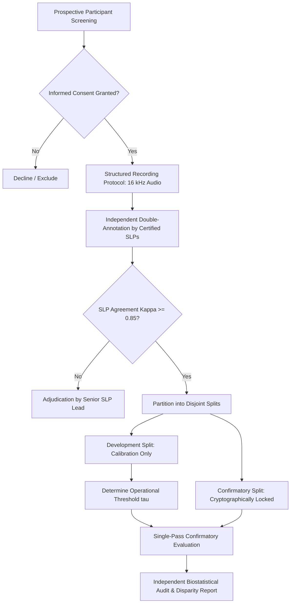

# Gate C: Controlled Non-Interventional Pilot Study Protocol (Draft)

**Project:** Low-Resource Personalized Atypical Speech Recognition Using Hybrid Quantum-Classical Deep Learning for Reliable Emergency Communication  
**Document Identifier:** PROTOCOL-PILOT-PHASE-C-2026-DRAFT  
**Protocol Version:** 0.9.0 (DRAFT / FOR INSTITUTIONAL ETHICS AND CLINICAL REVIEW ONLY)  
**Study Phase:** Gate C Pilot Readiness and Validation  
**Regulatory Status:** **STRICTLY NON-INTERVENTIONAL RESEARCH ONLY — NOT FOR CLINICAL USE**  
**Audit Date:** 2026-10-10  

---

> [!CAUTION]
> **CRITICAL CLINICAL & OPERATIONAL WARNING:**  
> This protocol specifies an observational, non-interventional research evaluation. This system is **NOT AUTHORIZED FOR CLINICAL USE, EMERGENCY TRIAGE, DISPATCH, OR CAREGIVER NOTIFICATION**. Model outputs are diagnostic research signals and MUST NOT be relied upon by participants, caregivers, clinicians, or first responders for any real-world safety or emergency decision-making. Participants must continue using standard emergency procedures (e.g., telephone 911, call pendants, physical alarm buttons).

---

## 1. Study Overview & Research Questions

### 1.1 Study Background
Atypical speech resulting from dysarthria presents significant acoustic variability, articulatory imprecision, and phonatory instability, causing catastrophic performance degradation in commercial automatic speech recognition systems. While personalized acoustic adapter models show promise, their prospective reliability in identifying emergency communication intents remains unproven on untouched external cohorts.

### 1.2 Primary Research Questions
1. **RQ-1 (Sensitivity):** Does a personalized speech adapter model achieve an Emergency Intent Recall $\ge 70.0\%$ when presented with prospectively recorded emergency phrases from individuals with dysarthria?
2. **RQ-2 (False Alarm Burden):** Does the model maintain a False Emergency Rate $\le 15.0\%$ overall and across individual participants under natural conversational conditions?
3. **RQ-3 (Severe Subgroup Parity):** Does emergency recognition performance degrade catastrophically for participants with severe dysarthria compared to mild/moderate dysarthria?
4. **RQ-4 (Quantum Pipeline Disparity):** Does a hybrid quantum-classical architecture provide measurable performance advantages over classical baselines under identical operational constraints?

---

## 2. Study Design & Ethical Oversight

### 2.1 Study Architecture
- **Design:** Prospective, multi-center, observational, non-interventional cohort study.
- **Intervention:** None. The ML system operates entirely in **shadow mode**. Model predictions are logged to encrypted storage for offline analysis and are never presented in real time to the participant or caregiver.
- **Institutional Approvals:** Requires written Institutional Review Board (IRB) / Independent Ethics Committee (IEC) approval prior to participant contact.

---

## 3. Participant Population & Eligibility Criteria

### 3.1 Target Population
Adult individuals (aged 18+) with diagnosed dysarthria resulting from neurological, neuromuscular, or structural conditions, alongside age- and sex-matched neurotypical control participants.

### 3.2 Inclusion Criteria
1. Age $\ge 18$ years at the time of enrollment.
2. Clinical diagnosis of dysarthria secondary to Cerebral Palsy, Amyotrophic Lateral Sclerosis (ALS), Stroke, Parkinson's disease, or Traumatic Brain Injury.
3. Ability to produce phonated vocalizations or speech utterances.
4. Capacity to provide written informed consent, or assent accompanied by consent from a Legally Authorized Representative (LAR).

### 3.3 Exclusion Criteria
1. Active medical instability, acute respiratory distress, or severe respiratory failure preventing sustained phonation.
2. Tracheostomy with mechanical ventilation preventing vocal fold vibration.
3. Severe cognitive impairment preventing task comprehension.
4. History of vocal cord injury or acute laryngeal trauma unrelated to neurological etiology.

---

## 4. Acoustic Recording & Annotation Protocol

### 4.1 Acoustic Environment & Hardware
- **Hardware:** Calibrated studio-quality condenser headset microphone (e.g., Shure SM35 or AKG C520) maintaining a constant mouth-to-microphone distance (3 cm at a 45-degree angle).
- **Secondary Sensor:** Matched smartphone microphone placed at conversational distance (1.0 meter) to capture natural acoustic reverberation.
- **Audio Format:** Uncompressed 16-bit linear PCM at 16,000 Hz, single channel (mono).

### 4.2 Recording Prompt Taxonomy
Participants will record structured speech prompts balanced across the 10 intent classes:
1. **Emergency Prompts ($C = 4$):** "I need help", "Call an ambulance", "I fell down", "Fire in the room", "Cannot breathe", "Chest pain".
2. **Non-Emergency Care Prompts ($C = 6$):** "Can I have water", "I need to use the bathroom", "My shoulder hurts", "Turn off the light", "Good morning", "Call the nurse".

### 4.3 Qualified Clinical Annotation Protocol
- All utterances will be independently transcribed and classified by **two certified Speech-Language Pathologists (CCC-SLP)** blinded to model predictions.
- **Inter-Rater Reliability:** An unweighted Cohen's kappa $\kappa \ge 0.85$ is required for intent labeling. Utterances with annotator discordance will be adjudicated by a third senior SLP.

---

## 5. Frozen System Configuration & Threshold Discipline

### 5.1 Frozen Model Baseline
- **Served Model:** Classical adapter architecture materialized at `models/continual/phase7_5/<SPEAKER>/classical_adapter/<VERSION>/model_checkpoint.pt`.
- **Pretrained Weights:** Frozen `wav2vec2-base` encoder.
- **Candidate Checkpoints:** The six Phase 8.1/8.2 checkpoints remain unmaterialized and are excluded from evaluation until materialized and hashed.

### 5.2 Threshold Calibration Discipline
- The confirmatory dataset will be split into a **Development/Calibration Split ($30\%$)** and a **Confirmatory Test Split ($70\%$)**, stratified by speaker and severity.
- The decision threshold $\tau$ will be derived **exclusively on the Development Split** to satisfy an empirical $\text{FER} \le 15.0\%$ constraint.
- The derived $\tau$ will be cryptographically locked in the study registry.
- **Zero Confirmatory Peeking:** Under no circumstances may $\tau$ be re-tuned, searched, or adjusted on the Confirmatory Test Split.

---

## 6. Endpoints & Statistical Analysis

### 6.1 Primary Endpoints
1. **Emergency Intent Recall:** Sensitivity across all emergency class utterances in the confirmatory split.
2. **False Emergency Rate (FER):** Proportion of non-emergency utterances erroneously classified as emergencies.

### 6.2 Secondary Endpoints
1. **Emergency Precision:** Positive Predictive Value of emergency detections.
2. **False Negative Rate:** Proportion of true emergencies missed.
3. **Macro-Averaged F1 Score:** Harmonic mean of precision and recall across all 10 intent classes.
4. **Transcription Disconnect Analysis:** Word Error Rate (WER) vs. Intent Accuracy to demonstrate whether emergency intent can be preserved despite articulatory phoneme substitutions.

---

## 7. Safety Monitoring & Stopping Rules

- **Participant Welfare:** Recording sessions are capped at 45 minutes to prevent vocal fatigue. A qualified SLP must monitor all sessions.
- **Stopping Rule:** If rolling aggregate FER exceeds $20.0\%$, or if any individual participant experiences FER $> 25.0\%$, evaluation is immediately paused for clinical safety review.

---

## 8. Reporting Discipline for Null / Negative Outcomes

In the event that the primary endpoints are not achieved (e.g., Recall $< 70.0\%$ or FER $> 15.0\%$):
- The research team commits to publishing a complete, unredacted scientific report.
- Post-hoc subgroup cherry-picking or threshold adjustments will not be presented as primary findings.
- All per-speaker confusion matrices and calibration curves will be released openly.
