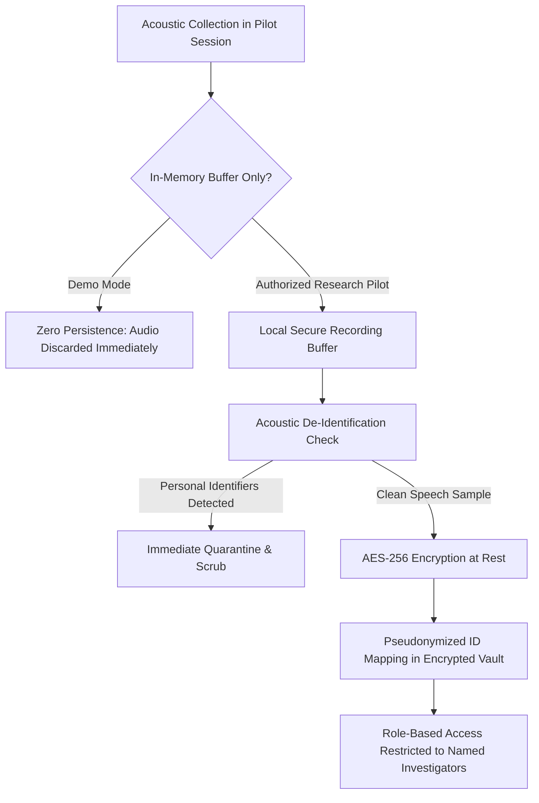

# Gate C: Data Governance and Participant Consent Checklist

**Project:** Low-Resource Personalized Atypical Speech Recognition Using Hybrid Quantum-Classical Deep Learning for Reliable Emergency Communication  
**Document Version:** 1.0.0 (DRAFT / FOR INSTITUTIONAL ETHICS REVIEW ONLY)  
**Status:** **NOT PROVIDED / BLOCKED**  
**Audit Date:** 2026-10-10  
**Authors:** Clinical-ML Validation Lead, Data Governance Auditor  

---

## 1. Executive Summary & Governance Determination

Gate C represents the transition from controlled engineering demonstration to prospective human-subject research involving individuals with dysarthria and speech motor impairments.

> [!CAUTION]
> **NO PARTICIPANT RECRUITMENT OR DATA COLLECTION IS PERMITTED.**  
> Under current repository evidence, **0 of 4 essential institutional governance approvals exist**. No Institutional Review Board (IRB) or Independent Ethics Committee (IEC) clearance has been granted. No participant informed consent forms, patient information sheets, or Data Use Agreements (DUA) are executed. All prerequisites in this checklist are recorded as **NOT PROVIDED** and constitute critical blockers.

---

## 2. Governance Prerequisite Checklist

| Checklist Item | Required Standard | Repository Status | Evidence Location / Missing Artifact | Action Required to Close Gap |
| :--- | :--- | :--- | :--- | :--- |
| **DG-01: IRB / IEC Approval** | Full review or stamped exemption by accredited institutional ethics board | **NOT PROVIDED** | None (`reports/phase_c/evidence_inventory.json`) | Submit research protocol to institutional IRB; obtain stamped approval letter. |
| **DG-02: Participant Consent Form** | Explicit informed consent including voice biometric disclosure and withdrawal rights | **NOT PROVIDED** | None | Draft, validate with patient advocates, and approve participant consent form. |
| **DG-03: Legally Authorized Representative (LAR)** | Surrogate consent protocol for participants with severe motor/cognitive impairment | **NOT PROVIDED** | None | Define LAR consent pathway compliant with local human research regulations. |
| **DG-04: Institutional Data Use Agreement** | Bilateral DUA governing speech recordings, pseudonymization, and research restrictions | **NOT PROVIDED** | None | Execute formal DUA between research institution and data collection site. |
| **DG-05: De-Identification & Pseudonymization** | Separation of direct identifiers (PHI/PII) from acoustic tokens; master key encryption | **PARTIALLY DESIGNED** | `src/data/external_dataset_validator.py` | Implement encrypted key escrow and audit logging for de-identification pipeline. |
| **DG-06: Voice Biometric Protection** | Acoustic data classified as sensitive biometric data; encryption at rest (AES-256) | **PARTIALLY DESIGNED** | `src/app/core/orchestrator.py` | Configure zero-persistence default; enforce AES-256-GCM for all archival research audio. |
| **DG-07: Right to Erasure / Withdrawal** | Immediate cessation of recording and complete deletion of participant data upon request | **DESIGNED** | `reports/phase_c/CONTROLLED_PILOT_PROTOCOL_DRAFT.md` | Formalize script-based audio and embedding purging protocol with verifiable audit trail. |
| **DG-08: Access Control & Role-Based Security** | Least-privilege access restricted to credentialed named investigators | **NOT PROVIDED** | None | Configure IAM role-based access control and hardware security token authentication. |
| **DG-09: Incident & Breach Response** | Documented breach notification procedure (72-hour regulatory disclosure window) | **DRAFT** | `reports/phase_c/STOP_RULES_AND_INCIDENT_RESPONSE_PLAN.md` | Formalize institutional reporting chain with Data Protection Officer (DPO). |

---

## 3. Participant Consent & Vulnerable Population Safeguards

Participants in atypical speech research frequently represent vulnerable clinical populations (e.g., individuals with Amyotrophic Lateral Sclerosis [ALS], Cerebral Palsy, Parkinson's disease, or stroke).

### 3.1 Informed Consent Requirements
1. **Voluntary Participation:** Prospective participants must be informed that participation is entirely voluntary and that refusal to participate or withdrawal will have **no impact on their medical care, speech therapy, or clinical services**.
2. **Communication Accessibility:** Consent materials must be provided in accessible formats (e.g., large font, high contrast, plain language, screen-reader compatible, and assisted by augmentative and alternative communication [AAC] devices).
3. **No Clinical Benefit Disclosure:** Consent forms must explicitly disclose:
   > *"This study is an engineering research pilot. The experimental software does not provide emergency assistance, does not contact 911 or first responders, and will not improve your communication safety during this study. You must continue to rely on your existing emergency call and alert systems."*

### 3.2 Right to Withdrawal and Data Deletion Protocol
- Participants may withdraw consent at any point during or after data collection without giving a reason.
- Upon receipt of a withdrawal request:
  1. The participant's pseudonymized ID is flagged as `WITHDRAWN` in the master enrollment register.
  2. All raw audio recordings, feature vectors, embeddings, and transcriptions associated with the participant ID are immediately removed from the active training/evaluation pool.
  3. Physical and cloud storage volumes are securely sanitized using cryptographic erasure.
  4. A formal certificate of deletion is issued to the participant within 30 calendar days.

---

## 4. Acoustic Data Governance & Security Controls

Acoustic recordings of atypical speech contain immutable physiological and biometric features that cannot be completely anonymized through traditional text-redaction methods.

### 4.1 Storage and Encryption Standards
- **In-Memory Volatility:** The production demonstration application (`src/app/`) enforces zero raw audio persistence to disk by default.
- **Archival Research Data:** If authorized pilot recordings are collected in the future:
  - All acoustic files (`.wav`) must be encrypted at rest using **AES-256-GCM**.
  - Direct identifiers (name, date of birth, medical record number) must never be stored in the file system or manifest.
  - A salted cryptographic hash (`HMAC-SHA256`) must be used for participant aliases (e.g., `EXT_SPK_001`).
  - Master key encryption keys (MEK) must be held in a dedicated hardware security module (HSM) or managed key vault separate from the storage volume.

### 4.2 Data Retention Schedule
- **Raw Audio Recordings:** Retained for a maximum of 36 months following study completion, or until manuscript publication and peer review verification, after which raw audio is destroyed.
- **Derived Feature Representations:** Anonymized bottleneck embeddings and aggregated confusion matrices may be archived for open scientific reproducibility, provided no raw voice re-identification is possible.

---

## 5. Audit Conclusion

The data governance and participant consent framework is **structurally defined** but **operationally unverified**. Because no institutional ethics clearances or legal agreements have been executed, this prerequisite remains a **CRITICAL BLOCKER** for Gate C.
