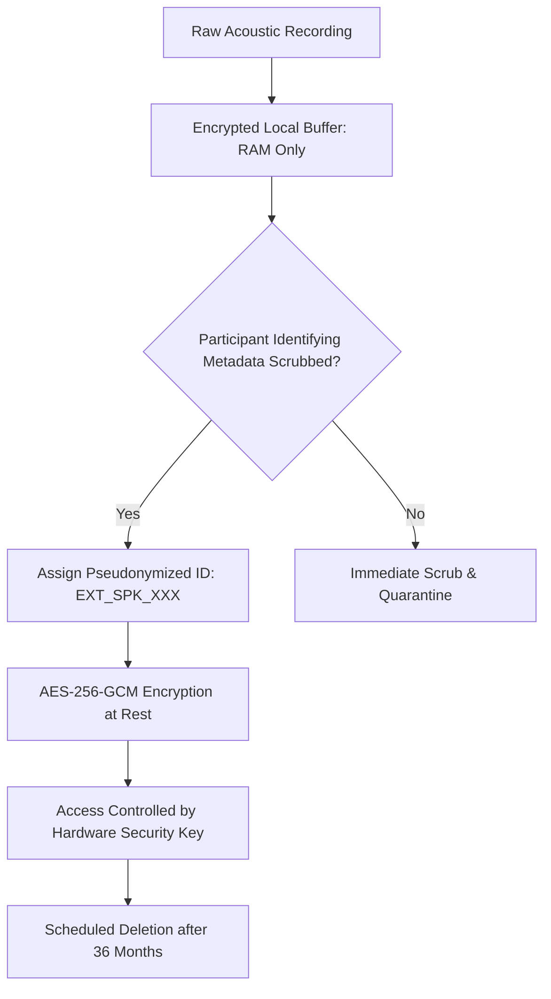

# Gate C: Institutional Ethics, DUA, and Clinical Oversight Submission Package

**Project:** Low-Resource Personalized Atypical Speech Recognition Using Hybrid Quantum-Classical Deep Learning for Reliable Emergency Communication  
**Document Identifier:** ETHICS-PKG-PHASE-C-2026-DRAFT  
**Package Version:** 1.0.0 (REVIEW-READY DRAFT)  
**Status:** **DRAFT — NOT APPROVED / NOT EXECUTED**  
**Audit Date:** 2026-10-10  
**Target Submission Body:** Institutional Review Board (IRB) / Independent Ethics Committee (IEC)  

---

> [!CAUTION]
> **GOVERNANCE NOTICE — NOT AN EXECUTED AGREEMENT:**  
> This document constitutes a formal submission package prepared for institutional review. **It does NOT represent executed ethics approval or an active legal contract.** Signatures, IRB approval numbers, and executed DUAs must be independently issued by authorized institutional authorities. No participants may be recruited and no prospective data may be collected using this draft.

---

## 1. Study Overview & Institutional Protocol Summary

### 1.1 Study Title & Protocol Identity
- **Full Title:** Prospective Observational Shadow-Mode Evaluation of Personalized Acoustic Speech Adapters for Emergency Intent Recognition in Atypical Speech.
- **Short Title:** Atypical Speech Emergency Pilot (Gate C).
- **Study Classification:** Observational, non-interventional, prospective cohort study (Class IIb Diagnostic Software Research).
- **Primary Objective:** To evaluate the sensitivity, specificity, and false emergency rate of personalized acoustic adapter neural networks on natural conversational speech from adults with dysarthria.

### 1.2 Non-Interventional Shadow-Mode Governance
- **Zero Real-World Alerts:** The software processes speech in a passive, disconnected shadow mode. Model predictions are logged to local encrypted storage for offline statistical auditing.
- **No Emergency Service Integration:** The system is **NOT connected to 911/112, emergency medical services, nurse call stations, or caregiver paging networks**.
- **No Treatment Impact:** The system will not influence, modify, or direct any clinical care, medication administration, or emergency response. Participants will rely exclusively on their existing emergency alert systems (e.g., telephone, pull cords, medical call pendants).

---

## 2. Participant Eligibility & Recruitment Protocol

### 2.1 Target Population
Adult individuals (aged 18+) with motor speech impairment (dysarthria) secondary to non-progressive or slowly progressive neurological conditions (Cerebral Palsy, Post-Stroke Dysarthria, Traumatic Brain Injury, Parkinson's disease, or Amyotrophic Lateral Sclerosis [ALS]).

### 2.2 Inclusion & Exclusion Criteria
- **Inclusion Criteria:**
  1. Age $\ge 18$ years at enrollment.
  2. Documented clinical diagnosis of dysarthria of any severity (mild, moderate, or severe).
  3. Ability to provide written informed consent, or assent accompanied by Legally Authorized Representative (LAR) consent.
  4. Willingness to participate in audio recording sessions under the supervision of a Speech-Language Pathologist.
- **Exclusion Criteria:**
  1. Acute respiratory failure or medical instability requiring active life support.
  2. Tracheostomy with cuff inflated preventing phonatory airflow.
  3. Severe cognitive impairment preventing comprehension of basic research tasks.
  4. Active acute laryngitis or structural vocal cord trauma unrelated to dysarthria.

---

## 3. Informed Consent, Assent, and Withdrawal Procedures

### 3.1 Accessible Informed Consent
1. Consent documents must be provided in accessible typography (minimum 14 pt, high contrast) and Plain Language Summary formats.
2. For participants with severe motor impairment preventing manual signature, oral assent witnessed by an independent monitor or digital eye-gaze confirmation is required, alongside written LAR consent.

### 3.2 Participant Withdrawal Protocol
- Participants maintain the unrestricted right to withdraw from the study at any time without penalty or loss of benefits.
- Upon notification of withdrawal:
  - All pending recording sessions are cancelled immediately.
  - All stored audio files, intermediate bottleneck representations, and transcripts associated with the participant ID are cryptographically erased within 14 business days.
  - A formal written Certificate of Erasure will be issued to the participant.

---

## 4. Acoustic Data Governance & Biometric Voice Safeguards

Acoustic recordings of atypical speech contain unique physiological biometric markers. To protect participant privacy:



1. **Classification as Sensitive Biometric Data:** Voice recordings are classified as Sensitive Personal Data (governed by the Digital Personal Data Protection Act 2023, HIPAA, and GDPR).
2. **Pseudonymization:** Direct identifiers (names, dates, medical records) are permanently separated from acoustic files and stored in a physically air-gapped encryption key vault.
3. **Encryption at Rest & in Transit:** All archival research recordings are encrypted using **AES-256-GCM**. Unencrypted raw audio may never be stored on shared cloud drives.
4. **Data Retention & Erasure Schedule:** Raw acoustic recordings are retained for a maximum of 36 months following peer-reviewed study publication, after which raw audio files are permanently destroyed.

---

## 5. Clinical Oversight & Double-Annotation Protocol

### 5.1 Named Clinical Roles Required (Template Specification)
To satisfy clinical governance, the project requires the following formally appointed roles:
- **Principal Clinical Investigator:** Board-certified Neurologist or Physical Medicine & Rehabilitation (PM&R) Physician.
- **Lead Speech-Language Pathologist:** Certified Speech-Language Pathologist (CCC-SLP) with $\ge 5$ years of dysarthria clinical experience.
- **Independent Clinical Safety Officer:** Emergency Medicine Physician responsible for adverse event review.
*(Note: Actual practitioner appointments and credential verifications must be documented in the Signature Register upon execution).*

### 5.2 SLP Double-Annotation Protocol
- Every recorded utterance will be independently transcribed and classified into the 10-class taxonomy by two blinded, certified SLPs.
- **Inter-Annotator Agreement Bound:** An unweighted Cohen's kappa $\kappa \ge 0.85$ is required. Utterances with annotator discordance will be adjudicated by the Lead SLP.

---

## 6. Submission Checklist & Signature Register

| Item ID | Submission Document | Target Institutional Authority | Verification Status |
| :--- | :--- | :--- | :--- |
| **SUB-01** | Full Pilot Protocol ([`reports/phase_c/CONTROLLED_PILOT_PROTOCOL_DRAFT.md`](file:///d:/DL/reports/phase_c/CONTROLLED_PILOT_PROTOCOL_DRAFT.md)) | Institutional Review Board (IRB) | **DRAFT — AWAITING SUBMISSION** |
| **SUB-02** | Participant Informed Consent & LAR Assent Forms | IRB / Ethics Committee | **DRAFT — AWAITING SUBMISSION** |
| **SUB-03** | Bilateral Institutional Data Use Agreement (DUA) | University Legal Counsel & Hospital Site | **DRAFT — AWAITING EXECUTION** |
| **SUB-04** | Statistical Analysis Plan ([`reports/phase_c/STATISTICAL_ANALYSIS_PLAN.md`](file:///d:/DL/reports/phase_c/STATISTICAL_ANALYSIS_PLAN.md)) | Lead Biostatistician Review Panel | **DRAFT — REVIEW READY** |
| **SUB-05** | Stop Rules & Incident Response Plan ([`reports/phase_c/STOP_RULES_AND_INCIDENT_RESPONSE_PLAN.md`](file:///d:/DL/reports/phase_c/STOP_RULES_AND_INCIDENT_RESPONSE_PLAN.md)) | Clinical Safety Officer | **DRAFT — REVIEW READY** |

### Execution Signature Register:
```
[ ] Institutional Review Board Approval Stamped & Executed (IRB Protocol ID: _____________)
[ ] Clinical Medical Director Protocol Endorsement (Name & Licensure: _____________)
[ ] Lead Speech-Language Pathologist (CCC-SLP) Sign-off (Name & Licensure: _____________)
[ ] Institutional Legal Counsel DUA Execution (DUA Identifier: _____________)
[ ] Project Owner Explicit Written Authorization (Authorization Token: _____________)
```
