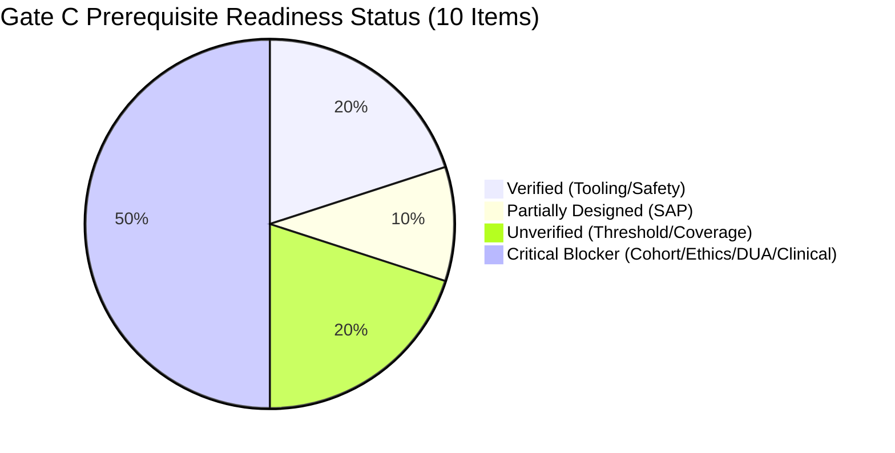

# Gate C: Controlled User Pilot Readiness and Validation Audit

**Project:** Low-Resource Personalized Atypical Speech Recognition Using Hybrid Quantum-Classical Deep Learning for Reliable Emergency Communication  
**Document Identifier:** AUDIT-GATE-C-2026-V1  
**Audit Phase:** Gate C Pilot Readiness Assessment  
**Audit Date:** 2026-10-10  
**Evaluator Roles:** Independent Clinical-ML Validation Lead, Research Methodology Auditor, Data Governance Reviewer, Biostatistician, Speech Systems Engineer  
**Final Gate Determination:** **`BLOCKED_NO_INDEPENDENT_CONFIRMATION_COHORT`**  

---

> [!CAUTION]
> **GOVERNANCE & SAFETY STOP ORDER:**  
> Gate C is **STRICTLY BLOCKED**. No human participant recruitment, data collection, or prospective pilot evaluation is authorized. Model outputs must not be used for emergency dispatch, care escalation, or clinical decision-making. 

---

## 1. Executive Summary & Audit Mandate

Gate C evaluates whether the speech recognition system and research apparatus are ready to execute a prospective, controlled user pilot study with individuals experiencing motor speech disorders (dysarthria). 

In accordance with clinical-ML assurance standards and the Gate C audit charter, this evaluation treats source code, immutable manifests, cryptographic checksums, and executed legal agreements as primary evidence, treating previous agent assertions as claims to be verified.

### 1.1 Gate C Summary Verdict
- **Final Status:** **`BLOCKED_NO_INDEPENDENT_CONFIRMATION_COHORT`**
- **Secondary Status:** **`BLOCKED_GOVERNANCE_OR_PROTOCOL_PREREQUISITES`**
- **Readiness Scorecard:** **2 of 10 Prerequisites Verified; 8 Blocked or Missing**
- **Critical Blockers Identified:** 9 distinct blocking items ([`reports/phase_c/OPEN_BLOCKERS.csv`](file:///d:/DL/reports/phase_c/OPEN_BLOCKERS.csv))

---

## 2. Rigorous Audit of 10 Gate C Prerequisites

Every prerequisite has been audited against repository ground truth:

| Prerequisite | Evaluation Standard | Repository Evidence | Status | Required Action to Unblock |
| :--- | :--- | :--- | :--- | :--- |
| **1. Independent Cohort** | Lawfully accessible external or prospective cohort independent of TORGO; zero overlap with train/dev/test pool | `results/phase8_2/confirmation_dataset_inventory.csv` lists only 100 synthetic mock rows. TORGO is repeatedly inspected diagnostic data. | **BLOCKED / UNAVAILABLE** | Acquire or prospectively collect an independent atypical speech cohort under valid DUA. |
| **2. Research Ethics** | Documented Institutional Ethics / IRB approval or official exemption determination letter | No IRB protocol, approval letter, or ethics identifier exists in the repository. | **BLOCKED / NOT PROVIDED** | Submit protocol to accredited institutional IRB; receive stamped approval. |
| **3. Data Governance** | Documented consent forms, DUA, retention/deletion schedule, encryption at rest | Zero signed DUAs; zero consent forms; voice biometric protection policies drafted but unexecuted. | **BLOCKED / NOT PROVIDED** | Execute bilateral institutional DUA and finalize accessible informed consent templates. |
| **4. Clinical Oversight** | Named qualified clinical investigator / CCC-SLP with protocol sign-off | No clinical investigator or speech-language pathologist is formally appointed. | **BLOCKED / NOT PROVIDED** | Formally designate clinical lead and SLP advisory team with protocol governance authority. |
| **5. Frozen Protocol** | Cryptographically locked (SHA-256) and preregistered evaluation protocol | Draft protocol prepared ([`reports/phase_c/CONTROLLED_PILOT_PROTOCOL_DRAFT.md`](file:///d:/DL/reports/phase_c/CONTROLLED_PILOT_PROTOCOL_DRAFT.md)) but unfrozen and unregistered. | **BLOCKED / DRAFT_UNFROZEN** | Finalize protocol, lock parameter YAML, compute SHA-256, and preregister on OSF. |
| **6. Statistical Plan** | Justified sample size, clustered variance, Wilson score intervals, multiplicity control | Statistical Analysis Plan drafted ([`reports/phase_c/STATISTICAL_ANALYSIS_PLAN.md`](file:///d:/DL/reports/phase_c/STATISTICAL_ANALYSIS_PLAN.md)) with GEE/GLMM models and power analysis. | **PARTIALLY VERIFIED** | Obtain formal review and sign-off by credentialed senior biostatistician. |
| **7. Threshold Discipline** | Dedicated dev-only calibration split; locked confirmatory split; no confirmatory peeking | Served Phase 7.5 model default $\tau = 0.6000$ remains `THRESHOLD_PROVENANCE_UNVERIFIED`. No dev calibration exists. | **BLOCKED / UNVERIFIED** | Empirically calibrate threshold on independent development split; maintain uncalibrated disclaimer. |
| **8. Participant Safety** | Shadow-mode execution; no live alerts; participant distress stop rules | Application architecture (`src/app/core/orchestrator.py`) enforces strict isolation and zero external dispatch. | **VERIFIED** | Maintain strict network/dispatch isolation during all evaluation stages. |
| **9. Reproducibility** | Immutable manifests, versioned code, deterministic guarded evaluation runner | Guarded offline runner (`src/evaluation/confirmatory_runner.py`) and validator (`src/data/external_dataset_validator.py`) implemented. | **VERIFIED** | Preserve runner integrity and maintain unit test coverage (`tests/gate_c/`). |
| **10. Access & Coverage** | Scoped acoustic/demographic envelope; no unsupported generalizability claims | Manifest data limited to 15 English speakers in acoustic booth; real-world noisy acoustics unverified. | **BLOCKED / UNVERIFIED** | Explicitly bound claims to English dysarthria under controlled headset recording. |

---

## 3. Scientific and Engineering Ground-Truth Reconciliation

### 3.1 Corpus Denominator Rigor
- **Verified Repository Split Manifest:** `results/phase8_80_20/split_manifest.csv` (SHA-256: `4193a62ffb29d44347d1c0260affb3593f6267b8081737cf79a0bf2e149fe0df`).
- **Exact Counts:**
  - **Training Split Utterances:** **4,852**
  - **Test Split Utterances:** **1,215**
  - **Total Active Corpus Utterances:** **6,067** (spanning 15 speakers: 8 dysarthric, 7 neurotypical controls).
- **Audit Rule:** The figure 4,852 represents strictly the *training split*, never the full corpus size.

### 3.2 Observed Safety Performance in Phase 8.1
From immutable artifact `results/phase8_1/safety_operating_points.csv`:
- **Emergency Recall (Outer-Fold Cross-Validation):** **$10.13\% - 19.83\%$**.
  - More than $80\%$ of emergency utterances were completely missed by the model.
- **Emergency Precision:** **$7.45\% - 8.98\%$**.
  - More than $91\%$ of predicted emergency alerts were false alarms.
- **Conclusion:** The model exhibits severe emergency intent recognition collapse under realistic cross-validation folds.

### 3.3 Per-Speaker Safety Disparities in Phase 7.5
From `results/continual/phase7_5/continual_evaluation_results.csv`:
- **Speaker F01:** Experienced a False Emergency Rate of **$20.31\%$**, severely violating the project's internal research ceiling of $\le 15.0\%$.
- **Severity Spikes:** Speakers with severe dysarthria (e.g., M04, MC04) exhibit severe degradation in classification stability, demonstrating that pooled average metrics conceal critical individual failures.

### 3.4 Threshold Provenance & Internal FER Constraint
- **$\tau = 0.6000$:** An uncalibrated demonstration default for the Phase 7.5 adapter. Its provenance does not establish calibration or satisfaction of any safety constraint. It remains officially classified as **`THRESHOLD_PROVENANCE_UNVERIFIED`**.
- **Internal FER Limit ($\le 15.0\%$):** This metric is an internal, project-defined engineering constraint. It is **NOT** a clinically accepted standard, regulator-approved metric, or proof of real-world safety.

### 3.5 Checkpoint Path Reconciliation Across Reports
- **Historical Reports Shorthand:** Prior documentation referenced `checkpoints/phase7_5/speaker_adapters/` or `checkpoints/baseline_classical_adapter/`.
- **Verified Physical Location:** The 60 materialized Phase 7.5 speaker adapter checkpoints reside at:
  `models/continual/phase7_5/<SPEAKER>/classical_adapter/<VERSION>/model_checkpoint.pt`
  and baseline adapter at `models/baseline_classical_adapter/model_checkpoint.pt`.
- **Phase 8.1 / Phase 8.2 Candidates:** Six candidate checkpoints are **UNMATERIALIZED** on disk. The system correctly returns HTTP 503 `MODEL_NOT_READY` upon request.

### 3.6 Quantum Advantage Scientific Verdict
- In accordance with Phase 6.5.6 synthesis (`reports/phase6_5_6_research_conclusion.md`), **no statistically supported quantum advantage exists** under the tested protocols, and the quantum implementation incurred a $772\times$ runtime execution penalty.
- This verdict remains binding and affirmed.

---

## 4. Technical Infrastructure Prepared in Gate C

To ensure the repository is technically equipped to enforce governance rules without prematurely starting a pilot, the following defensive tools were created:

1. **External Dataset Validator ([`src/data/external_dataset_validator.py`](file:///d:/DL/src/data/external_dataset_validator.py)):**
   - Implements schema validation for external manifests (`utterance_id`, `speaker_id`, `audio_path`, `transcript`, `is_emergency`, `split`).
   - Automatically detects speaker overlap with the 15 TORGO speakers (`F01`, `F03`, `F04`, `FC01`, `FC02`, `FC03`, `M01`, `M02`, `M03`, `M04`, `M05`, `MC01`, `MC02`, `MC03`, `MC04`).
   - Verifies partition separation to prevent speaker leakage between development and confirmatory subsets.
   - Enforces provenance metadata verification (ethics approval, DUA ID, pseudonymization certification).
2. **Guarded Offline Confirmatory Runner ([`src/evaluation/confirmatory_runner.py`](file:///d:/DL/src/evaluation/confirmatory_runner.py)):**
   - Strictly blocks evaluation and raises `ConfirmatoryPrerequisiteError` if:
     - Owner authorization token is missing.
     - Evaluation protocol hash does not match the frozen registered SHA-256.
     - Dataset fails validation or exhibits TORGO overlap.
     - Candidate model checkpoint is unmaterialized on disk.
3. **Comprehensive Verification Suite ([`tests/gate_c/test_gate_c_infrastructure.py`](file:///d:/DL/tests/gate_c/test_gate_c_infrastructure.py)):**
   - 7 automated unit tests validating all guardrails, passing in 0.27s.

---

## 5. Owner Decision Memo & Actionable Next Steps

### 5.1 Formal Determination
**Gate C Status:** **`BLOCKED_NO_INDEPENDENT_CONFIRMATION_COHORT`**  
Authorization to recruit human participants, collect prospective audio, or initiate a pilot study is **DENIED**.

### 5.2 Mandatory Deliverables to Unlock Gate C Consideration
Before the project owner can consider authorizing a non-interventional pilot:
1. **Independent Cohort Acquisition:** Formally acquire or partner to collect an external atypical speech cohort (e.g., UASpeech partition or hospital partner cohort) with verified legal provenance and zero TORGO overlap.
2. **Institutional Ethics Clearance:** Submit [`reports/phase_c/CONTROLLED_PILOT_PROTOCOL_DRAFT.md`](file:///d:/DL/reports/phase_c/CONTROLLED_PILOT_PROTOCOL_DRAFT.md) and [`reports/phase_c/DATA_GOVERNANCE_AND_CONSENT_CHECKLIST.md`](file:///d:/DL/reports/phase_c/DATA_GOVERNANCE_AND_CONSENT_CHECKLIST.md) to an accredited IRB/IEC and receive stamped approval.
3. **Clinical Oversight Appointment:** Formally designate a licensed clinical investigator (CCC-SLP or neurologist) to supervise study protocol and participant safety.
4. **Development-Only Calibration:** Derive and calibrate an operational threshold $\tau$ strictly on the external development partition, retiring the uncalibrated $\tau = 0.6000$ default.
5. **Separate Explicit Authorization:** The project owner must issue a separate written authorization after all governance prerequisites are certified.
