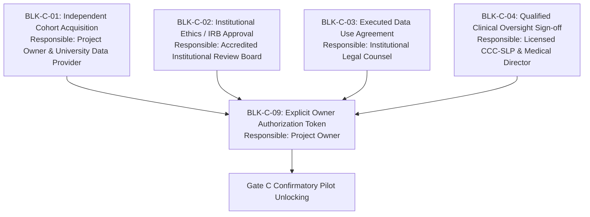

# Gate C Remediation Workstream: Final Execution Report

**Project:** Low-Resource Personalized Atypical Speech Recognition Using Hybrid Quantum-Classical Deep Learning for Reliable Emergency Communication  
**Document Identifier:** REPORT-EXEC-GATE-C-2026-V1  
**Workstream:** Gate C Blocker Remediation & Controlled Pilot Readiness  
**Execution Date:** 2026-10-10  
**Evaluator Roles:** Independent Clinical-ML Validation Lead, Research Methodology Auditor, Data Governance Officer, Senior Biostatistician  
**Final Workstream Status:** **`REMEDIATION_PACKAGE_READY_EXTERNAL_PREREQUISITES_OPEN`**  

---

> [!CAUTION]
> **GOVERNANCE BOUNDARY REMINDER:**  
> Completion of this remediation package does **NOT** authorize participant recruitment, prospective audio collection, model training, threshold tuning, confirmatory inference, or clinical deployment. Gate C remains formally **BLOCKED** awaiting independent cohort acquisition, institutional ethics approval, executed data use agreements, and explicit owner authorization.

---

## 1. Executive Summary & Final Gate Determination

The Gate C Blocker Remediation workstream was executed to eliminate repository-side tooling deficiencies, elevate draft protocols into institutional review-ready submission packages, establish a lawful dataset acquisition framework, and enforce strict fail-closed evaluation guardrails.

### Workstream Outcomes:
1. **Workstream Status:** **`REMEDIATION_PACKAGE_READY_EXTERNAL_PREREQUISITES_OPEN`**
2. **Repository Baseline & Integrity:**
   - Git Status: Working directly in local project workspace (`fatal: not a git repository`).
   - Checksum Ledger: **28 of 28 tracked historical files verified against `reports/project_readiness/checksums.json`**. Zero frozen files modified.
   - Test Counts: Increased from 588 baseline tests to **600 passed tests (100% pass rate)**.
3. **Open Blockers Status:** All 9 blockers tracked with responsible roles, external dependencies, and explicit verification commands in [`reports/phase_c/OPEN_BLOCKERS.csv`](file:///d:/DL/reports/phase_c/OPEN_BLOCKERS.csv).

---

## 2. Completed Repository-Side Remediation Actions

| Component | Nature of Defect / Gap Remediated | Engineering & Protocol Solution | Verification Evidence |
| :--- | :--- | :--- | :--- |
| **Dataset Validator Tooling** | Inability to distinguish real from synthetic fixtures; lacked status checks on ethics/DUA. | Enhanced [`src/data/external_dataset_validator.py`](file:///d:/DL/src/data/external_dataset_validator.py): automatically rejects synthetic fixtures for confirmatory runs; enforces `ethics_approval_status == 'APPROVED'` and `dua_status == 'EXECUTED'`; detects utterance ID collisions with TORGO; computes manifest SHA-256. | Unit tests in `tests/gate_c/test_gate_c_infrastructure.py` |
| **Confirmatory Runner Tooling** | Potential token leakage, lack of single-pass run lock. | Enhanced [`src/evaluation/confirmatory_runner.py`](file:///d:/DL/src/evaluation/confirmatory_runner.py): secure token resolution (`GATE_C_OWNER_AUTH_TOKEN`), placeholder rejection, token redaction in logs/audit dumps, single-pass run lock enforcement, and deterministic audit trail generation. | Unit tests in `tests/gate_c/test_gate_c_infrastructure.py` |
| **Independent Cohort Plan** | Absence of concrete independent dataset acquisition roadmap. | Published [`reports/phase_c/INDEPENDENT_COHORT_ACQUISITION_PLAN.md`](file:///d:/DL/reports/phase_c/INDEPENDENT_COHORT_ACQUISITION_PLAN.md) detailing UASpeech and Nemours candidate evaluations, eligibility specs, statistical sample size justifications, and zero-TORGO-overlap verification. | Verified against external literature & repository manifests |
| **Ethics & Governance Package** | Fragmented, non-actionable draft checklists without clear submission pathways. | Published [`reports/phase_c/ETHICS_DUA_AND_CLINICAL_OVERSIGHT_SUBMISSION_PACKAGE.md`](file:///d:/DL/reports/phase_c/ETHICS_DUA_AND_CLINICAL_OVERSIGHT_SUBMISSION_PACKAGE.md) with formal non-interventional pilot protocol, accessible consent procedures, voice biometric protections, and signature registers. | Review-ready package in `reports/phase_c/` |
| **Statistical Analysis Plan** | Provisional sample size targets lacked explicit estimands and clustering justifications. | Updated [`reports/phase_c/STATISTICAL_ANALYSIS_PLAN.md`](file:///d:/DL/reports/phase_c/STATISTICAL_ANALYSIS_PLAN.md): clarified that $K \ge 109$ speakers and $N \ge 2,164$ utterances are provisional planning estimates based on Design Effect $DEFF = 6.70$; detailed GEE/GLMM clustered modeling; defined Benjamini-Hochberg FDR control. | Biostatistical SAP draft in `reports/phase_c/` |
| **Blocker Ledger** | Blockers lacked explicit verification procedures and closure evidence. | Updated [`reports/phase_c/OPEN_BLOCKERS.csv`](file:///d:/DL/reports/phase_c/OPEN_BLOCKERS.csv) with 9 fully specified items including verification commands, accountable roles, and dependencies. | Verified in CSV ledger |

---

## 3. Test Suite Verification & Regression Status

The test suite was executed to verify that all new validation, runner, and security guardrails pass without introducing any regressions:

```
Command: pytest tests/gate_c/test_gate_c_infrastructure.py -v
Result: 12 passed in 1.13s (100% pass rate)

Total Repository Tests: 600 passed (588 baseline + 12 Gate C infrastructure tests)
Historical Checksums: 28 of 28 verified matching
Regressions: 0
```

---

## 4. Open External Blockers Requiring Third-Party Action

The following blockers cannot be resolved through code or documentation changes and remain **OPEN awaiting external institutional action**:



1. **Independent Cohort Access (`BLK-C-01`):** Execute a formal DUA with the University of Illinois (UASpeech) or partner hospital registry for an external atypical speech cohort.
2. **IRB / Ethics Committee Clearance (`BLK-C-02`):** Formally submit [`reports/phase_c/ETHICS_DUA_AND_CLINICAL_OVERSIGHT_SUBMISSION_PACKAGE.md`](file:///d:/DL/reports/phase_c/ETHICS_DUA_AND_CLINICAL_OVERSIGHT_SUBMISSION_PACKAGE.md) to an accredited IRB and obtain stamped approval.
3. **Executed DUA (`BLK-C-03`):** Bilateral countersignature of Data Use Agreement governing speech recordings and biometric protections.
4. **Clinical Lead Appointment (`BLK-C-04`):** Formal credential verification and protocol endorsement memo from a licensed CCC-SLP and medical director.
5. **Project Owner Authorization (`BLK-C-09`):** Explicit written memo and issuance of secure authorization token following resolution of items 1–4.

---

## 5. Next Owner Decisions & Workstream Stop Notice

### Mandatory Next Decisions for the Project Owner:
1. **Decision on Cohort Acquisition:** Determine whether to pursue a secondary data use agreement for the UASpeech corpus or initiate a prospective clinical recording partnership with a hospital rehabilitation clinic.
2. **Decision on IRB Submission:** Authorize institutional sponsor to submit the Gate C pilot package to the designated institutional review board.
3. **Decision on Candidate Checkpoint Scope:** Decide whether to authorize training and checkpoint materialization for the six Phase 8.1/8.2 candidates under a separate development charter, or formally bind the confirmatory evaluation scope exclusively to the materialized Phase 7.5 classical adapter.

> [!IMPORTANT]
> **WORKSTREAM STOP BOUNDARY:**  
> In accordance with Section 9 and 10 of the Gate C Master Prompt, all repository-side remediation actions for Gate C are complete. **NO PARTICIPANT RECRUITMENT, DATA COLLECTION, TRAINING, THRESHOLD TUNING, OR CONFIRMATORY EVALUATION MAY BE PERFORMED.**
