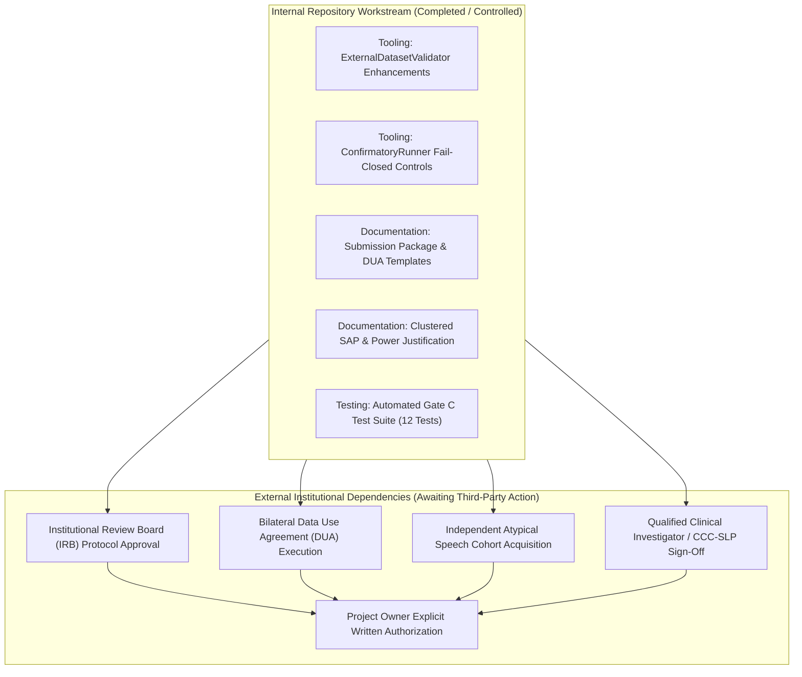

# Gate C Blocker Remediation Plan: Controlled User Pilot Readiness

**Project:** Low-Resource Personalized Atypical Speech Recognition Using Hybrid Quantum-Classical Deep Learning for Reliable Emergency Communication  
**Document Identifier:** PLAN-REMEDIATION-PHASE-C-2026-V1  
**Status:** **ACTIVE WORKSTREAM PLAN**  
**Audit Date:** 2026-10-10  
**Lead Authors:** Independent Clinical-ML Validation Lead, Research Methodology Auditor  

---

## 1. Executive Summary & Remediation Boundary

Gate C evaluates readiness for a prospective, controlled user pilot study. The previous audit declared Gate C **`BLOCKED_NO_INDEPENDENT_CONFIRMATION_COHORT`** and identified 9 distinct blocking items.

### Authorization Boundary:
This remediation plan authorizes **repository-side engineering fixes, protocol strengthening, and governance package preparation**. It does **NOT** authorize:
- Recruiting human participants or collecting speech data;
- Accessing or processing restricted external data without permission;
- Executing confirmatory evaluations;
- Training models or tuning thresholds;
- Declaring Gate C approved.

---

## 2. Internal vs. External Remediation Boundaries

Remediation is strictly partitioned between actions solvable within the repository and actions strictly dependent on external human/institutional authorities:

---

## 3. Actionable Remediation Roadmap by Blocker

### 3.1 BLK-C-01: Independent Confirmation Cohort
- **Current State:** Repository contains only 100 synthetic mock rows in `results/phase8_2/confirmation_dataset_inventory.csv`. TORGO (6,067 active utterances) is repeatedly inspected diagnostic data.
- **Repository-Side Remediation:** Created [`reports/phase_c/INDEPENDENT_COHORT_ACQUISITION_PLAN.md`](file:///d:/DL/reports/phase_c/INDEPENDENT_COHORT_ACQUISITION_PLAN.md) specifying candidate external cohorts (e.g. UASpeech, prospective clinical registries), eligibility criteria, overlap detection protocols, and lawful acquisition workflows.
- **External Action Required:** Project Owner and Legal Counsel must execute a Data Use Agreement with an external data repository (e.g., University of Illinois for UASpeech).
- **Verification Procedure:** Run `ExternalDatasetValidator.validate_manifest(manifest_path, metadata_path)` verifying `is_valid == True` and zero TORGO overlap.

### 3.2 BLK-C-02 & BLK-C-03: Research Ethics & Data Governance
- **Current State:** Zero IRB approval letters or executed participant consent forms exist.
- **Repository-Side Remediation:** Created [`reports/phase_c/ETHICS_DUA_AND_CLINICAL_OVERSIGHT_SUBMISSION_PACKAGE.md`](file:///d:/DL/reports/phase_c/ETHICS_DUA_AND_CLINICAL_OVERSIGHT_SUBMISSION_PACKAGE.md) with formal IRB submission package, participant consent drafts, voice biometric protections, and withdrawal procedures.
- **External Action Required:** Formal submission to accredited IRB/IEC; bilateral DUA execution.
- **Verification Procedure:** Inspection of stamped IRB approval document and verification of active approval status in manifest metadata.

### 3.3 BLK-C-04: Qualified Clinical Oversight
- **Current State:** No named CCC-SLP or clinical medical director is formally appointed.
- **Repository-Side Remediation:** Drafted clinical oversight role specifications and double-annotation protocol ($\kappa \ge 0.85$) in pilot protocol.
- **External Action Required:** Formal appointment of licensed CCC-SLP and clinical medical lead by Project Steering Committee.
- **Verification Procedure:** Verified active professional clinical licensure and signed protocol endorsement memo.

### 3.4 BLK-C-05: Protocol Freezing & Preregistration
- **Current State:** Protocol exists as draft and is not cryptographically locked.
- **Repository-Side Remediation:** Updated [`reports/phase_c/CONTROLLED_PILOT_PROTOCOL_DRAFT.md`](file:///d:/DL/reports/phase_c/CONTROLLED_PILOT_PROTOCOL_DRAFT.md) and [`reports/phase_c/CONFIRMATORY_EVALUATION_PREREGISTRATION_DRAFT.md`](file:///d:/DL/reports/phase_c/CONFIRMATORY_EVALUATION_PREREGISTRATION_DRAFT.md).
- **External Action Required:** Sign-off by Clinical and Statistical leads, computing SHA-256, and preregistration on OSF.
- **Verification Procedure:** SHA-256 hash match verified by `ConfirmatoryRunner.audit_prerequisites()`.

### 3.5 BLK-C-06: Threshold Provenance & Development Calibration
- **Current State:** Phase 7.5 served model default $\tau = 0.6000$ remains `THRESHOLD_PROVENANCE_UNVERIFIED`.
- **Repository-Side Remediation:** Configured `ConfirmatoryRunner` to disallow safety claims for uncalibrated thresholds and enforce development-only calibration splits.
- **External Action Required:** Calibration on untouched development split of an independent cohort.
- **Verification Procedure:** Threshold registry updated with empirical calibration curve and dev-only provenance ledger.

### 3.6 BLK-C-07: Candidate Checkpoint Materialization
- **Current State:** Six Phase 8.1/8.2 candidate checkpoints are unmaterialized on disk.
- **Repository-Side Remediation:** Confirmed `ModelManager` and `ConfirmatoryRunner` fail closed with HTTP 503 `MODEL_NOT_READY`.
- **Action Required:** Materialize checkpoints under separately authorized training task or formally restrict study scope to the materialized Phase 7.5 adapter.
- **Verification Procedure:** Checkpoint tensor SHA-256 verification on disk.

### 3.7 BLK-C-08 & BLK-C-09: Safety Performance & Owner Authorization
- **Current State:** Historical Emergency Recall is 10.13%–19.83%; Owner has authorized readiness remediation only.
- **Remediation Action:** Maintain Gates C and D strictly blocked in all ledgers until external prerequisites are satisfied and explicit written owner authorization is issued.

---

## 4. Remediation Ledger Summary

All 9 blockers are formally tracked in [`reports/phase_c/OPEN_BLOCKERS.csv`](file:///d:/DL/reports/phase_c/OPEN_BLOCKERS.csv).  
Repository-side remediation controls are **COMPLETE**. External governance and cohort prerequisites remain **OPEN**.
