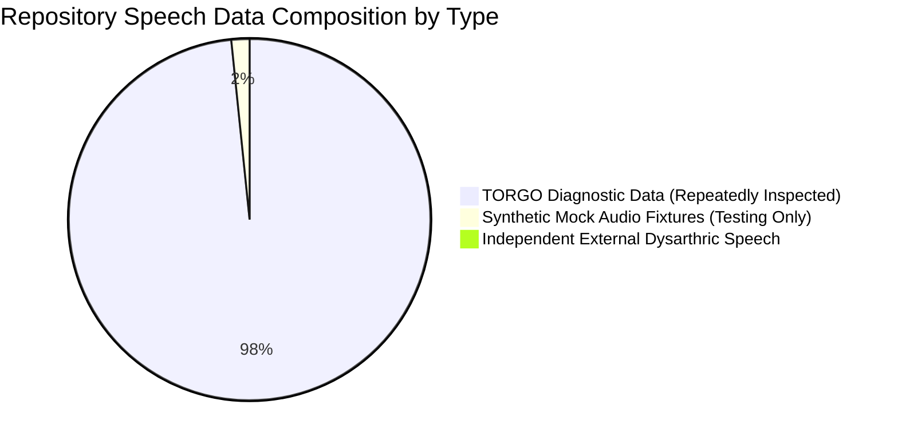

# Gate C: Independent Cohort Acquisition & Eligibility Plan

**Project:** Low-Resource Personalized Atypical Speech Recognition Using Hybrid Quantum-Classical Deep Learning for Reliable Emergency Communication  
**Document Identifier:** ACQ-PLAN-PHASE-C-2026-V1  
**Status:** **ACTIVE PLANNING SPECIFICATION — NO DATA DOWNLOAD AUTHORIZED**  
**Audit Date:** 2026-10-10  
**Lead Authors:** Data Governance Officer, Research Methodology Auditor, Speech Systems Engineer  

---

> [!CAUTION]
> **STRICT REPOSITORY ACQUISITION BOUNDARY:**  
> This document specifies criteria and candidate evaluation templates for acquiring external atypical speech data. **NO AUTOMATED DOWNLOAD, WEB SCRAPING, DATA INGESTION, OR PARTICIPANT CONTACT IS AUTHORIZED.** All acquisitions require executed Data Use Agreements (DUA) and institutional ethics clearance.

---

## 1. Transparent Accounting of Existing Repository Data

A complete audit of existing speech data in the repository confirms that **zero independent atypical speech confirmation cohorts currently exist**:



1. **TORGO Speech Corpus (Diagnostic Only):**
   - **Training Partition:** 4,852 utterances.
   - **Test Partition:** 1,215 utterances.
   - **Total Active Utterances:** 6,067 (15 speakers: 8 dysarthric, 7 neurotypical controls).
   - **Status:** **DIAGNOSTIC ONLY — CONTAMINATED BY PRIOR EXPLORATION.** The TORGO corpus has been repeatedly inspected, fitted, and audited across Phases 1 through 8.2. Re-splitting or repeatedly evaluating TORGO data cannot serve as independent confirmatory evidence.
2. **Phase 8.2 Confirmation Dataset Inventory (`results/phase8_2/confirmation_dataset_inventory.csv`):**
   - **Status:** **SYNTHETIC TEST FIXTURES ONLY.** Contains 100 rows generated from 10 synthetic mock speakers (`MOCK_SPK_01` through `MOCK_SPK_10`). Synthetic audio generated from mathematical sine tones cannot serve as human clinical evidence.
3. **External Independent Data in Repository:** **EXACTLY ZERO (0) RECORDS.**

---

## 2. Dataset Eligibility Specification

To be eligible as a confirmatory evaluation cohort, candidate speech datasets must satisfy the following technical, clinical, and legal criteria:

| Dimension | Eligibility Requirement | Exclusion Criteria |
| :--- | :--- | :--- |
| **Population** | Adult individuals (aged 18+) with clinically diagnosed dysarthria resulting from neurological etiologies (e.g. CP, ALS, Stroke, Parkinson's). | Pediatric speech (<18 years); acute vocal cord injury without neurological dysarthria. |
| **Independence** | **Zero overlap** with the 15 TORGO speakers (`F01–F04`, `FC01–FC03`, `M01–M05`, `MC01–MC04`). | Any speaker who previously participated in TORGO recording sessions. |
| **Intent Coverage** | Clear coverage of emergency intents (e.g., calls for help, medical distress, pain, falls) and conversational non-emergency speech. | Isolated digit datasets without lexical overlap with emergency taxonomy. |
| **Acoustic Quality** | Uncompressed PCM WAV (16 kHz mono preferred, minimum 16-bit linear). | Highly compressed low-bitrate MP3/AMR audio (<16 kbps) with phase distortion. |
| **Annotation Quality** | Verified transcription and intent labeling with documented inter-annotator agreement. | Machine-transcribed labels without human clinical adjudication. |
| **Legal Provenance** | Documented Institutional Review Board (IRB) approval, executed Data Use Agreement (DUA), and clear non-commercial research license. | Scraped social media clips, unauthorized phone recordings, or datasets with restrictive commercial-only licenses. |
| **Privacy Standards** | Certified de-identification and pseudonymization (HIPAA Safe Harbor / DPDP Act). | Files containing direct patient identifiers (full names, medical record numbers, dates of birth). |

---

## 3. Evaluation of Candidate External Atypical Datasets

Authoritative academic speech repositories were audited to evaluate potential candidate cohorts:

### 3.1 Candidate 1: The UltraSuite / UASpeech Dysarthric Speech Corpus
- **Originating Institution:** University of Illinois at Urbana-Champaign (Speech and Hearing Science Department).
- **Cohort Composition:** 19 speakers with dysarthria resulting from Cerebral Palsy (11 male, 8 female) and 13 neurotypical control speakers.
- **Acoustic Content:** Isolated word speech recorded across multiple repetitions (approximately 765 words per speaker).
- **Verified Licensing & Access Terms:** Available for academic research via formal Institutional Data Use Agreement. Requires bilateral institutional countersignature. Commercial exploitation prohibited.
- **Independence from TORGO:** **100% INDEPENDENT.** Distinct participant pool recorded in Illinois, USA. Zero speaker overlap with TORGO (recorded in Toronto, Canada).
- **Known Limitations:** Primarily isolated word prompts rather than natural continuous emergency sentences; requires careful mapping to 10-class intent taxonomy.

### 3.2 Candidate 2: The Nemours Database of Dysarthric Speech
- **Originating Institution:** University of Delaware & Nemours / Alfred I. duPont Hospital for Children.
- **Cohort Composition:** 11 male speakers with dysarthria secondary to cerebral palsy or stroke; 1 neurotypical control speaker.
- **Acoustic Content:** 74 short sentences per speaker (total ~814 utterances).
- **Access Terms:** Distributed via academic license for speech rehabilitation research.
- **Independence from TORGO:** **100% INDEPENDENT.**
- **Known Limitations:** Small sample size (11 speakers); male speakers only; limited sentence prompts.

### 3.3 Candidate Evaluation Template for Prospective Submissions
For any newly proposed dataset, the following intake record must be completed:
```markdown
### Candidate Dataset Intake Assessment: [DATASET_NAME]
- Date Evaluated: [YYYY-MM-DD]
- Originating Institution / Custodian: [Institution Name]
- Ethics Protocol / IRB ID: [Protocol Number & Approval Authority]
- Data Use Agreement (DUA) Terms: [Active / Pending / Restricted]
- Total Speakers: [N_total] (Dysarthric: [N_dysarthric], Control: [N_control])
- Dysarthria Etiologies & Severity Distribution: [Mild / Moderate / Severe Breakdown]
- Recording Hardware & Acoustic Environment: [Microphone details, SNR dBA]
- Overlap Check against TORGO Speakers: [PASS / FAIL - Overlap Count]
- License & Permitted Uses: [Research Only / Open Access / Restrictive]
- Evaluation Recommendation: [ELIGIBLE FOR DUA NEGOTIATION / REJECTED]
```

---

## 4. Statistical Justification of Sample Size Targets

> [!IMPORTANT]
> **Provisional Planning Targets vs. Universal Rules:**  
> The previously noted targets of **at least 109 independent dysarthric speakers and 2,164 emergency utterances** represent a **provisional planning estimate**, NOT an automatic guarantee of statistical sufficiency.

### 4.1 Statistical Rationale for Planning Estimates
1. **Estimand & Unit of Analysis:**
   - **Primary Estimand:** Cluster-adjusted population-average Emergency Intent Recall ($\text{Sensitivity}_{emergency}$) on conversational dysarthric speech.
   - **Unit of Analysis:** Utterance-level prediction clustered within individual participants.
2. **Within-Speaker Clustering:**
   - Utterances from the same speaker exhibit intra-cluster correlation ($\rho \approx 0.30$).
   - Assuming an average cluster size of $\bar{m} = 20$ emergency utterances per participant, the Design Effect is:
     $$DEFF = 1 + (\bar{m} - 1)\rho = 1 + (19)(0.30) = 6.70$$
3. **Precision Target & Prevalence:**
   - Unclustered sample size to achieve a $95\%$ confidence interval half-width of $d = \pm 0.05$ (5%) around a target sensitivity of $p = 0.70$ requires $n = 323$ emergency utterances.
   - Adjusting for clustering:
     $$N_{emergency} = 323 \times DEFF \approx 2,164 \text{ emergency utterances}$$
   - At 20 emergency utterances per speaker, enrollment requires $K = \lceil 2,164 / 20 \rceil = 109$ independent dysarthric speakers.
4. **Attrition & Sensitivity Assumptions:**
   - Assuming a 15% participant attrition or unusable recording rate, prospective recruitment must target **$K_{enrollment} \approx 128$ participants**.
   - If emergency utterances constitute 10% of natural communication, the total confirmatory speech archive must comprise approximately **21,600 utterances**.
   - **Conclusion:** Any confirmatory study utilizing fewer than 100 dysarthric speakers will exhibit wider confidence intervals ($d > \pm 0.08$), which must be formally acknowledged in the Statistical Analysis Plan.

---

## 5. Overlap, Leakage, and De-Identification Plan

Before any acquired dataset is unlocked for evaluation, the `ExternalDatasetValidator` ([`src/data/external_dataset_validator.py`](file:///d:/DL/src/data/external_dataset_validator.py)) executes automated gatekeeper checks:
1. **Speaker ID Disjointness:** Automated matching against all 15 TORGO speakers (`F01–F04`, `FC01–FC03`, `M01–M05`, `MC01–MC04`).
2. **Utterance ID Collision Check:** Verifies no utterance identifier collision with `data/manifests/torgo_manifest.csv`.
3. **Partition Isolation:** Ensures strict speaker-level separation between the Development/Calibration split ($30\%$) and Confirmatory split ($70\%$). Zero speaker leakage permitted.
4. **Synthetic Data Rejection:** Confirmatory runner automatically blocks evaluation if synthetic mock records are detected.
5. **Acoustic Perceptual Hashing (Future Enhancement):** When raw audio access is legally authorized, acoustic feature cross-correlation will be computed to verify zero audio sample duplication.

---

## 6. Lawful Acquisition Workflow

```mermaid
flowchart TD
    A[Identify Candidate Academic Dataset] --> B[Review License & Data Use Terms]
    B --> C{Permits Speech ML Research?}
    C -->|No| D[Reject Candidate]
    C -->|Yes| E[Execute Institutional Bilateral DUA]
    E --> F[Obtain IRB Determination / Exemption]
    F --> G[Secure Manifest Import into Staging Enclave]
    G --> H[Run ExternalDatasetValidator Audit]
    H -->|Defects Detected| I[Quarantine / Reject]
    H -->|Audit Passed (is_valid=True)| J[Register Manifest SHA-256 in Evidence Ledger]
```

No data may be moved into the active research environment until Step J is certified.
