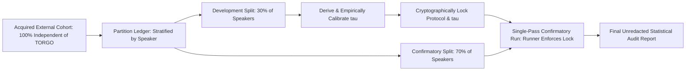

# Gate C: Statistical Analysis Plan (SAP) — Confirmatory Pilot Evaluation

**Project:** Low-Resource Personalized Atypical Speech Recognition Using Hybrid Quantum-Classical Deep Learning for Reliable Emergency Communication  
**Document Identifier:** SAP-PHASE-C-2026-V2  
**Document Status:** **DRAFT — NOT FROZEN / NOT REGISTERED (FOR BIOSTATISTICAL PEER REVIEW)**  
**Audit Date:** 2026-10-10  
**Authors:** Senior Biostatistician & Clinical-ML Validation Lead  

---

> [!CAUTION]
> **UNFROZEN PROTOCOL NOTICE:**  
> This Statistical Analysis Plan represents a versioned, change-controlled draft. **It is NOT cryptographically frozen or preregistered on a public registry.** Formal cryptographic hashing (SHA-256) and registry deposit (e.g., Open Science Framework) will occur only upon formal institutional review board approval and project owner authorization.

---

## 1. Study Objectives & Primary Estimands

### 1.1 Research Hypotheses
- **Primary Hypothesis $H_1$ (Sensitivity):** On an independent confirmatory dysarthric speech cohort, the personalized classical adapter operated at a development-calibrated threshold achieves a population-average Emergency Intent Recall $\ge 70.0\%$.
- **Secondary Hypothesis $H_2$ (Specificity / False Alarm Burden):** The system maintains a population-average False Emergency Rate (FER) $\le 15.0\%$ overall, and does not exceed an individual speaker FER $> 20.0\%$.
- **Exploratory Hypothesis $H_3$ (Quantum Equivalence):** Under identical experimental splits and feature representations, a hybrid quantum-classical adapter achieves no statistically significant improvement in Emergency Recall or Macro-F1 over an identically parameterized classical adapter ($p > 0.05$, confirming Case B).

### 1.2 Definition of Estimands
1. **Primary Estimand (Population-Average Emergency Sensitivity):**
   $$\theta_{recall} = E\left[ \frac{\sum_{j=1}^{M_i} Y_{ij} \cdot \hat{Y}_{ij}}{\sum_{j=1}^{M_i} Y_{ij}} \right]$$
   where $Y_{ij} \in \{0, 1\}$ is the true emergency indicator for utterance $j$ of speaker $i$, and $\hat{Y}_{ij} \in \{0, 1\}$ is the binary classification outcome under the frozen decision policy $\tau$.
2. **Unit of Analysis:** Utterance-level intent classification nested within individual human participants.

---

## 2. Sample Size Justification & Power / Precision Analysis

### 2.1 Provisional Nature of Planning Targets
> [!IMPORTANT]
> The target figure of **at least 109 independent dysarthric speakers and 2,164 emergency utterances** represents a **provisional planning estimate requiring empirical justification**, NOT an automatic guarantee of statistical power across all clinical sub-populations.

### 2.2 Mathematical Derivation of Planning Estimates
1. **Intra-Cluster Correlation (ICC, $\rho$):**
   Because speech recordings from the same individual share articulatory and vocal tract characteristics, repeated utterances are clustered. Historical acoustic modeling in dysarthric speech estimates the intra-speaker correlation coefficient at $\rho \approx 0.25 - 0.35$.
2. **Design Effect ($DEFF$):**
   Assuming an average cluster size of $\bar{m} = 20$ emergency utterances per participant and $\rho = 0.30$:
   $$DEFF = 1 + (\bar{m} - 1)\rho = 1 + (20 - 1)(0.30) = 1 + 5.70 = 6.70$$
3. **Precision Calculation:**
   To estimate Emergency Recall ($p = 0.70$) with a half-width precision margin of $d = \pm 0.05$ (5%) at a 95% confidence level ($Z_{1-\alpha/2} = 1.96$):
   $$n_{unclustered} = \frac{(1.96)^2 \cdot (0.70)(0.30)}{(0.05)^2} \approx 323 \text{ emergency utterances}$$
   $$N_{emergency\_required} = n_{unclustered} \times DEFF \approx 323 \times 6.70 \approx 2,164 \text{ emergency utterances}$$
4. **Speaker Enrollment Target:**
   - At 20 emergency utterances per speaker: $K = \lceil 2,164 / 20 \rceil = 109$ independent dysarthric speakers.
   - Adjusting for an anticipated 15% participant attrition or unusable recording rate:
     $$K_{enrollment} = \lceil 109 / 0.85 \rceil = 129 \text{ dysarthric participants}$$
5. **Total Utterance Corpus Volume:**
   Assuming emergency phrases constitute approximately $10\% - 15\%$ of total conversational interactions, the total speech archive requires between $14,400$ and $21,600$ utterances.

---

## 3. Clustered Variance & Statistical Modeling

### 3.1 Primary Analytical Models
To account for repeated measures nested within speakers:
1. **Generalized Estimating Equations (GEE):**
   - Logit link function with an exchangeable working correlation structure.
   - Robust Huber-White sandwich variance estimator to guarantee asymptotically valid standard errors.
2. **Generalized Linear Mixed-Effects Models (GLMM):**
   $$\text{logit}(P(\hat{Y}_{ij} = 1 \mid Y_{ij} = 1, u_i)) = \beta_0 + u_i$$
   where $u_i \sim \mathcal{N}(0, \sigma_u^2)$ represents the speaker random effect.

### 3.2 Confidence Intervals
- Proportions will be reported with **Cluster-Adjusted Wilson Score Confidence Intervals** or **1,000-resample Stratified Clustered Bootstrap Intervals** (resampling clusters of utterances by speaker).
- Unclustered Wald confidence intervals are strictly prohibited.

---

## 4. Single-Pass Confirmatory Evaluation Discipline

1. **Two-Way Split Architecture:** The external cohort is partitioned into a Development/Calibration Split ($30\%$) and a Confirmatory Split ($70\%$) with strict speaker-level disjointness.
2. **Threshold Derivation Discipline:**
   - The operational threshold $\tau$ is derived exclusively on the Development Split.
   - The derived threshold is cryptographically registered prior to confirmatory data access.
3. **Single-Pass Evaluation:**
   - The confirmatory runner ([`src/evaluation/confirmatory_runner.py`](file:///d:/DL/src/evaluation/confirmatory_runner.py)) enforces a single-pass execution by writing a cryptographic run lock.
   - Re-running inference on the confirmatory data or post-hoc threshold searching is strictly blocked.
4. **Diagnostic Status of Historical TORGO:**
   - Historical TORGO 80/20 test data (1,215 utterances) has been repeatedly inspected across 8 research phases and is **diagnostic only**. It will never be relabeled or reused as confirmatory data.

---

## 5. Multiplicity Control, Missing Data, and Subgroup Analyses

1. **Multiplicity Adjustment:** When evaluating secondary endpoints across 10 intent classes and demographic subgroups, False Discovery Rate (FDR) will be controlled at $q = 0.05$ using the **Benjamini-Hochberg (BH)** procedure.
2. **Handling Sparse / Zero-Support Classes:**
   - If an intent class has zero positive instances for a given participant, precision and recall must be reported as **`N/A`**.
   - Imputing 0.0 or 1.0 on unsupported classes is prohibited.
3. **Missing Data Handling:** Audio corrupted by hardware failure or clipping will be excluded with a documented exclusion code; algorithmic imputation of audio tokens is strictly disallowed.
4. **Mandatory Subgroup Analyses:**
   - Dysarthria Severity (Mild, Moderate, Severe).
   - Etiology (Cerebral Palsy, ALS, Stroke, Parkinson's disease).
   - Biological Sex (Male vs. Female acoustic pitch profiles).
   - Per-speaker breakdown tables to ensure aggregate averages do not conceal individual failures.
