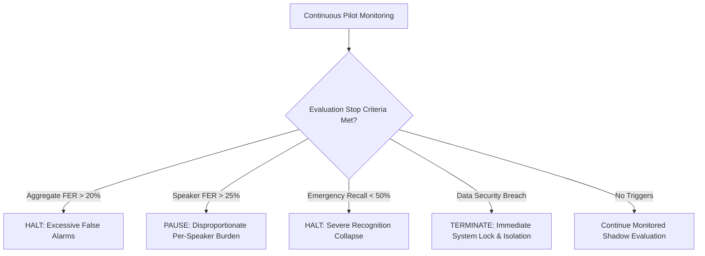

# Gate C: Stop Rules and Incident Response Plan

**Project:** Low-Resource Personalized Atypical Speech Recognition Using Hybrid Quantum-Classical Deep Learning for Reliable Emergency Communication  
**Document Identifier:** STOP-PLAN-PHASE-C-2026-V1  
**Status:** **DRAFT / SAFETY SPECIFICATION**  
**Lead Authors:** Clinical-ML Safety Lead, Systems Reliability Engineer  

---

## 1. Purpose & Scope

This document defines the formal stopping boundaries, incident triage classifications, escalation pathways, and decommissioning protocols for the proposed non-interventional controlled user pilot evaluation.

> [!CAUTION]
> The evaluation system is strictly non-interventional and operates in shadow mode. No live alerts, dispatch calls, or clinical interventions may be triggered. However, strict stopping boundaries are mandatory to prevent participant fatigue, data leakage, and algorithmic harm.

---

## 2. Prespecified Stopping Boundaries

The pilot evaluation must be immediately paused or permanently terminated if any of the following predefined stop conditions are met:

### 2.1 Algorithmic Stop Rules
1. **Excessive False Emergency Triggering:** If the aggregate False Emergency Rate exceeds **$\text{FER} > 20.0\%$** across any rolling window of 100 non-emergency utterances.
2. **Individual Participant Disparity Breach:** If any single participant experiences an individual False Emergency Rate exceeding **$\text{FER}_{speaker} > 25.0\%$** (comparable to historical F01 Phase 7.5 failure of $20.31\%$), evaluation for that participant must be immediately suspended.
3. **Severe Emergency Recall Collapse:** If the Emergency Intent Recall drops below **$\text{Recall}_{emergency} < 50.0\%$** across the first $N = 200$ emergency evaluation utterances (indicating that more than half of emergency phrases are missed).
4. **Calibration Drift Breach:** If the Brier score or Expected Calibration Error (ECE) on the evaluation cohort deteriorates by more than $50\%$ relative to the development cohort baseline.

### 2.2 Operational and Ethical Stop Rules
1. **Participant Distress / Fatigue:** Any indication of physical fatigue, respiratory strain, or vocal distress reported by the participant, speech-language pathologist, or caregiver results in immediate session termination.
2. **Data Security / Privacy Compromise:** Any unauthorized access, inadvertent transmission of unencrypted audio, or failure of pseudonymization mandates an immediate, total system halt.

---

## 3. Incident Severity Tiers & Escalation Matrix

| Severity Level | Definition | Examples | Response Time | Action Required |
| :--- | :--- | :--- | :--- | :--- |
| **Tier 1 (Critical)** | Potential human harm, regulatory violation, or security breach | Transmission of real-world alert; PII/PHI leakage; participant respiratory distress | **Immediate (< 1 hour)** | Immediate system shutdown; notify Project Owner, IRB, and Data Protection Officer within 24 hours. |
| **Tier 2 (High)** | Algorithmic failure crossing predefined stop boundaries | Rolling FER > 20%; speaker FER > 25%; runtime crash loop | **Within 4 hours** | Pause evaluation pipeline; freeze all evaluation data; initiate root-cause analysis (RCA). |
| **Tier 3 (Moderate)** | Non-blocking data quality defect or hardware irregularity | Microphone clipping; corrupted audio header; transient network glitch | **Within 24 hours** | Quarantine defective recordings; log defect in evaluation audit ledger; resume session. |

---

## 4. Root Cause Analysis (RCA) & Decommissioning

### 4.1 Post-Incident Investigation Procedure
Upon triggering a Tier 1 or Tier 2 incident:
1. **Immediate State Freeze:** The execution runner halts all inference. Memory dumps, audit logs, and configuration hashes are locked.
2. **Independent Review Panel:** A three-member review committee (Clinical Lead, ML Safety Auditor, Systems Architect) convenes within 48 hours.
3. **Formal RCA Document:** The committee completes a 5-Whys Root Cause Analysis investigating data provenance, acoustic noise, model divergence, and threshold selection.

### 4.2 Decommissioning Criteria
The evaluation system will be permanently decommissioned and Gate C formally declared failed if:
- Root cause analysis demonstrates that the model architecture cannot achieve $\text{Recall} \ge 70\%$ without exceeding $\text{FER} \le 15\%$ under realistic acoustic conditions.
- Institutional IRB revokes or suspends study approval.
- An unresolvable participant privacy breach occurs.
