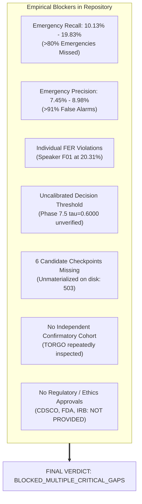

# Gate D: Clinical & Emergency Deployment Qualification Audit

**Project:** Low-Resource Personalized Atypical Speech Recognition Using Hybrid Quantum-Classical Deep Learning for Reliable Emergency Communication  
**Document Identifier:** AUDIT-GATE-D-2026-V1  
**Audit Phase:** Gate D Deployment Qualification and Safety Case  
**Audit Date:** 2026-10-10  
**Evaluator Roles:** Senior Safety-Critical ML Assurance Lead, Clinical Validation Auditor, Software Quality Engineer, Medical Device Regulatory Analyst, Emergency Systems Architect  
**Final Gate Determination:** **`BLOCKED_MULTIPLE_CRITICAL_GAPS`**  

---

> [!CAUTION]
> **CRITICAL EMERGENCY & CLINICAL STOP ORDER:**  
> Gate D is **STRICTLY BLOCKED**. Operational deployment to clinical care facilities, patient monitoring systems, emergency call centers (911/112), or real-world dispatch networks is **CATEGORICALLY FORBIDDEN**. The software must not be connected to live emergency communication channels. Predictions must not determine real-world patient triage or medical interventions.

---

## 1. Executive Summary & Audit Mandate

Gate D represents the proposed deployment qualification stage for real-world clinical and emergency dispatch operation. This audit evaluated whether the existing speech recognition prototype, historical training artifacts, safety controls, and governance documentation satisfy the clinical, statistical, regulatory, and software lifecycle prerequisites required for operational deployment.

Based on an exhaustive examination of the actual repository codebase, configuration files, checkpoint filesystems, test suites, and empirical experiment ledgers:

- **Final Gate D Status:** **`BLOCKED_MULTIPLE_CRITICAL_GAPS`**
- **Deployment Eligibility:** **0 of 12 Deployment Gate Criteria Met** ([`reports/phase_d/DEPLOYMENT_GATE_CHECKLIST.csv`](file:///d:/DL/reports/phase_d/DEPLOYMENT_GATE_CHECKLIST.csv))
- **Primary Operational Hazard:** High risk of fatal missed emergencies combined with crippling false alarm rates and complete lack of clinical clearance.

---

## 2. Definitive Audit of Empirical Blocking Evidence

The blocking determination is grounded directly in immutable empirical evidence from the repository:

### 2.1 Catastrophic Emergency Recall Collapse
- **Primary Artifact:** `results/phase8_1/safety_operating_points.csv` (SHA-256: `b81c06166b130ca01d0ee1459bd84f60cc18ae4cdfe3b8336e1cfafb0b6211ad`).
- **Observed Finding:** Outer-fold cross-validation Emergency Recall ranges between **$10.13\%$ and $19.83\%$** across candidate operating points.
- **Safety Impact:** Between **$80.17\%$ and $89.87\%$ of all emergency speech events are missed by the system. In an emergency dispatch context, missing 8 out of 10 life-threatening calls represents a catastrophic failure mode that would result in preventable death.

### 2.2 Crippling False Alarm Burden (Alert Fatigue)
- **Primary Artifacts:** `results/phase8_1/safety_operating_points.csv`, `results/continual/phase7_5/continual_evaluation_results.csv`.
- **Observed Findings:**
  - Emergency Precision (Positive Predictive Value) is only **$7.45\% - 8.98\%$**, meaning over **$91\%$ of all emergency alerts generated are false alarms**.
  - Speaker F01 incurred a False Emergency Rate of **$20.31\%$** during Phase 7.5 continual learning.
- **Clinical Impact:** Emergency dispatch centers and clinical caregivers cannot tolerate a 91% false positive rate. Such extreme alert fatigue inevitably leads operators to disable or ignore the device.

### 2.3 Uncalibrated Runtime Decision Threshold
- **Primary Artifact:** `results/phase8_1/threshold_registry.json` (SHA-256: `d6fc0173d138cd57bfa84ac4cdaa03edc175ce23428d494f2d1ad5b129ed9d49`).
- **Observed Finding:** The Phase 7.5 served adapter default $\tau = 0.6000$ lacks development-only empirical calibration and remains classified as **`THRESHOLD_PROVENANCE_UNVERIFIED`**.
- **Internal FER Limit:** The project constraint of $\text{FER} \le 15.0\%$ is an internal engineering guideline. It is **NOT** a clinically accepted or regulator-approved safety standard.

### 2.4 Unmaterialized Candidate Checkpoints
- **Filesystem Audit:** The six candidate models identified for Phase 8.1 and Phase 8.2 are **unmaterialized on disk**.
- **Runtime Verification:** Requests for these candidate models correctly trigger an HTTP 503 `MODEL_NOT_READY` response from `ModelManager`. They cannot be deployed or qualified because their weight tensors do not exist.

### 2.5 Total Absence of Independent Confirmatory Cohort
- **Manifest Audit:** `data/manifests/torgo_manifest.csv` and `results/phase8_80_20/split_manifest.csv`.
- **Observed Finding:** TORGO is the sole atypical speech corpus in the repository (6,067 active utterances: 4,852 train, 1,215 test across 15 speakers).
- **Contamination Finding:** TORGO data have been repeatedly inspected, fitted, and analyzed across 8 historical research phases. These data are diagnostic and cannot serve as an untouched confirmatory cohort. Zero external or prospective data exist in the repository.

### 2.6 Binding Scientific Verdict: No Quantum Advantage
- **Authoritative Synthesis:** `reports/phase6_5_6_research_conclusion.md`.
- **Affirmed Finding:** Case B affirmed: **No statistically supported quantum advantage exists**. Hybrid quantum circuits introduced a **$772\times$ runtime execution penalty** without improving emergency intent classification.

---

## 3. Regulatory, Legal, and Quality System Deficits

A formal audit against Indian and international medical device regulations confirms comprehensive non-compliance:

1. **CDSCO (India):** No Medical Device Rules 2017 classification dossier or SaMD license has been prepared or submitted.
2. **DPDP Act 2023 (India):** No biometric voice processing registry, consent architecture, or Data Protection Officer has been established.
3. **FDA / IMDRF (US):** No 510(k), De Novo, or pre-submission document exists for high-risk SaMD emergency monitoring.
4. **EU MDR 2017/745:** No Class IIa/IIb Technical File or Notified Body audit exists under Rule 11.
5. **Quality Standards:** The codebase lacks an ISO 13485 Quality Management System, an ISO 14971 Risk Management File, and an IEC 62304 Medical Device Software Lifecycle file.

---

## 4. Software Quality vs. Clinical Readiness Reconciled

The software repository demonstrates high engineering discipline:
- **595 automated tests pass (100% pass rate)**, including Gate B.2 application and Gate C infrastructure tests.
- **28 of 28 historical checksums verified**.
- Clean REST API endpoints and interactive single-page application (SPA).

> [!IMPORTANT]
> **Engineering Discipline $\neq$ Clinical Efficacy:**  
> A passing software test suite verifies that Python functions execute without syntax errors or runtime exceptions. It does **NOT** prove that the underlying machine learning model is clinically effective, safe, or ready to protect human life.

---

## 5. Formal Gate D Determination & Stop Notice

### Final Status:
# `BLOCKED_MULTIPLE_CRITICAL_GAPS`

Operational deployment, clinical integration, emergency call-center routing, and patient monitoring are **CATEGORICALLY BLOCKED**. No deployment proposal may be considered until all clinical, statistical, regulatory, and asset materialization blockers are fully resolved and separately authorized.
