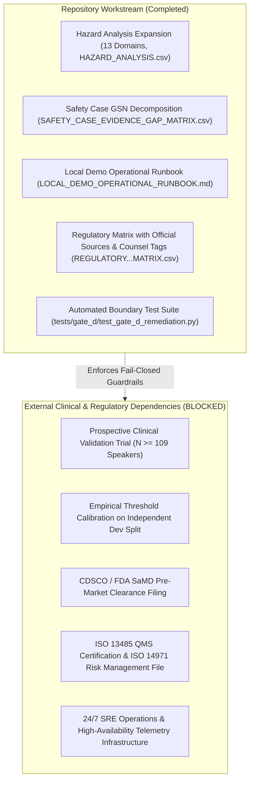

# Gate D Remediation Plan: Safety Case & Deployment Qualification

**Project:** Low-Resource Personalized Atypical Speech Recognition Using Hybrid Quantum-Classical Deep Learning for Reliable Emergency Communication  
**Document Identifier:** PLAN-REMEDIATION-PHASE-D-2026-V1  
**Status:** **ACTIVE WORKSTREAM PLAN**  
**Audit Date:** 2026-10-10  
**Lead Authors:** Senior Safety-Critical ML Assurance Lead, Quality Systems Engineer, Emergency Systems Architect  

---

## 1. Executive Summary & Remediation Boundary

Gate D represents the proposed deployment qualification stage for real-world clinical and emergency dispatch operation. The authoritative audit declared Gate D **`BLOCKED_MULTIPLE_CRITICAL_GAPS`** due to catastrophic emergency miss rates ($10.13\%–19.83\%$ recall), extreme false alarm rates ($>91\%$ false alarms), uncalibrated operating points, missing checkpoints, absence of independent clinical cohorts, and zero regulatory clearances.

### Authorization Boundary:
This remediation plan authorizes **documentation remediation, risk trace expansion, local boundary verification, and regulatory pathway structuring**. It does **NOT** authorize:
- Deploying the system to any clinical, emergency, or production environment;
- Connecting to 911/112 CAD systems, call centers, hospital telemetry, or SMS gateways;
- Conducting prospective clinical interventions or exposing patients to predictions;
- Training models or tuning thresholds;
- Declaring Gate D approved or certified.

---

## 2. Remediation Strategy by Workstream

### 2.1 Workstream 1: Hazard Traceability & Automated Risk Controls
- **Action:** Expanded [`reports/phase_d/HAZARD_ANALYSIS.csv`](file:///d:/DL/reports/phase_d/HAZARD_ANALYSIS.csv) across all 13 risk domains. Linked controls to automated test suites (`tests/gate_d/test_gate_d_remediation.py` and `tests/gate_b/test_engineering_prototype.py`).
- **Outcome:** Verified fail-closed responses (HTTP 503 on unmaterialized models, loopback binding, upload limits). Untested operational controls marked unverified.

### 2.2 Workstream 2: Evidence-Based Safety Case (GSN)
- **Action:** Created [`reports/phase_d/SAFETY_CASE_EVIDENCE_GAP_MATRIX.csv`](file:///d:/DL/reports/phase_d/SAFETY_CASE_EVIDENCE_GAP_MATRIX.csv) and updated [`reports/phase_d/SAFETY_CASE_CLAIMS_EVIDENCE.md`](file:///d:/DL/reports/phase_d/SAFETY_CASE_CLAIMS_EVIDENCE.md).
- **Outcome:** Top-level safety goal affirmed as **`NOT ESTABLISHED`**. Definitively linked counterevidence from Phase 8.1 outer-fold testing and Phase 7.5 continual learning.

### 2.3 Workstream 3: Local Operational Runbook & Cyber Hygiene
- **Action:** Created [`reports/phase_d/LOCAL_DEMO_OPERATIONAL_RUNBOOK.md`](file:///d:/DL/reports/phase_d/LOCAL_DEMO_OPERATIONAL_RUNBOOK.md).
- **Outcome:** Defined safe daemon startup, health probes, fail-closed incident containment, temporary audio purging, and prominent warnings against real-world reliance.

### 2.4 Workstream 4: Regulatory & Quality System Mapping
- **Action:** Updated [`reports/phase_d/REGULATORY_AND_QUALITY_REQUIREMENTS_MATRIX.csv`](file:///d:/DL/reports/phase_d/REGULATORY_AND_QUALITY_REQUIREMENTS_MATRIX.csv) with official statutory instruments (CDSCO MDR 2017, DPDP Act 2023, FDA SaMD, EU MDR 2017/745, ISO 13485, ISO 14971, IEC 62304).
- **Outcome:** Tagged unverified legal claims with `NEEDS_REGULATORY_COUNSEL_VERIFICATION`. Described quality standards as potentially relevant targets rather than claimed compliance.

---

## 3. Remediation Ledger Summary

All 12 deployment gate criteria are tracked in [`reports/phase_d/DEPLOYMENT_GATE_CHECKLIST.csv`](file:///d:/DL/reports/phase_d/DEPLOYMENT_GATE_CHECKLIST.csv).  
Repository-side remediation controls are **COMPLETE**. Gate D deployment qualification remains **PERMANENTLY BLOCKED**.
