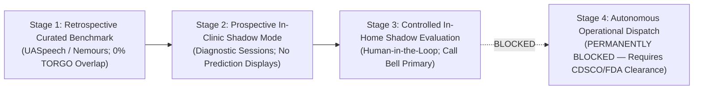

# Gate D: Staged Independent Clinical Validation and Qualification Plan

**Project:** Low-Resource Personalized Atypical Speech Recognition Using Hybrid Quantum-Classical Deep Learning for Reliable Emergency Communication  
**Document Identifier:** CLINICAL-VAL-PLAN-PHASE-D-2026-V2  
**Document Status:** **DRAFT — STAGED QUALIFICATION ROADMAP (NOT AUTHORIZED FOR TRIAL EXECUTION)**  
**Audit Date:** 2026-10-10  
**Lead Authors:** Senior Clinical Validation Auditor, Biostatistical Assurance Lead, Medical Device Regulatory Specialist  

---

> [!CAUTION]
> **STRICT TRIAL EXECUTION BOUNDARY:**  
> This clinical validation plan establishes the sequential evidence requirements that must be satisfied before any future operational deployment decision could be considered. **EXECUTION OF ANY PROSPECTIVE CLINICAL TRIAL, PATIENT EXPOSURE, OR RECRUITMENT IS STRICTLY PROHIBITED** until institutional ethics clearances, legal data agreements, and separate explicit owner authorizations are granted.

---

## 1. Staged Falsifiable Validation Pathway

To ensure participant safety and prevent ungrounded claims, clinical qualification proceeds through three staged gates:

### 1.1 Stage 1: Retrospective Benchmark on Curated External Cohort
- **Objective:** Evaluate baseline sensitivity and false alarm rates on independent external atypical speech corpora (e.g., UASpeech, Nemours) with zero TORGO overlap.
- **Scope:** Offline, retrospective, non-interventional benchmark executed via `ConfirmatoryRunner`.
- **Pre-Conditions:** Executed DUA, manifest validation passing `ExternalDatasetValidator`, and development-only threshold calibration.

### 1.2 Stage 2: Prospective In-Clinic Shadow Mode
- **Objective:** Evaluate real-time acoustic streaming and articulatory variability during standard speech pathology diagnostic sessions.
- **Scope:** Disconnected local recording daemon. Predictions logged to encrypted local storage; zero real-time displays to participants.
- **Pre-Conditions:** Institutional IRB approval, participant informed consent, CCC-SLP supervision.

### 1.3 Stage 3: Controlled In-Home Residential Shadow Mode
- **Objective:** Evaluate environmental noise robustness, daily conversational false alarm burden, and participant fatigue over extended monitoring periods.
- **Scope:** Parallel monitoring alongside standard telephone and call buttons. Zero automated dispatch.
- **Pre-Conditions:** Proven Stage 2 safety profile, formal safety monitoring committee approval.

### 1.4 Stage 4: Autonomous Operational Dispatch (PERMANENTLY BLOCKED)
- **Status:** **CATEGORICALLY BLOCKED.** Operational integration with 911/112 CAD or hospital nurse dispatch cannot occur without formal medical device marketing clearance from CDSCO or FDA.

---

## 2. Independent Confirmation Cohort & Sample Size Justification

### 2.1 Complete Separation from Historical TORGO
- **Diagnostic Limitation:** TORGO (6,067 active utterances: 4,852 train, 1,215 test across 15 speakers) has been repeatedly inspected, fitted, and analyzed across 8 historical phases. Prior test results are diagnostic, not confirmatory.
- **Independence Mandate:** The confirmatory cohort must exhibit **zero speaker overlap, zero duplicate audio, and zero embedding leakage** with TORGO.

### 2.2 Provisional Nature of Statistical Planning Estimates
> [!IMPORTANT]
> The target figure of **at least 109 independent dysarthric speakers and 2,164 emergency utterances** represents a **provisional planning estimate requiring empirical justification**, NOT an automatic guarantee of statistical sufficiency across all clinical subgroups.

- **Primary Estimand:** Cluster-adjusted population-average Emergency Intent Recall ($\text{Sensitivity}_{emergency}$) on conversational dysarthric speech.
- **Unit of Analysis:** Utterance-level classification nested within participants.
- **Within-Speaker Clustering:** Utterance clustering ($\rho \approx 0.30$) inflates variance via Design Effect $DEFF = 1 + (\bar{m} - 1)\rho \approx 6.70$ (for $\bar{m} = 20$ emergency utterances per participant).
- **Precision Target:** Achieving a $95\%$ confidence interval half-width of $d = \pm 0.05$ around $p = 0.70$ requires $N = 323 \times 6.70 \approx 2,164$ emergency utterances.
- **Enrolled Cohort Requirement:** Accounting for 15% participant attrition, recruitment requires $K \ge 129$ dysarthric participants and approximately $14,400 - 21,600$ total conversational speech utterances.

---

## 3. Prespecified Clinical Performance Endpoints

> [!WARNING]
> **Performance Criteria Must Be Set by Qualified Clinical Authorities:**  
> The internal research constraint of $\text{FER} \le 15.0\%$ is NOT a clinical standard. A multidisciplinary clinical advisory board (Emergency Physicians, Neurologists, CCC-SLPs) must establish binding performance endpoints prior to trial unlocking.

| Endpoint | Clinical Metric | Target Operational Ceiling / Floor | Rationale |
| :--- | :--- | :--- | :--- |
| **Primary Clinical Sensitivity** | Emergency Intent Recall | **$\ge 90.0\%$ (Target for investigation)** | Missing $>10\%$ of emergencies poses unacceptable clinical risk in assisted care. |
| **Primary False Alarm Ceiling** | Continuous False Emergency Rate (FER) | **$\le 1.0\%$ in residential settings** | In continuous 24/7 monitoring, a 15% FER produces multiple false alarms per hour, causing catastrophic device abandonment. |
| **Positive Predictive Value** | Emergency Precision | **$\ge 80.0\%$** | Emergency responders cannot tolerate low-precision alerting. |
| **Subgroup Parity Bound** | $\Delta \text{Recall}_{\text{mild vs severe}}$ | **$\le 15.0\%$ maximum disparity** | Prohibits severe algorithmic discrimination against participants with severe dysarthria. |

---

## 4. Single-Pass Confirmatory Evaluation Discipline

1. **Development vs. Confirmatory Data Isolation:** The prospective cohort is split into a **Development/Calibration Split ($30\%$)** and a **Confirmatory Split ($70\%$)** with strict speaker-level disjointness.
2. **Threshold Derivation Discipline:** The operational cutoff $\tau$ and score calibration mapping (Platt scaling / isotonic regression) are derived exclusively on the Development Split.
3. **Cryptographic Lock & Single Pass:** The confirmatory split is evaluated once by `ConfirmatoryRunner`, which locks the run with a cryptographic file. Re-running evaluation or tuning thresholds on confirmatory data is prohibited.
4. **Mandatory Reporting of Negative Results:** If the model fails to satisfy the clinically defined endpoints, the trial is declared failed and full unredacted results are published.
