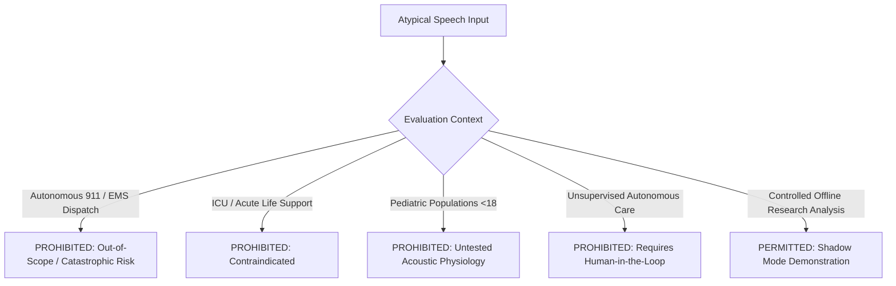

# Gate D: Intended Use and Out-of-Scope Statement (Draft)

**Project:** Low-Resource Personalized Atypical Speech Recognition Using Hybrid Quantum-Classical Deep Learning for Reliable Emergency Communication  
**Document Identifier:** INTENDED-USE-PHASE-D-2026-DRAFT  
**Document Version:** 1.0.0 (DRAFT / FOR REGULATORY & CLINICAL ADVISORY REVIEW)  
**Status:** **NOT APPROVED FOR CLINICAL OR OPERATIONAL USE**  
**Audit Date:** 2026-10-10  

---

> [!CAUTION]
> **INVESTIGATIONAL SYSTEM DISCLAIMER:**  
> This software is an investigational engineering research prototype. It has **NOT been evaluated, cleared, or approved by the Central Drugs Standard Control Organisation (CDSCO), the United States Food and Drug Administration (FDA), or any European Notified Body**. It is **STRICTLY PROHIBITED** from use in clinical diagnosis, patient monitoring, emergency triage, automated 911 dispatch, or life-safety systems.

---

## 1. Intended Use Definition (Proposed)

### 1.1 Device Category & Functional Classification
The system is designed as an **Investigational Clinical Decision Support Tool (Non-Device Software / Pre-Market Prototype)** intended to assist trained caregivers and speech-language pathologists in exploring acoustic intent recognition from dysarthric vocalizations.

### 1.2 Target User Population
- **Primary Beneficiaries:** Adults (aged 18 years and older) with diagnosed mild, moderate, or severe dysarthria secondary to non-progressive or slowly progressive neurological conditions (e.g., Cerebral Palsy, post-stroke motor impairment, Parkinson's disease, or Amyotrophic Lateral Sclerosis [ALS]).
- **Secondary Operators:** Trained family caregivers, professional speech-language pathologists (CCC-SLP), and credentialed research investigators.

### 1.3 Intended Acoustic & Operational Environment
- **Acoustic Environment:** Controlled domestic or assisted-care indoor residential settings with ambient sound levels below 55 dBA.
- **Microphone Hardware:** Close-proximity condenser headset microphones (mouth-to-capsule distance 3–5 cm) or calibrated desktop array microphones.
- **Language & Dialect:** Standard spoken English.

---

## 2. Explicit Out-of-Scope Uses & Contraindications

The system is strictly contraindicated and out-of-scope for the following environments, applications, and populations:

1. **Automated Emergency Dispatch:** Under no circumstances may this software connect directly or indirectly to public safety answering points (PSAPs), 911 call centers, police, fire, or ambulance dispatch networks.
2. **Autonomous Alerting Without Human Verification:** The system must never independently dispatch emergency personnel or trigger actionable alarms without mandatory real-time human verification.
3. **Acute Medical Care & Intensive Care Units (ICU):** Prohibited from use in hospital ICUs, emergency departments, or surgical suites where instantaneous response is essential for life preservation.
4. **Pediatric Use:** Prohibited for individuals under 18 years of age due to fundamental differences in vocal tract physiology, pitch variability, and developmental dysarthria acoustics.
5. **Acoustically Hostile Environments:** Prohibited in public transit, outdoor crowds, industrial environments, or rooms with signal-to-noise ratios (SNR) below 12 dB.
6. **Non-English Speech:** Prohibited for non-English speakers or accented speech outside the training baseline without formal retraining and verification.

---

## 3. System Behavior Under Adverse & Edge Conditions

The system implements defensive fail-safe behaviors to ensure user safety when operational assumptions are violated:

| Operational Condition | Detection Mechanism | System Action & Output | Safety Rationale |
| :--- | :--- | :--- | :--- |
| **Requested Model Unmaterialized** | File verification in `ModelManager` | **HTTP 503 `MODEL_NOT_READY`** | Prevents execution of missing Phase 8.1/8.2 models; prohibits silent fallback to incompatible weights. |
| **Speaker Unknown / Unenrolled** | Session handshake & enrollment check | **`SPEAKER_UNKNOWN` Abstention** | Informs user that personalized adapter is unavailable; uses generic baseline with low confidence flag. |
| **Severe Acoustic Noise (SNR < 10 dB)** | Preprocessing DSP energy estimator | **`POOR_AUDIO_QUALITY` Abstention** | Refuses inference on severely corrupted or clipped audio to prevent random false emergency alarms. |
| **Acoustic Waveform Clipping** | Amplitude saturation detector | **`AUDIO_CLIPPED` Warning** | Instructs user to adjust microphone distance; flags prediction as unverified. |
| **Intent Class Zero Support** | Class taxonomy validation | **Explicit `N/A` Metric Output** | Prohibits algorithmic imputation of 0.0 or 1.0 on unsupported intent classes. |
| **Network / Server Disconnection** | Heartbeat watchdog | **Immediate UI Disconnect Banner** | Caregiver immediately alerted that monitoring is inactive; fallback to physical call bell. |

---

## 4. Human Operator Responsibilities & Automation Safeguards

1. **Mandatory Human-in-the-Loop:** All model outputs represent unverified diagnostic signals. The caregiver or clinician bears sole legal and operational responsibility for interpreting patient needs and contacting medical assistance.
2. **Physical Call Bell Priority:** Users and caregivers are explicitly instructed that standard physical emergency buttons, pull cords, or telephone lines remain the **primary, authoritative emergency communication channel**.
3. **Prohibition of Reliance:** The user interface displays an omnipresent, un-dismissible warning:
   > *"DEMONSTRATION ONLY: This research software misses emergency requests and generates false alarms. Never rely on this screen for safety or medical emergencies."*

---

## 5. Comprehensive Summary of Known Technical Limitations

1. **Severe Emergency Miss Rate:** Outer-fold cross-validation in Phase 8.1 demonstrated Emergency Recall between **$10.13\%$ and $19.83\%$**, meaning over **$80\%$ of emergency calls are missed**.
2. **Extreme False Alarm Rate:** Phase 8.1 Emergency Precision was **$7.45\% - 8.98\%$**, meaning over **$91\%$ of emergency predictions are false alarms**.
3. **Severe Speaker Disparity:** Phase 7.5 continual learning exhibited an individual False Emergency Rate of **$20.31\%$** for Speaker F01, demonstrating severe risk of alert fatigue for specific speakers.
4. **Uncalibrated Operating Point:** The demonstration default threshold $\tau = 0.6000$ remains **`THRESHOLD_PROVENANCE_UNVERIFIED`** and cannot guarantee any safety or error rate envelope.
