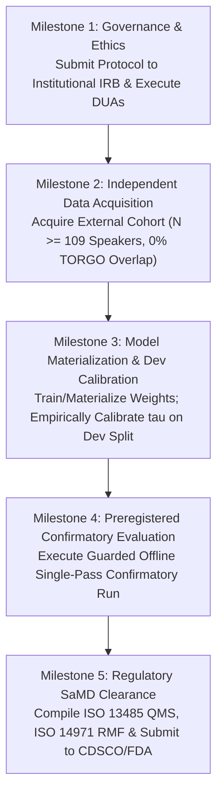

# Gate D: Owner Decision Memo & Deployment Blockers Summary

**Project:** Low-Resource Personalized Atypical Speech Recognition Using Hybrid Quantum-Classical Deep Learning for Reliable Emergency Communication  
**Document Identifier:** MEMO-OWNER-GATE-D-2026-V2  
**Addressed To:** Project Owner & Steering Committee  
**From:** Independent Clinical-ML Validation Lead & Senior Safety Assurance Auditor  
**Date:** 2026-10-10  
**Subject:** Formal Gate D Deployment Qualification Audit Verdict & Actionable Remediation Roadmap  

---

## 1. Executive Summary & Definitive Verdict

Following an exhaustive audit of repository source code, model checkpoints, statistical evaluations, regulatory documentation, and safety hazards:

### Official Gate Determinations:
- **Gate C (Controlled User Pilot):** **`BLOCKED_NO_INDEPENDENT_CONFIRMATION_COHORT`**
- **Gate D (Clinical / Emergency Deployment):** **`BLOCKED_MULTIPLE_CRITICAL_GAPS`**

> [!CAUTION]
> **OPERATIONAL DEPLOYMENT IS CATEGORICALLY FORBIDDEN.**  
> The system must NOT be deployed to clinical environments, integrated into emergency dispatch call centers (911/112), or utilized for real-world patient decision-making. No human participants may be recruited or exposed to predictions without prior independent ethics approval and separate explicit owner authorization.

---

## 2. Synthesis of Critical Blocking Gaps

The decision to block Gate D is necessitated by six unyielding empirical and governance realities:

| Blocker ID | Domain | Critical Finding | Impact on Deployment Safety |
| :--- | :--- | :--- | :--- |
| **BLK-D-01** | Clinical Performance | **Emergency Recall is $10.13\% - 19.83\%$** (Phase 8.1 outer fold) | **Over $80\%$ of true emergencies are missed**. Fatal failure mode for emergency communications. |
| **BLK-D-02** | Clinical Performance | **Emergency Precision is $7.45\% - 8.98\%$**; F01 FER is **$20.31\%$** | **Over $91\%$ of emergency alerts are false alarms**, inducing crippling alert fatigue. |
| **BLK-D-03** | Algorithmic Integrity | Served model threshold $\tau = 0.6000$ has **`THRESHOLD_PROVENANCE_UNVERIFIED`** | Operational threshold is an uncalibrated default lacking empirical derivation on dev data. |
| **BLK-D-04** | Model Availability | **Six candidate checkpoints are unmaterialized** on disk | Models cannot be evaluated or served; correctly return HTTP 503 `MODEL_NOT_READY`. |
| **BLK-D-05** | Confirmatory Data | **Zero independent atypical speech data** exist in repository | TORGO data (6,067 utterances) are repeatedly inspected diagnostic data; cannot confirm safety. |
| **BLK-D-06** | Regulatory & Legal | **Zero regulatory clearances** (CDSCO, FDA, CE) or IRB approvals exist | Commercial or clinical operation violates medical device and data protection laws. |

---

## 3. Actionable Remediation Roadmap for the Project Owner

Before the project owner can consider lifting Gate C or Gate D blockers, the following sequential milestones must be achieved:

### Milestone 1: Institutional Ethics & Governance Clearance
- **Action:** Submit [`reports/phase_c/ETHICS_DUA_AND_CLINICAL_OVERSIGHT_SUBMISSION_PACKAGE.md`](file:///d:/DL/reports/phase_c/ETHICS_DUA_AND_CLINICAL_OVERSIGHT_SUBMISSION_PACKAGE.md) to an accredited Institutional Review Board (IRB).
- **Deliverable:** Stamped IRB protocol approval letter and executed Data Use Agreements (DUA).

### Milestone 2: Independent Confirmatory Cohort Acquisition
- **Action:** Secure access to an untouched, external atypical speech cohort (e.g., partitioned UASpeech or prospective hospital registry) with zero TORGO overlap.
- **Deliverable:** Validated dataset manifest satisfying `ExternalDatasetValidator` schema and provenance checks.

### Milestone 3: Model Materialization & Development-Only Calibration
- **Action:** Materialize and hash candidate model weights; derive and empirically calibrate an operational threshold $\tau$ strictly on development data.
- **Deliverable:** Updated threshold registry with certified Brier scores and retiring the uncalibrated $\tau = 0.6000$ default.

### Milestone 4: Preregistered Confirmatory Evaluation
- **Action:** Preregister the evaluation plan on the Open Science Framework (OSF); unlock confirmatory data for a single-pass run using `ConfirmatoryRunner`.
- **Deliverable:** Public confirmatory audit report detailing Emergency Recall, Precision, and per-speaker disparity.

### Milestone 5: Regulatory & Quality System Certification
- **Action:** Establish an ISO 13485 compliant Quality Management System and compile an ISO 14971 Risk Management File.
- **Deliverable:** Statutory SaMD clearance / investigational device exemption from CDSCO or FDA.

---

## 4. Strict Stop Conditions & Owner Attestation

By receiving this audit dossier, the project steering committee reaffirms adherence to the following non-negotiable boundaries:
1. **No live emergency dispatch or call-center connections.**
2. **No participant recruitment or clinical use without documented IRB approval.**
3. **No claims of clinical safety, regulatory approval, or quantum advantage.**
4. **Gates C and D remain strictly BLOCKED in all repository registries.**
