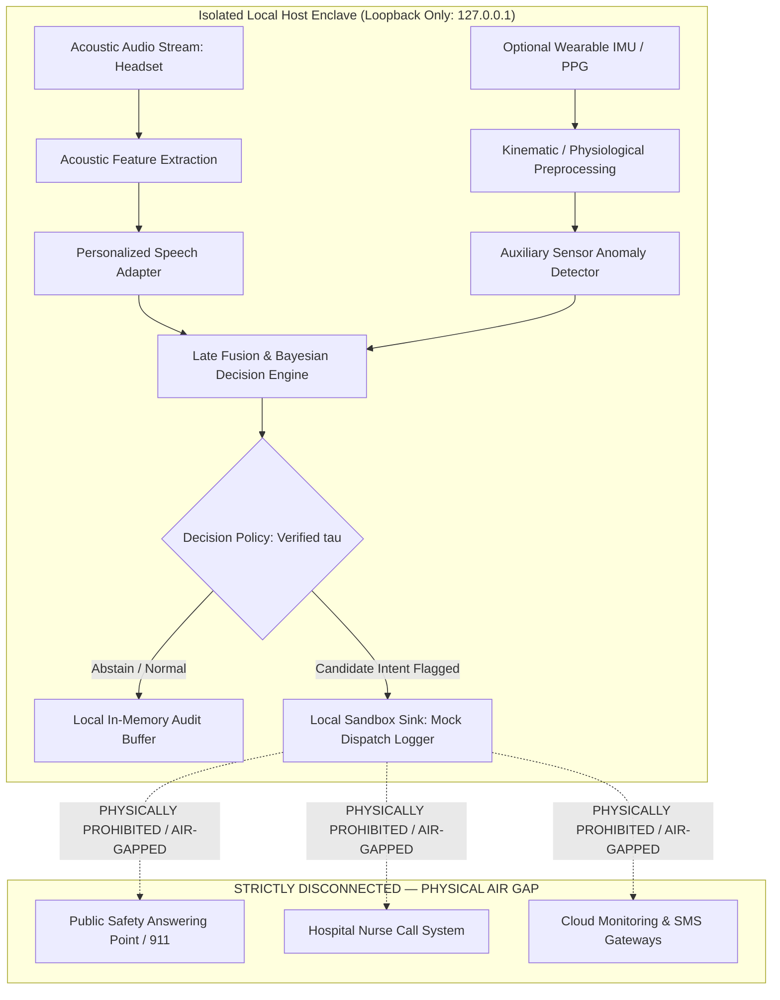

# Gate D: Proposed Disconnected Multimodal and Dispatch Architecture (Specification & Assessment)

**Project:** Low-Resource Personalized Atypical Speech Recognition Using Hybrid Quantum-Classical Deep Learning for Reliable Emergency Communication  
**Document Identifier:** ARCH-SPEC-PHASE-D-2026-V1  
**Architecture Status:** **CONCEPTUAL SPECIFICATION ONLY — STRICTLY DISCONNECTED FROM LIVE NETWORKS**  
**Audit Date:** 2026-10-10  
**Lead Authors:** Emergency Systems Architect, Clinical ML Systems Engineer  

---

> [!CAUTION]
> **NETWORK ISOLATION & NON-ROUTABLE SINK MANDATE:**  
> This document specifies an isolated, local-only architectural concept for engineering assessment. **NO LIVE DISPATCH INTEGRATION IS AUTHORIZED OR IMPLEMENTED.** The software must NOT be connected to Public Safety Answering Points (PSAPs), 911/112 CAD systems, telephone networks, SMS gateways, hospital nurse-call systems, or electronic health records (EHR). Any future sandbox testing must bind exclusively to a non-routable local loopback sink (`127.0.0.1`) and requires separate explicit authorization.

---

## 1. Architectural Philosophy: Air-Gapped Local-First Design

To guarantee absolute safety during exploratory development, the architecture enforces an air-gapped boundary between the local inference engine and external telecommunication infrastructure:



---

## 2. Multimodal Sensor Assessment: Rationale and Limitations

While integrating auxiliary physiological and kinematic sensors is frequently proposed to compensate for acoustic speech degradation, **adding sensors cannot be assumed to improve performance without rigorous empirical proof**.

### 2.1 Evaluated Modalities & Failure Mode Hypotheses

| Proposed Auxiliary Sensor | Targeted Acoustic Failure Mode | Theoretical Hypothesis | Technical & Clinical Hazards Introduced | Regulatory & Privacy Burden |
| :--- | :--- | :--- | :--- | :--- |
| **Wearable 6-Axis IMU (Accelerometer / Gyroscope)** | Missed verbal emergency during a physical fall (`accident_emergency`) | Rapid acceleration followed by prolonged immobility flags high fall probability, boosting emergency prior. | High false alarms during normal bed transfers or dropped sensor; battery depletion; device detachment. | Low-to-Moderate (accelerometry is non-biometric, but gait patterns can be re-identifiable). |
| **Photoplethysmography (PPG) / Heart Rate Sensor** | Articulatory collapse during acute cardiovascular distress (`medical_emergency`) | Acute tachycardia ($>130$ bpm) or extreme bradycardia provides physiological corroboration of distress. | Motion artifacts in dysarthric tremor mimic arrhythmias; high latency ($10–30$ seconds to physiological response). | High (Continuous biometric health data governed by HIPAA and DPDP Act). |
| **Computer Vision (Facial Expression / Gaze)** | Complete vocal aphonia or respiratory fatigue preventing speech | Facial grimacing or sustained fixation on panic target signals distress. | Severe privacy invasion in domestic living space; occlusion from bedrails or blankets; lighting sensitivity. | Extreme (Facial biometric templates require extensive explicit legal consent). |

### 2.2 Multimodal Fusion Strategy & Degradation Modes
If multimodal signals are introduced in future authorized research:
1. **Late Decision Fusion:** Acoustic intent and sensor signals must be processed via independent specialized backends and combined via a **Bayesian Belief Network** or Dempster-Shafer evidential framework:
   $$P(\text{Emergency} \mid X_{audio}, X_{sensor}) = \frac{P(X_{audio} \mid \text{Em}) P(X_{sensor} \mid \text{Em}) P(\text{Em})}{P(X_{audio}, X_{sensor})}$$
2. **Missing-Sensor Graceful Degradation:** If an auxiliary wearable disconnects or runs out of battery, the decision engine must gracefully degrade to unimodal acoustic inference without raising an exception, explicitly logging `SENSOR_DROPPED`.
3. **Independent Performance Qualification:** Auxiliary sensors must demonstrate an independent positive predictive value ($PPV$) and receiver operating characteristic ($AUROC$) in a preregistered clinical trial before inclusion in the fusion engine.

---

## 3. Disconnected Local Mock Dispatch Interface Specification

To permit engineering validation of serialization, payload schemas, and latency without risking live network transmission, the system specifies a **local-only mock sink**:

### 3.1 Interface Contract (JSON Schema)
```json
{
  "$schema": "https://json-schema.org/draft/2020-12/schema",
  "title": "LocalMockDispatchEvent",
  "type": "object",
  "properties": {
    "event_id": { "type": "string", "format": "uuid" },
    "timestamp_iso8601": { "type": "string" },
    "system_mode": { "type": "string", "enum": ["LOCAL_RESEARCH_DEMONSTRATION"] },
    "speaker_id": { "type": "string" },
    "inferred_intent": { "type": "string" },
    "calibrated_score": { "type": "number", "minimum": 0.0, "maximum": 1.0 },
    "operating_threshold": { "type": "number" },
    "audio_snr_db": { "type": "number" },
    "dispatch_action": { "type": "string", "enum": ["MOCK_LOG_ONLY_NO_EXTERNAL_TRANSMISSION"] }
  },
  "required": [
    "event_id", "timestamp_iso8601", "system_mode", "inferred_intent",
    "calibrated_score", "operating_threshold", "dispatch_action"
  ]
}
```

### 3.2 Technical Safeguards Against Accidental Transmission
1. **Loopback Binding Only:** The API service binds strictly to `127.0.0.1` and refuses non-local connections.
2. **Zero External Sockets:** The codebase contains zero HTTP client calls (`requests`, `httpx`, `aiohttp`, `urllib`) pointing to external IP addresses or external dispatch URLs.
3. **Mock Logger Sink:** Events are written strictly to an in-memory buffer or a local test file in `reports/` for audit verification.
4. **No Telephony / Twilio SDKs:** Telecommunication SDKs (e.g., Twilio, Asterisk, WebRTC gateway) are strictly prohibited from the repository dependencies.
