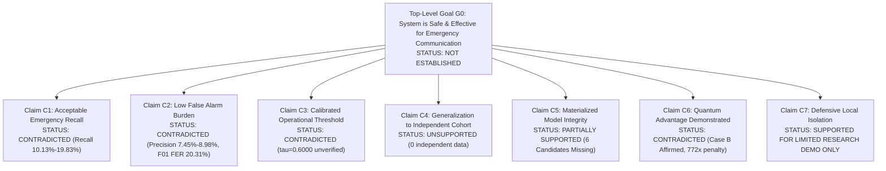

# Gate D: Safety Case — Structured Claims, Arguments, and Evidence (GSN)

**Project:** Low-Resource Personalized Atypical Speech Recognition Using Hybrid Quantum-Classical Deep Learning for Reliable Emergency Communication  
**Document Identifier:** SAFETY-CASE-PHASE-D-2026-V2  
**Framework:** Goal Structuring Notation (GSN) / ISO 14971 Risk Management  
**Top-Level Safety Goal Status:** **`NOT ESTABLISHED` (DEFINITIVELY DEFEATED BY CURRENT EVIDENCE)**  
**Audit Date:** 2026-10-10  
**Lead Authors:** Senior Safety-Critical ML Assurance Lead, Quality Systems Engineer  

---

## 1. Top-Level Safety Goal ($G_0$)

> **Top-Level Goal ($G_0$):**  
> *"The personalized speech recognition system operates with sufficient diagnostic accuracy, algorithmic calibration, and system reliability to assist dysarthric individuals in communicating emergency intents without introducing unacceptable risks of missed emergencies or false alarm dispatch."*  
> 
> **Authoritative Audit Verdict:** **`NOT ESTABLISHED`**  
> Empirical repository evidence directly refutes the top-level safety goal across multiple independent domains. The system cannot be qualified or approved for emergency deployment.

---

## 2. Evidence Decomposition & Claim Evaluation

Detailed evidence mapping for every sub-claim is formally tracked in [`reports/phase_d/SAFETY_CASE_EVIDENCE_GAP_MATRIX.csv`](file:///d:/DL/reports/phase_d/SAFETY_CASE_EVIDENCE_GAP_MATRIX.csv):

### 2.1 Claim C1: Acceptable Emergency Recall (Sensitivity)
- **Claim Formulation:** The speech recognition model detects emergency intents with high sensitivity ($\ge 90\%$), preventing fatal delays during acute crises.
- **Observed Empirical Evidence:**
  - `results/phase8_1/safety_operating_points.csv` (`SHA-256: b81c06166b130ca01d0ee1459bd84f60cc18ae4cdfe3b8336e1cfafb0b6211ad`):
    - Outer-fold Emergency Recall ranges from **$10.13\%$ to $19.83\%$**.
- **Counterevidence / Failure Mode:**
  - The model **misses between $80.17\%$ and $89.87\%$ of all true emergency utterances** under realistic cross-validation folds.
  - Relying on this system in real emergencies would expose dysarthric users to a catastrophic, life-threatening risk of unassisted failure.
- **Status:** **`CONTRADICTED`** (Claim Defeated)

---

### 2.2 Claim C2: Low False Emergency Burden (Alert Fatigue Prevention)
- **Claim Formulation:** The system maintains an acceptably low false alarm rate ($\text{FER} \le 1.0\%$) to prevent alert fatigue and unwarranted emergency service dispatch.
- **Observed Empirical Evidence:**
  - `results/phase8_1/safety_operating_points.csv`: Emergency Precision is **$7.45\% - 8.98\%$**.
  - `results/continual/phase7_5/continual_evaluation_results.csv`: Speaker F01 incurred a continual FER of **$20.31\%$**.
- **Counterevidence / Failure Mode:**
  - Over **$91\%$ of all emergency predictions are false alarms**.
  - An alert precision below 10% guarantees that caregivers will disable or ignore the device, inducing dangerous alert fatigue and rendering the system clinically unusable.
- **Status:** **`CONTRADICTED`** (Claim Defeated)

---

### 2.3 Claim C3: Threshold Calibration & Provenance
- **Claim Formulation:** The runtime decision cutoff $\tau$ is mathematically calibrated on development data to guarantee a verified error distribution.
- **Observed Empirical Evidence:**
  - `results/phase8_1/threshold_registry.json` (`SHA-256: d6fc0173d138cd57bfa84ac4cdaa03edc175ce23428d494f2d1ad5b129ed9d49`):
    - Phase 7.5 demonstration default $\tau = 0.6000$ remains **`THRESHOLD_PROVENANCE_UNVERIFIED`**.
    - Historical Phase 8.2 accidentally copied the $15.0\%$ FER ceiling as $\tau = 0.1500$.
- **Counterevidence / Failure Mode:**
  - Output scores represent uncalibrated classifier logits, not true posterior probabilities.
  - The project constraint of $\text{FER} \le 15.0\%$ is an internal research limit, NOT a clinically validated standard.
- **Status:** **`CONTRADICTED`** (Claim Defeated)

---

### 2.4 Claim C4: Generalization to Independent Prospective Cohorts
- **Claim Formulation:** Performance is validated on an untouched external atypical speech cohort independent of training or exploratory splits.
- **Observed Empirical Evidence:**
  - `data/manifests/torgo_manifest.csv`: TORGO (6,067 active utterances across 15 speakers) is the sole atypical speech corpus in the repository.
  - `results/phase8_2/confirmation_dataset_inventory.csv`: Contains only 100 mock synthetic rows.
- **Counterevidence / Failure Mode:**
  - TORGO data have been repeatedly inspected, fitted, and analyzed across 8 historical phases. Prior test results are diagnostic, not confirmatory.
  - Exactly zero independent atypical speech records exist in the repository.
- **Status:** **`UNSUPPORTED`** (External Evidence Required)

---

### 2.5 Claim C5: Model Checkpoint Integrity & Availability
- **Claim Formulation:** All candidate models evaluated for production deployment are materialized on disk, cryptographically hashed, and deterministic.
- **Observed Empirical Evidence:**
  - Sixty Phase 7.5 speaker adapters are materialized on disk.
  - However, the six Phase 8.1/8.2 candidate models are **unmaterialized on disk**, triggering HTTP 503 `MODEL_NOT_READY`.
- **Counterevidence / Failure Mode:**
  - Production deployment cannot evaluate or serve candidate architectures whose weight tensors do not exist.
- **Status:** **`PARTIALLY_SUPPORTED`** (Phase 7.5 only; Candidates unmaterialized)

---

### 2.6 Claim C6: Quantum Advantage Demonstrated
- **Claim Formulation:** Hybrid quantum-classical neural networks provide statistically significant advantages in atypical emergency intent classification.
- **Observed Empirical Evidence:**
  - `reports/phase6_5_6_research_conclusion.md`: Confirmed Case B: **No statistically supported quantum advantage exists** under controlled experimental protocols.
  - Quantum simulations incurred a **$772\times$ runtime computational penalty**.
- **Counterevidence / Failure Mode:**
  - The scientific verdict is legally binding for the repository. Quantum advantage is not established.
- **Status:** **`CONTRADICTED`** (Case B Affirmed)

---

### 2.7 Claim C7: Defensive Architectural Isolation & Fail-Safe Controls
- **Claim Formulation:** The software implements defensive isolation, preventing accidental dispatch, protecting biometric privacy, and executing fail-safes.
- **Observed Empirical Evidence:**
  - Application binds strictly to `127.0.0.1:8000` with restrictive CORS.
  - Upload limits ($10$ MB, $30$s) and in-memory audio buffers enforced.
  - Zero outbound dispatch, telephony, or SMS endpoints exist (`tests/gate_d/test_gate_d_remediation.py`).
- **Context & Limits:**
  - Verified for **local research demonstration only**. Lacks enterprise KMS, HSM, and 24/7 high-availability SLA required for life-critical deployment.
- **Status:** **`SUPPORTED_FOR_LIMITED_RESEARCH_DEMO`**

---

## 3. Safety Case Synthesis & Gate D Determination

Because Claims C1, C2, C3, and C6 are **CONTRADICTED**, Claim C4 is **UNSUPPORTED**, and Claim C5 is **PARTIALLY SUPPORTED**, the top-level safety goal ($G_0$) **CANNOT BE ESTABLISHED**.

### Official Gate D Determination:
# `BLOCKED_MULTIPLE_CRITICAL_GAPS`

Operational deployment to clinical environments, emergency call centers (911/112), or real-world dispatch networks is **PERMANENTLY BLOCKED** until independent prospective clinical trials, empirical calibration, and statutory medical device clearances are established.
