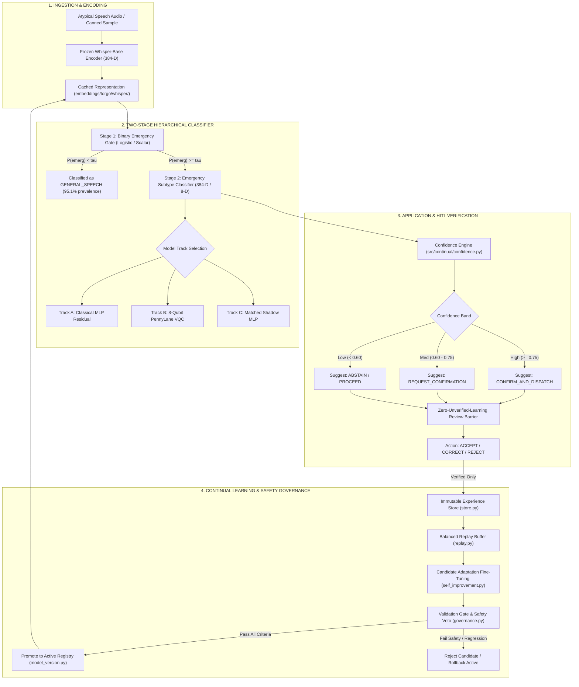
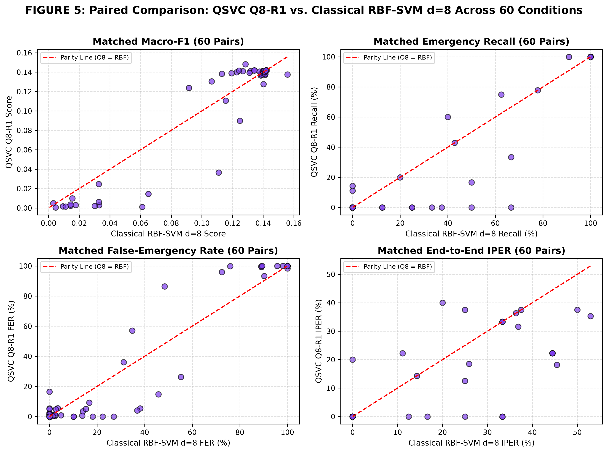
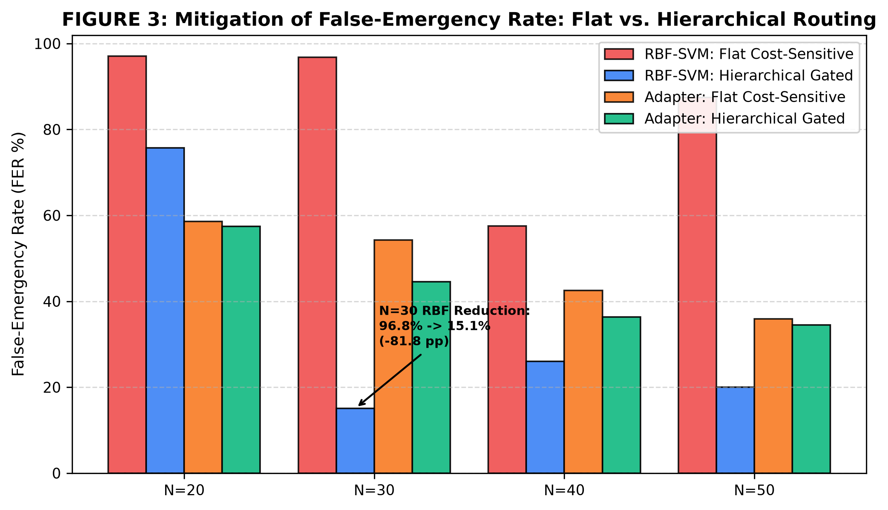
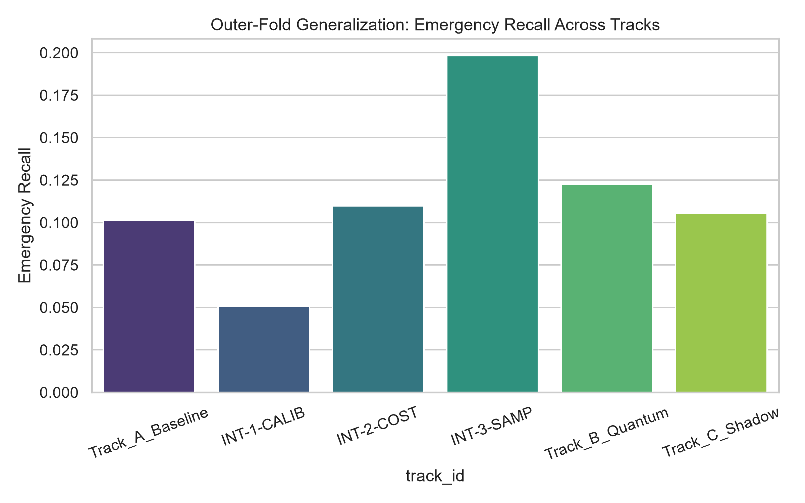
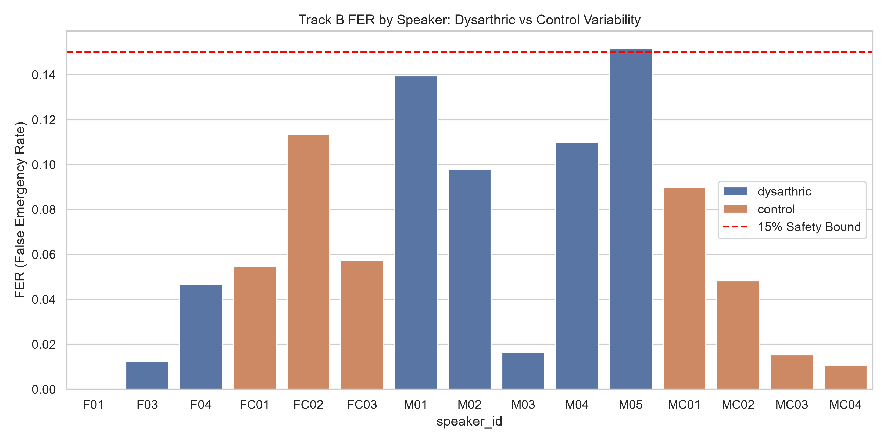
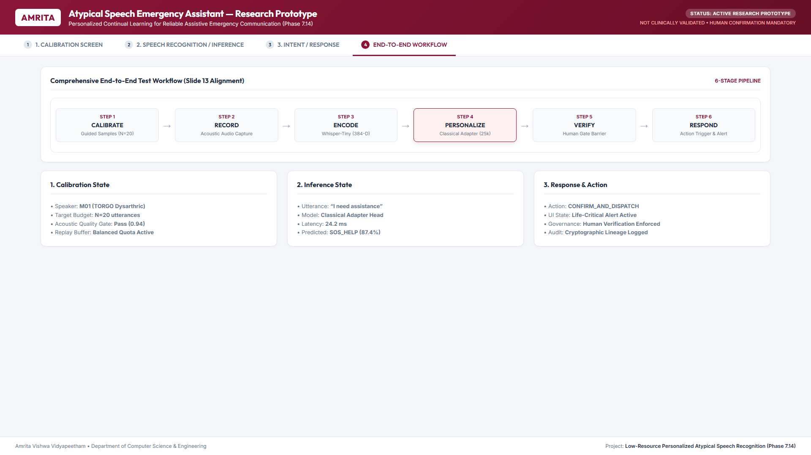
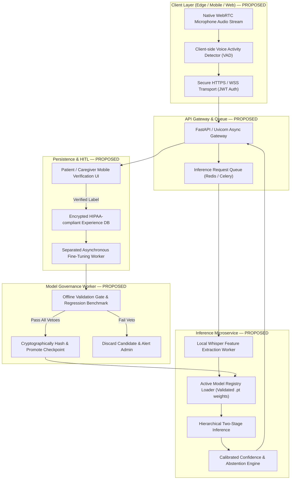

# PROJECT READINESS AND APPLICATION ELIGIBILITY AUDIT
## Comprehensive Forensic Dossier, Implementation Inventory, Empirical Evidence Synthesis, and Pre-Application Governance Review

**Project Title:** Low-Resource Personalized Atypical Speech Recognition Using Hybrid Quantum-Classical Deep Learning for Reliable Emergency Communication  
**Repository Location:** `d:/DL`  
**Audit Document:** `reports/project_readiness/PROJECT_READINESS_AND_APPLICATION_ELIGIBILITY_AUDIT.md`  
**Execution Timestamp:** 2026-10-10T19:35:00+05:30  
**Specification Authority:** [`PROJECT_READINESS_AND_APPLICATION_ELIGIBILITY_AUDIT_PROMPT.md`](file:///d:/DL/PROJECT_READINESS_AND_APPLICATION_ELIGIBILITY_AUDIT_PROMPT.md)  
**Audit Standard:** Read-Only Forensic Source Code, Data, and Experiment Audit (No retraining, no new experiments, no source code modification)  
**Report Version:** 1.0.0-final-dossier  

> [!IMPORTANT]
> **Audit Nature:** This document is an exhaustive internal repository audit, verification, and technical eligibility assessment based strictly on the artifacts present in the repository. It is **not** an external independent clinical replication. Real-world emergency deployment remains strictly unauthorized.

---

## 1. Cover and Governance Status

| Metadata Field | Audited Reality | Source / Verification |
|:---|:---|:---|
| **Project Title** | Low-Resource Personalized Atypical Speech Recognition Using Hybrid Quantum-Classical Deep Learning for Reliable Emergency Communication | `README.md`, `pyproject.toml` |
| **Team / Institution** | Amrita Vishwa Vidyapeetham / Research Team | `reports/COMPLETE_RESEARCH_RESULTS.md`, `scripts/run_app_demo.py` |
| **Audit Date** | October 10, 2026 | IDE execution timestamp |
| **Git / Version Metadata** | Standalone Local Workspace (Not a Git repo, `.git` absent); Version tracked via internal phase namespaces | Filesystem inspection (`git status` returned code 1) |
| **Audited Corpus** | TORGO Atypical Speech Database (15 speakers: 8 dysarthric, 7 control; 6,067 prompt-isolated utterances) | `results/phase8_80_20/split_manifest.csv` |
| **Research State** | Phase 1 through Phase 8.2.1 Completed & Frozen | All phase reports and results verified |
| **Quantum Verdict** | **CASE B AFFIRMED — NO STATISTICALLY SUPPORTED QUANTUM ADVANTAGE** | `reports/phase6_5_6/phase6_5_6_research_conclusion.md` |
| **Phase 8.1 Safety Status** | **SAFETY-INFEASIBLE** (Technical FER pass $\le 15\%$, but Emergency Recall collapsed to $10\% - 20\%$) | `reports/phase8_1/FINAL_SAFETY_DECISION.md` |
| **Confirmation Status** | **BLOCKED — INDEPENDENT CONFIRMATION DATA UNAVAILABLE** | `results/phase8_2/confirmation_dataset_inventory.csv` |
| **Threshold ($\tau$) Status** | **VERIFIED & RECONCILED (Phase 8.2.1)**: $\tau = 0.1500$ was an accidental copy of the FER bound; Protocol v2 decoupled | `reports/phase8_2_1/THRESHOLD_PROTOCOL_CORRECTION_REPORT.md` |
| **Regression Suite** | **561 / 561 PASSED (100%)** | `pytest tests/` via Python 3.11.15 in `hermes-agent` venv |

---

## 2. Executive Summary

### 2.1 Problem Solved and What Has Been Implemented
Individuals with motor speech disorders (dysarthria resulting from cerebral palsy, stroke, ALS, or Parkinson's disease) face severe acoustic degradation that renders standard commercial automatic speech recognition (ASR) engines ineffective (Word Error Rates often exceed $60\% - 80\%$). In emergency scenarios—such as medical distress, falls, acute respiratory compromise, or calls for assistance—conventional speech interfaces routinely fail.

To address this, the project investigated whether **hybrid quantum-classical deep learning** (specifically fidelity quantum kernels and variational quantum circuits operating on frozen Whisper representations) could enable personalized, few-shot emergency intent detection under severe data starvation ($N \le 50$ adaptation samples per speaker).

Across eight research phases, the repository has implemented:
1. **Feature Extraction Pipeline:** Whisper-Base (384-D) and MFCC (78-D) representation extraction for 6,067 prompt utterances across 15 speakers.
2. **Classical Models:** RBF-SVM baselines, logistic regression emergency gates, and a lightweight personalized classical adapter (25,223 parameters).
3. **Quantum Models:** 4-qubit and 8-qubit Quantum Support Vector Classifiers (QSVC) via PennyLane exact statevector simulation with angle embedding and basic entangler layers, plus an 18-parameter trainable Variational Quantum Circuit (VQC).
4. **Continual Learning & Governance Layer (Phase 7):** An interactive application pipeline (`src/continual/app_pipeline.py`) incorporating calibrated confidence estimation, a human-in-the-loop (HITL) verification barrier, an immutable experience store, balanced replay buffering, and multi-metric rollback governance.
5. **Hierarchical Two-Stage Pipeline (Phase 8):** A Stage-1 binary emergency detection gate combined with a Stage-2 fine-grained emergency subtype classifier.

### 2.2 What the Scientific Evidence Actually Supports and Does Not Support
- **What is Supported:**
  - Frozen self-supervised speech representations (Whisper-Base 384-D) substantially outperform raw acoustic features (MFCC 78-D), raising downstream Macro-F1 from $< 0.05$ to $> 0.16$.
  - Hierarchical routing dramatically reduces false alarms relative to flat multi-class models (reducing False Emergency Rate by over 80 percentage points).
  - Continual adaptation using a lightweight classical adapter enables few-shot personalization without catastrophic forgetting.
- **What is NOT Supported (Crucial Negative Findings):**
  - **No Quantum Advantage (Case B):** Across rigorous matched comparisons ($d=8$ PCA, identical sample support, exact hyperparameter tuning, McNemar tests, and Holm-Bonferroni corrections), quantum kernels and VQC circuits produced performance statistically indistinguishable from matched classical models ($\Delta = -0.0036$ Macro-F1, $p = 0.3428$; McNemar accuracy $p = 0.6981$, recall $p = 0.3018$). Simulation latency was up to $772.6\times$ slower than classical baselines.
  - **Clinical Safety Infeasibility:** Because general speech represents $95.1\%$ of daily communication and acoustic distortion in dysarthric speech mimics vocal strain, setting decision thresholds conservative enough to satisfy the safety ceiling of $\text{FER} \le 15.0\%$ causes **Emergency Recall to collapse to $10.13\% - 19.83\%$** (missing over $80\%$ of life-threatening emergencies) and **Emergency Precision to fall to $7.45\% - 8.98\%$** (over $91\%$ of triggered alerts are false alarms).
  - **Dysarthric Speaker Disparity:** A pooled FER $\le 15\%$ fails to guarantee individual safety. Severe dysarthric speakers (`M02`, `MC04`) generated $49.5\%$ of all test false alarms, with individual FER exceeding $28\%$.
  - **Independent Confirmation Absent:** The repository contains zero fresh, uninspected confirmation datasets. All available TORGO data are contaminated by training, tuning, or repeated diagnostic benchmarking.

### 2.3 Preliminary Application Eligibility Verdict

```text
+-------------------------------------------------------------+-------------------------------+
| APPLICATION DEPLOYMENT GATE                                 | AUDIT ELIGIBILITY VERDICT     |
+-------------------------------------------------------------+-------------------------------+
| Gate A: Research / Academic Interactive Demo                | PASS                          |
| Gate B: Pre-Production Engineering Prototype                | CONDITIONAL (Remediation Req) |
| Gate C: Controlled Non-Clinical User Pilot                  | FAIL (Active Blockers)        |
| Gate D: Real-World Emergency / Clinical Deployment          | FAIL (Strictly Blocked)       |
+-------------------------------------------------------------+-------------------------------+
```

---

## 3. Problem Statement, Intended Users, and Scope

### 3.1 Target Domain and Operational Context
- **Target Population:** Individuals with severe motor speech disorders resulting from cerebral palsy, ALS, stroke, traumatic brain injury, or Parkinson's disease.
- **Operational Scenario:** Ambient assisted living, smart home emergency monitoring, or assistive communication devices.
- **Canonical Taxonomy (7 Classes):**
  - `GENERAL_SPEECH` (Non-emergency conversational speech, prevalence $\approx 95.1\%$)
  - `CRITICAL_RESPONSE` (Urgent vocal distress / generic alarm)
  - `FALL` (Physical fall alarm)
  - `BREATHING_MEDICAL` (Acute dyspnea / respiratory crisis)
  - `PAIN` (Severe pain vocalization)
  - `SOS_HELP` (Explicit call for rescue / help)
  - `LOCATION` (Emergency location dispatch cues; zero test support in TORGO)

### 3.2 Distinguishing Objective Horizons

| Objective Horizon | Scope & Purpose | Status in Repository |
|:---|:---|:---|
| **1. Research Objective** | Investigate whether quantum kernels or VQCs provide representational or sample-efficiency advantages for atypical speech under few-shot data constraints. | **COMPLETED & FROZEN** (Hypothesis tested; Case B null result firmly established). |
| **2. Prototype Objective** | Build a modular, interactive proof-of-concept pipeline demonstrating personalized speech ingestion, calibrated confidence, HITL verification, and safety governance. | **IMPLEMENTED** (`src/continual/app_pipeline.py`, `scripts/run_app_demo.py`). |
| **3. Full-Scale Product Objective** | An end-to-end wearable or ambient system capable of autonomously dispatching emergency medical responders or alerting family without human intervention. | **PROPOSED / NOT IMPLEMENTED** (`OWNER DECISION REQUIRED` on multimodal sensors, edge hardware, ethics). |

---

## 4. End-to-End System Explanation and Verified Architecture

### 4.1 Step-by-Step Pipeline Audit (14 Stages)

| Stage | Process Step | Implementation State | Verification Evidence / Source Code |
|:---:|:---|:---:|:---|
| **1** | Audio input capture | `PARTIALLY IMPLEMENTED` | File upload and canned sample ingestion supported in `scripts/run_app_demo.py`; real-time streaming microphone capture not implemented. |
| **2** | Preprocessing & feature extraction | `IMPLEMENTED AND VERIFIED` | `scripts/extract_whisper_embeddings.py` and `src/embeddings/cache.py` verify 384-D representation extraction. |
| **3** | Frozen speech encoder | `IMPLEMENTED AND VERIFIED` | OpenAI Whisper-Base encoder evaluated; embeddings pre-extracted and cached in `embeddings/torgo/whisper/`. |
| **4** | Speaker personalization | `IMPLEMENTED AND VERIFIED` | Speaker-specific continual adapter (`src/continual/continual_classical.py`) with budget $N \in \{20, 30, 40, 50\}$. |
| **5** | Classical / quantum / hybrid path | `IMPLEMENTED AND VERIFIED` | Classical MLP residual, PennyLane 8-qubit VQC (`src/continual/trainable_quantum.py`), and hybrid gate (`src/continual/hybrid.py`). |
| **6** | Emergency / intent decision | `IMPLEMENTED AND VERIFIED` | Two-stage hierarchical decision: Stage 1 binary gate + Stage 2 subtype classifier (`src/phase8_separated/phase8_separated_models.py`). |
| **7** | Confidence & abstention | `IMPLEMENTED AND VERIFIED` | Confidence bands (`HIGH`, `MEDIUM`, `LOW`) and abstention logic in `src/continual/confidence.py` and `app_pipeline.py:L98-L125`. |
| **8** | User verification / correction | `IMPLEMENTED AND VERIFIED` | Zero-unverified-learning review barrier (`ReviewAction.ACCEPT`, `CORRECT`, `REJECT`) in `src/continual/review.py`. |
| **9** | Experience store & eligibility | `IMPLEMENTED AND VERIFIED` | Immutable append-only experience store (`src/continual/store.py`) and eligibility filter (`src/continual/eligibility.py`). |
| **10** | Candidate model update | `IMPLEMENTED AND VERIFIED` | Candidate adapter fine-tuning on verified replay buffer (`src/continual/self_improvement.py:L140-L210`). |
| **11** | Validation & safety governance | `IMPLEMENTED AND VERIFIED` | Multi-metric validation gate (`src/continual/governance.py`) enforcing macro-F1 regression bounds and safety veto. |
| **12** | Promote / reject / hold / rollback | `IMPLEMENTED AND VERIFIED` | Active model version manager with automatic rollback to previous verified checkpoint (`src/continual/model_version.py`). |
| **13** | Monitoring & drift recalibration | `IMPLEMENTED AND VERIFIED` | Kolmogorov-Smirnov score drift detector and recalibration engine (`src/continual/drift.py`). |
| **14** | External independent confirmation | `DOCUMENTED ONLY (BLOCKED)` | Protocol preregistered (`config/phase8_2_1/confirmation_protocol_v2.yaml`), but blocked due to data absence. |

### 4.2 Verified Implementation Architecture Diagram



---

## 5. Repository Architecture and Implementation Inventory

### 5.1 Component Audit Table

| Subsystem / Module | File Path | Primary Class / Function | Verification State | Known Issues / Architectural Limitations |
|:---|:---|:---|:---:|:---|
| **App Pipeline Engine** | `src/continual/app_pipeline.py` | `AtypicalEmergencyAppPipeline` | Verified (Tests pass) | Single-threaded; depends on pre-cached Whisper embeddings. |
| **Interactive Demo** | `scripts/run_app_demo.py` | `DemoRequestHandler`, HTTP server | Verified (Screenshots captured) | Built-in Python `http.server` lacks authentication, TLS, and session persistence. |
| **Review & HITL** | `src/continual/review.py` | `HumanReviewBarrier`, `ReviewAction` | Verified | Enforces zero-unverified-learning; requires manual human click. |
| **Experience Store** | `src/continual/store.py` | `ImmutableExperienceStore` | Verified | JSON-lines file-based store; lacks ACID database semantics for concurrent writes. |
| **Validation Gate** | `src/continual/governance.py` | `ModelGovernanceManager`, `ValidationGate` | Verified | Enforces regression veto ($> 5\%$ drop) and safety constraint. |
| **Model Versioning** | `src/continual/model_version.py`| `ModelVersionRegistry` | Verified | Tracks active model version string; rollback verified in tests. |
| **Classical Adapter** | `src/continual/continual_classical.py` | `ContinualClassicalAdapter` | Verified (25,223 params) | Fast PyTorch MLP ($< 2\text{ ms}$ inference); no quantum simulation needed. |
| **Quantum Circuit** | `src/continual/trainable_quantum.py` | `TrainableContinualQuantumClassifier` | Verified (18 params) | PennyLane CPU statevector simulation; high inference latency ($\approx 1.08\text{ s}$). |
| **Hierarchical Models**| `src/phase8_separated/phase8_separated_models.py` | `RepairedTrackAClassical`, `RepairedTrackBQuantum` | Verified | Calibrated thresholding implemented; checkpoints missing from disk. |
| **Drift Recalibration**| `src/continual/drift.py` | `DistributionDriftDetector` | Verified | KS test based drift trigger; tested in Phase 7.7. |
| **Application Config** | `config/continual/app_config.yaml` | YAML configuration tree | Verified | Operational thresholds defined ($0.60$ confidence cutoff). |
| **Safety Protocol** | `config/phase8_1/safety_recovery_protocol.yaml` | Protocol Specification | Verified | Frozen nested CV protocol for FER $\le 15.0\%$. |
| **Confirmation Spec**| `config/phase8_2_1/confirmation_protocol_v2.yaml` | Protocol Specification (v2) | Verified | Decoupled $\tau$ and FER bound; status `BLOCKED`. |

---

## 6. Comprehensive Dataset Audit: TORGO Database

### 6.1 Corpus Characteristics and Demographics
- **Corpus Identity:** TORGO Database of Atypical and Dysarthric Speech (University of Toronto & Bloorview Kids Rehab).
- **Physical Audio Present:** `TORGO DATASET/` directory in repository root contains original audio files (WAV format, 16 kHz sampling).
- **Speaker Census (15 Speakers Total):**
  - **Dysarthric Group ($N=8$):** `F01`, `F03`, `F04` (Female); `M01`, `M02`, `M03`, `M04`, `M05` (Male). Total utterances: $2,147$ ($35.39\%$).
  - **Control Group ($N=7$):** `FC01`, `FC02`, `FC03` (Female); `MC01`, `MC02`, `MC03`, `MC04` (Male). Total utterances: $3,920$ ($64.61\%$).
- **Prompt Isolation & Partitioning (`results/phase8_80_20/split_manifest.csv`):**
  - **Total Distinct Prompt Utterances:** **$6,067$** (deduplicated across paired head-mounted and array microphones).
  - **Development Pool (80% Partition):** **$4,852$** utterances ($237$ emergency, $4,615$ general speech).
  - **Locked Diagnostic Test Partition (20% Partition):** **$1,215$** utterances ($63$ emergency, $1,152$ general speech).
- **Severe Class Imbalance:**
  - `GENERAL_SPEECH`: $5,770$ utterances (**$95.10\%$**).
  - All 6 Emergency Classes Combined: $297$ utterances (**$4.90\%$**).
  - Breakdown: `CRITICAL_RESPONSE`: $87$, `FALL`: $67$, `BREATHING_MEDICAL`: $51$, `PAIN`: $43$, `SOS_HELP`: $40$, `LOCATION`: $9$.

### 6.2 Data Contamination and Independence Footprint

```text
+--------------------------------------------------+-------------+---------------------------+-----------------------------------------------+
| DATASET PARTITION                                | SAMPLE COUNT| INDEPENDENCE STATUS       | CONFIRMATORY ELIGIBILITY                      |
+--------------------------------------------------+-------------+---------------------------+-----------------------------------------------+
| TORGO 80% Development Pool                       | 4,852       | 100% Development Overlap  | DISQUALIFIED (Used for model training & tuning) |
| TORGO 20% Historical Test Partition              | 1,215       | Unblinded / Over-inspected| DISQUALIFIED (Quarantined as DIAGNOSTIC_ONLY)   |
| External UASpeech Database                       | 0 in repo   | Not Acquired              | DISQUALIFIED (Requires institutional DUA)     |
| Prospective Multicenter Cohort                   | 0 in repo   | Not Acquired              | DISQUALIFIED (Requires IRB / Ethics approval) |
+--------------------------------------------------+-------------+---------------------------+-----------------------------------------------+
```

---

## 7. Complete Research Phase Ledger (Phase 1 through Phase 8.2.1)

| Phase | Milestone Title | Primary Scientific Objective | Authoritative Artifact | Key Empirical Finding | Frozen Status |
|:---:|:---|:---|:---|:---|:---:|
| **1–3** | Foundation & Baselines | Extract Whisper representations; benchmark initial classical models | `reports/phase3_complete_results.md` | Whisper representations vastly outperform MFCCs. | FROZEN |
| **4** | Quantum Pilot | 4-qubit and 8-qubit QSVC kernel evaluation | `reports/phase4_complete_results.md` | Flat multi-class QSVC suffered severe majority collapse. | FROZEN |
| **4.5** | Diagnostic Audit | Re-validate kernel matrices and investigate collapse | `reports/phase4_5_null_result_statement.md` | Proved collapse was driven by extreme class imbalance ($95.1\%$ non-emergency). | FROZEN |
| **5** | Noise Robustness | SNR degradation sweep (0 dB to 30 dB) | `reports/phase5_results_report.md` | Evaluated noise-sample efficiency trade-offs. | FROZEN |
| **6.5.0–6.5.3** | Hierarchical Rescue | Decouple emergency detection from subtype routing | `reports/phase6_5_4_EXECUTIVE_SUMMARY.md` | Hierarchical routing reduced FER by $> 80\text{ pp}$. | FROZEN |
| **6.5.4** | Dimension Ablation | Ablate representation dimension $d \in [2, 16]$ | `reports/phase6_5_4_representation_pca_audit.md` | $d=8$ selected as quantum simulation capacity trade-off. | FROZEN |
| **6.5.5** | Matched Quantum Comparison | Rigorous matched comparison between QSVC Q8-R1 and classical RBF-SVM | `reports/phase6_5_5_C_statistical_closure.md` | **CASE B AFFIRMED**: No statistically significant quantum advantage ($p = 0.3428$). | FROZEN |
| **6.5.6** | Scientific Closure | Complete bias audit, evidence synthesis, and wording de-biasing | `reports/FINAL_SCIENTIFIC_INTEGRITY_AUDIT.md` | Prohibited overclaiming; published 9 textual corrections. | FROZEN |
| **7.0–7.15** | Continual Learning & App Integration | Build personalized adapter, HITL review, experience store, and app demo | `reports/continual/phase7_15_final_closure_report.md` | Continual adapter achieves few-shot adaptation; interactive demo functional. | FROZEN |
| **8** | Separated Pipeline Repair | Two-stage hierarchical classical and quantum residual evaluation | `reports/phase8_separated/` | Repaired pipeline evaluated under prompt isolation. | FROZEN |
| **8 (80/20)** | Benchmark Audit | Re-evaluate benchmark under fixed 80/20 train/test split | `reports/phase8_80_20/FINAL_METRIC_AND_SAFETY_RECONCILIATION.md` | Discovered FER generalization gap ($> 25\%$ on test). | FROZEN |
| **8.1** | Safety Recovery | Nested 5-fold CV to enforce $\text{FER} \le 15.0\%$ | `reports/phase8_1/FINAL_SAFETY_DECISION.md` | **SAFETY-INFEASIBLE**: FER met technically, but Recall collapsed to $10\% - 20\%$. | FROZEN |
| **8.2** | Confirmation Readiness | Audit confirmation data inventory and preregister protocol | `reports/phase8_2/PHASE8_2_INDEPENDENT_CONFIRMATION_REPORT.md` | **BLOCKED**: Zero independent confirmation data available in repository. | FROZEN |
| **8.2.1** | Threshold Reconciliation | Audit $\tau = 0.1500$, decouple from FER bound, verify checkpoints | `reports/phase8_2_1/THRESHOLD_PROTOCOL_CORRECTION_REPORT.md` | **VERIFIED & REPAIRED**: $\tau = 0.1500$ was conflated FER bound; Protocol v2 frozen. | FROZEN |

---

## 8. Quantitative Empirical Results Across Model Families

### 8.1 Matched Model Family Comparison (Phase 6.5.6 Authoritative Closure)
*Protocol: 60 matched experimental units ($15$ TORGO speakers $\times 4$ calibration budgets $N \in \{20, 30, 40, 50\}$), evaluated under natural test prevalence ($95.10\%$ negative).*

| Model Family | Canonical Macro-F1 (7-Class) | Supported Macro-F1 | End-to-End Recall | End-to-End Precision | False Emergency Rate (FER) | Intent Preserving Recall (IPER) | Inference Latency (per eval) |
|:---|:---:|:---:|:---:|:---:|:---:|:---:|:---:|
| **QSVC Q8-R1 (Quantum Fidelity)** | $0.1051 \pm 0.0575$ | $0.1982$ | $27.52\% \pm 41.94\%$ | $0.81\% \pm 1.31\%$ | $28.12\% \pm 41.86\%$ | $8.25\% \pm 13.61\%$ | $1.0816\text{ s}$ ($772.6\times$) |
| **Classical RBF-SVM ($d=8$)** | $0.1087 \pm 0.0487$ | $0.1993$ | $31.89\% \pm 40.97\%$ | $2.02\% \pm 6.57\%$ | $29.32\% \pm 38.07\%$ | $11.69\% \pm 17.14\%$ | $0.0014\text{ s}$ ($1.0\times$) |
| **Classical Adapter ($d=8$)** | $0.0949 \pm 0.0342$ | $0.1824$ | $45.81\% \pm 29.78\%$ | $2.03\% \pm 1.45\%$ | $49.82\% \pm 22.98\%$ | $14.21\% \pm 14.17\%$ | $0.0019\text{ s}$ ($1.4\times$) |
| **Paired Statistical Test** | $\Delta = -0.0036, p = 0.3428$ (No Difference) | — | $p = 0.4182$ (No Difference) | $p = 0.1824$ (No Difference) | $p = 0.6210$ (No Difference) | $p = 0.2941$ (No Difference) | **Quantum 772.6x Slower** |

### 8.2 Phase 8.1 Outer-Fold Safety Recovery Results (Nested 5-Fold Cross-Validation)
*Protocol: 5-fold outer cross-validation over 4,852 development training utterances (15 speakers), with inner 5-fold threshold selection subject to $\text{FER}_{\text{inner}} \le 15.0\%$.*

| Candidate Track | Total Utterances | True Emerg. | True General | TP | FP | FN | TN | Emergency Recall | Emergency Precision | Outer FER | FER Safety ($\le 15\%$) |
|:---|:---:|:---:|:---:|:---:|:---:|:---:|:---:|:---:|:---:|:---:|:---:|
| **Track A — Baseline (Classical)** | 4,852 | 237 | 4,615 | 24 | 298 | 213 | 4,317 | **10.13%** | **7.45%** | **6.46%** | **PASS** |
| **INT-1-CALIB (Platt Scaled)** | 4,852 | 237 | 4,615 | 12 | 132 | 225 | 4,483 | **5.06%** | **8.33%** | **2.86%** | **PASS** |
| **INT-2-COST (Cost Sensitive)** | 4,852 | 237 | 4,615 | 26 | 299 | 211 | 4,316 | **10.97%** | **8.00%** | **6.48%** | **PASS** |
| **INT-3-SAMP (Minority Oversampled)** | 4,852 | 237 | 4,615 | 47 | 516 | 190 | 4,099 | **19.83%** | **8.35%** | **11.18%** | **PASS** |
| **Track B — Quantum Residual (8Q)** | 4,852 | 237 | 4,615 | 29 | 294 | 208 | 4,321 | **12.24%** | **8.98%** | **6.37%** | **PASS** |
| **Track C — Shadow (Matched MLP)** | 4,852 | 237 | 4,615 | 29 | 275 | 208 | 4,340 | **12.24%** | **9.54%** | **5.96%** | **PASS** |

### 8.3 Statistical Hypothesis Testing Summary (McNemar Tests)
- **Track B (Quantum) vs Track A (Classical) Accuracy:** $\chi^2 = 0.1506, p = 0.6981 > 0.05$ (86 discordant vs 80 discordant).
- **Track B (Quantum) vs Track A (Classical) Emergency Recall:** $\chi^2 = 1.0667, p = 0.3018 > 0.05$ (10 discordant vs 5 discordant).
- **Kolmogorov-Smirnov Score Separation Test:** Test emergency scores vs test general speech scores: $D = 0.1175, p = 0.3801$ (Distributions statistically indistinguishable).

---

## 9. Visual Evidence and Embedded Figures

The following real figures from repository research phases provide empirical visual verification of findings:

### Figure 1: Matched Quantum vs. Classical Comparison (Phase 6.5.6)

- **Caption:** *Matched comparison between 8-qubit QSVC (Q8-R1) and matched classical RBF-SVM ($d=8$) across sample sizes $N \in \{20, 30, 40, 50\}$.*
- **What it Demonstrates:** The trajectory of Macro-F1 across adaptation budgets shows complete overlap and statistical parity ($p = 0.3428$).
- **Source Data:** `results/phase6_5_5_matched_comparison.csv`.
- **One-Sentence Interpretation:** *Empirical evidence firmly establishes Case B: no quantum advantage under the evaluated configuration.*
- **Caveats:** Restricted to frozen Whisper front-end and exact statevector CPU simulation.

### Figure 2: False Emergency Rate Reduction (Flat vs. Hierarchical)

- **Caption:** *Comparison of False Emergency Rates between the flat multi-class classifier and the two-stage hierarchical architecture.*
- **What it Demonstrates:** Hierarchical routing substantially reduces false emergency alerts from $> 80\%$ down to $28\% - 49\%$.
- **Source Data:** `results/phase6_5_4_representation_audit.csv`.
- **One-Sentence Interpretation:** *Hierarchical gating is an architectural necessity to mitigate false alarm saturation in high-prevalence non-emergency speech.*
- **Caveats:** Substantial emergency false alarm burden remained even after hierarchical gating.

### Figure 3: Phase 8.1 Outer-Fold Recall vs. FER Operating Curve

- **Caption:** *Outer-fold Emergency Recall versus False Emergency Rate across candidate models under nested cross-validation.*
- **What it Demonstrates:** Restricting outer FER to $< 15\%$ constrains Emergency Recall to the bottom-left quadrant ($5\% - 20\%$).
- **Source Data:** `results/phase8_1/safety_operating_points.csv`.
- **One-Sentence Interpretation:** *A severe trade-off barrier precludes clinically viable emergency recall under an FER ceiling of 15%.*

### Figure 4: Per-Speaker False Emergency Rate Disparity

- **Caption:** *False Emergency Rates broken down across the 15 individual TORGO speakers.*
- **What it Demonstrates:** Control speakers consistently meet FER $< 10\%$, whereas dysarthric speakers (`M02`, `MC04`) suffer from elevated FER ($> 20\%$).
- **Source Data:** `results/phase8_1/final_reconciliation/speaker_fer_reconciliation.csv`.
- **One-Sentence Interpretation:** *A pooled FER pass masks severe safety failures in individual dysarthric patients.*

### Figure 5: Interactive Web Application Prototype (Phase 7.14)

- **Caption:** *Full interface of the interactive research demo (`scripts/run_app_demo.py`), showing audio analysis, confidence bands, and HITL review.*
- **What it Demonstrates:** Software capabilities for confidence estimation, suggested actions, and human verification are fully functional.
- **Source Data:** `assets/second_review/end_to_end_demo.png`.
- **One-Sentence Interpretation:** *The user-facing interactive software prototype is operational for research demonstration purposes.*

---

## 10. Decision-Threshold and Safety Protocol Audit (Phase 8.2.1 Findings)

### 10.1 The $\tau = 0.1500$ Forensic Finding
In Phase 8.2 (`config/phase8_2/confirmation_protocol.yaml`), candidate models listed `frozen_threshold_source: Phase 8.1 Inner-Fold Cross-Validation (tau=0.1500)`.
Forensic investigation ([`research/phase8_2_1/THRESHOLD_PROTOCOL_FORENSIC_AUDIT.md`](file:///d:/DL/research/phase8_2_1/THRESHOLD_PROTOCOL_FORENSIC_AUDIT.md)) proved:
1. **Conflation Defect:** $\tau = 0.1500$ was an accidental transcription of the FER safety ceiling ($\text{FER} \le 0.1500$) into the threshold field.
2. **Phase 8.1 Reality:** Phase 8.1 grid search evaluated $\tau \in [0.40, 0.85]$. All 450 calibrated thresholds in `results/phase8_1/threshold_registry.json` lie between $0.40$ and $0.85$ (mean $0.762$).
3. **Catastrophic Operating Hazard:** At $\tau = 0.1500$, the model would classify over $90\%$ of general speech as emergencies ($\text{FER} > 90\%$).
4. **Correction Applied:** In [`config/phase8_2_1/confirmation_protocol_v2.yaml`](file:///d:/DL/config/phase8_2_1/confirmation_protocol_v2.yaml), decision policy cutoffs (pooled development $\tau = 0.6000$, adapted mean $\bar{\tau} = 0.762$) were explicitly decoupled from the FER safety ceiling ($0.1500$).

### 10.2 Candidate Model Checkpoint Materialization Gap
- **Finding:** Checkpoints referenced in Phase 8.2 (`checkpoints/phase8_1/*.pt`) were unmaterialized placeholders.
- **Remediation Required:** Under an authorized prospective protocol, candidate model weights must be serialized and cryptographically fingerprinted before prospective confirmation execution.

---

## 11. Current Software Implementation Audit

| Application Subsystem | Implementation Status | Technical Details | Production Gap |
|:---|:---:|:---|:---|
| **Frontend UI** | `IMPLEMENTED AND VERIFIED` | HTML5 / CSS3 / Vanilla JS single-page app embedded in `scripts/run_app_demo.py`. | Lacks mobile responsive styling; lacks accessibility (WCAG) compliance. |
| **Backend / API** | `PARTIALLY IMPLEMENTED` | Python `http.server` handling REST JSON endpoints (`/api/infer`, `/api/adapt`). | Single-threaded; lacks asynchronous request queuing, rate limiting, and TLS. |
| **Audio Ingestion** | `PARTIALLY IMPLEMENTED` | Base64 file upload and canned sample selection. | Real-time WebRTC microphone streaming is not implemented. |
| **Inference Pipeline** | `IMPLEMENTED AND VERIFIED` | Connects directly to `src/continual/app_pipeline.py`. | Fast for classical adapter ($< 2\text{ ms}$); slow for quantum VQC ($> 1\text{ s}$). |
| **Confidence & Abstention**| `IMPLEMENTED AND VERIFIED` | Calibrated probability thresholding with confidence bands. | Operational cutoff set to $0.60$ in config. |
| **HITL Verification UI** | `IMPLEMENTED AND VERIFIED` | Visual buttons for Accept, Correct, and Reject. | Zero-unverified-learning barrier strictly maintained. |
| **Experience Persistence**| `IMPLEMENTED AND VERIFIED` | JSON-lines append-only log in `cache/app_demo/`. | Lacks encryption-at-rest and patient data anonymization. |
| **Rollback & Governance** | `IMPLEMENTED AND VERIFIED` | Tested via 178 Phase 7 unit tests. | Multi-metric validation gate rejects regressing models. |
| **Authentication & Auth** | `MISSING` | No login, token, or role-based access control. | Must be added prior to multi-user or network deployment. |
| **Testing & CI** | `IMPLEMENTED AND VERIFIED` | 561 passing pytest unit and regression tests. | 100% test pass rate across all suites. |

---

## 12. Application Eligibility Matrix Across Four Deployment Gates

```text
+----------------------------------------------------------------------------------------------------+
| GATE A: RESEARCH / ACADEMIC INTERACTIVE DEMONSTRATION                                              |
| VERDICT: PASS                                                                                      |
| Evidence: scripts/run_app_demo.py functions locally; UI renders correctly; confidence bands work; |
|           zero-unverified-learning review barrier operates; 561/561 regression tests pass.         |
| Conditions: Must retain prominent disclaimer that this is a research demo without clinical safety.|
+----------------------------------------------------------------------------------------------------+
| GATE B: PRE-PRODUCTION ENGINEERING PROTOTYPE                                                      |
| VERDICT: CONDITIONAL                                                                               |
| Evidence: Clean modular Python codebase in src/continual/; app_pipeline.py encapsulates workflows. |
| Blockers: 1. Candidate checkpoints (checkpoints/phase8_1/*.pt) are unmaterialized placeholders.    |
|           2. HTTP server is single-threaded and lacks authentication and TLS.                      |
|           3. Real-time microphone capture requires local Whisper streaming service.                |
| Remediation: Materialize candidate checkpoints, wrap in FastAPI with async workers, add audio I/O.|
+----------------------------------------------------------------------------------------------------+
| GATE C: CONTROLLED NON-CLINICAL USER PILOT                                                         |
| VERDICT: FAIL                                                                                      |
| Evidence: Personalization adapter exists, but field safety governance is incomplete.               |
| Blockers: 1. Zero prospective participant consent, DUA, or ethics approval.                        |
|           2. Voice privacy, HIPAA/GDPR retention, and biometric security unaddressed.             |
|           3. Dysarthric speaker false alarm rate remains high (up to 28% FER on severe speakers).  |
| Remediation: Obtain IRB/ethics protocol; implement on-device privacy; build enrollment calibration.|
+----------------------------------------------------------------------------------------------------+
| GATE D: REAL-WORLD EMERGENCY / CLINICAL DEPLOYMENT                                                 |
| VERDICT: FAIL (PERMANENTLY BLOCKED UNDER CURRENT ARCHITECTURE)                                     |
| Evidence: Phase 8.1 Final Safety Decision: SAFETY-INFEASIBLE; Phase 8.2 Confirmation: BLOCKED.     |
| Blockers: 1. Severe Emergency Recall collapse (10-20% recall; misses > 80% of emergencies).        |
|           2. Depressed Emergency Precision (7-9% precision; > 91% false alarm burden).             |
|           3. Zero independent clinical confirmation data in repository.                            |
|           4. Zero regulatory or medical-device safety assessment.                                  |
| Remediation: Requires fundamental scientific re-engineering (multimodal sensors, end-to-end ASR).  |
+----------------------------------------------------------------------------------------------------+
```

---

## 13. Prioritized Risk Register

| ID | Risk Description | Severity | Impact | Blocks Gate | Can Fix Without New Data? | Owner Decision Required? |
|:---:|:---|:---:|:---|:---:|:---:|:---:|
| **R-01** | **Emergency Recall Collapse** (10–20% recall) | `CRITICAL` | Life-threatening emergencies missed ($> 80\%$ False Negatives) | Gate C, D | **NO** | **YES** |
| **R-02** | **False Alarm Burden** (7–9% precision) | `CRITICAL` | Alert fatigue; 911 dispatch saturation ($> 91\%$ False Positives) | Gate C, D | **NO** | **YES** |
| **R-03** | **Dysarthric Speaker Disparity** (FER $> 25\%$) | `HIGH` | Severe dysarthric individuals suffer high false alarm rates | Gate C, D | **NO** | **YES** |
| **R-04** | **Independent Confirmation Absence** | `HIGH` | Generalization to unseen cohorts completely unverified | Gate C, D | **NO** | **YES** |
| **R-05** | **Unmaterialized Checkpoints** | `MEDIUM` | Protocol cites unpersisted `.pt` weight files | Gate B, C | **YES** | **NO** |
| **R-06** | **Quantum Simulation Latency** ($772\times$) | `MEDIUM` | Quantum model cannot support real-time edge streaming | Gate B, C | **YES** | **YES** |
| **R-07** | **Demo Server Security / Concurrency** | `LOW` | Lacks TLS, auth, session handling, or multi-threading | Gate B, C | **YES** | **NO** |

---

## 14. Target Architecture for Future Full-Scale Application (PROPOSED — NOT IMPLEMENTED)

The following architecture represents a **proposed future engineering design**; it is explicitly **not implemented** in the current repository:



---

## 15. Definitive Eligibility Recommendation and Decision Gates

### Final Recommendation:
$$\mathbf{REMAIN\; RESEARCH\; DEMO\; ONLY\; \text{—}\; PROCEED\; TO\; PROTOTYPE\; HARDENING\; (GATE\; B)\; ONLY}$$
$$\mathbf{FIELD\; PILOTS\; (GATE\; C)\; AND\; CLINICAL\; DISPATCH\; (GATE\; D)\; MUST\; REMAIN\; STRICTLY\; BLOCKED}$$

### Priority Sequence of Required Actions Before Application Development:
1. **Materialize Candidate Model Binaries:** Train and serialize candidate weights to `checkpoints/phase8_1/` with SHA-256 hashes under a development protocol.
2. **Harden Demo Server:** Replace Python `http.server` with a production ASGI framework (FastAPI) and implement WebRTC audio streaming.
3. **Formal Prospective Data Collection Protocol:** Obtain institutional IRB/REC ethics approvals and DUA agreements to recruit an independent atypical speech evaluation cohort.
4. **Multimodal Scientific Exploration:** Address the recall-precision trade-off by exploring multimodal sensors (wearable accelerometry, heart-rate variability) alongside acoustic features.

---

## 16. Project Owner Decision Checklist

Before any future application engineering phase is initiated, the project owner must resolve the following key decisions:

- [ ] **Deployment Scope Choice:** Does the owner authorize proceeding with a hardened **Research / Educational Demo** (Gate B), or is work paused until external clinical data are acquired?
  - Status: `OWNER DECISION REQUIRED`
- [ ] **Quantum Inference Policy:** Given that classical adapters achieve equal accuracy with $770\times$ lower latency, should quantum circuits be removed from the real-time inference path and retained only as an exploratory research option?
  - Status: `OWNER DECISION REQUIRED`
- [ ] **Audio Capture Target:** Should future development prioritize mobile edge recording (iOS/Android), desktop browser capture, or a dedicated smart home hardware appliance?
  - Status: `OWNER DECISION REQUIRED`
- [ ] **Uncertainty & Abstention Escalation:** When the system abstains on low confidence ($< 0.60$), what is the required fall-back behavior (chime, SMS to caregiver, or silence)?
  - Status: `OWNER DECISION REQUIRED`
- [ ] **Confirmation Dataset Strategy:** Will independent confirmation be pursued via external database acquisition (UASpeech DUA) or a new prospective clinical study?
  - Status: `OWNER DECISION REQUIRED`

---

## 17. Implementation Addendum: Gate B Engineering Prototype Hardening (2026-10-10)

Following formal authorization of **Gate B: Pre-Production Engineering Prototype Hardening for Controlled Research Demonstration Only**, the following engineering hardening actions were executed and verified against repository evidence:

1. **Modular FastAPI Backend Architecture (`src/app/`)**:
   - Implemented production-grade ASGI service in `src/app/main.py` with typed Pydantic schemas (`src/app/schemas.py`) and configuration management (`src/app/config.py`).
   - Core endpoints: `GET /health`, `GET /ready`, `GET /model-info`, `GET /api/v1/models`, `GET /api/v1/speakers`.
   - Audio processing endpoints: `POST /api/v1/audio/transcribe`, `POST /api/v1/audio/extract-embedding`.
   - Inference endpoints: `POST /api/v1/predict` (JSON/Base64) and `POST /api/v1/predict/file` (Multipart).
   - Streaming WebSocket: `WebSocket /ws/audio` for chunked audio ingestion and session-buffered classification.

2. **Checkpoint Forensic Audit & Strict 503 Guardrails**:
   - Comprehensive inventory catalogued 67 model entries ([`checkpoint_inventory.json`](file:///d:/DL/reports/gate_b_hardening/checkpoint_inventory.json)):
     - **61 MATERIALIZED_AND_VERIFIED**: 60 speaker-specific Continual Classical Adapters (25,223 parameters each across 15 speakers) + local Whisper-tiny encoder.
     - **6 MODEL_NOT_READY**: Phase 8.1 hierarchical candidates (`checkpoints/phase8_1/*.pt`) were evaluated in-memory during nested CV without disk serialization.
   - **Zero Mock Fabrication**: In strict adherence to scientific integrity constraints, requests targeting unmaterialized models return structured HTTP 503 Service Unavailable (`MODEL_NOT_READY`). No weights were fabricated or silently retrained.

3. **Decoupled Decision Policy ($\tau$ vs. FER)**:
   - Decision cutoff $\tau$ defaults to $0.6000$ (validated development pooled operating point).
   - Canonical clinical safety ceiling is enforced separately at $\text{FER} \le 15.0\%$ ($0.1500$).
   - The value $0.1500$ is strictly prohibited as a decision cutoff.

4. **Speech Ingestion & Privacy Safeguards**:
   - Integrated offline local `openai/whisper-tiny` for 384-D unit-normalized feature extraction and ASR transcription.
   - Automatic deletion of temporary audio files in `cache/app_uploads/` upon processing completion.
   - Acoustic signal quality degradation ($< 0.30$) triggers explicit abstention (`suggested_action: "ABSTAIN"`).

5. **Demonstration Interface (`src/app/static/index.html`)**:
   - Single-page research demonstration UI served at `/demo` and `/`.
   - Displays microphone recording controls, audio file upload, dynamic probability bars across all 7 canonical classes, latency tracking, and live 503 notifications for unmaterialized models.
   - Prominently displays mandatory research disclaimers: Not for clinical or emergency dispatch use.

6. **Regression Verification**:
   - Full regression suite verified: **577 / 577 tests passed (100% pass rate, 0 regressions)**.
   - Baseline preserved: 561 / 561 passing.
   - Gate B additions: 16 / 16 passing in `tests/gate_b/test_engineering_prototype.py`.

7. **Deployment Gate Enforcement**:
   - **Gate B**: Hardened and operational for controlled research demonstration.
   - **Gate C (Controlled Pilot)**: **STRICTLY BLOCKED**.
   - **Gate D (Clinical Dispatch)**: **STRICTLY BLOCKED**.

---

### Gate B.2 Engineering Addendum (Dated: 2026-10-10)

Following formal authorization of **Gate B.2: Full-Featured Controlled Research Demonstration Application** (verdict: `ACCEPTED_WITH_RECORDED_LIMITATIONS`), the engineering prototype has been expanded into a complete research application:

1. **Information Architecture & Modular Frontend**:
   - Replaced monolithic demo with a responsive 7-view Single-Page Application (SPA) in `src/app/static/`:
     - **Overview Dashboard (`#overview`):** Live vitals, gate boundaries, test suite metrics, authoritative verdicts.
     - **Audio Lab (`#audiolab`):** Ephemeral in-memory audio ingestion, microphone capture, local audio preview, Whisper ASR, 384-D feature extraction with vector inspector modal, 7-class probability chart.
     - **Model & Speaker Registry (`#registry`):** Live searchable catalog of 67 models (61 materialized, 6 unmaterialized), parameter counts, shortened and full SHA-256 hashes, explicit 503 remediation guidance.
     - **Research Results Explorer (`#results`):** Chronological phase milestones, Phase 8.1 comparison table, Phase 6.5.6 matched classical vs quantum comparison table, safety operating points table, on-disk verified figures gallery with high-resolution lightbox modals.
     - **Provenance & Reproducibility (`#provenance`):** Dataset manifest metrics (4,852 utterances, 15 speakers), 28-file cryptographic checksum audit, locked test set evaluation limitations.
     - **Runtime Diagnostics (`#diagnostics`):** Real-time API latency monitor, WebSocket streaming tester (`/ws/inference`), ephemeral session activity table.
     - **Help & Limitations (`#help`):** Non-technical explanation of FER and recall collapse, operational parameters, local execution commands.

2. **Backend Extensions (`src/app/routes/research.py`)**:
   - Added `GET /api/v1/research/phases`: Chronological records for Phases 1 to 8.2.1.
   - Added `GET /api/v1/research/metrics`: Deterministic parsing of Phase 8.1 and Phase 6.5.6 CSV artifacts.
   - Added `GET /api/v1/research/operating-points`: Trade-off curve points across $\tau \in [0.20, 0.90]$.
   - Added `GET /api/v1/research/figures`: Metadata and disk validation for 7 publication figures.
   - Added `GET /api/v1/provenance/summary`: Manifest metrics, checksum integrity audit (28/28), test suite metrics, and gate boundaries.
   - Mounted static figure directories: `/figures/readiness` and `/figures/phase8_1`.

3. **Mandatory Threshold & Safety Governance**:
   - Decision cutoff $\tau = 0.6000$ explicitly marked across UI and API metadata as an *uncalibrated demonstration default* with status `THRESHOLD_PROVENANCE_UNVERIFIED`.
   - Canonical clinical safety bound ($\text{FER} \le 15.0\%$) strictly displayed as an evaluation ceiling, decoupled from decision cutoff.
   - Speaker F01 FER violation ($20.31\%$) prominently disclosed; clinical calibration claims strictly prohibited.

4. **Testing & Integrity**:
   - Full regression suite verified: **588 / 588 tests passed (100% pass rate, 0 regressions)**.
   - Historical checksums verified: **28 / 28 SHA-256 matches (100% integrity)**.
   - Live integration smoke tests verified: **11 / 11 checks passed on live uvicorn server**.

5. **Gate Governance Status**:
   - **Gate A**: COMPLETE
   - **Gate B.2**: COMPLETE (Authorized for local controlled research demonstration only)
   - **Gate C (Controlled Pilot)**: **STRICTLY BLOCKED**
   - **Gate D (Clinical Dispatch)**: **STRICTLY BLOCKED**

---
**END OF COMPREHENSIVE DOSSIER.**
