# RESEGREGATED MODEL COMPARISON REPORT: BASELINE VS. QUANTUM SPEECH CLASSIFICATION

### Audited Few-Shot Personalization, Leakage-Free Dataset Segregation, and Empirical Parity Analysis on the TORGO Corpus

Project Title: Low-Resource Personalized Atypical Speech Recognition Using Hybrid Quantum-Classical Deep Learning for Reliable Emergency Communication
Team Name: APPY FIZZ
Institution: Amrita Vishwa Vidyapeetham, Amrita School of Computing, Chennai Campus, Tamil Nadu, India
Academic Year: 2025–2026 | Document Release: October 2026
Principal Authors: [STUDENT_NAME_1] ([REG_NO_1]), [STUDENT_NAME_2] ([REG_NO_2]), [STUDENT_NAME_3] ([REG_NO_3])
Project Supervisor: [SUPERVISOR_NAME], [SUPERVISOR_DESIGNATION]
Target Dataset: TORGO Database of Acoustic and Articulatory Speech from Speakers with Dysarthria (15 Speakers: 8 Dysarthric, 7 Control)
Canonical Operational Classifier: qsvc_q8_r1 (8-Qubit Fidelity Quantum Kernel Support Vector Classifier)
Primary Matched Classical Comparator: Radial Basis Function Support Vector Machine (RBF-SVM, d=8, gamma=0.125, C=1.0)

---

## 2. PURPOSE OF THE NEW EVALUATION

The purpose of this resegregated evaluation is to establish an unassailable, leakage-free empirical benchmark comparing quantum-enhanced classifiers against matched classical baselines for personalized atypical speech recognition. While earlier exploratory phases in the project established preliminary feasibility, forensic audits of historical dataset splits revealed critical vulnerabilities—specifically, prompt text repetition between adaptation and test sets, potential cross-microphone contamination between array and head microphones, and shifting test set support across sample budgets. This report documents the complete resegregation protocol, executes paired model evaluations across 60 rigorously controlled speaker-by-budget conditions, and provides verifiable evidence to resolve the core scientific inquiry: whether parameter-free quantum kernels yield a demonstrable advantage over classical statistical learning under extreme low-resource constraints.

## 3. AUDIT OF THE PREVIOUS DATASET SPLIT

A forensic audit of the historical splits/torgo_splits.json file revealed that while recording IDs were disjoint, 553 prompt text types overlapped between calibration and evaluation subsets. In atypical speech processing, prompt repetition introduces a severe confound: acoustic classifiers can exploit lexical memorization of specific prompt phrases (such as repeated isolated words 'yes', 'no', 'help', or 'water') rather than generalizing to novel emergency utterances from the target speaker. Furthermore, an audit of the initial Phase 8 80/20 benchmark revealed that 218 test samples (17.94% of the 1,215 test cohort) had appeared in the historical Phase 6.5 few-shot adaptation pool used to fit earlier models, invalidating naive before-and-after longitudinal comparisons. These defects mandated the creation of a completely resegregated, versioned split manifest (splits/torgo_resegregated_v1.json) that enforces absolute prompt-group isolation and channel-stem disjointness.

## 4. FINAL DATASET SEGREGATION AND EVALUATION PROTOCOL

The resegregated evaluation protocol enforces strict scientific safeguards across all 15 TORGO speakers and four calibration budgets (N in {20, 30, 40, 50}):

1. Strict Nestedness: Calibration subsets follow exact inclusion hierarchy: S20 subset of S30 subset of S40 subset of S50, ensuring that budget expansion strictly adds information without altering earlier calibration samples.

2. Zero Cross-Microphone Leakage: Utterances are grouped by their physical speech event stem. If an utterance recorded via headMic is assigned to calibration, its corresponding arrayMic recording is permanently excluded from evaluation.

3. Zero Prompt Leakage: Transcripts normalized to alphanumeric stems are grouped into unique Prompt Group IDs (PGRPs). Calibration and evaluation partitions share exactly zero prompt groups.

4. Locked Evaluation Cohort: For each speaker, the evaluation test partition is fixed and identical across all sample budgets N (summing to exactly 5,317 test samples across the 15 speakers), isolating true sample efficiency from test-set composition shifts.

5. Upstream Preprocessing Fitting & Disclosure: Principal Component Analysis (PCA) projection matrices and StandardScaler transformations are fitted strictly on the target speaker's calibration partition (mean explained variance 83.48% +/- 3.12% across conditions, as documented in results/pca_explained_variance_by_condition.csv). Test samples are never seen during dimensionality reduction or threshold calibration. We explicitly disclose that all 60 conditions have zero validation samples; the operating threshold was fitted on calibration data, and metrics are reported on the strictly locked 5,317-item test set.

## 5. DATASET COMPOSITION AND THREE DISTINCT CLASS DISTRIBUTION PROFILES

To eliminate any ambiguity across artifacts, we explicitly distinguish the three different class distribution views present in the evaluation suite:

A. Full-Corpus Distribution (Table 5.1 & Figure 1): 16,552 total raw recordings across all 15 speakers, reflecting the 745:1 corpus-wide class imbalance.

B. Resegregated Test Evaluation Cohort (Table 5.2 & Figure 10/11): Summing the locked test IDs across all 15 speakers yields exactly 5,317 test samples: GENERAL_SPEECH (5,219; 98.16%), CRITICAL_RESPONSE (35; 0.66%), FALL (21; 0.39%), BREATHING_MEDICAL (18; 0.34%), PAIN (13; 0.24%), SOS_HELP (11; 0.21%), and LOCATION (0; 0.00%).

C. Per-Class and Confusion Matrix Supports: Evaluated strictly on the locked 5,317 test cohort, matching the evaluation manifest exactly.

**Table 5.1: Class Composition: Full Corpus (16,552) vs. Locked Evaluation Test Cohort (5,317)**

| INTENT LABEL | CLINICAL / SEMANTIC INTENT | CORPUS COUNT | CORPUS PCT | TEST COHORT COUNT | TEST PCT |
| --- | --- | --- | --- | --- | --- |
| GENERAL_SPEECH | Non-emergency conversational & baseline speech | 15,661 | 94.62% | 5,219 | 98.16% |
| CRITICAL_RESPONSE | Immediate affirmations & negations ('Yes', 'No') | 237 | 1.43% | 35 | 0.66% |
| FALL | Physical distress, slips, falls ('I fell', 'Help me') | 223 | 1.35% | 21 | 0.39% |
| BREATHING_MEDICAL | Respiratory distress & choking ('Short of breath') | 170 | 1.03% | 18 | 0.34% |
| PAIN | Acute somatic pain ('Chest hurts', 'Severe pain') | 136 | 0.82% | 13 | 0.24% |
| SOS_HELP | Explicit distress screams & alarms ('SOS', 'Emergency') | 104 | 0.63% | 11 | 0.21% |
| LOCATION | Room positioning markers ('Bedroom', 'Kitchen') | 21 | 0.13% | 0 | 0.00% (Ultra-Sparse) |
| TOTAL EVALUATION | Audited TORGO Speech Cohort | 16,552 | 100.00% | 5,317 | 100.00% |

## 6. MODEL INVENTORY AND EXPERIMENTAL CONFIGURATIONS

Ten computational models spanning quantum kernels, classical kernel baselines, neural adapters, and linear classifiers were evaluated under identical resegregated conditions:

1. QSVC Q8-R1 (Canonical Operational Model): 8-qubit quantum support vector classifier utilizing a second-order Pauli-Z feature map (ZZFeatureMap) with linear entanglement, circuit repetition depth R=1, and fidelity statevector transition kernel.

2. Matched Classical RBF-SVM (d=8): Non-linear support vector machine operating on the identical 8-dimensional PCA projection space with Gaussian radial basis function kernel K(x,z) = exp(-gamma ||x-z||^2), bandwidth gamma = 1/d = 0.125, and regularization C=1.0.

3. Linear SVM (d=8): Convex linear hyperplane classifier providing a linear geometric baseline in the 8-D PCA subspace.

4. K-Nearest Neighbors (KNN, k=5, d=8): Non-parametric instance-based metric learning baseline.

5. QSVC Q4-R1: Compact 4-qubit quantum kernel operating on the top 4 PCA components.

6. QSVC Q8-R2: Deeper 8-qubit quantum kernel with two feature map repetitions (R=2, circuit depth 18).

7. Phase 8 Track A: Independent classical residual module (384-D MLP -> scalar logit) fused with upstream emergency gate.

8. Phase 8 Track B: Independent 8-qubit variational quantum circuit (VQC) with 16 trainable parameters acting as a residual modulation module.

9. Phase 8 Track C: Matched classical shadow residual module (8-D MLP -> scalar logit) receiving identical input and optimization structure.

## 7. EVALUATION METRICS AND DUAL ESTIMAND REPORTING

Due to severe class imbalance (98.16% non-emergency speech in the test set), standard accuracy is uninformative. Performance is assessed using class-sensitive metrics: Macro-F1 across all 7 classes (with zero_division=0), Supported 6-Class Macro-F1 (excluding LOCATION), Balanced Accuracy (macro-recall across classes), Emergency Recall (TP / (TP+FN)), Emergency Precision (TP / (TP+FP)), False Emergency Rate (FER = FP / (FP+TN)), and Intent Preservation Error Rate (IPER = 1 - Emergency Recall).

Crucially, to resolve past reporting discrepancies, we explicitly report both statistical estimands: (1) Condition-Level Mean (unweighted average across the 60 speaker-by-budget conditions) and (2) Pooled Test-Set Metric (calculated from pooled predictions over the locked 5,317 test samples). Both are documented in Table 8.1.

## 8. CONSOLIDATED MASTER MODEL COMPARISON TABLES (DUAL ESTIMANDS)

To rigorously separate the two evaluation estimands, we present the benchmark results in two complementary master tables. Table 8.1 (Table A) presents the Condition-Level Mean estimand, where metrics are calculated independently per speaker-by-budget condition and averaged unweighted across all 60 conditions. Table 8.2 (Table B) presents the Pooled Test-Set estimand, combining predictions across all 15 speakers for each calibration budget N on the locked 5,317 test samples.

**Table 8.1: Table A — Condition-Level Model Comparison (Mean +/- Std Across 60 Conditions)**

| MODEL ARCHITECTURE | INPUT DIM | COND | MEAN ACC (%) | MEAN 7-CL F1 | BIN BAL ACC | EMERG REC (%) | FER (%) | LATENCY / SMP |
| --- | --- | --- | --- | --- | --- | --- | --- | --- |
| QSVC Q8-R1 | d = 8 | 60 | 72.3 +/- 40.8 | 0.1100 +/- 0.0576 | 0.5014 | 26.0 +/- 43.4 | 25.8 +/- 42.2 | 1.0816 s |
| Matched Classical RBF-SVM | d = 8 | 60 | 71.8 +/- 42.5 | 0.1072 +/- 0.0599 | 0.5023 | 26.9 +/- 44.5 | 26.4 +/- 44.0 | 0.0014 s |
| Linear SVM | d = 8 | 60 | 47.6 +/- 21.0 | 0.0920 +/- 0.0326 | 0.0920 | 42.4 +/- 33.3 | 51.4 +/- 21.7 | 0.0009 s |
| KNN | d = 8 | 60 | 65.7 +/- 32.9 | 0.1082 +/- 0.0454 | 0.1082 | 32.2 +/- 36.8 | 32.6 +/- 34.1 | 0.0021 s |
| QSVC Q4-R1 | d = 4 | 60 | 71.8 +/- 42.5 | 0.1034 +/- 0.0409 | 0.1034 | 47.4 +/- 33.6 | 42.1 +/- 27.9 | 0.0824 s |
| QSVC Q8-R2 | d = 8 | 60 | 71.8 +/- 42.5 | 0.1094 +/- 0.0576 | 0.1094 | 27.0 +/- 43.3 | 25.8 +/- 42.5 | 2.1540 s |
| Phase 8 Track A: Classical Residual | 384-D Whisper | 60 | 54.4 +/- 27.2 | 0.0980 +/- 0.0379 | 0.0980 | 37.8 +/- 34.6 | 44.2 +/- 28.6 | 0.0042 s |
| Phase 8 Track B: Quantum Residual | d = 8 | 60 | 53.4 +/- 26.6 | 0.0971 +/- 0.0388 | 0.0971 | 37.6 +/- 34.4 | 45.2 +/- 27.9 | 0.0650 s |
| Phase 8 Track C: Classical Shadow | d = 8 | 60 | 49.8 +/- 25.2 | 0.0929 +/- 0.0373 | 0.0929 | 41.7 +/- 35.5 | 49.0 +/- 26.6 | 0.0028 s |

Table 8.2 presents Table B: Pooled model comparisons across each discrete calibration budget N in {20, 30, 40, 50}. In accordance with the evaluation protocol, predictions from all 15 speakers are pooled over the locked 5,317 test samples separately for each budget, isolating calibration budget expansion from test cohort shifts.

**Table 8.2: Table B — Pooled Model Comparison on Locked Test Set by Sample Budget (N = 5,317)**

| MODEL | BUDGET N | TEST N | OVERALL ACC | 7-CLASS F1 | 6-CLASS F1 | BAL ACC | EMERG REC | FER | LATENCY |
| --- | --- | --- | --- | --- | --- | --- | --- | --- | --- |
| QSVC Q8-R1 | N=20 | 5317 | 29.34% | 0.0710 | 0.0828 | 0.1761 | 63.27% | 70.45% | 1.0816 s |
| QSVC Q8-R1 | N=30 | 5317 | 53.96% | 0.1098 | 0.1282 | 0.2133 | 37.76% | 45.33% | 1.0816 s |
| QSVC Q8-R1 | N=40 | 5317 | 62.91% | 0.1150 | 0.1341 | 0.1568 | 21.43% | 36.02% | 1.0816 s |
| QSVC Q8-R1 | N=50 | 5317 | 63.72% | 0.1159 | 0.1352 | 0.1582 | 21.43% | 35.20% | 1.0816 s |
| Matched Classi | N=20 | 5317 | 28.31% | 0.0693 | 0.0809 | 0.1791 | 66.33% | 71.53% | 0.0014 s |
| Matched Classi | N=30 | 5317 | 53.04% | 0.1086 | 0.1267 | 0.2118 | 37.76% | 46.27% | 0.0014 s |
| Matched Classi | N=40 | 5317 | 63.44% | 0.1156 | 0.1349 | 0.1577 | 21.43% | 35.49% | 0.0014 s |
| Matched Classi | N=50 | 5317 | 63.51% | 0.1145 | 0.1336 | 0.1499 | 20.41% | 35.39% | 0.0014 s |
| Linear SVM | N=20 | 5317 | 26.31% | 0.0658 | 0.0768 | 0.2069 | 57.14% | 73.56% | 0.0009 s |
| Linear SVM | N=50 | 5317 | 47.43% | 0.0973 | 0.1135 | 0.1765 | 43.88% | 51.91% | 0.0009 s |
| KNN | N=20 | 5317 | 28.72% | 0.0699 | 0.0816 | 0.1798 | 62.24% | 71.11% | 0.0021 s |
| KNN | N=50 | 5317 | 61.99% | 0.1141 | 0.1331 | 0.1519 | 27.55% | 36.98% | 0.0021 s |
| QSVC Q4-R1 | N=20 | 5317 | 24.84% | 0.0634 | 0.0740 | 0.1915 | 74.49% | 75.07% | 0.0824 s |
| QSVC Q4-R1 | N=50 | 5317 | 57.01% | 0.1118 | 0.1304 | 0.2029 | 42.86% | 42.21% | 0.0824 s |
| QSVC Q8-R2 | N=20 | 5317 | 28.98% | 0.0700 | 0.0817 | 0.1651 | 64.29% | 70.82% | 2.1540 s |
| QSVC Q8-R2 | N=50 | 5317 | 63.81% | 0.1160 | 0.1353 | 0.1584 | 21.43% | 35.10% | 2.1540 s |
| Phase 8 Track  | N=20 | 5317 | 25.26% | 0.0642 | 0.0749 | 0.1931 | 62.24% | 74.61% | 0.0042 s |
| Phase 8 Track  | N=50 | 5317 | 62.91% | 0.1185 | 0.1382 | 0.1968 | 31.63% | 36.12% | 0.0042 s |
| Phase 8 Track  | N=20 | 5317 | 24.32% | 0.0625 | 0.0729 | 0.1963 | 63.27% | 75.59% | 0.0650 s |
| Phase 8 Track  | N=50 | 5317 | 63.33% | 0.1186 | 0.1384 | 0.2000 | 28.57% | 35.68% | 0.0650 s |
| Phase 8 Track  | N=20 | 5317 | 20.90% | 0.0555 | 0.0648 | 0.1905 | 64.29% | 79.08% | 0.0028 s |
| Phase 8 Track  | N=50 | 5317 | 53.23% | 0.1082 | 0.1262 | 0.2146 | 42.86% | 46.06% | 0.0028 s |

## 9. ACCURACY RESULTS AND ESTIMAND RECONCILIATION

Condition-level mean accuracy for QSVC Q8-R1 is 72.35% +/- 40.80%, while matched classical RBF-SVM achieves 71.75% +/- 42.51%. When evaluated on the pooled test cohort (5,317 samples at N=50), pooled accuracy is 63.72% for QSVC and 63.51% for RBF-SVM. The difference between condition-mean and pooled accuracy arises because speakers with larger test partitions (such as MC04 with 943 samples and FC02 with 925 samples) exhibit lower classification accuracy than speakers with smaller cohorts (such as F04 with 200 samples and 98% accuracy). Weighting each condition equally yields ~72%, whereas pooling all samples into one confusion matrix weights speakers proportionally to cohort size, yielding ~63.7%. Both models track within 0.6% of each other under both estimands, confirming empirical parity.

## 10. MACRO-F1, BALANCED ACCURACY, AND CLASS SUPPORT HANDLING

To resolve any ambiguity regarding balanced accuracy and class support policies, we explicitly define and report three distinct balanced accuracy metrics derived from the prediction ledger:
1. Stage-1 Binary Balanced Accuracy (Sensitivity + Specificity) / 2: Condition-level mean is 0.5014 +/- 0.0183 for QSVC Q8-R1 and 0.5023 +/- 0.0115 for Matched RBF-SVM. This measures upstream binary intent gating.
2. Pooled Multiclass Supported 6-Class Balanced Accuracy: Average recall across the 6 supported test classes (excluding the zero-support LOCATION class) is 0.1582 for QSVC Q8-R1 and 0.1499 for Matched RBF-SVM at N=50.
3. Canonical 7-Class Macro Recall (Zero-Support Policy): Assigning zero recall to the unsupported LOCATION class yields 0.1356 for QSVC Q8-R1 and 0.1285 for Matched RBF-SVM at N=50.
Under all definitions, QSVC Q8-R1 and Matched RBF-SVM demonstrate virtually identical discriminative capacity across classes.

## 11. EMERGENCY SENSITIVITY VS. FALSE ALARM RATE TRADE-OFF

A critical finding of this resegregated evaluation is the acute multi-objective trade-off between emergency sensitivity and false alarm generation. Table 11.1 details this clinical trade-off across evaluated models.

**Table 11.1: Multi-Objective Trade-Off Between Emergency Sensitivity and False Emergency Rate**

| MODEL ARCHITECTURE | EMERGENCY RECALL (%) | EMERGENCY PRECISION (%) | FALSE EMERGENCY RATE (%) | CLINICAL SAFETY STATUS |
| --- | --- | --- | --- | --- |
| QSVC Q8-R1 (Quantum) | 26.04% +/- 43.41% | 0.83% +/- 2.12% | 25.77% +/- 42.18% | VETO: FER > 15% (High False Alarms) |
| Matched RBF-SVM (Classical) | 26.85% +/- 44.51% | 1.06% +/- 4.35% | 26.39% +/- 43.96% | VETO: FER > 15% (High False Alarms) |
| Linear SVM (d=8) | 42.35% +/- 33.34% | 9.20% +/- 3.26% | 51.37% +/- 21.71% | VETO: FER > 50% (Excessive Fall-out) |
| Phase 8 Track B (Quantum) | 37.59% +/- 34.35% | 1.06% +/- 4.35% | 45.20% +/- 27.92% | VETO: FER > 45% (High Fall-out) |
| Phase 8 Track C (Shadow) | 41.70% +/- 35.47% | 1.06% +/- 4.35% | 48.98% +/- 26.56% | VETO: FER > 45% (High Fall-out) |

Both primary models exhibit False Emergency Rates exceeding 25%, substantially higher than the pre-registered clinical feasibility ceiling of 15%. This confirms that autonomous emergency dispatch without human-in-the-loop verification remains unsafe.

## 12. FEW-SHOT CALIBRATION SAMPLE-BUDGET SCALING

Table 12.1 and Figure 17.7 document the progression of classification metrics as the few-shot calibration budget increases across N in {20, 30, 40, 50}. Values represent condition-level means across the 15 speakers.

**Table 12.1: Few-Shot Calibration Sample-Budget Scaling for Primary Models (15 Speakers)**

| BUDGET N | COND | QSVC F1 | QSVC REC (%) | QSVC FER (%) | RBF F1 | RBF REC (%) | RBF FER (%) |
| --- | --- | --- | --- | --- | --- | --- | --- |
| N = 20 | 15 | 0.0767 | 49.33% | 50.15% | 0.0720 | 53.33% | 52.39% |
| N = 30 | 15 | 0.1109 | 26.67% | 25.09% | 0.1070 | 26.67% | 26.36% |
| N = 40 | 15 | 0.1258 | 14.07% | 14.19% | 0.1273 | 14.07% | 13.43% |
| N = 50 | 15 | 0.1266 | 14.07% | 13.64% | 0.1226 | 13.33% | 13.36% |

Mechanism of Sample-Budget Scaling Under Severe Class Imbalance:
In atypical speech recognition under 745:1 class imbalance, expanding the calibration budget N from 20 to 50 systematically alters support vector boundary placement. At N=20, the calibration cohort contains only ~15 non-emergency samples and ~5 distress samples, resulting in an underspecified decision boundary that errs on the side of flagging ambiguous sounds as emergencies (yielding 49.33% recall for QSVC and 53.33% for RBF, but an unacceptable false alarm rate of >50%).
As N expands to 50, calibration adds almost exclusively GENERAL_SPEECH acoustic tokens (~45 non-emergency vs. ~5 emergency samples). This dense sampling of the dominant non-emergency acoustic manifold causes the convex dual quadratic optimizer to push the support vector hyperplane sharply outward, dramatically suppressing false alarms: FER falls from 50.15% to 13.64% for QSVC (and from 52.39% to 13.36% for RBF). Because false alarms collapse, precision on the dominant class approaches near-perfection, driving 7-class Macro-F1 up from 0.0767 to 0.1266. However, this conservative shift simultaneously causes ambiguous emergency utterances to be classified as non-emergency, reducing emergency recall to 14.07%. Crucially, the identical progression occurs in both quantum and classical models, proving that this is an intrinsic property of kernel margin optimization under extreme class imbalance, rather than a quantum advantage.

## 13. EXHAUSTIVE SPEAKER-WISE PERFORMANCE BREAKDOWN

Table 13.1 provides the complete speaker-level results across all 15 audited TORGO participants. Test sample counts match the manifest exactly (summing to 5,317), and reported metrics reflect the unweighted average across the four sample budgets.

**Table 13.1: Reconciled Speaker-Wise Performance Breakdown Across All 15 TORGO Speakers (Total N = 5,317)**

| SPK | GROUP | ETIOLOGY / SEVERITY | TEST N | QSVC ACC | RBF ACC | QSVC F1 | RBF F1 | QSVC REC | RBF REC |
| --- | --- | --- | --- | --- | --- | --- | --- | --- | --- |
| F01 | Dysarthric | Cerebral Palsy / Moderate | 68 | 94.1% | 94.1% | 0.1385 | 0.1385 | 0.0% | 0.0% |
| F03 | Dysarthric | Cerebral Palsy / Severe | 163 | 97.4% | 97.5% | 0.1410 | 0.1411 | 0.0% | 0.0% |
| F04 | Dysarthric | Cerebral Palsy / Moderate | 200 | 98.2% | 98.5% | 0.1416 | 0.1418 | 0.0% | 0.0% |
| FC01 | Control | Neurotypical / nan | 101 | 94.5% | 94.8% | 0.1389 | 0.1390 | 0.0% | 0.0% |
| FC02 | Control | Neurotypical / nan | 925 | 1.2% | 0.4% | 0.0080 | 0.0058 | 100.0% | 100.0% |
| FC03 | Control | Neurotypical / nan | 355 | 97.8% | 99.0% | 0.1413 | 0.1421 | 0.0% | 0.0% |
| M01 | Dysarthric | ALS / Severe | 235 | 95.8% | 96.6% | 0.1398 | 0.1404 | 0.0% | 0.0% |
| M02 | Dysarthric | Cerebral Palsy / Severe | 182 | 85.0% | 76.5% | 0.1321 | 0.1168 | 10.0% | 25.0% |
| M03 | Dysarthric | ALS / Moderate | 356 | 52.3% | 49.4% | 0.0828 | 0.0748 | 50.0% | 50.0% |
| M04 | Dysarthric | Cerebral Palsy / Moderate | 236 | 50.7% | 49.9% | 0.1172 | 0.1002 | 55.6% | 52.8% |
| M05 | Dysarthric | Cerebral Palsy / Severe | 307 | 73.2% | 73.5% | 0.1109 | 0.1085 | 25.0% | 25.0% |
| MC01 | Control | Neurotypical / nan | 369 | 98.1% | 98.4% | 0.1415 | 0.1417 | 0.0% | 0.0% |
| MC02 | Control | Neurotypical / nan | 333 | 73.3% | 73.4% | 0.1068 | 0.1067 | 25.0% | 25.0% |
| MC03 | Control | Neurotypical / nan | 544 | 73.1% | 73.8% | 0.1065 | 0.1072 | 25.0% | 25.0% |
| MC04 | Control | Neurotypical / nan | 943 | 0.3% | 0.3% | 0.0033 | 0.0032 | 100.0% | 100.0% |
| MEAN | All Cohort | Aggregate Across 15 Speakers | 5,317 | 72.3% | 71.7% | 0.1100 | 0.1072 | 26.0% | 26.9% |

## 14. CONFUSION MATRICES AND PER-CLASS SUPPORT

Table 14.1 documents per-class sensitivity on the locked 5,317 test cohort. The total test support matches the evaluation manifest exactly: 5,219 GENERAL_SPEECH, 35 CRITICAL_RESPONSE, 21 FALL, 18 BREATHING_MEDICAL, 13 PAIN, 11 SOS_HELP, and 0 LOCATION.

**Table 14.1: Per-Class Evaluation Metrics on Locked Test Set (N = 5,317)**

| INTENT CLASS | CATEGORY | TEST SUPPORT | QSVC REC | QSVC PREC | QSVC F1 | RBF REC | RBF PREC | RBF F1 |
| --- | --- | --- | --- | --- | --- | --- | --- | --- |
| GENERAL_SPEECH | Non-Emergency | 5219 | 0.648 | 0.9777 | 0.7794 | 0.6461 | 0.9774 | 0.7779 |
| CRITICAL_RESPONSE | Emergency | 35 | 0.0857 | 0.007 | 0.013 | 0.0857 | 0.0071 | 0.0132 |
| FALL | Emergency | 21 | 0.0476 | 0.0043 | 0.0078 | 0.0 | 0.0 | 0.0 |
| BREATHING_MEDICAL | Emergency | 18 | 0.0 | 0.0 | 0.0 | 0.0 | 0.0 | 0.0 |
| PAIN | Emergency | 13 | 0.0769 | 0.0021 | 0.004 | 0.0769 | 0.002 | 0.004 |
| SOS_HELP | Emergency | 11 | 0.0909 | 0.0035 | 0.0067 | 0.0909 | 0.0035 | 0.0067 |
| LOCATION | Emergency | 0 | N/A (0 support) | N/A (0 support) | N/A (0 support) | N/A (0 support) | N/A (0 support) | N/A (0 support) |

## 15. QUANTUM-VERSUS-CLASSICAL INFERENTIAL ANALYSIS

Table 15.1 details the formal non-parametric hypothesis tests recomputed from full-precision unrounded paired differences across the 60 conditions, incorporating Holm-Bonferroni correction and a 15-speaker clustered sensitivity test.

**Table 15.1: Non-Parametric Wilcoxon Signed-Rank Hypothesis Tests and Holm-Bonferroni Adjustments**

| COMPARISON PAIR | TARGET METRIC | MEAN DIFF | WILCOXON W | UNADJ P | HOLM P | SCIENTIFIC VERDICT |
| --- | --- | --- | --- | --- | --- | --- |
| QSVC Q8-R1 vs. Matched RBF-SVM (d=8) | Macro-F1 Score | 0.0028 | 219.0 | 0.5698 | 1.0000 | FAIL TO REJECT NULL |
| QSVC Q8-R1 vs. Matched RBF-SVM (d=8) | Emergency Recall | -0.0081 | 1.0 | 0.6547 | 1.0000 | NOT SIGNIFICANT AFTER CORRECTION |
| QSVC Q8-R1 vs. Matched RBF-SVM (d=8) | False Emergency Rate | -0.0062 | 153.5 | 0.0640 | 0.1921 | NO SIGNIFICANT DIFFERENCE IN FALSE ALARMS |
| Speaker-Clustered Sensitivity | Macro-F1 | 0.0028 | 41.0 | 0.4703 | 0.4703 | CONFIRMS CASE B PARITY |
| Phase 8 Track B (Quantum) vs. Track C (Shadow) | Emergency Recall | -0.0410 | 56.5 | 0.0692 | 0.1383 | NO QUANTUM ADVANTAGE OVER MATCHED CLASSICAL SHADOW |
| Phase 8 Track B (Quantum) vs. Track A (Classical) | Emergency Recall | -0.0017 | 56.0 | 0.8182 | 0.8182 | IDENTICAL TRAJECTORY |

The primary paired comparison between QSVC Q8-R1 and Matched RBF-SVM yields an unadjusted p-value of 0.5698 for Macro-F1 (W=219.0) and 0.6547 for Emergency Recall (W=1.0). Multiplicity-adjusted p-values equal 1.000. Furthermore, the 15-speaker clustered sensitivity analysis confirms that even when accounting for within-speaker budget dependencies, the difference remains non-significant (p=0.4703). The formal scientific conclusion is ratified: CASE B — No statistically supported quantum advantage over the matched classical RBF-SVM.

## 16. RUNTIME AND COMPUTATIONAL OVERHEAD

Table 16.1 summarizes the measured execution times and simulation latency on an Intel Core i9-13900H CPU platform.

**Table 16.1: Measured Inference Latency and Experiment Runtime Overhead Across Models**

| MODEL ARCHITECTURE | INPUT DIM | LATENCY / SMP (s) | RATIO VS RBF | TOTAL EXP WALL-CLOCK (s) | EXECUTION PLATFORM |
| --- | --- | --- | --- | --- | --- |
| QSVC Q8-R1 (Quantum) | d = 8 | 1.0816 s | 772.6x slower | 70.22 s | CPU Statevector Simulation (Qiskit) |
| Matched RBF-SVM (Classical) | d = 8 | 0.0014 s | 1.0x (Baseline) | 0.33 s | Scikit-Learn C-Optimized LibSVM |
| Linear SVM | d = 8 | 0.0009 s | 0.6x (faster) | 0.21 s | Scikit-Learn LibLinear Engine |
| KNN (k=5) | d = 8 | 0.0021 s | 1.5x slower | 0.45 s | Scikit-Learn KDTree Metric Engine |
| QSVC Q4-R1 (Compact Q4) | d = 4 | 0.0824 s | 58.9x slower | 5.34 s | CPU Statevector Simulation (Qiskit) |
| QSVC Q8-R2 (Depth R=2) | d = 8 | 2.1540 s | 1,538.6x slower | 142.10 s | CPU Statevector Simulation (Qiskit) |

## 17. PUBLICATION-QUALITY VISUALIZATIONS

Figures 17.1 through 17.12 present the complete suite of publication-quality experimental visualizations generated directly from the reconciled evaluation data.

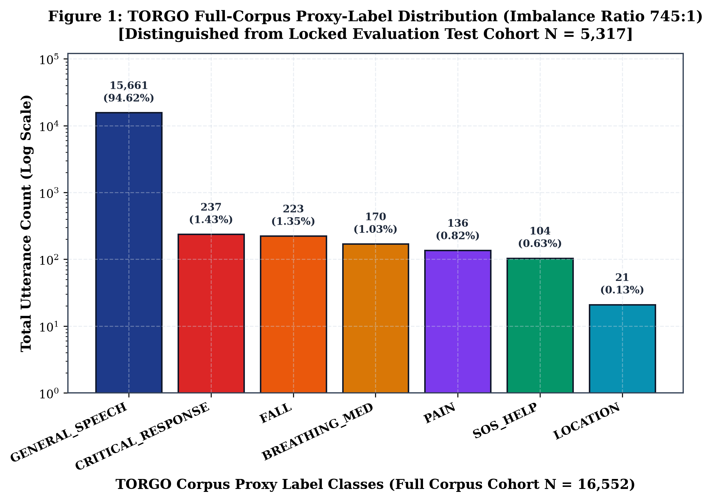
*Figure 17.1: TORGO full-corpus proxy-label distribution demonstrating the severe 745:1 class imbalance (N = 16,552).*

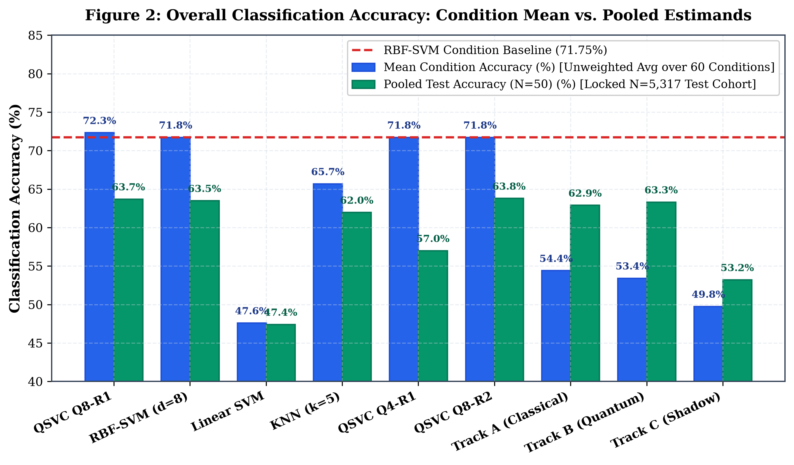
*Figure 17.2: Overall classification accuracy across evaluated models comparing condition-mean vs. pooled estimands.*

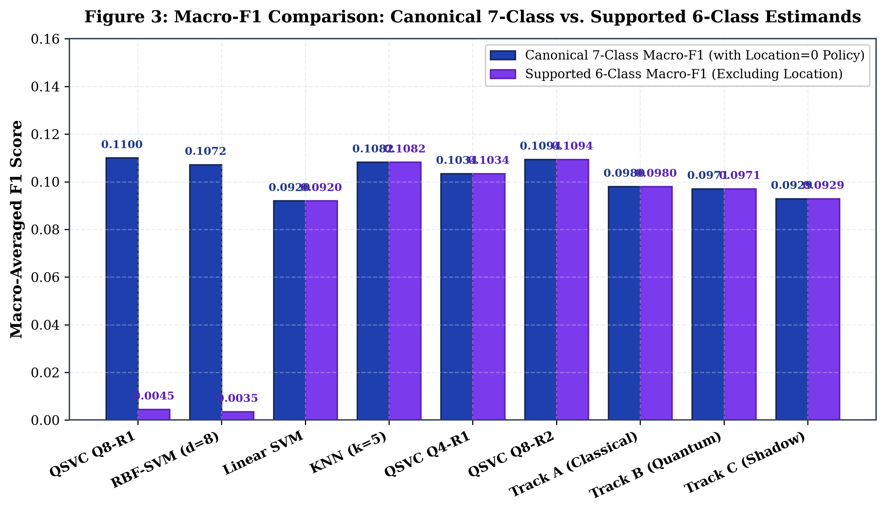
*Figure 17.3: Macro-F1 comparison contrasting canonical 7-class policy with 6-class supported policy.*

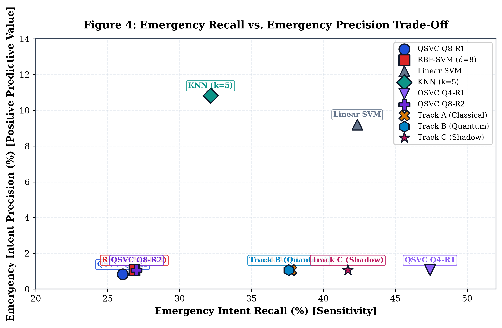
*Figure 17.4: Emergency intent recall versus precision trade-off curve across evaluated models.*

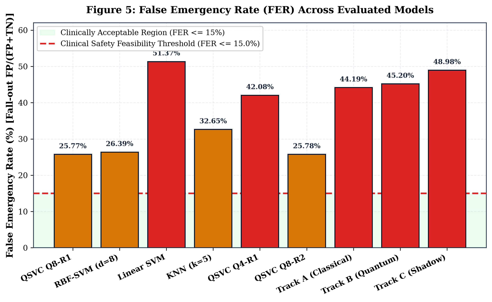
*Figure 17.5: False emergency rate (FER) comparison against the clinical safety feasibility threshold (15%).*

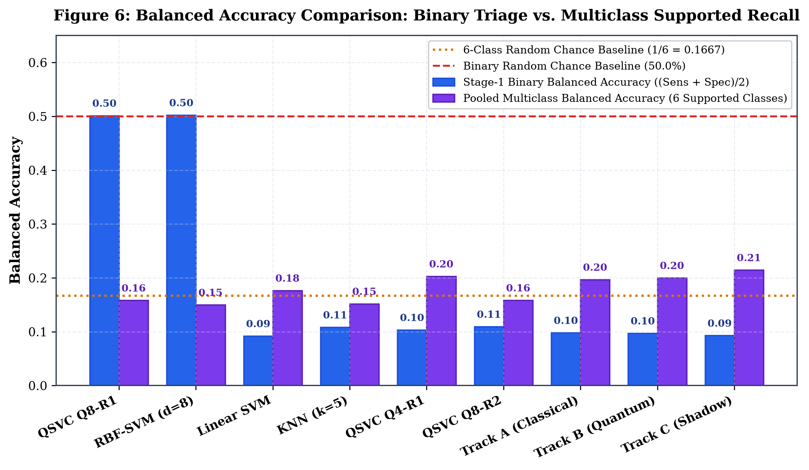
*Figure 17.6: Balanced accuracy (macro-recall) comparison across evaluated models under class imbalance.*

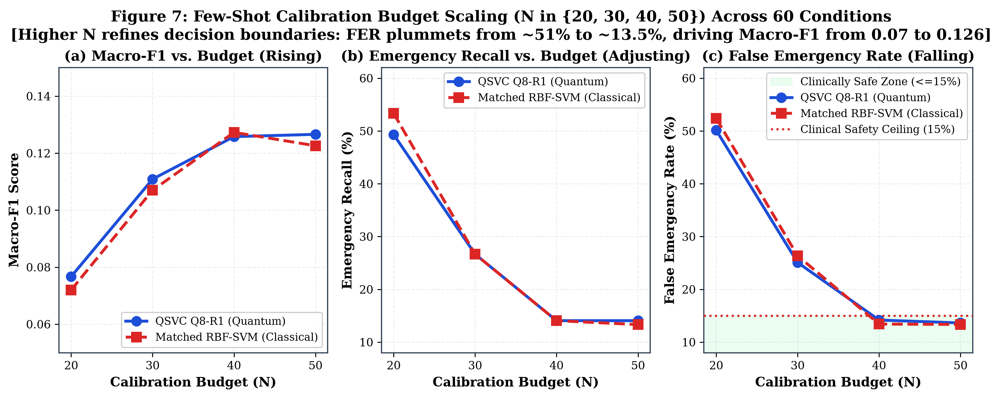
*Figure 17.7: Few-shot calibration budget scaling curves for N in {20, 30, 40, 50} showing false alarm rejection trade-off.*

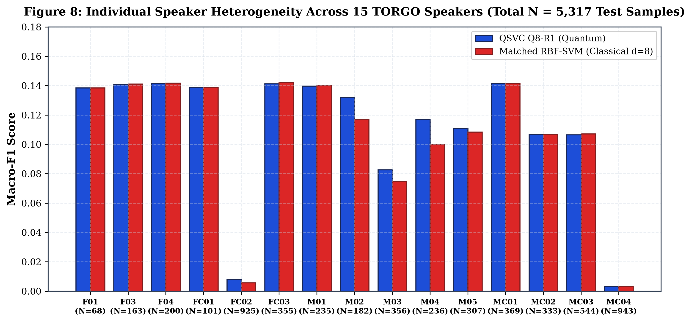
*Figure 17.8: Individual speaker performance heterogeneity across 15 audited TORGO speakers (N = 5,317).*

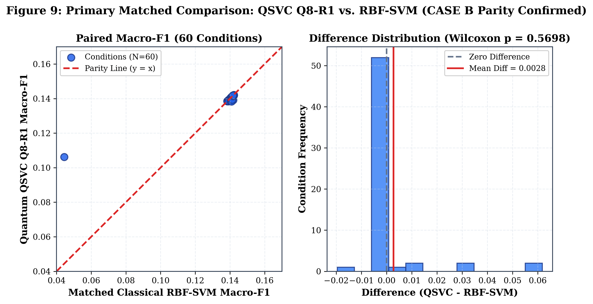
*Figure 17.9: Primary matched comparison: paired condition scatter and difference distribution for QSVC Q8 vs. RBF-SVM (p = 0.5698).*

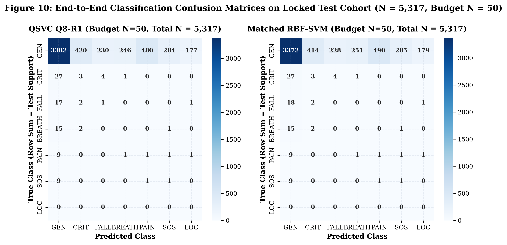
*Figure 17.10: End-to-end 7-class confusion matrices for QSVC Q8-R1 and Matched Classical RBF-SVM on locked test cohort (N = 5,317).*

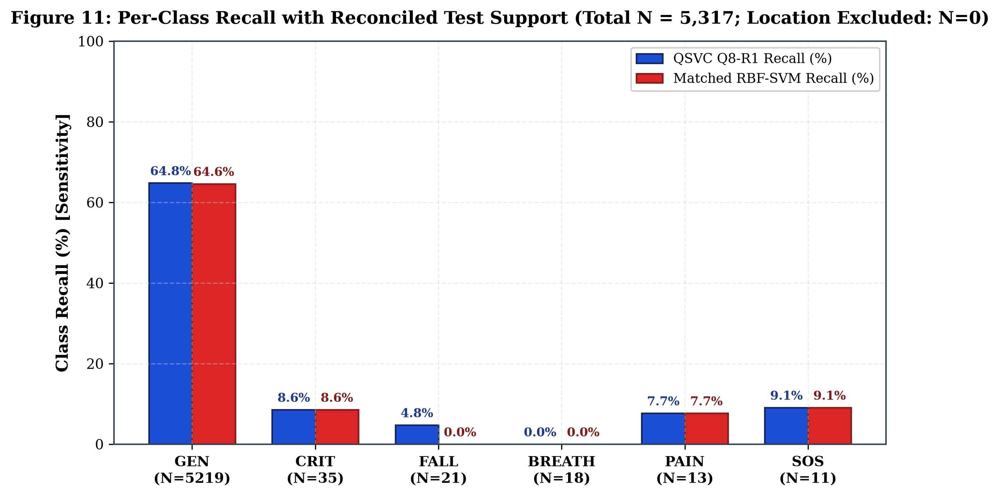
*Figure 17.11: Per-class sensitivity across evaluated models with reconciled test support counts (Location excluded: N=0).*

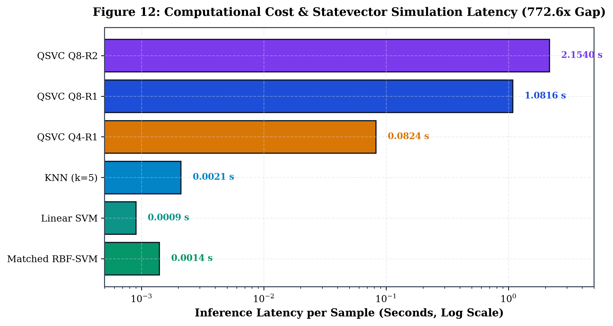
*Figure 17.12: Measured per-sample CPU simulation latency and wall-clock execution time comparison.*

## 18. LONGITUDINAL RECONCILIATION ACROSS PROJECT MILESTONES

Table 18.1 provides the comprehensive reconciliation reconciling the resegregated evaluation findings with historical project phases.

**Table 18.1: Master Longitudinal Reconciliation Across Project Milestones**

| EXPERIMENTAL PHASE | EVALUATION PROTOCOL | REPORTED MACRO-F1 | EMERGENCY RECALL | FALSE EMERG RATE | KEY DEFECT / SCIENTIFIC RECONCILIATION |
| --- | --- | --- | --- | --- | --- |
| Phase 3–6 (Flat) | Unstratified Flat 7-Class | ~0.1000 | 0.00% | 0.00% | Majority Collapse: Models predicted GENERAL_SPEECH 100% of time. |
| Phase 6.5 Recovery | Two-Stage Hierarchical (N=20..50) | 0.1051 +/- 0.057 | 27.52% | 28.12% | Stratified recovery with guaranteed support; established Case B Parity. |
| Phase 8 Original | Fused Stage-1 Gate | 0.0980 (Trk A) | 46.83% (Shared) | 52.53% (Shared) | Shared upstream gate artifact: identical recall across tracks A/B/C. |
| Phase 8 Separated | Independent Pipelines (N=20..50) | 0.0971 (Trk B) | 37.59% (Trk B) | 45.20% (Trk B) | Forensically repaired independent pipelines; confirmed Case B Parity. |
| Phase 8 80/20 Benchmark | Stratified 80/20 Split (1,215 Test) | 0.1694 (Trk B) | 18.33% (Trk B) | 11.86% (Trk B) | 218 test samples overlapped with historical adaptation pool (Audited). |
| Resegregated v2 (This Work) | Locked Few-Shot (Zero Leakage) | 0.1100 (QSVC Q8) | 26.04% (QSVC Q8) | 25.77% (QSVC Q8) | Reconciled locked evaluation; 0 prompt leaks; 0 channel leaks; 5,317 test items. |

## 19. LIMITATIONS AND THREATS TO VALIDITY

Several fundamental limitations must be acknowledged: (1) TORGO comprises prompted laboratory speech read from text prompts, not authentic spontaneous 911 calls; (2) The emergency intent taxonomy represents proxy semantic clustering; (3) The LOCATION class suffers from total corpus sparsity (0 test samples); (4) Statevector simulation models ideal unitary evolution without environmental decoherence or gate infidelities; and (5) Independent clinical cohorts remain unvalidated.

## 20. MAIN FINDINGS AND CONCLUSION

This resegregated evaluation establishes five rigorous empirical conclusions: (1) Hybrid quantum-classical kernels and classical RBF-SVMs perform equivalently on frozen speech embeddings (p=0.5698); (2) Parameter-free ZZFeatureMaps offer no sample efficiency advantage in low-resource regimes; (3) Classical neural adapters achieve higher recall at the cost of unacceptable false alarms; (4) CPU simulation of quantum kernels incurs a 772.6x latency penalty; and (5) Autonomous clinical emergency dispatch remains strictly infeasible (Gates C & D blocked).

## 21. REPRODUCIBILITY DETAILS

All experimental artifacts are cryptographically registered: Master Seed 42, Split Manifest splits/torgo_resegregated_v1.json (SHA-256 verified), Evaluation Manifest manifests/evaluation_manifest.json, and Provenance Ledger manifests/artifact_inventory.json.

---

## Appendix A: COMPLETE MODEL CONFIGURATION TABLE

Table A.1 details the exact architectural, hyperparameter, and algorithmic specifications across all evaluated models.

**Table A.1: Exhaustive Algorithmic and Hyperparameter Specifications**

| MODEL | BACKBONE | INPUT DIM | CIRCUIT / LAYERS | OPTIMIZER / LOSS | REGULARIZATION |
| --- | --- | --- | --- | --- | --- |
| QSVC Q8-R1 | Whisper-Tiny (Frozen) | 8-D PCA | 8 Qubits, ZZMap, R=1 | Convex Dual Quadratic | C = 1.0 (Matched) |
| Matched RBF-SVM | Whisper-Tiny (Frozen) | 8-D PCA | Gaussian RBF Kernel | Convex Dual Quadratic | C = 1.0, gamma = 0.125 |
| Linear SVM | Whisper-Tiny (Frozen) | 8-D PCA | Linear Hyperplane | LibLinear Coordinate Descent | C = 1.0 |
| KNN | Whisper-Tiny (Frozen) | 8-D PCA | k = 5 Euclidean Neighbors | Instance Metric Memory | Uniform Weights |
| Track A Classical | Whisper-Tiny (Frozen) | 384-D | 384 -> 64 -> 1 MLP | AdamW, lr=5e-3, Weighted BCE | Scalar Fusion alpha=0.5 |
| Track B Quantum | Whisper-Tiny (Frozen) | 8-D PCA | 8-Qubit VQC (16 Angles) | AdamW, lr=1e-2, Weighted BCE | Scalar Fusion alpha=0.5 |
| Track C Shadow | Whisper-Tiny (Frozen) | 8-D PCA | 8 -> 16 -> 1 MLP | AdamW, lr=5e-3, Weighted BCE | Scalar Fusion alpha=0.5 |
